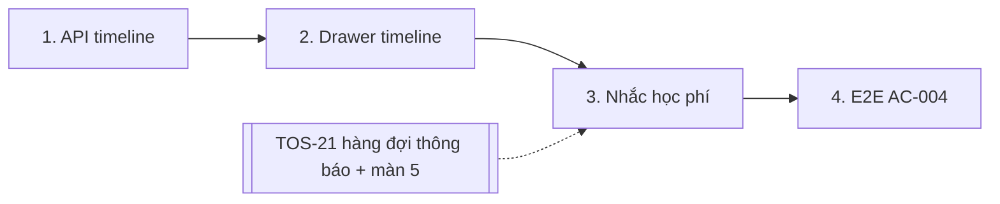

# Plan: TOS-18 — Dòng thời gian hóa đơn/giao dịch và nhắc học phí

## Overview

AC-004 của US-003:

1. Bấm **(eye) Xem dòng thời gian lịch sử hóa đơn & giao dịch** của học viên → hiện toàn bộ hóa đơn học phí đã phát hành và giao dịch thanh toán (QR Bank-Hub hoặc thu thủ công) theo thứ tự thời gian.
2. Tích chọn học viên đang nợ → **Gửi nhắc học phí** → hệ thống phát thông báo nhắc hạn hóa đơn qua **Email & In-app** (FR-selfomy-alignment-001) và ghi vào **Nhật ký thông báo** `[5]`.

Nền tảng: TOS-15 (`/debts`, cột Thao tác, chỗ nút nhắc phí ở PageHead), TOS-16 (phiếu thu thủ công nằm trong ledger `payment_transaction` với `provider = "manual"`, `method`). Guard tài chính của TOS-17 tự áp lên endpoint mới nếu đặt dưới prefix đã guard; nếu TOS-17 merge sau, endpoint mới phải được thêm vào danh sách guard của TOS-17.

Nguồn: Jira [TOS-18](https://teacher-os.atlassian.net/browse/TOS-18) (subtask TOS-10 / US-003 · AC-004), FR-selfomy-alignment-010/001, wireframe `debt-and-notification-flow.md` mục [1], [15] và screen `notification-logs` `[5]`.

## Scope Challenge

- **Có sẵn:** hóa đơn (snapshot), giao dịch matched theo hóa đơn (`GET /api/invoices/:id/transactions`), mailer (`packages/auth/src/mail/mailer.ts`), bảng `notif` (feed đọc-only của **giáo viên**, không phải thông báo cho học viên).
- **Còn thiếu:** endpoint timeline gộp theo **học viên**; drawer UI; chọn nhiều học viên + nút nhắc phí.
- **Phụ thuộc ngoài 4 ticket này:** hạ tầng thông báo **Email + In-app cho học viên, khóa chống trùng, trạng thái queued/sent/read/failed và màn Nhật ký thông báo `[5]`** thuộc **US-004 / TOS-19 (TOS-21)** — chưa có plan / GitHub issue. Plan này **không** tự dựng hệ thông báo thứ hai.
- **Mode:** fast + scout, HOLD SCOPE.

## Quyết định

| # | Quyết định | Lý do |
|---|---|---|
| D1 | **Endpoint `GET /api/students/:id/billing-timeline`** trả mảng sự kiện đã sắp xếp: `invoice_issued` (từ `invoice`: mã, loại, số tiền, hạn, ngày phát hành = `date` hoặc `createdAt`) và `payment` (từ `payment_transaction` matched của các hóa đơn đó: số tiền, nguồn `bank_hub` / `manual`, `method`, ghi chú, ngày). Sắp xếp **mới nhất trước**, tie-break theo `createdAt`, `id`. Org-scoped, 404 nếu học viên không thuộc org. | Giao dịch không nằm trong snapshot; gộp phía server một lần, tránh N request `/invoices/:id/transactions`. |
| D2 | **Không trả `raw` / payload provider** — chỉ trường hiển thị. | Giữ retention PII của #320. |
| D3 | **Drawer** (Sheet bên phải, full-screen ở 375) mở từ nút `(eye)` ở cột Thao tác; tóm tắt 3 số lũy kế của học viên ở đầu (từ `debtLedger`), danh sách timeline nhóm theo tháng; badge nguồn "QR Bank-Hub" / "Thu thủ công · Tiền mặt". Có link sang `/tuition/$invoiceId`. | Wireframe [15]; dữ liệu tóm tắt dùng lại view-model TOS-15, không tính lại. |
| D4 | **Chọn nhiều + nhắc phí:** cột checkbox chỉ bật cho học viên Còn nợ > 0; nút "Gửi nhắc học phí (N)" ở PageHead disabled khi N = 0; xác nhận → `POST /api/debt-reminders { studentIds }`. Server lấy các hóa đơn còn nợ của từng học viên và **enqueue sự kiện `tuition_reminder` qua API hàng đợi thông báo của TOS-21** với `idempotency_key = tuition_reminder:<invoiceId>:<ngày VN>` (bấm 2 lần trong ngày không gửi trùng). Trả `{ queued, skipped }` → toast + link "Xem nhật ký thông báo" tới màn `[5]`. | Đúng AC "kích hoạt FR-001 và ghi vào [5]"; chống trùng theo BR-009/NFR-004 do hạ tầng TOS-21 bảo đảm. |
| D5 | **Thứ tự triển khai:** phase 1–2 (timeline) chỉ cần TOS-15/16; phase 3 (nhắc phí) **chờ TOS-21** cung cấp hàm enqueue + màn `[5]`. Người duyệt không kéo issue sang Ready cho tới khi TOS-21 có issue và đã merge, hoặc tách phase 3 ra issue riêng. | Tránh dựng tạm một kênh thông báo song song rồi phải gỡ. |

## Non-goals

- Hạ tầng gửi Email/In-app, retry 3 lần, trạng thái failed, nút "Gửi lại", màn `[5]` (TOS-19/21/22/23).
- Nhắc phí tự động theo lịch (cron). Nội dung template email ngoài 1 template nhắc phí (template thuộc TOS-21 nếu hệ thống template ở đó).
- Sửa / hoàn tiền giao dịch từ timeline.

## Phases

| # | Phase | Ước lượng | Trạng thái | Phụ thuộc |
|---|---|---|---|---|
| 1 | [phase-01-billing-timeline-api.md](phase-01-billing-timeline-api.md): `GET /api/students/:id/billing-timeline` | 3h | pending | #449, #450 |
| 2 | [phase-02-timeline-drawer-ui.md](phase-02-timeline-drawer-ui.md): nút (eye) + drawer timeline | 4h | pending | 1 |
| 3 | [phase-03-tuition-reminders.md](phase-03-tuition-reminders.md): checkbox + "Gửi nhắc học phí (N)" + `POST /api/debt-reminders` | 4h | pending | 2, TOS-21 |
| 4 | [phase-04-e2e-ac-004.md](phase-04-e2e-ac-004.md): E2E timeline + nhắc phí | 2h | pending | 3 |

## Acceptance criteria (từ AC-004)

- [ ] Bấm (eye) trên dòng "Nguyễn Minh Anh" → drawer liệt kê mọi hóa đơn đã phát hành và mọi giao dịch (QR Bank-Hub + thu thủ công) theo thứ tự thời gian, đúng số tiền / nguồn / phương thức.
- [ ] Học viên đã thu đủ không tích chọn được; tích 2 học viên đang nợ → nút "Gửi nhắc học phí (2)".
- [ ] Bấm gửi → mỗi hóa đơn còn nợ của học viên được chọn có 1 bản ghi thông báo `tuition_reminder` (Email + In-app) ở màn Nhật ký thông báo `[5]`; bấm lần 2 cùng ngày → không tạo bản ghi trùng (`skipped`).
- [ ] API: học viên org khác → 404; role không có quyền tài chính → 403 (TOS-17).
- [ ] `pnpm check`, `pnpm check-types`, test package bị đụng, E2E AC-004 xanh.

## Rủi ro

| Rủi ro | Giảm thiểu |
|---|---|
| TOS-21 chưa có lịch, phase 3 bị treo. | D5: phase 1–2 tự đứng được; có thể tách phase 3 thành issue riêng blocked by TOS-21. |
| Thời điểm phát hành hóa đơn cũ không có `date`. | Fallback `createdAt` (timestamp ms) đổi sang giờ VN bằng `vietnamStampParts`. |

## Cần người duyệt xác nhận

- D5: nhắc phí chờ hạ tầng thông báo TOS-19/21 (hiện chưa có GitHub issue) thay vì dựng tạm. Khi TOS-21 có issue, chạy `gh issue edit 452 --add-blocked-by <TOS-21>`.
