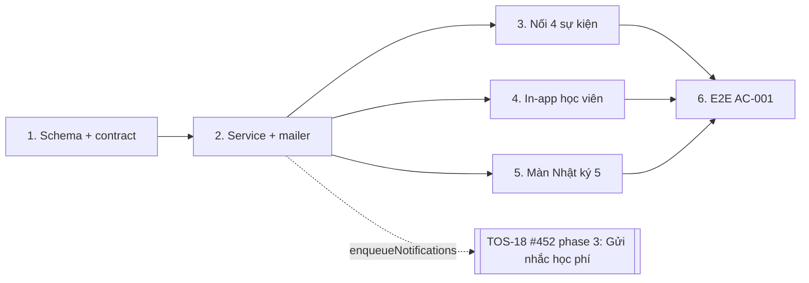
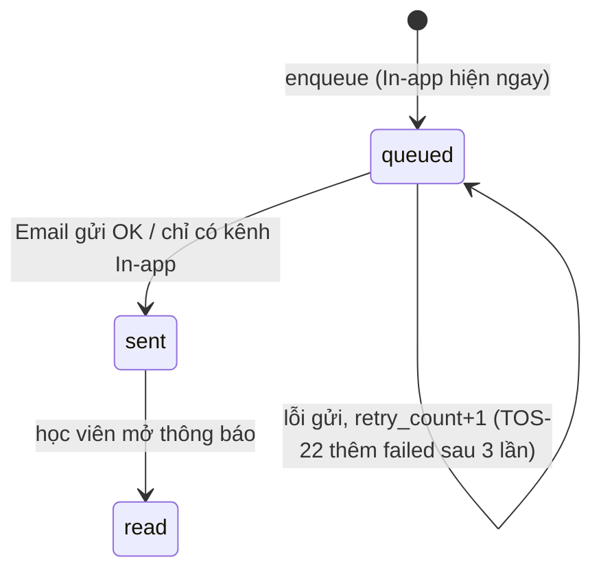

# Plan: TOS-21 — Hàng đợi thông báo Email + In-app cho 4 sự kiện chính

## Overview

AC-001 của US-004 (FR-selfomy-alignment-001, FR-selfomy-alignment-002):

> Khi phát sinh 1 trong 4 sự kiện chính (**Mời học viên vào lớp**, **Giao bài tập mới / Chốt trả điểm**, **Phát hành / nhắc hạn hóa đơn học phí**, **Thay đổi lịch học / Tạo lịch nghỉ chung**) cho học viên có Email hợp lệ → tạo bản ghi thông báo `queued`, hiện In-app ngay trên cổng học viên, gửi thư từ tên miền chung Teacher OS kèm **Tên người gửi** và **Reply-To** của giáo viên/trung tâm. Email chuyển phát thành công → `sent`; học viên mở xem → `read`. Trạng thái hiển thị trên màn **Nhật ký gửi thông báo `[5]`**.

Plan này là hạ tầng mà TOS-18 (#452, phase 3 "Gửi nhắc học phí") đang chờ: TOS-18 chỉ cần gọi `enqueueNotifications` với sự kiện `tuition_reminder`.

Nguồn: Jira [TOS-21](https://teacher-os.atlassian.net/browse/TOS-21) (subtask của TOS-19 / US-004 · AC-001), `docs/selfomy-alignment/userstories/us-004.md#AC-001`, ERD `NotificationRecord` (`docs/selfomy-alignment/srs/selfomy-alignment-erd.md:152`), máy trạng thái (`docs/selfomy-alignment/srs/selfomy-alignment-states.md:83`), wireframe `docs/selfomy-alignment/ascii-wireframe/debt-and-notification-flow.md#Screen: notification-logs`.

## Scope Challenge

- **Có sẵn:**
  - `Mailer` (`packages/auth/src/mail/mailer.ts`, Resend + log) — hiện chỉ auth dùng; chưa có `replyTo` / tên người gửi; `AppDeps` chưa nhận mailer.
  - `AppDeps.runInBackground` (= `waitUntil` trên Workers) để gửi sau response.
  - Bảng `notif` = feed đọc-only của **giáo viên** theo org — không có người nhận học viên, không trạng thái; **không tái dùng**.
  - Chuông `apps/student/src/components/layout/notification-bell.tsx` — hiện chỉ hiển thị lời mời tham gia org (`useStudentNotifications`).
  - Mẫu trang list có filter trên URL: `/assignments` + `chip-filter.tsx`.
  - Recording mailer trong `apps/e2e/src/boot.ts` → E2E kiểm được thư đã gửi.
- **Không có:** Cloudflare Queue / cron trong `packages/infra/alchemy.run.ts`. Gửi Email chạy ngay trong `runInBackground` sau khi ghi bản ghi.
- **Thuộc ticket khác (không làm ở đây):** thử lại tự động 3 lần + `failed` + E-selfomy-alignment-010 (TOS-22); nút "Gửi lại" / "Gửi lại tất cả mục lỗi" (TOS-23); nút "Gửi nhắc học phí" trên `/debts` (TOS-18 #452); dựng lịch nghỉ chung (TOS-11 #445).
- **Mode:** fast + scout, HOLD SCOPE.

## Quyết định

| # | Quyết định | Lý do |
|---|---|---|
| D1 | **Bảng mới `notification_record`** (1 dòng = 1 thông báo cho 1 học viên, phục vụ cả 2 kênh): `id`, `org_id`, `student_id`, `event_type`, `event_group`, `idempotency_key`, `title`, `body`, `link_path`, `ref_type`, `ref_id`, `channels` (`"email,in_app"` hoặc `"in_app"`), `recipient_email` (snapshot), `sender_name`, `reply_to_email`, `status` (`queued` \| `sent` \| `read` \| `failed`), `retry_count` (0), `last_error`, `sent_at`, `read_at`, `created_at`. **Unique `(org_id, idempotency_key)`**, index `(org_id, created_at, id)`, `(org_id, student_id, created_at)`. Cột `failed` / `retry_count` / `last_error` có sẵn để TOS-22/23 không phải migration lại. | Khớp ERD `NotificationRecord`; 1 bản ghi cho cả In-app lẫn Email nên "Gửi lại" (TOS-23) chỉ đặt lại kênh Email trên cùng dòng, không nhân bản In-app. |
| D2 | **`event_type` chi tiết, `event_group` 4 nhóm** cho chip lọc màn `[5]`: `class_invite` ← `class_enrolled`; `assignment` ← `assignment_published`, `grade_returned`; `tuition` ← `invoice_issued`, `tuition_reminder`; `schedule` ← `schedule_changed`, `holiday_created`. | Wireframe lọc theo 4 sự kiện; nội dung thư cần biết sự kiện cụ thể. |
| D3 | **Khóa chống trùng** do nơi phát sự kiện tạo, dạng `<event_type>:<ref>[:<student>]`: `class_enrolled:<enrollmentId>`, `assignment_published:<classAssignmentId>:<studentId>`, `grade_returned:<attemptId>` / `grade_returned:assignment:<assignmentId>`, `invoice_issued:<invoiceId>`, `tuition_reminder:<invoiceId>:<YYYY-MM-DD VN>` (TOS-18), `schedule_changed:<classId>:<date>:<editedAtMs>:<studentId>`, `holiday_created:<holidayId>:<studentId>`. Insert `ON CONFLICT DO NOTHING`. | BR-009 / NFR-004: cùng (sự kiện, người nhận, đối tượng) không tạo 2 bản ghi; bấm/gọi lại không gửi trùng. |
| D4 | **Service `apps/server/src/lib/notifications/`**: `enqueueNotifications(db, orgId, events[])` (resolve học viên + email trong org, tính `channels`, chèn bản ghi, trả id mới tạo) và `deliverNotifications(db, mailer, ids)` (mỗi bản ghi `queued` có kênh email: gửi → `sent` + `sent_at`; nếu `read_at` đã có thì → `read`). Lỗi gửi: giữ `queued`, `retry_count + 1`, `last_error` (TOS-22 thêm vòng thử 3 lần và `failed`). Bản ghi chỉ có `in_app` (học viên không có email) → `sent` ngay khi tạo. Route phát sự kiện gọi `enqueue` **sau** khi ghi nghiệp vụ thành công, bọc try/catch + log; lỗi thông báo **không** làm hỏng thao tác chính; `deliver` chạy qua `deps.runInBackground`. | Không có queue hạ tầng; `waitUntil` đủ cho AC-001. Fail-open giống mẫu mailer ở auth. |
| D5 | **Tên người gửi / Reply-To:** `sender_name = organization.name`; `reply_to_email` = email của thành viên chủ org (membership `teacher`/`owner` sớm nhất → `user.email`). `From` = `"<org name> qua Teacher OS" <địa chỉ của MAIL_FROM>`. Mở rộng `MailInput` thêm `replyTo?`, `fromName?`; Resend gửi `reply_to` + `from` có tên. Snapshot cả hai vào bản ghi. | AC: thư từ tên miền chung kèm Tên người gửi và Reply-To của giáo viên/trung tâm. Không thêm màn cấu hình (non-goal). |
| D6 | **`AppDeps.mailer?: Mailer`**: `apps/server/src/index.ts` tách mailer thành getter lười dùng chung cho auth và app; `apps/e2e/src/boot.ts` truyền `recordingMailer`. Vắng mailer → bản ghi vẫn tạo, Email giữ `queued` + log cảnh báo. | Một nguồn cấu hình mailer; test node không cần binding. |
| D7 | **In-app học viên:** `GET /api/student/inbox` (bản ghi của `studentCtx.student` trong org đang chọn, mới nhất trước, 50 dòng, kèm `unread`), `POST /api/student/inbox/:id/read` (đặt `read_at`; `status` `sent` → `read`). Chuông hiện cả lời mời org (giữ nguyên) và thông báo sự kiện; badge = lời mời pending + chưa đọc; bấm 1 thông báo → đánh dấu đọc và mở `link_path`. | In-app hiện ngay từ khi `queued`; `read` theo đúng máy trạng thái (chỉ từ `sent`; nếu học viên đọc trước khi email xong thì `deliver` chuyển thẳng `read`). |
| D8 | **Màn `[5]` `/notifications` (apps/web):** `GET /api/notification-logs?q&event&status&page` (20 dòng/trang, đếm theo trạng thái cho chip) — cột Thời gian, Người nhận (tên + email), Sự kiện, Kênh, Trạng thái; nút (eye) mở hộp thoại nội dung thư, `sent_at`, `read_at`. Filter sống trên URL, search debounce 300ms, theo mẫu `/assignments`. Nút "Gửi lại" / "Gửi lại tất cả mục lỗi" **không** làm ở đây (TOS-23). Mục sidebar "Nhật ký thông báo". | Wireframe `[5]` mục 2–5, 7, 8. Mọi thành viên org xem được (không phải dữ liệu tài chính). |
| D9 | **Nối 4 sự kiện** (phase 3): `POST /classes/:id/enroll` → `class_enrolled`; `POST /classes/:id/assignments` → `assignment_published` cho từng học viên đích; `POST /grading/:attemptId/grade` và `POST /assignments/:id/grade` → `grade_returned`; `POST /invoices` → `invoice_issued`; `POST /lessons/:id/edit`, `POST /classes/:id/sessions/:date/edit`, `.../cancel` → `schedule_changed`. **`holiday_created`**: nếu TOS-11 (#445) đã merge khi làm phase 3 thì nối vào `POST /api/holidays` (chỉ khi `notify = true`); nếu chưa, export sẵn builder sự kiện và ghi việc nối vào #445. | Đúng 4 sự kiện của FR-001; không chặn TOS-21 vào tiến độ lịch nghỉ. |

## Non-goals

- Thử lại tự động 3 lần, trạng thái `failed`, mã lỗi E-selfomy-alignment-010 (TOS-22); nút "Gửi lại" (TOS-23).
- Zalo ZNS, push notification, màn cấu hình template / Reply-To theo org, opt-out của học viên.
- Nút "Gửi nhắc học phí" trên `/debts` và nhắc phí tự động theo lịch (TOS-18).
- Sự kiện "mời khách thi thử vào lớp" từ phòng thi công khai (US-008) — dùng lại `class_enrolled` khi US-008 được làm.
- Webhook trạng thái chuyển phát của Resend (delivered/bounced): `sent` = Resend nhận thư thành công (HTTP 2xx).

## Phases

| # | Phase | Ước lượng | Trạng thái | Phụ thuộc |
|---|---|---|---|---|
| 1 | [phase-01-notification-schema-and-contracts.md](phase-01-notification-schema-and-contracts.md): bảng `notification_record` + migration + zod contract | 3h | pending | — |
| 2 | [phase-02-notification-service-and-mailer.md](phase-02-notification-service-and-mailer.md): enqueue/deliver, Reply-To + tên người gửi, `AppDeps.mailer` | 5h | pending | 1 |
| 3 | [phase-03-wire-core-events.md](phase-03-wire-core-events.md): nối 4 sự kiện vào route | 5h | pending | 2 |
| 4 | [phase-04-student-inapp-inbox.md](phase-04-student-inapp-inbox.md): API inbox + chuông In-app + đánh dấu đã xem | 4h | pending | 2 |
| 5 | [phase-05-notification-logs-screen.md](phase-05-notification-logs-screen.md): màn `[5]` Nhật ký thông báo | 5h | pending | 2 |
| 6 | [phase-06-e2e-ac-001.md](phase-06-e2e-ac-001.md): E2E AC-001 | 3h | pending | 3, 4, 5 |

## Acceptance criteria (từ AC-001)

- [ ] Học viên có email hợp lệ được ghi danh vào lớp / được giao bài / được trả điểm / có hóa đơn mới / có buổi học bị đổi → 1 bản ghi `queued` xuất hiện ngay, chuông cổng học viên hiện thông báo tương ứng.
- [ ] Thư gửi từ địa chỉ của `MAIL_FROM`, tên hiển thị chứa tên tổ chức, `Reply-To` = email chủ tổ chức; gửi thành công → bản ghi `sent` + `sent_at` trên màn `[5]`.
- [ ] Học viên bấm mở thông báo → bản ghi `read` + `read_at`; badge chuông giảm.
- [ ] Phát lại cùng sự kiện (cùng khóa chống trùng) → không tạo bản ghi / thư thứ hai.
- [ ] Lỗi tạo thông báo hoặc lỗi gửi thư không làm hỏng thao tác nghiệp vụ gốc (ghi danh, tạo hóa đơn…).
- [ ] Màn `[5]`: lọc theo 4 nhóm sự kiện và 4 trạng thái trên URL, tìm theo tên/email/tiêu đề, phân trang 20 dòng; chỉ thấy bản ghi của org mình.
- [ ] `pnpm check`, `pnpm check-types`, test package bị đụng, E2E AC-001 xanh; verify UI 3 viewport.

## Rủi ro

| Rủi ro | Giảm thiểu |
|---|---|
| `waitUntil` bị hủy / Resend lỗi → bản ghi kẹt `queued`. | Bản ghi + `retry_count` / `last_error` đã ghi; TOS-22 thêm vòng thử lại và `failed`. Màn `[5]` vẫn hiển thị `queued` trung thực. |
| Fan-out lớn (giao bài cho lớp 40 học viên) làm chậm request. | Insert theo lô (1 câu INSERT nhiều dòng, chunk theo giới hạn biến D1); gửi thư nằm trong `runInBackground`. |
| `schedule_changed` gửi quá nhiều khi giáo viên sửa liên tục. | Khóa gồm `editedAtMs` → mỗi lần sửa thật 1 thông báo; chỉ phát khi `date`/`time` thực sự đổi hoặc buổi bị hủy. |
| Org không có membership chủ / email trống. | `reply_to_email` để trống → thư không có header Reply-To, vẫn gửi; ghi chú ở màn chi tiết. |
| Holiday (TOS-11) chưa merge. | D9: builder sự kiện sẵn sàng; việc nối ghi vào #445. |

## Liên kết

- TOS-18 #452 (phase 3 "Gửi nhắc học phí") **blocked by** issue của plan này.
- TOS-11 #445: nối `holiday_created` (D9).
- TOS-22 / TOS-23: chưa có plan; dùng lại cột `status`, `retry_count`, `last_error`.

## Cần người duyệt xác nhận

- D5: Reply-To lấy email chủ tổ chức (không làm màn cấu hình riêng).
- D9: `schedule_changed` gửi cho đổi giờ/ngày và hủy buổi lẻ; điểm danh không phát thông báo.
- D8: màn `[5]` mở cho mọi thành viên org (không áp guard tài chính TOS-17).
