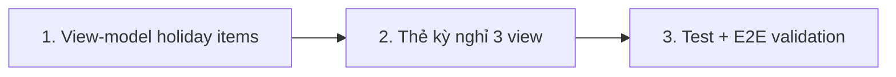

# Plan: TOS-14b — Thẻ kỳ nghỉ trong 3 view lịch + khóa validation Lịch nghỉ chung

Tách từ #447 (TOS-14) theo Scope split 2026-10-26; phụ thuộc #445 (TOS-11) **đã merge vào develop** (PR #457, 2026-10-26). Deliverable 1 cần `holidays`/`holidayShifts` trong kernel snapshot (đã có: `snapshot.ts:689-696` fill, `KernelHolidaySummary { id, name, fromDate, toDate, scope }`); Deliverable 2 cần `holidayDraftSchema` + hộp thoại (đã có: `packages/api/src/contracts.ts:3141`, `apps/web/src/components/schedule/holiday-modal.tsx`).

## Overview

AC-004 mục 1–2 của US-002 (phần follow-up #453):

1. **Thẻ kỳ nghỉ hiển thị trong cả 3 view** Tháng / Tuần / Ngày của `/schedule` — thêm `kind: "holiday"` vào union item của view-model (đang là `"lesson" | "event"`) cùng adapter dữ liệu thật từ snapshot.
2. **Khóa kịch bản validation hộp thoại "Tạo lịch nghỉ chung"**: tên 1 ký tự hoặc khoảng 35 ngày → cảnh báo inline + nút xác nhận khóa + không gọi preview; sửa về hợp lệ thì mở khóa; server từ chối 35 ngày ở cả preview và apply; E2E AC-004 kịch bản validation xanh.

Hiện trạng liên quan (đã khảo sát trên worktree `ai-handle-issue-453`, chứa develop mới nhất `be8b731a`):

- `apps/web/src/lib/schedule-month.ts` — `MonthItem = MonthLessonItem | MonthEventItem`, cell cap 3 items + overflow, item sort theo `time` rồi `id`. `MonthSourceData` có `classes/lessons/events`.
- `apps/web/src/lib/schedule-day.ts` — `DayAgendaItem = DayLessonItem | DayEventItem`, agenda time-ascending.
- `apps/web/src/components/schedule/schedule-week-view.tsx` — render thẳng `data.events` trong cột ngày (không qua view-model union); buổi `status === "holiday"` đã có nhãn "Nghỉ lễ — Đã dời lịch · tên · Đã dời sang dd/MM" (TOS-11 phase 5) — nhưng đó là nhãn trên block buổi, **chưa phải thẻ kỳ nghỉ độc lập** (ngày nghỉ không có buổi nào thì tuần không hiện gì).
- `holiday-modal.tsx` đã validate inline qua `holidayDraftSchema.safeParse` và khóa nút khi invalid (test "khóa xác nhận khi tên 1 ký tự" xanh) — **không sửa modal** (tránh xung đột với PR #460 đang mở trên `holidays.ts` route).
- Test hiện có: `holiday-contracts.test.ts` phủ 31+ ngày từ chối / 30 nhận (cả hai đầu inclusive) và tên 1 ký tự từ chối; `holiday-modal.test.tsx` có "khoảng 31 ngày → lỗi inline + không gọi preview"; `holidays.test.ts` có 400 cho name "N" + ngày 30/2.

Nguồn: issue [#453](https://github.com/vinh19410/teacher-os/issues/453), plan TOS-14 `plans/261026-2018-tos-14-schedule-views-and-events/plan.md` (Scope split + D5/D7), Jira [TOS-14](https://teacher-os.atlassian.net/browse/TOS-14) AC-004.

## Scope Challenge

- **Có sẵn:** snapshot `holidays` (`KernelHolidaySummary`), hộp thoại holiday với validation + preview/apply đầy đủ, 3 view + view-model Tháng/Ngày của #447, pattern thẻ phụ (`OrgEventChip`), warn token (`border-warn/50 bg-warn-soft text-warn` dùng sẵn trong repo).
- **Chưa có:** item `kind: "holiday"` trong view-model, thẻ kỳ nghỉ độc lập trên lịch, test 35 ngày literal ở modal/server, E2E validation hộp thoại.
- **Độ phức tạp:** thuần client cho deliverable 1 (snapshot đã có), thêm test cho deliverable 2. Không migration, không đổi contract/API.
- **Mode:** fast + scout, HOLD SCOPE.

## Quyết định

| # | Quyết định | Lý do |
|---|---|---|
| D1 | **Item holiday trong view-model Tháng/Ngày:** `HolidaySpanLike { id, name, fromDate, toDate }` (structural mirror của `KernelHolidaySummary`, không import từ `@teacher-os/api` — giữ pattern `ScheduleEventLike` hiện có). Expand span `[fromDate..toDate]` thành 1 item mỗi ngày, index theo date một lần ngoài vòng lặp cell (cùng pattern events). `kind: "holiday"` sort **trước** lesson/event (kỳ nghỉ là "cả ngày"), tie-break `id`. Chiếm slot trong cap 3 + overflow của ô Tháng như item thường. | Union mở đúng như issue chỉ định; expand một lần giữ ngân sách perf của `buildMonthCells`; kỳ nghỉ đại diện cả ngày nên đứng đầu ô. |
| D2 | **`holiday-calendar-card.tsx` dùng chung** (`apps/web/src/components/schedule/`, tên file theo phase-03 của plan #447): card warn (`border-warn/50 bg-warn-soft text-warn`), 2 variant `compact` (Tháng/Tuần) và full (Ngày — kèm khoảng ngày khi span > 1). `data-testid="holiday-calendar-card"`. Chấm mobile 375px ở ô Tháng: `bg-warn`. | Một component, một nguồn hiển thị cho 3 view; tái dùng warn token sẵn có theo `DESIGN.md`. |
| D3 | **View Tuần render thẻ trực tiếp từ `data.holidays`** (expand span trong component, cùng chỗ `eventsByDate`), đặt sau block buổi học, trước `OrgEventChip`. Không đưa holiday vào `WeekModel`. | Week view không dùng union item — giữ nguyên kiến trúc #447, ít xung đột nhất. |
| D4 | **Deliverable 2 chỉ thêm test, không sửa production code:** `holiday-contracts.test.ts` **xác nhận đã phủ** (31+ ngày từ chối bao hàm 35; tên 1 ký tự) — **không thêm case trùng lặp**. `holiday-modal.test.tsx` thêm test 35 ngày literal → cảnh báo "tối đa 30 ngày" + nút "Xác nhận áp dụng & Dời buổi" `disabled` + `previewHoliday` không được gọi; sửa `toDate` về đúng 30 ngày → nút mở khóa + preview chạy. `holidays.test.ts` thêm test: preview và apply với khoảng 35 ngày → 400. Test 31 ngày hiện có giữ nguyên. | Modal + schema đã đúng từ #445 (PR #457 đã review/merge); issue ghi rõ "chỉ xác nhận nếu #445 đã có, không trùng lặp"; server không tin client → 400 đã là hành vi route (`readBody(holidayDraftSchema)`). |
| D5 | **E2E 2 test mới** trong `apps/e2e/specs/schedule-views-and-events.spec.ts` (cập nhật comment đầu file): (a) validation hộp thoại AC-004 mục 2 — tên 1 ký tự → lỗi inline + nút khóa; 35 ngày → cảnh báo + nút khóa; sửa 30 ngày → nút mở + preview hiện; (b) thẻ kỳ nghỉ 3 view — tạo holiday qua hộp thoại (apply thật, khoảng 1 ngày hôm nay với lớp có buổi hôm nay đã seed), thấy `holiday-calendar-card` ở view Ngày → Tuần → Tháng, reload vẫn ổn định. | AC đòi "E2E AC-004 kịch bản validation xanh" và "kỳ nghỉ hiển thị 3 view, ổn định giữa các lần tải"; flow preview→apply qua UI đã có precedent `holiday-shift.spec.ts`. |
| D6 | **Không đổi `holiday-modal.tsx`, `contracts.ts`, route `holidays.ts`, schema DB.** Không có migration → không đụng kỷ luật migration `0046` của TOS-14. | Zero xung đột với PR #460 (holiday preview guard) và #457 đã merge; không public contract thay đổi → bỏ `/ak:docs update` (beta mode, ghi trong PR). |

## Non-goals

- Thuật toán dời buổi (TOS-11), hoàn tác (TOS-13), sửa/xóa kỳ nghỉ trong view lịch (theo issue #453).
- Đổi hộp thoại Lịch nghỉ chung, schema, API, migration.
- Lọc thẻ kỳ nghỉ theo lớp (scope `classes`): `KernelHolidaySummary` không mang `classIds` — thẻ hiển thị theo ngày cho mọi kỳ nghỉ trong khoảng (metadata scope đủ dùng khi TOS-12/13 mở rộng hiển thị).
- Sửa test 31 ngày hiện có hoặc hạ assertion nào đó.

## Phases

| # | Phase | Ước lượng | Phụ thuộc |
|---|---|---|---|
| 1 | [phase-01-holiday-items-view-models.md](phase-01-holiday-items-view-models.md): `kind: "holiday"` trong `schedule-month.ts` + `schedule-day.ts`, expand span, sort, test red→green | 2h | — |
| 2 | [phase-02-holiday-cards-ui.md](phase-02-holiday-cards-ui.md): `holiday-calendar-card.tsx` + render trong 3 view, chấm mobile | 1.5h | 1 |
| 3 | [phase-03-validation-tests-and-e2e.md](phase-03-validation-tests-and-e2e.md): modal test 35 ngày, server test 400, E2E validation + thẻ 3 view | 1.5h | 2 |

## Acceptance criteria (từ issue #453)

- [x] Kỳ nghỉ hiển thị trong cả 3 view (Tháng/Tuần/Ngày), ổn định giữa các lần tải.
- [x] Hộp thoại Tạo lịch nghỉ chung: tên 1 ký tự hoặc khoảng 35 ngày → cảnh báo inline, nút xác nhận khóa; sửa về hợp lệ thì mở khóa.
- [x] E2E AC-004 kịch bản validation xanh (chạy cùng bộ spec #447).
- [x] `pnpm check`, `pnpm check-types`, test `web`/`server` bị đụng, E2E bộ `schedule-views-and-events` xanh.

## Rủi ro

| Rủi ro | Giảm thiểu |
|---|---|
| Thẻ holiday làm vỡ layout ô Tháng (cap 3, min-h-20) hoặc tràn ngang 375px. | Card compact truncate 1 dòng như `month-item`; E2E chụp 3 viewport + assert không tràn ngang ở 375px. |
| Xung đột với PR #460 (đang sửa `holidays.ts` route + `holiday-plan.ts`). | D6: không đụng bất kỳ file production nào của #460; chỉ thêm test ở `holidays.test.ts` (append describe mới, không sửa test cũ). |
| Apply holiday trong E2E dính ngày không có buổi học → 422 `no-sessions`. | Seed lớp `startDate = TODAY` có buổi hôm nay (precedent spec #447); tạo holiday đúng 1 ngày `TODAY`. |
| Đổi test modal 35 ngày trùng test 31 ngày hiện có. | D4: test mới dùng đúng 35 ngày literal (`fromDate = 2026-11-01`, `toDate = 2026-12-05`) + kịch bản unlock — khác biệt rõ với test 31. |

## Unresolved questions

- Không có — scope tách sẵn từ issue #453, AC đã định lượng.
