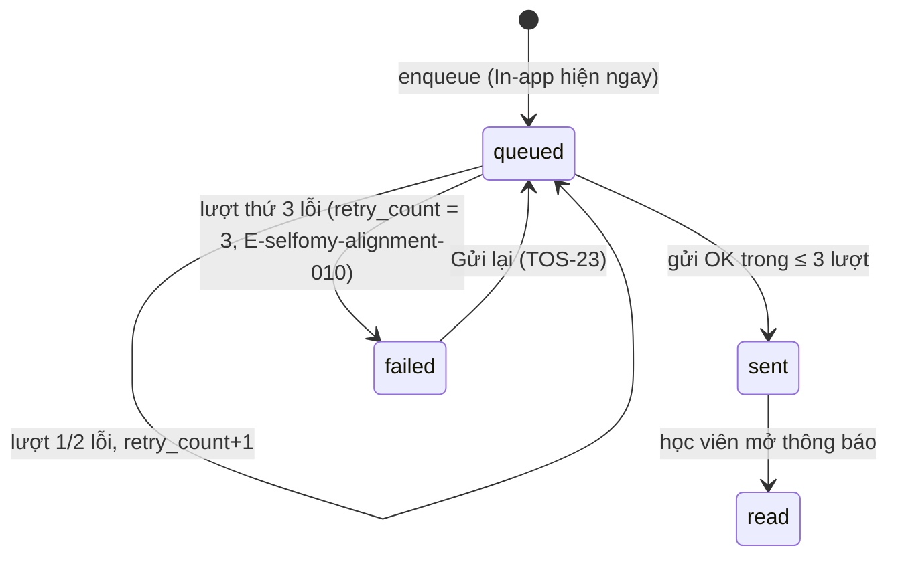

# Plan: TOS-22 — Tự động thử lại 3 lần và trạng thái Lỗi gửi (failed)

## Overview

AC-002 của US-004 (FR-selfomy-alignment-002, FR-selfomy-alignment-003, E-selfomy-alignment-010):

> Thông báo đang `queued` nhưng Email người nhận sai hoặc dịch vụ Email lỗi tạm thời → hệ thống gửi tự động thất bại đủ 3 lần liên tiếp (`retry_count = 3`) → bản ghi chuyển **Lỗi gửi (`failed`)** kèm thông điệp nguyên nhân (E-selfomy-alignment-010) và màn `[5]` hiển thị nút **"Gửi lại"**.

Nguồn: Jira [TOS-22](https://teacher-os.atlassian.net/browse/TOS-22) (subtask của TOS-19 / US-004 · AC-002), `docs/selfomy-alignment/userstories/us-004.md`, spec E-selfomy-alignment-010 (`docs/selfomy-alignment/srs/selfomy-alignment-spec.md:119`), máy trạng thái (`docs/selfomy-alignment/srs/selfomy-alignment-states.md:88`), wireframe `docs/selfomy-alignment/ascii-wireframe/debt-and-notification-flow.md#Screen: notification-logs` mục 5–7.

## Scope Challenge

- **Có sẵn (TOS-21 #454 đã merge vào develop):**
  - Bảng `notification_record` với `status` (`queued|sent|read|failed`), `retry_count`, `last_error` — **không cần migration**.
  - `deliverNotifications` (`apps/server/src/lib/notifications/deliver.ts`): gửi 1 lần; lỗi → giữ `queued`, `retry_count + 1`, `last_error` (cắt 500 ký tự). Update có điều kiện `status = 'queued'`.
  - `emitNotifications` chạy deliver qua `deps.runInBackground` (= `waitUntil`).
  - Màn `[5]` `apps/web/src/routes/_auth/notifications/index.tsx` đã có chip trạng thái `failed` và `StatusTag tone="danger"`; contract `NotificationLogRow` đã trả `retryCount`, `lastError`.
  - `recordingMailer` trong `apps/e2e/src/boot.ts` ghi thư ra `.mail-log.jsonl`.
- **Không có:** Cloudflare Queue / cron trigger (`packages/infra/alchemy.run.ts`). Vòng thử lại phải chạy trong cùng `waitUntil` của lần phát sự kiện.
- **Thuộc ticket khác:** hành động bấm "Gửi lại" / "Gửi lại tất cả mục lỗi" (TOS-23).
- **Mode:** fast + scout, HOLD SCOPE.

## Quyết định

| # | Quyết định | Lý do |
|---|---|---|
| D1 | **Thử lại theo lượt (pass), không theo từng bản ghi:** `deliverNotifications` chạy tối đa 3 lượt. Lượt 1 gửi mọi bản ghi `queued` có kênh email; lượt 2 và 3 chỉ gửi lại các bản ghi vừa lỗi, sau khoảng chờ `retryDelaysMs` (mặc định `[2000, 5000]`). Tổng thời gian chờ ≤ 7s + thời gian gửi, nằm gọn trong giới hạn `waitUntil` (30s) kể cả khi fan-out 40 học viên cùng lỗi. | Không có queue/cron; chờ tuần tự từng bản ghi sẽ vượt 30s khi dịch vụ Email sập. |
| D2 | **Đếm lượt thử bằng `retry_count`:** mỗi lần gửi lỗi tăng `retry_count` bằng SQL increment (giữ nguyên cơ chế hiện có). Khi lần lỗi làm `retry_count` đạt `MAX_EMAIL_ATTEMPTS = 3` → cùng câu UPDATE đặt `status = 'failed'` (`CASE WHEN retry_count + 1 >= 3 THEN 'failed' ELSE status END`), điều kiện `status = 'queued'`. Bản ghi đã `retry_count ≥ 3` khi bắt đầu deliver thì bỏ qua (không gửi thêm). | Đúng AC "retry_count = 3 → failed"; điều kiện `queued` giữ an toàn khi chạy song song. |
| D3 | **Mọi lỗi mailer đều tính 1 lượt**, kể cả lỗi vĩnh viễn (địa chỉ sai, Resend 4xx). Không phân loại lỗi tạm thời / vĩnh viễn. | AC và spec E-010 gộp chung "hộp thư đầy, địa chỉ sai, lỗi kết nối"; phân loại là tối ưu không được yêu cầu. |
| D4 | **Mã lỗi:** thêm `NOTIFICATION_ERROR_CODES = { DELIVERY_FAILED: "E-selfomy-alignment-010" }` vào `packages/api/src/contracts.ts`. Khi chuyển `failed`, `last_error` = `"E-selfomy-alignment-010: <message gốc>"` (vẫn cắt 500 ký tự, không chứa API key). Các lần lỗi chưa tới 3 giữ `last_error` = message gốc. | Lưu mã trong cột có sẵn, không migration; UI đọc tiền tố để hiện thông điệp tiếng Việt. |
| D5 | **Kênh In-app không đổi:** bản ghi `failed` vẫn hiện trong chuông học viên như cũ (`GET /api/student/inbox` không lọc theo status); học viên mở xem → chỉ đặt `read_at`, **không** đổi `status` khỏi `failed` (đã đúng nhờ điều kiện `status = 'sent'` của route read — xác minh bằng test). | Spec E-010: "thông báo In-app trên cổng học viên vẫn giữ nguyên"; giáo viên vẫn cần thấy dòng lỗi để Gửi lại. |
| D6 | **`retryDelaysMs` inject được:** `deliverNotifications(db, mailer, ids, studentOrigin, { retryDelaysMs })`, `NotificationDeps.retryDelaysMs?`, `AppDeps.notificationRetryDelaysMs?`. Production dùng mặc định; test node và `apps/e2e/src/boot.ts` truyền `[0, 0]`. | Test/E2E không phải chờ 7s mỗi ca. |
| D7 | **Màn `[5]`:** dòng `failed` hiện thêm 1 hàng phụ chữ đỏ dưới người nhận: `E-010: <nguyên nhân rút gọn> sau 3 lần thử` (nguyên nhân = `last_error` bỏ tiền tố mã). Hộp thoại chi tiết (eye) hiện "Số lần thử: N/3" và `last_error` đầy đủ cho mọi trạng thái có lỗi. Nút **"Gửi lại"** trên dòng `failed` và nút header làm ở TOS-23 (xem "Cần người duyệt xác nhận"). | Wireframe mục 5 (thông điệp lỗi E-010) và mục 7 (chi tiết lần thử). |
| D8 | **E2E giả lập lỗi:** `recordingMailer` (chỉ trong `apps/e2e/src/boot.ts`) ném lỗi `"mailbox unavailable"` khi `to` kết thúc bằng `@bounce.test`, và vẫn ghi dòng `{ ..., failed: true }` vào mail log để spec đếm số lần thử. | Kiểm đúng 3 lần thử thật qua stack đầy đủ, không mock trong app code. |

## Non-goals

- Nút "Gửi lại" / "Gửi lại tất cả mục lỗi" và API reset `failed → queued` (TOS-23).
- Cron/queue quét lại bản ghi kẹt `queued` khi `waitUntil` bị hủy giữa chừng.
- Lưu thời điểm từng lần thử (`attempt 1..3`) — cần cột/bảng mới; hộp thoại chỉ hiện số lần thử + lỗi cuối.
- Webhook bounce của Resend (lỗi chuyển phát sau khi Resend đã nhận thư).
- Phân loại lỗi tạm thời / vĩnh viễn (D3).

## Phases

| # | Phase | Ước lượng | Trạng thái | Phụ thuộc |
|---|---|---|---|---|
| 1 | [phase-01-retry-loop-and-failed-status.md](phase-01-retry-loop-and-failed-status.md): vòng thử 3 lượt, `failed` + mã E-010, inject delay | 4h | pending | — |
| 2 | [phase-02-failed-row-ui.md](phase-02-failed-row-ui.md): nhãn đỏ + thông điệp lỗi trên màn `[5]`, chi tiết số lần thử | 2h | pending | 1 |
| 3 | [phase-03-e2e-ac-002.md](phase-03-e2e-ac-002.md): E2E AC-002 với địa chỉ `@bounce.test` | 2h | pending | 1, 2 |

## Acceptance criteria (từ AC-002)

- [ ] Mailer lỗi liên tục cho 1 bản ghi → đúng 3 lần gọi gửi, bản ghi `failed`, `retry_count = 3`, `last_error` bắt đầu bằng `E-selfomy-alignment-010:` kèm nguyên nhân.
- [ ] Mailer lỗi 1–2 lần rồi thành công → bản ghi `sent`, `retry_count` = số lần lỗi, không thành `failed`.
- [ ] Bản ghi đã `failed` hoặc `retry_count ≥ 3` không bị gửi thêm khi `deliverNotifications` chạy lại.
- [ ] Học viên vẫn thấy thông báo In-app của bản ghi `failed`; mở xem không đổi `status`.
- [ ] Màn `[5]`: dòng `failed` có nhãn đỏ "Lỗi gửi" + thông điệp E-010; chip "Lỗi gửi" đếm đúng; chi tiết hiện "3/3 lần thử".
- [ ] Lỗi gửi không ảnh hưởng thao tác nghiệp vụ gốc (giữ nguyên hành vi fail-open của TOS-21).
- [ ] `pnpm check`, `pnpm check-types`, `pnpm --filter server test`, `pnpm --filter web test`, E2E AC-002 + AC-001 xanh; verify UI 3 viewport.

## Rủi ro

| Rủi ro | Giảm thiểu |
|---|---|
| `waitUntil` bị hủy giữa các lượt → bản ghi kẹt `queued` với `retry_count` 1–2. | Trạng thái trung thực trên `[5]`; ghi rõ trong non-goal; TOS-23 chỉ reset `failed` nên bản ghi kẹt cần follow-up riêng nếu gặp thực tế. |
| Rate limit Resend khi fan-out lớn cùng lỗi → 3 lượt dồn dập. | Khoảng chờ 2s/5s giữa các lượt; lượt sau chỉ gửi bản ghi lỗi. |
| `last_error` lộ thông tin nhạy cảm. | Giữ quy tắc hiện có: message Resend không chứa API key, cắt 500 ký tự; test khẳng định. |

## Liên kết

- TOS-21 #454: hạ tầng hàng đợi (đã merge vào develop).
- TOS-23 #464: nút "Gửi lại" dùng trạng thái `failed` của plan này — #464 **blocked by** #463.

## Cần người duyệt xác nhận

- D7: nút "Gửi lại" (phần "hiển thị nút" của AC-002) giao cùng hành động bấm ở TOS-23 để không có nút chết; E2E của TOS-23 kiểm nút xuất hiện trên dòng `failed`.
- D3: không phân loại lỗi — địa chỉ sai cũng thử đủ 3 lần.
- Non-goal: không lưu thời điểm từng lần thử (wireframe mục 7 nhắc `attempt 1..3`).
