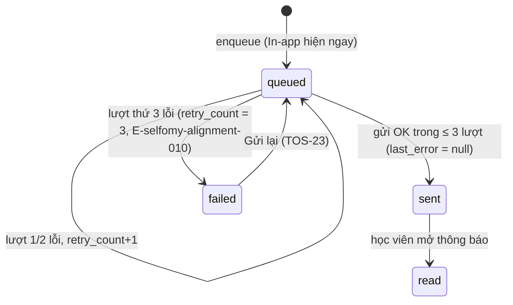

# Plan: TOS-22 — Tự động thử lại 3 lần và trạng thái Lỗi gửi (failed)

## Overview

AC-002 của US-004 (FR-selfomy-alignment-002, FR-selfomy-alignment-003, E-selfomy-alignment-010):

> Thông báo đang `queued` nhưng Email người nhận sai hoặc dịch vụ Email lỗi tạm thời → hệ thống gửi tự động thất bại đủ 3 lần liên tiếp (`retry_count = 3`) → bản ghi chuyển **Lỗi gửi (`failed`)** kèm thông điệp nguyên nhân (E-selfomy-alignment-010) và màn `[5]` hiển thị nút **"Gửi lại"**.

Nguồn: Jira [TOS-22](https://teacher-os.atlassian.net/browse/TOS-22) (subtask của TOS-19 / US-004 · AC-002), `docs/selfomy-alignment/userstories/us-004.md`, spec E-selfomy-alignment-010 (`docs/selfomy-alignment/srs/selfomy-alignment-spec.md:119`), máy trạng thái (`docs/selfomy-alignment/srs/selfomy-alignment-states.md:88`), wireframe `docs/selfomy-alignment/ascii-wireframe/debt-and-notification-flow.md#Screen: notification-logs` mục 5–7.

Plan này đã được chuẩn hóa theo hợp đồng bàn giao `--advice` (`advice-handover-plan.md`): từng phase phân rã thành các Task độc lập có `Goal`, `Target files and symbols`, `Steps`, `Success criteria`, `Verify` (điều kiện pass cơ học) và khối `## Failure Protocol` bắt buộc dừng và tham vấn `kongming` khi bất kỳ bước Verify nào thất bại.

## Scope Challenge

- **Có sẵn (TOS-21 #454 đã merge vào develop):**
  - Bảng `notification_record` với `status` (`queued|sent|read|failed`), `retry_count`, `last_error` — **không cần migration**.
  - `deliverNotifications` (`apps/server/src/lib/notifications/deliver.ts`): gửi 1 lần; lỗi → giữ `queued`, `retry_count + 1`, `last_error` (cắt 500 ký tự). Update có điều kiện `status = 'queued'`.
  - `emitNotifications` chạy deliver qua `deps.runInBackground` (= `waitUntil`).
  - Màn `[5]` `apps/web/src/routes/_auth/notifications/index.tsx` đã có chip trạng thái `failed` và `StatusTag tone="danger"`; `NotificationDetailDialog` (`apps/web/src/components/notifications/notification-detail-dialog.tsx`) đã có nhãn `"Số lần thử lại"` và `"Lỗi gửi"`; contract `NotificationLogRow` đã trả `retryCount`, `lastError`.
  - `recordingMailer` trong `apps/e2e/src/boot.ts` ghi thư ra `.mail-log.jsonl`.
- **Không có:** Cloudflare Queue / cron trigger (`packages/infra/alchemy.run.ts`). Vòng thử lại phải chạy trong cùng `waitUntil` của lần phát sự kiện.
- **Thuộc ticket khác:** hành động bấm "Gửi lại" / "Gửi lại tất cả mục lỗi" (TOS-23 #464).
- **Mode:** fast + scout, HOLD SCOPE, `--advice` handover-ready.

## Quyết định

| # | Quyết định | Lý do |
|---|---|---|
| D1 | **Thử lại theo lượt (pass), không theo từng bản ghi:** `deliverNotifications` chạy tối đa `MAX_EMAIL_ATTEMPTS = 3` lượt. Lượt 1 gửi mọi bản ghi `queued` (`retry_count < 3`) có kênh email; lượt 2 và 3 chỉ gửi lại các bản ghi còn `status = 'queued' AND retry_count < 3` (re-select từ DB sau khoảng chờ `retryDelaysMs`, mặc định `[2000, 5000]`). Tổng thời gian chờ ≤ 7s + thời gian gửi, nằm gọn trong giới hạn `waitUntil` (30s). | Không có queue/cron; chờ tuần tự từng bản ghi sẽ vượt 30s khi dịch vụ Email sập; re-select đầu mỗi lượt tránh gửi trùng khi chạy song song. |
| D2 | **Đếm lượt thử nguyên tử bằng `retry_count`:** mỗi lần gửi lỗi tăng `retry_count` bằng SQL increment (`retry_count + 1`). Khi lần lỗi làm `retry_count + 1 >= 3` → cùng câu UPDATE đặt `status = CASE WHEN retry_count + 1 >= 3 THEN 'failed' ELSE status END` và `last_error = CASE WHEN retry_count + 1 >= 3 THEN <prefixed> ELSE <raw> END` với điều kiện `status = 'queued'`. Khi gửi thành công ở bất kỳ lượt nào → đặt `sent_at = new Date()` tại thời điểm gửi xong và xóa `last_error = null`. Bản ghi đã `retry_count ≥ 3` hoặc khác `queued` thì bỏ qua. | Đúng AC "retry_count = 3 → failed"; tính cả `status` và `last_error` trong cùng SQL CASE đảm bảo không bao giờ lệch trạng thái giữa JS và DB. |
| D3 | **Mọi lỗi mailer đều tính 1 lượt**, kể cả lỗi vĩnh viễn (địa chỉ sai, Resend 4xx). Không phân loại lỗi tạm thời / vĩnh viễn. | AC và spec E-010 gộp chung "hộp thư đầy, địa chỉ sai, lỗi kết nối"; phân loại là tối ưu không được yêu cầu. |
| D4 | **Mã lỗi & làm sạch message:** thêm `NOTIFICATION_ERROR_CODES = { DELIVERY_FAILED: "E-selfomy-alignment-010" } as const` và `MAX_EMAIL_ATTEMPTS = 3` vào `packages/api/src/contracts.ts`. Hàm `sanitizeDeliveryError` trong `deliver.ts` che các token nhạy cảm (`Bearer\s+\S+`, `re_[A-Za-z0-9_]+`), bỏ tiền tố trùng lặp và cắt tổng chuỗi `≤ 500` ký tự sau khi ghép tiền tố `"E-selfomy-alignment-010: "`. | Lưu mã trong cột có sẵn, không migration; đảm bảo không lộ API key/Bearer token và không vượt 500 ký tự. |
| D5 | **Kênh In-app không đổi:** bản ghi `failed` vẫn hiện trong chuông học viên như cũ (`GET /api/student/inbox` không lọc theo status); học viên mở xem → chỉ đặt `read_at`, **không** đổi `status` khỏi `failed` (đã đúng nhờ điều kiện `status = 'sent'` của route read — xác minh bằng test trong `student-inbox.test.ts`). | Spec E-010: "thông báo In-app trên cổng học viên vẫn giữ nguyên"; giáo viên vẫn cần thấy dòng lỗi để Gửi lại. |
| D6 | **`retryDelaysMs` inject xuyên suốt DI:** `deliverNotifications(db, mailer, ids, studentOrigin, { retryDelaysMs })`, `NotificationDeps.retryDelaysMs?`, `notificationDepsFrom`, `AppDeps.notificationRetryDelaysMs?`, và chữ ký `deps` của 4 route factory (`kernelRoutes`, `gradingRoutes`, `holidayRoutes`, `assignmentRoutes`). Production dùng mặc định `[2000, 5000]`; test node và `apps/e2e/src/boot.ts` (tại `buildApp`) truyền `[0, 0]`. | Test/E2E không phải chờ 7s mỗi ca; tránh rơi mất trường khi truyền qua route factory. |
| D7 | **Màn `[5]` (`notifications/index.tsx` & `notification-detail-dialog.tsx`):** dòng `failed` hiện thêm 1 hàng phụ chữ đỏ dưới người nhận: `E-010: <nguyên nhân rút gọn> sau <retryCount> lần thử` (`className="mt-0.5 max-w-[260px] break-words text-destructive text-xs"`, fallback `"Không gửi được email"` khi `lastError` rỗng/null). Hộp thoại chi tiết (`NotificationDetailDialog`) giữ nguyên nhãn `"Số lần thử lại"` (hiển thị `"N/3 lần thử"`) và nhãn `"Lỗi gửi"` (hiển thị `lastError` đầy đủ). Nút **"Gửi lại"** giao ở TOS-23 (#464). | Wireframe mục 5 (thông điệp lỗi E-010) và mục 7 (chi tiết lần thử); giữ tương thích unit test hiện có trong `index.test.tsx`. |
| D8 | **E2E giả lập lỗi (`@bounce.test`):** `recordingMailer` trong `apps/e2e/src/boot.ts` chỉ ném lỗi `Error("mailbox unavailable")` và ghi `{ ...base, failed: true, at }` vào `.mail-log.jsonl` đối với **thư thông báo nghiệp vụ** (`!verifyMatch && !resetMatch`) khi `input.to` kết thúc bằng `@bounce.test`; thư xác thực tài khoản / đặt lại mật khẩu của Better-Auth vẫn ghi `url` và không ném lỗi để học viên `@bounce.test` đăng nhập được cổng học viên ở Bước 4. | Kiểm đúng 3 lần thử thật qua stack đầy đủ mà không làm hỏng bước xác thực email đăng nhập cổng học viên. |

## Non-goals

- Nút "Gửi lại" / "Gửi lại tất cả mục lỗi" và API reset `failed → queued` (TOS-23 #464).
- Cron/queue quét lại bản ghi kẹt `queued` khi `waitUntil` bị hủy giữa chừng.
- Lưu thời điểm từng lần thử (`attempt 1..3`) — cần cột/bảng mới; hộp thoại chỉ hiện `"N/3 lần thử"` + lỗi cuối.
- Webhook bounce của Resend (lỗi chuyển phát sau khi Resend đã nhận thư).
- Phân loại lỗi tạm thời / vĩnh viễn (D3).

## Phases

| # | Phase | Ước lượng | Trạng thái | Phụ thuộc |
|---|---|---|---|---|
| 1 | [phase-01-retry-loop-and-failed-status.md](phase-01-retry-loop-and-failed-status.md): vòng thử 3 lượt, `failed` + mã E-010, inject delay | 4h | completed | — |
| 2 | [phase-02-failed-row-ui.md](phase-02-failed-row-ui.md): nhãn đỏ + thông điệp lỗi trên màn `[5]`, chi tiết `"N/3 lần thử"` | 2h | completed | 1 |
| 3 | [phase-03-e2e-ac-002.md](phase-03-e2e-ac-002.md): E2E AC-002 với địa chỉ `@bounce.test` | 2h | completed | 1, 2 |

## Acceptance criteria (từ AC-002)

- [x] Mailer lỗi liên tục cho 1 bản ghi → đúng 3 lần gọi gửi, bản ghi `failed`, `retry_count = 3`, `last_error` bắt đầu bằng `E-selfomy-alignment-010:` kèm nguyên nhân (đã redact secret, tổng độ dài ≤ 500).
- [x] Mailer lỗi 1–2 lần rồi thành công → bản ghi `sent`, `retry_count` = số lần lỗi, `last_error = null`, không thành `failed`.
- [x] Bản ghi đã `failed` hoặc `retry_count ≥ 3` không bị gửi thêm khi `deliverNotifications` chạy lại.
- [x] Học viên vẫn thấy thông báo In-app của bản ghi `failed`; mở xem chỉ đặt `read_at`, không đổi `status`.
- [x] Màn `[5]`: dòng `failed` có nhãn đỏ "Lỗi gửi" + thông điệp `E-010: <nguyên nhân> sau 3 lần thử`; chip "Lỗi gửi" đếm đúng; chi tiết hiện `"3/3 lần thử"`.
- [x] Lỗi gửi không ảnh hưởng thao tác nghiệp vụ gốc (giữ nguyên hành vi fail-open của TOS-21).
- [x] `pnpm check`, `pnpm check-types`, `pnpm --filter server test`, `pnpm --filter web test`, E2E AC-002 + AC-001 xanh; verify UI 3 viewport.

## Rủi ro

| Rủi ro | Giảm thiểu |
|---|---|
| `waitUntil` bị hủy giữa các lượt → bản ghi kẹt `queued` với `retry_count` 1–2. | Trạng thái trung thực trên `[5]`; ghi rõ trong non-goal; TOS-23 chỉ reset `failed` nên bản ghi kẹt cần follow-up riêng nếu gặp thực tế. |
| Rate limit Resend khi fan-out lớn cùng lỗi → 3 lượt dồn dập. | Khoảng chờ 2s/5s giữa các lượt; lượt sau chỉ re-select và gửi bản ghi lỗi. |
| `last_error` lộ thông tin nhạy cảm hoặc còn sót sau khi retry thành công. | `sanitizeDeliveryError` che `Bearer ...` / `re_...`, cắt tổng độ dài ≤ 500 ký tự; xóa `last_error = null` khi gửi thành công ở lượt 2/3. |

## Liên kết

- TOS-21 #454: hạ tầng hàng đợi (đã merge vào develop).
- TOS-23 #464: nút "Gửi lại" dùng trạng thái `failed` của plan này — #464 **blocked by** #463.

## Validation Log

### Session 1 — 2026-10-27
- **Mode:** Autonomous pipeline validation (`/ak:plan validate` under `ak-vibe --ship --beta --advice`)
- **Decisions confirmed:**
  1. Nút "Gửi lại" thuộc phạm vi TOS-23 (#464) để không sinh nút chết trên UI ở TOS-22.
  2. Mọi lỗi mailer đều tính 1 lượt thử (không phân loại tạm thời / vĩnh viễn).
  3. Hộp thoại chi tiết (`NotificationDetailDialog`) giữ nguyên nhãn `"Số lần thử lại"` (hiển thị `"N/3 lần thử"`) và `"Lỗi gửi"` để đồng nhất toàn bộ phase và tương thích unit test sẵn có.

### Verification Results
- **Tier:** Standard (3 phases — Fact Checker + Contract Verifier)
- **Claims checked:** 30
- **Verified:** 26 | **Failed:** 4 (đã khắc phục toàn bộ trong plan & phase files) | **Unverified:** 0
- **Failures resolved:**
  1. [Fact Checker] `phase-01:22` ghi 2 lần gọi `buildApp` trong `apps/e2e/src/boot.ts` — thực tế chỉ có 1 lần tại `apps/e2e/src/boot.ts:142` (lần ở dòng 108 là `createAuth`). Đã cập nhật Phase 1.
  2. [Contract Verifier] `notificationDepsFrom` được gọi tại 4 route factory (`kernel.ts:174`, `grading.ts:659`, `holidays.ts:536`, `assignments/index.ts:147`) có khai báo kiểu `deps` inline. Đã bổ sung cả 4 file vào Phase 1.
  3. [Fact Checker] Hộp thoại chi tiết nằm tại `apps/web/src/components/notifications/notification-detail-dialog.tsx:54-83`, không nằm trong `apps/web/src/routes/_auth/notifications/index.tsx`. Đã bổ sung vào Phase 2.
  4. [Contract Verifier] `recordingMailer` trong `apps/e2e/src/boot.ts:52-80` dùng chung cho `createAuth` và `buildApp`, và `VerificationEmailEntry` trong `apps/e2e/specs/helpers.ts:48-58` cần thêm `failed?: boolean`. Đã cập nhật Phase 3 và D8.

### Whole-Plan Consistency Sweep
- Files reread: `plan.md`, `phase-01-retry-loop-and-failed-status.md`, `phase-02-failed-row-ui.md`, `phase-03-e2e-ac-002.md`
- Decision deltas checked: 6
- Reconciled stale references: 6
- Unresolved contradictions: 0

## Red Team Review

### Session — 2026-10-27
**Findings:** 5 (4 accepted, 1 rejected)
**Severity breakdown:** 1 Critical, 2 High, 2 Medium

| # | Finding | Severity | Disposition | Applied To |
|---|---------|----------|-------------|------------|
| 1 | `recordingMailer` dùng chung cho `createAuth` và `buildApp`: nếu throw cho mọi thư `@bounce.test` sẽ làm hỏng `verifyStudentEmailFromMailLog` ở Bước 4 Phase 3 và lệch số dòng `failed: true`; thiếu `failed?: boolean` trong `helpers.ts` và `onboarded: true` khi seed | Critical | Accept | `plan.md` (D8), Phase 3 |
| 2 | Lệch trạng thái giữa `pending` trong RAM và `retry_count` trong SQL qua các lượt chờ 2s–5s; không xóa `last_error = null` khi retry thành công ở lượt 2–3; thiếu redact token nhạy cảm và `now = new Date()` đặt ngoài vòng lặp | High | Accept | `plan.md` (D1, D2, D4), Phase 1 |
| 3 | Phase 2 thiếu `notification-detail-dialog.tsx` và `index.test.tsx` trong `## Files`, mâu thuẫn nhãn `"Số lần thử lại"` / `"Lỗi gửi"`, thiếu fallback khi `lastError` rỗng và `max-w` / `break-words` trên dòng lỗi `E-010` | High | Accept | `plan.md` (D7), Phase 2 |
| 4 | Phase 1 thiếu 4 route factory (`kernel.ts`, `grading.ts`, `holidays.ts`, `assignments/index.ts`) truyền `notificationRetryDelaysMs`, thiếu `student-inbox.test.ts` trong `## Files` (cần tránh làm bẩn fixture `student-hoa`), và ghi sai số lần gọi `buildApp` trong `boot.ts` | Medium | Accept | `plan.md` (D6), Phase 1 |
| 5 | Đề xuất sửa `packages/auth/src/mail/mailer.ts` (`createResendMailer`) và viết lại `POST /api/student/inbox/:id/read` trong `student.ts` | Medium | Reject | Out of scope (HOLD SCOPE; `student.ts:758` đã giữ nguyên `failed` khi mark read) |

### Whole-Plan Consistency Sweep
- Files reread: `plan.md`, `phase-01-retry-loop-and-failed-status.md`, `phase-02-failed-row-ui.md`, `phase-03-e2e-ac-002.md`
- Decision deltas checked: 4 accepted findings
- Reconciled stale references: 4 (đồng bộ chuỗi `"3/3 lần thử"`, danh sách file Phase 1–3, SQL CASE cho `last_error`, điều kiện bounce `!verifyMatch && !resetMatch`)
- Unresolved contradictions: 0
