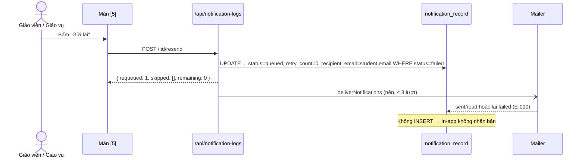

# Plan: TOS-23 — Gửi lại thông báo lỗi không nhân bản In-app

## Overview

AC-003 của US-004 (FR-selfomy-alignment-003, E-selfomy-alignment-010, BR-selfomy-alignment-009):

> Bản ghi đang **Lỗi gửi (`failed`)** trên màn `[5]` → người dùng kiểm tra/cập nhật lại Email học viên rồi bấm **"Gửi lại"** (hoặc **"Gửi lại tất cả mục lỗi"**) → hệ thống đặt lại **đúng bản ghi đó** về `queued` để gửi lại kênh Email; nhờ `idempotency_key`, **không** tạo thêm thông báo In-app trùng trên cổng học viên.

Nguồn: Jira [TOS-23](https://teacher-os.atlassian.net/browse/TOS-23) (subtask của TOS-19 / US-004 · AC-003), máy trạng thái `failed → queued` (`docs/selfomy-alignment/srs/selfomy-alignment-states.md:93`), flow `docs/selfomy-alignment/srs/selfomy-alignment-flows.md:80`, wireframe `docs/selfomy-alignment/ascii-wireframe/debt-and-notification-flow.md#Screen: notification-logs` mục 1, 6 và "Chống nhân bản thông báo khi bấm Gửi lại".

Plan này đã được chuẩn hóa theo hợp đồng bàn giao `--advice` (`advice-handover-plan.md`): từng phase phân rã thành các Task độc lập có `Goal`, `Target files and symbols`, `Steps`, `Success criteria`, `Verify` (điều kiện pass cơ học) và khối `## Failure Protocol` bắt buộc dừng và tham vấn `kongming` khi bất kỳ bước Verify nào thất bại.

## Scope Challenge

- **Có sẵn (TOS-21 #454 & TOS-22 #463 đã merge vào develop):**
  - `notification_record` 1 dòng phục vụ cả Email lẫn In-app, unique `(org_id, idempotency_key)` (TOS-21 D1) — reset trên cùng dòng thì In-app không thể nhân bản.
  - `deliverNotifications` chỉ gửi bản ghi `queued` có kênh email; sau TOS-22 (#463) tự thử 3 lượt và chuyển `failed` kèm `E-selfomy-alignment-010`.
  - `notificationLogRoutes` (`apps/server/src/routes/notification-logs.ts`) mount trong `kernelRoutes` → thừa hưởng Origin guard (CSRF 403), Content-Type guard (415 cho `POST` thiếu `application/json`) + gate thành viên org. Hiện chỉ có `GET /`.
  - `notificationDepsFrom(deps)` để lấy `mailer`, `runInBackground`, `studentOrigin`, `retryDelaysMs`.
  - Màn `[5]` đã có `counts.failed` theo bộ lọc `q + event` → dùng cho nhãn "(N)" của nút header.
- **Không có:** màn sửa Email học viên. `student.email` là định danh portal (unique theo org, khớp khi provisioning `apps/server/src/student-provisioning.ts:30`), nên **không** thêm ô sửa Email trong plan này.
- **Phụ thuộc:** TOS-22 (#463, trạng thái `failed` + vòng thử 3 lượt) — đã merge vào `develop` (`9015dcbd`).
- **Mode:** fast + scout, HOLD SCOPE, `--advice` handover-ready.

## Quyết định

| # | Quyết định | Lý do |
|---|---|---|
| D1 | **Reset nguyên tử trên cùng bản ghi:** `UPDATE notification_record SET status='queued', retry_count=0, last_error=NULL, recipient_email=(SELECT trim(student.email) FROM student WHERE student.id = notification_record.student_id AND student.org_id = notification_record.org_id), channels=CASE WHEN channels='in_app' THEN 'email,in_app' WHEN channels='' THEN 'email' ELSE channels END WHERE org_id=? AND id IN (...) AND status='failed' AND EXISTS (SELECT 1 FROM student WHERE student.id = notification_record.student_id AND student.org_id = notification_record.org_id AND length(trim(student.email)) > 0) RETURNING id`. Không INSERT, không đổi `idempotency_key`, `read_at`, `created_at`. | AC: đặt lại đúng bản ghi; In-app (đọc từ cùng dòng) không nhân bản; correlated subquery gán đúng email hiện tại của từng học viên trong lô 50 bản ghi và chống TOCTOU; điều kiện `status='failed'` làm thao tác idempotent khi bấm 2 lần. |
| D2 | **Lấy lại Email hiện tại của học viên** (`student.email` qua join) lúc reset. Học viên không còn Email (`trim(student.email) === ""`) → bản ghi đó **không** reset, trả về trong `skipped` với lý do `no_email`. Trong bulk `resend-failed`, tách riêng truy vấn các dòng có email hợp lệ (`LIMIT 50`) và các dòng `no_email` để dòng thiếu email không chặn đầu hàng đợi (head-of-line starvation) và không bị cộng vào `remaining`. | Bước "kiểm tra/cập nhật Email" của AC: nếu Email học viên đã được sửa ở nơi khác, lần gửi lại dùng địa chỉ mới thay vì snapshot sai; tránh kẹt hàng đợi khi có học viên thiếu email. |
| D3 | **API** (thêm vào `notificationLogRoutes`): `POST /api/notification-logs/:id/resend` → 200 `{ requeued: 1, skipped: [], remaining: 0 }` (hoặc `{ requeued: 0, skipped: [{ id, reason: "no_email" }], remaining: 0 }` nếu học viên trống email); bản ghi không thuộc org → 404; không ở `failed` (hoặc thua race condition khi 2 người bấm cùng lúc) → 409 `{ error: "not_failed" }`. `POST /api/notification-logs/resend-failed` body `{ q?, event? }` (cùng bộ lọc màn hình, **không** nhận `status`) → reset tối đa `RESEND_BATCH_LIMIT = 50` bản ghi `failed` có email hợp lệ mới nhất, trả `{ requeued, skipped, remaining }` (`remaining` = số bản ghi `failed` có email hợp lệ còn lại sau đợt reset). | Wireframe mục 1: "toàn bộ mục lỗi trong bộ lọc hiện tại"; giới hạn 50 giữ deliver (3 lượt) trong 30s của `waitUntil`. |
| D4 | **Gửi lại chạy nền:** sau reset (khi `requeuedIds.length > 0`) gọi `deliverNotifications(db, mailer, requeuedIds, studentOrigin, retryDelaysMs ? { retryDelaysMs } : undefined).catch(...)` qua `runInBackground` (vắng mặt thì `await`). Lần gửi lại có đủ 3 lượt thử mới; lỗi tiếp → lại `failed` với E-010. | Máy trạng thái `failed → queued → sent/failed`; tái dùng nguyên service, bọc `.catch` để lỗi D1/network không gây unhandled rejection sau khi đã reset. |
| D5 | **Bản ghi học viên đã đọc In-app** (`read_at` có giá trị): gửi lại thành công → `status = 'read'` (CASE hiện có trong `deliverNotifications`). Không reset `read_at`. | `read_at` là nguồn chân lý (TOS-21 D7). |
| D6 | **Quyền:** cùng gate với màn `[5]` (thành viên org qua `kernelRoutes`), không thêm guard tài chính. | Giữ quyết định đã khóa trong issue #464 và TOS-21 D8 (mọi thành viên org xem được màn `[5]` đều bấm được Gửi lại; `KernelCtx.role` đã có từ #451 nhưng màn `[5]` là shared screen cho toàn org). |
| D7 | **UI màn `[5]`:** nút "Gửi lại" (`Button size="sm" variant="outline"`, icon `RotateCcw`) chỉ hiện trên dòng `failed` (cột Thao tác, cạnh nút eye); nút header `Button variant="secondary"` "Gửi lại tất cả mục lỗi (N)" với N = `counts.failed`, ẩn khi N = 0, mở hộp thoại xác nhận bằng `Modal` (`apps/web/src/components/ui/modal.tsx`) ("Đưa N thông báo lỗi về hàng đợi để gửi lại Email. Thông báo In-app không bị gửi trùng."). Mutation TanStack Query → `toast.success` / `toast.error` (`sonner`) hiển thị kết quả (`requeued`, `skipped`, `remaining`) → `queryClient.invalidateQueries({ queryKey: notificationLogsAllQueryKey })`. Chỉ hiện `notifications-empty-state` khi `counts.all === 0` và không có filter để không mất thanh `ChipFilter` khi lọc `?status=failed` về 0 dòng. | Wireframe mục 1, 6; dùng đúng `Modal` và `sonner` chuẩn của repo; ngăn bấm đúp và giữ thanh chip lọc khi hết mục lỗi. |

## Non-goals

- Màn/ô sửa Email học viên (định danh portal) — chỉ dùng Email hiện tại của học viên.
- Gửi lại bản ghi kẹt `queued` / `sent` / `read`; gửi lại kênh In-app.
- Hàng đợi nền cho "Gửi lại tất cả" vượt 50 bản ghi (người dùng bấm lại; response trả `remaining`).
- Ghi audit log ai bấm Gửi lại.

## Phases

| # | Phase | Ước lượng | Trạng thái | Phụ thuộc |
|---|---|---|---|---|
| 1 | [phase-01-resend-api.md](phase-01-resend-api.md): service `requeueFailedNotifications` + 2 endpoint + contract | 4h | completed | TOS-22 phase 1 |
| 2 | [phase-02-resend-buttons-ui.md](phase-02-resend-buttons-ui.md): nút Gửi lại trên dòng + nút header có xác nhận | 3h | completed | 1 |
| 3 | [phase-03-e2e-ac-003.md](phase-03-e2e-ac-003.md): E2E AC-003 (không nhân bản In-app) | 2h | completed | 1, 2 |

## Acceptance criteria (từ AC-003)

- [x] Bấm "Gửi lại" trên 1 dòng `failed` → đúng bản ghi đó về `queued` (`retry_count = 0`, `last_error` rỗng) rồi gửi lại Email; số bản ghi `notification_record` của học viên không đổi; chuông học viên không có thông báo thứ hai.
- [x] Email học viên đã đổi trước khi bấm → thư gửi lại tới địa chỉ mới; `recipient_email` cập nhật.
- [x] "Gửi lại tất cả mục lỗi (N)" reset mọi bản ghi `failed` có email theo bộ lọc `q + event` hiện tại (tối đa 50/lần), không đụng bản ghi ngoài bộ lọc hay org khác.
- [x] Bấm 2 lần / bản ghi không ở `failed` → không gửi thư thứ hai (409 hoặc `requeued: 0`).
- [x] Gửi lại vẫn lỗi → bản ghi lại `failed` với E-010 sau 3 lượt.
- [x] Nút "Gửi lại" chỉ hiện trên dòng `failed`; nút header ẩn khi không có mục lỗi.
- [x] `pnpm check`, `pnpm check-types`, test server/web, E2E AC-003 + AC-002 xanh; verify UI 3 viewport + focus bàn phím.

## Rủi ro

| Rủi ro | Giảm thiểu |
|---|---|
| Hai người bấm cùng lúc → gửi 2 thư. | `UPDATE` có điều kiện `status='failed'` kèm `RETURNING id`; chỉ ID thực sự được `UPDATE` mới đưa vào `deliverNotifications`, request đến sau nhận `409 { error: "not_failed" }`. |
| Nhiều học viên khác nhau trong lô 50 bản ghi hoặc học viên thiếu email gây kẹt hàng đợi. | Dùng correlated subquery từ bảng `student` trong `UPDATE`; tách truy vấn bản ghi có email hợp lệ (`LIMIT 50`) khỏi bản ghi `no_email` (`skipped`) để không bao giờ bị head-of-line starvation. |
| Bulk lớn vượt `waitUntil`. | Giới hạn `RESEND_BATCH_LIMIT = 50` + trả đúng số `remaining` có thể gửi lại. |
| Địa chỉ vẫn sai → spam 3 lượt mỗi lần bấm. | Chấp nhận (người dùng chủ động); mỗi lần bấm tối đa 3 lần gửi. |

## Liên kết

- **Blocked by** #463 (TOS-22, trạng thái `failed` — đã merge vào `develop`).
- TOS-21 #454: `idempotency_key`, 1 bản ghi cho cả 2 kênh.

## Validation Log

### Session 1 — 2026-10-27
- **Mode:** Autonomous pipeline validation (`/ak:plan validate` under `ak-vibe --ship --beta --advice`)
- **Decisions confirmed:**
  1. Không thêm ô sửa Email học viên trên màn `[5]` vì `student.email` là định danh đăng nhập portal; khi gửi lại, hệ thống tự lấy `student.email` hiện tại từ bảng `student` bằng correlated subquery.
  2. Giới hạn `RESEND_BATCH_LIMIT = 50` bản ghi có email hợp lệ mỗi lần "Gửi lại tất cả", tách riêng các bản ghi thiếu email (`skipped: [{ id, reason: "no_email" }]`) để không gây nghẽn hàng đợi (starvation).
  3. Giữ nguyên quyền cấp org member trên `notificationLogRoutes` giống quyền xem màn `[5]`.
  4. Dùng `Modal` (`apps/web/src/components/ui/modal.tsx`) và `sonner` (`toast`) theo đúng chuẩn hiện có của repo.

### Verification Results
- **Tier:** Standard (3 phases — Fact Checker + Contract Verifier)
- **Claims checked:** 15
- **Verified:** 13 | **Failed:** 2 (đã khắc phục toàn bộ trong plan & phase files) | **Unverified:** 0
- **Failures resolved:**
  1. [Fact Checker] `plan.md:47` và `phase-02:17` ghi dùng `AlertDialog` shadcn trong `apps/web/src/components/ui/` — thực tế codebase không có `alert-dialog.tsx`, mà dùng `Modal` tại `apps/web/src/components/ui/modal.tsx:21`. Đã cập nhật D7 và Phase 2.
  2. [Fact Checker] `plan.md:46` ghi `KernelCtx không mang role` — thực tế `KernelCtx` tại `apps/server/src/app.ts:46-52` đã có `role?: string` từ #451. Đã cập nhật lý do ở D6 (giữ gate thành viên org theo thiết kế màn chung `[5]`).

### Whole-Plan Consistency Sweep
- Files reread: `plan.md`, `phase-01-resend-api.md`, `phase-02-resend-buttons-ui.md`, `phase-03-e2e-ac-003.md`
- Decision deltas checked: 5
- Reconciled stale references: 5
- Unresolved contradictions: 0

## Red Team Review

### Session — 2026-10-27
**Findings:** 5 (5 accepted, 0 rejected)
**Severity breakdown:** 2 Critical, 2 High, 1 Medium

| # | Finding | Severity | Disposition | Applied To |
|---|---------|----------|-------------|------------|
| 1 | `UPDATE ... WHERE id IN (...)` cần correlated subquery lấy `student.email` theo từng học viên + đảm bảo `channels` có `'email'`; tách truy vấn `no_email` khỏi `LIMIT 50` và dùng `COUNT(*)` để chống head-of-line starvation và tính đúng `remaining` | Critical | Accept | `plan.md` (D1, D2, D3), Phase 1 |
| 2 | `AlertDialog` không tồn tại (dùng `Modal`), `invalidateQueries` cần `notificationLogsAllQueryKey`, và điều kiện `total === 0` trên `/notifications` làm mất `ChipFilter` khi lọc `?status=failed` về 0 dòng | Critical | Accept | `plan.md` (D7), Phase 2 |
| 3 | Middleware `kernelRoutes` yêu cầu `Content-Type: application/json` cho mọi `POST` (trả 415 nếu thiếu); `resendNotification(id)` phải gửi body `"{}"` kèm header JSON, và test Origin 403 / Content-Type 415 trong `notification-logs.test.ts` phải đi qua `kernelRoutes` | High | Accept | Phase 1, Phase 2 |
| 4 | Trong E2E (`boot.ts`), `notificationRetryDelaysMs: [0, 0]` và không có `runInBackground` khiến `@bounce.test` hoàn tất 3 lượt ngay trong POST; kịch bản bulk ở Phase 3 cần cập nhật `student.email` sang địa chỉ hợp lệ trước khi bấm "Gửi lại tất cả mục lỗi (2)" để kiểm chứng đầy đủ AC-003 | High | Accept | Phase 3 |
| 5 | Bổ sung tìm kiếm theo `student.email` hiện tại trong `buildNotificationLogFilter`, bọc `.catch` cho `deliverNotifications` sau khi reset, và cập nhật thuyết minh `KernelCtx.role` ở D6 | Medium | Accept | `plan.md` (D4, D6), Phase 1 |

### Whole-Plan Consistency Sweep
- Files reread: `plan.md`, `phase-01-resend-api.md`, `phase-02-resend-buttons-ui.md`, `phase-03-e2e-ac-003.md`
- Decision deltas checked: 5 accepted findings
- Reconciled stale references: 5 (đồng bộ correlated subquery `UPDATE`, `NotificationResendResponse`, `Modal` xác nhận, `notificationLogsAllQueryKey`, và kịch bản E2E cập nhật email học viên)
- Unresolved contradictions: 0
