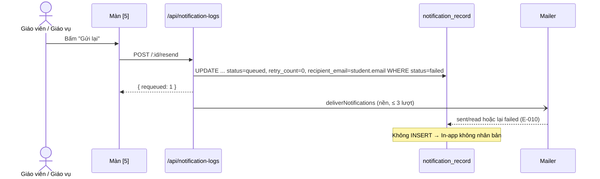

# Plan: TOS-23 — Gửi lại thông báo lỗi không nhân bản In-app

## Overview

AC-003 của US-004 (FR-selfomy-alignment-003, E-selfomy-alignment-010, BR-selfomy-alignment-009):

> Bản ghi đang **Lỗi gửi (`failed`)** trên màn `[5]` → người dùng kiểm tra/cập nhật lại Email học viên rồi bấm **"Gửi lại"** (hoặc **"Gửi lại tất cả mục lỗi"**) → hệ thống đặt lại **đúng bản ghi đó** về `queued` để gửi lại kênh Email; nhờ `idempotency_key`, **không** tạo thêm thông báo In-app trùng trên cổng học viên.

Nguồn: Jira [TOS-23](https://teacher-os.atlassian.net/browse/TOS-23) (subtask của TOS-19 / US-004 · AC-003), máy trạng thái `failed → queued` (`docs/selfomy-alignment/srs/selfomy-alignment-states.md:93`), flow `docs/selfomy-alignment/srs/selfomy-alignment-flows.md:80`, wireframe `docs/selfomy-alignment/ascii-wireframe/debt-and-notification-flow.md#Screen: notification-logs` mục 1, 6 và "Chống nhân bản thông báo khi bấm Gửi lại".

## Scope Challenge

- **Có sẵn:**
  - `notification_record` 1 dòng phục vụ cả Email lẫn In-app, unique `(org_id, idempotency_key)` (TOS-21 D1) — reset trên cùng dòng thì In-app không thể nhân bản.
  - `deliverNotifications` chỉ gửi bản ghi `queued` có kênh email; sau TOS-22 tự thử 3 lượt và chuyển `failed`.
  - `notificationLogRoutes` (`apps/server/src/routes/notification-logs.ts`) mount trong `kernelRoutes` → thừa hưởng Origin guard (CSRF) + gate teacher. Hiện chỉ có `GET /`.
  - `notificationDepsFrom(deps)` để lấy `mailer`, `runInBackground`, `studentOrigin`.
  - Màn `[5]` đã có `counts.failed` theo bộ lọc `q + event` → dùng cho nhãn "(N)" của nút header.
- **Không có:** màn sửa Email học viên. `student.email` là định danh portal (unique theo org, khớp khi provisioning `apps/server/src/student-provisioning.ts:30`), nên **không** thêm ô sửa Email trong plan này (xem "Cần người duyệt xác nhận").
- **Phụ thuộc:** TOS-22 (trạng thái `failed` + vòng thử 3 lượt). Có thể code song song nhưng merge sau TOS-22.
- **Mode:** fast + scout, HOLD SCOPE.

## Quyết định

| # | Quyết định | Lý do |
|---|---|---|
| D1 | **Reset trên cùng bản ghi:** `UPDATE notification_record SET status='queued', retry_count=0, last_error=NULL, recipient_email=<student.email hiện tại> WHERE org_id=? AND id IN (...) AND status='failed'`. Không INSERT, không đổi `idempotency_key`, `read_at`, `created_at`. | AC: đặt lại đúng bản ghi; In-app (đọc từ cùng dòng) không nhân bản; điều kiện `status='failed'` làm thao tác idempotent khi bấm 2 lần. |
| D2 | **Lấy lại Email hiện tại của học viên** (`student.email` qua join) lúc reset. Học viên không còn Email (trống) → bản ghi đó **không** reset, trả về trong `skipped` với lý do `no_email`. | Bước "kiểm tra/cập nhật Email" của AC: nếu Email học viên đã được sửa ở nơi khác, lần gửi lại dùng địa chỉ mới thay vì snapshot sai. |
| D3 | **API** (thêm vào `notificationLogRoutes`): `POST /api/notification-logs/:id/resend` → 200 `{ requeued: 1, skipped: [] }`; bản ghi không thuộc org → 404; không ở `failed` → 409 `{ error: "not_failed" }`. `POST /api/notification-logs/resend-failed` body `{ q?, event? }` (cùng bộ lọc màn hình, **không** nhận `status`) → reset tối đa `RESEND_BATCH_LIMIT = 50` bản ghi `failed` mới nhất, trả `{ requeued, skipped, remaining }`. | Wireframe mục 1: "toàn bộ mục lỗi trong bộ lọc hiện tại"; giới hạn 50 giữ deliver (3 lượt) trong 30s của `waitUntil`. |
| D4 | **Gửi lại chạy nền:** sau reset gọi `deliverNotifications(db, mailer, requeuedIds, studentOrigin, { retryDelaysMs })` qua `runInBackground` (vắng mặt thì await). Lần gửi lại có đủ 3 lượt thử mới; lỗi tiếp → lại `failed` với E-010. | Máy trạng thái `failed → queued → sent/failed`; tái dùng nguyên service, không nhánh gửi riêng. |
| D5 | **Bản ghi học viên đã đọc In-app** (`read_at` có giá trị): gửi lại thành công → `status = 'read'` (CASE hiện có trong deliver). Không reset `read_at`. | `read_at` là nguồn chân lý (TOS-21 D7). |
| D6 | **Quyền:** cùng gate với màn `[5]` (thành viên org qua `kernelRoutes`), không thêm guard tài chính. | Giữ quyết định TOS-21 D8; `KernelCtx` không mang role. |
| D7 | **UI màn `[5]`:** nút "Gửi lại" chỉ trên dòng `failed` (cột Thao tác, cạnh eye); nút header secondary "Gửi lại tất cả mục lỗi (N)" với N = `counts.failed`, ẩn khi N = 0, mở `AlertDialog` xác nhận ("Đưa N thông báo lỗi về hàng đợi để gửi lại Email. Thông báo In-app không bị gửi trùng."). Mutation TanStack Query → toast kết quả (`requeued`, `skipped`, `remaining`) → invalidate `notificationLogsQueryKey`. Nút disable khi đang chạy. | Wireframe mục 1, 6; ngăn bấm đúp. |

## Non-goals

- Màn/ô sửa Email học viên (định danh portal) — chỉ dùng Email hiện tại của học viên.
- Gửi lại bản ghi kẹt `queued` / `sent` / `read`; gửi lại kênh In-app.
- Hàng đợi nền cho "Gửi lại tất cả" vượt 50 bản ghi (người dùng bấm lại; response trả `remaining`).
- Ghi audit log ai bấm Gửi lại.

## Phases

| # | Phase | Ước lượng | Trạng thái | Phụ thuộc |
|---|---|---|---|---|
| 1 | [phase-01-resend-api.md](phase-01-resend-api.md): service `requeueFailedNotifications` + 2 endpoint + contract | 4h | pending | TOS-22 phase 1 |
| 2 | [phase-02-resend-buttons-ui.md](phase-02-resend-buttons-ui.md): nút Gửi lại trên dòng + nút header có xác nhận | 3h | pending | 1 |
| 3 | [phase-03-e2e-ac-003.md](phase-03-e2e-ac-003.md): E2E AC-003 (không nhân bản In-app) | 2h | pending | 1, 2 |

## Acceptance criteria (từ AC-003)

- [ ] Bấm "Gửi lại" trên 1 dòng `failed` → đúng bản ghi đó về `queued` (`retry_count = 0`, `last_error` rỗng) rồi gửi lại Email; số bản ghi `notification_record` của học viên không đổi; chuông học viên không có thông báo thứ hai.
- [ ] Email học viên đã đổi trước khi bấm → thư gửi lại tới địa chỉ mới; `recipient_email` cập nhật.
- [ ] "Gửi lại tất cả mục lỗi (N)" reset mọi bản ghi `failed` theo bộ lọc `q + event` hiện tại (tối đa 50/lần), không đụng bản ghi ngoài bộ lọc hay org khác.
- [ ] Bấm 2 lần / bản ghi không ở `failed` → không gửi thư thứ hai (409 hoặc `requeued: 0`).
- [ ] Gửi lại vẫn lỗi → bản ghi lại `failed` với E-010 sau 3 lượt.
- [ ] Nút "Gửi lại" chỉ hiện trên dòng `failed`; nút header ẩn khi không có mục lỗi.
- [ ] `pnpm check`, `pnpm check-types`, test server/web, E2E AC-003 + AC-002 xanh; verify UI 3 viewport + focus bàn phím.

## Rủi ro

| Rủi ro | Giảm thiểu |
|---|---|
| Hai người bấm cùng lúc → gửi 2 thư. | UPDATE có điều kiện `status='failed'`; chỉ id được UPDATE thật (đọc lại theo `retry_count = 0 AND status='queued'` trong cùng request, hoặc `RETURNING id`) mới được deliver. |
| Bulk lớn vượt `waitUntil`. | Giới hạn 50 + `remaining` trong response. |
| Địa chỉ vẫn sai → spam 3 lượt mỗi lần bấm. | Chấp nhận (người dùng chủ động); mỗi lần bấm tối đa 3 lần gửi. |

## Liên kết

- **Blocked by** #463 (TOS-22, trạng thái `failed`).
- TOS-21 #454: `idempotency_key`, 1 bản ghi cho cả 2 kênh.

## Cần người duyệt xác nhận

- D2 / Non-goal: không thêm ô sửa Email học viên vì `student.email` là định danh portal; "cập nhật Email" hiểu là Email đã sửa ở nơi khác được lấy lại khi gửi lại. Nếu cần ô sửa ngay trong hộp thoại, cần quyết định riêng về ảnh hưởng tới đăng nhập portal.
- D3: giới hạn 50 bản ghi mỗi lần "Gửi lại tất cả".
- D6: mọi thành viên org đều bấm được Gửi lại (giống quyền xem màn `[5]`).
