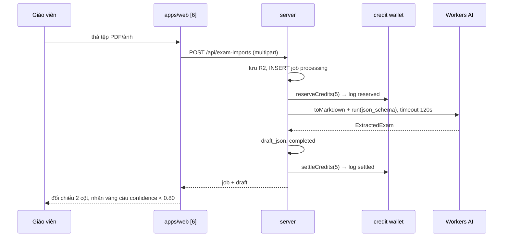

# Plan: TOS-24 — Tạm giữ 5 Credit, bóc tách đề thi thành công và mở đối chiếu 2 cột

## Overview

AC-001 của US-005 (FR-selfomy-alignment-013/015/016, BR-selfomy-alignment-004, NFR-selfomy-alignment-002):

> Tổ chức còn ≥ 5 Credit khả dụng → người dùng tải tệp PDF/JPG/PNG hợp lệ chưa từng bóc tách → hệ thống **tạm giữ 5 Credit (`reserved`)**, bóc tách cấu trúc đề trong **≤ 120 giây** → khi có bản đề nháp thì **chốt trừ 5 Credit (`settled`)** và mở giao diện **đối chiếu 2 cột** (trái: tài liệu gốc lật trang/zoom; phải: đoạn văn, câu hỏi, đáp án, nhãn vàng **"(!) Cần rà soát lại"** ở câu độ tự tin thấp).

Nguồn: Jira [TOS-24](https://teacher-os.atlassian.net/browse/TOS-24) (subtask của TOS-20 / US-005 · AC-001), `docs/selfomy-alignment/userstories/us-005.md`, `docs/selfomy-alignment/usecases/uc-ai-exam-import.md`, wireframe `docs/selfomy-alignment/ascii-wireframe/ai-teaching-assistant-flow.md#Screen: ai-exam-import-workspace`, ERD `docs/selfomy-alignment/srs/selfomy-alignment-erd.md` (`CreditWallet`, `CreditUsageLog`, `ExamImportJob`).

## Scope Challenge

- **Chưa có trong repo:** Ví Credit (`credit_wallet`, `credit_usage_log`) — Jira TOS-42 (US-009 AC-001) sở hữu đầy đủ nhưng chưa có GitHub issue; SDK/binding AI nào trong `apps/server`; bảng tiến trình nhập đề.
- **Có sẵn để tái dùng:** R2 + `MediaStore` (`apps/server/src/lib/r2-media-store.ts`, `media-store.ts`, bản đĩa cho e2e); `AppDeps` DI (`apps/server/src/app.ts`); ngân hàng đề org `assignment_prompt` + `assignment_test` (đích xuất bản ở TOS-26); contract câu hỏi `assignmentQuestionSchema` (`packages/api/src/contracts.ts:603`).
- **Quyết định người dùng (2026-10-27):** TOS-24 **dựng lõi Ví Credit tối thiểu**, TOS-42 về sau mở rộng (gói tháng/Top-up FEFO, cảnh báo 80/100%); dịch vụ AI dùng **Cloudflare Workers AI**.
- **Mode:** hard-lite (scout + quyết định), HOLD SCOPE.

## Quyết định

| # | Quyết định | Lý do |
|---|---|---|
| D1 | **Lõi ví tối thiểu**: bảng `credit_wallet` (`org_id` PK, `balance`, `held`, `updated_at`) và `credit_usage_log` append-only (`id`, `org_id`, `actor_user_id`, `action_type` = `exam_import`, `credit_delta`, `tx_status` `reserved`/`settled`/`released`, `ref_id` = job id, `idempotency_key` UNIQUE, `created_at`). Khả dụng = `balance - held`. Service `apps/server/src/lib/credits/wallet.ts`: `reserveCredits`, `settleCredits`, `releaseCredits` — mỗi hàm 1 batch D1 gồm UPDATE có điều kiện (`balance - held >= amount` cho reserve; `held >= amount` cho settle/release) + INSERT log; idempotency key `exam_import:<jobId>:<reserve|settle|release>`. | Đúng ERD `CreditWallet`/`CreditUsageLog` ở mức cần cho US-005; điều kiện trong UPDATE chống âm ví khi bấm song song; idempotent để retry an toàn. Tên cột tương thích để TOS-42 thêm `monthly_credit_balance`/`topup_*` mà không đổi API service. |
| D2 | **Khởi tạo ví**: tổ chức chưa có row → tạo lazy với `balance = TRIAL_CREDITS = 30` (gói Dùng thử, spec E-001) khi gọi lần đầu; seed dev/e2e set số dư cố định. Cổng mua/Top-up không thuộc plan. | Cần số dư thật để chạy AC; 30 Credit là mặc định Dùng thử trong spec. |
| D3 | **Trần Credit cá nhân (US-010)**: thêm hook `assertStaffCap(ctx, amount)` trả OK luôn (no-op), ghi TODO tham chiếu TOS-49. | AC yêu cầu "còn hạn mức trần" nhưng US-010 chưa làm; giữ đúng điểm gắn để TOS-49 chỉ cài thân hàm. |
| D4 | **Bảng `exam_import_job`**: `id`, `org_id`, `created_by`, `file_key` (R2), `file_name`, `mime_type`, `size_bytes`, `page_count`, `content_fingerprint` (SHA-256 hex), `held_credits` (5), `import_status` `processing`/`completed`/`failed_refunded`, `draft_json` (cấu trúc đề nháp), `error_code`, `started_at`, `completed_at`, `created_at`, `updated_at`; index `(org_id, content_fingerprint)`. | Đúng ERD `ExamImportJob`; `content_fingerprint` tính sẵn để TOS-25 chống trùng; `draft_json` là nguồn cho cột phải và cho TOS-26. |
| D5 | **Luồng đồng bộ trong 1 request**: `POST /api/exam-imports` (multipart) → kiểm tra cơ bản (mime, ≤ 15 MB) → lưu file R2 `exam-imports/<orgId>/<jobId>` → INSERT job `processing` → `reserveCredits(5)` → gọi extractor với `AbortSignal.timeout(120_000)` → hợp lệ thì lưu `draft_json`, `completed`, `settleCredits` → trả job. Lỗi bất kỳ sau reserve → `releaseCredits` + `failed_refunded` (catch-all tối thiểu; phân loại lỗi, E-004, nút thử lại thuộc TOS-27). | Không có Queue/cron (xem plan TOS-22); `waitUntil` chỉ ~30s nên không đủ 120s — request mở là lựa chọn đơn giản nhất; catch-all đảm bảo không bao giờ giữ Credit treo ngay từ plan này. |
| D6 | **Extractor Workers AI** (`apps/server/src/lib/exam-import/extractor.ts`, interface `ExamExtractor` inject qua `AppDeps.getExamExtractor?()`): (1) `env.AI.toMarkdown([{ name, blob }])` chuyển PDF/ảnh → markdown; (2) `env.AI.run("@cf/meta/llama-4-scout-17b-16e-instruct", { messages, response_format: { type: "json_schema", json_schema } })` ép ra `ExtractedExam` (`title`, `skill`, `parts[]` gồm `passage`, `questions[]` có `stem`, `opts`, `answer`, `type`, `explanation`, `confidence` 0–1). Parse lại bằng zod; câu `confidence < 0.80` hoặc thiếu `answer` → `needsReview = true`. Tên model là hằng `EXAM_EXTRACT_MODEL` để đổi không sửa logic. | Workers AI không cần key ngoài; `toMarkdown` xử lý cả PDF lẫn ảnh; JSON mode + zod cho đầu ra có kiểu; ngưỡng 0.80 theo wireframe mục 10. |
| D7 | **Hạ tầng**: thêm binding `AI: Cloudflare.Ai()` (alchemy) vào Worker `server` trong `packages/infra/alchemy.run.ts`; thiếu binding → route trả 503 `EXAM_IMPORT_DISABLED` (cùng hợp đồng `getMediaStore`). E2E và unit test dùng `fakeExamExtractor` trả đề cố định (1 câu `confidence 0.6`). | Theo pattern DI optional hiện có; E2E không gọi AI thật. |
| D8 | **Phân quyền**: owner + teacher (role `membership`) được nhập đề; TA chỉ xem (wireframe liệt kê TA nhưng AC chỉ nêu GV độc lập / Chủ trung tâm / GV đứng lớp). | Bám AC; TA mở rộng sau nếu cần. |
| D9 | **Màn `[6]`** `apps/web/src/routes/_auth/assignments/tests/import.tsx` (vào từ nút **"Nhập đề bằng AI (5 Credit)"** trên `/assignments/tests/new`): huy hiệu chi phí + số dư (`GET /api/credits/wallet`), dropzone, thanh tiến trình, layout 2 cột ≥ 1024px / 2 tab + sticky bar < 1024px. Cột trái: PDF render bằng `pdfjs-dist` (lật trang, zoom), ảnh dùng `` có zoom; file lấy qua `GET /api/exam-imports/:id/file`. Cột phải: tên đề, kỹ năng, thời gian, đoạn văn, thẻ câu hỏi; câu `needsReview` có nhãn vàng **"(!) Cần rà soát lại"**. Ở plan này cột phải **chỉ hiển thị** (sửa + lưu thuộc TOS-26). | Đúng wireframe mục 1, 2, 5–10; tách chỉnh sửa/xuất bản sang TOS-26 để PR gọn. |

## Non-goals

- Gói tháng, Top-up, FEFO, cảnh báo 80/100% (TOS-42); trần Credit cá nhân (TOS-49 — chỉ hook no-op).
- Chống trùng mã băm + "Mở lại bản nháp cũ (0 Cr)" (TOS-25).
- Chỉnh sửa tay, Lưu bản nháp, xác nhận rà soát, Lưu vào Ngân hàng đề (TOS-26).
- Chặn tệp > 20 trang/mật khẩu phía client, phân loại lỗi AI/timeout, E-003/E-004, nút "Thử bóc tách lại AI", dọn job treo (TOS-27).
- Tiến trình chạy ngầm khi đóng trình duyệt (UC ext 5a) — cần Queue; ghi nhận rủi ro.

## Phases

| # | Phase | Ước lượng | Trạng thái | Phụ thuộc |
|---|---|---|---|---|
| 1 | [phase-01-credit-wallet-core.md](phase-01-credit-wallet-core.md): schema + migration ví/sổ cái/job, service reserve/settle/release | 5h | done | — |
| 2 | [phase-02-extractor-and-import-api.md](phase-02-extractor-and-import-api.md): binding AI, extractor Workers AI, `POST /api/exam-imports`, `GET /:id`, `GET /:id/file`, `GET /api/credits/wallet` | 8h | done | 1 |
| 3 | [phase-03-import-workspace-ui.md](phase-03-import-workspace-ui.md): màn `[6]` dropzone + đối chiếu 2 cột + nhãn vàng | 8h | done | 2 |
| 4 | [phase-04-e2e-ac-001.md](phase-04-e2e-ac-001.md): E2E AC-001 với extractor giả lập | 3h | done | 3 |

## Acceptance criteria (từ AC-001)

- [x] Ví có ≥ 5 Credit + tệp hợp lệ → `credit_usage_log` có đúng 1 dòng `reserved` (−5) rồi 1 dòng `settled` cho cùng job; `balance` giảm 5, `held` về 0.
- [x] Job `completed` lưu `draft_json`, `content_fingerprint`, `page_count`; thời gian extractor bị chặn bởi timeout 120s.
- [x] Màn `[6]` hiển thị 2 cột (trái lật trang/zoom, phải đoạn văn + câu hỏi + đáp án); câu `confidence < 0.80` có nhãn vàng "(!) Cần rà soát lại"; < 1024px chuyển 2 tab.
- [x] Extractor ném lỗi → Credit được hoàn (`released`), ví không đổi (catch-all; UX lỗi ở TOS-27).
- [x] Hai request song song khi ví chỉ còn 5 Credit → chỉ 1 request reserve thành công.

## Validation

- `pnpm --filter server test` (wallet + exam-imports), `pnpm --filter web test`, `pnpm check`, `pnpm check-types`.
- `pnpm --filter e2e e2e` với port 8100/8101/8103/8104 (spec mới `ai-exam-import-ac-001`).
- Verify UI 3 viewport (1440×900, 768×1024, 375×812) + keyboard focus theo `REVIEW.md`; `pnpm design:compare`.

## Rủi ro

- **Chất lượng bóc tách của model Workers AI** với đề IELTS nhiều cột — giảm bằng prompt có ví dụ + nhãn Cần rà soát; tên model là hằng để đổi nhanh.
- **Đóng tab giữa chừng** có thể hủy request → job kẹt `processing` với Credit đang giữ; TOS-27 thêm cơ chế release lười khi job quá 120s.
- **Chi phí `toMarkdown` với PDF scan** (ảnh không có text layer) — chấp nhận cho v1.

## Cần người duyệt xác nhận

- Số dư khởi tạo 30 Credit cho mọi tổ chức hiện có (trước khi TOS-42 có gói thuê bao).
- Model mặc định `@cf/meta/llama-4-scout-17b-16e-instruct`.
