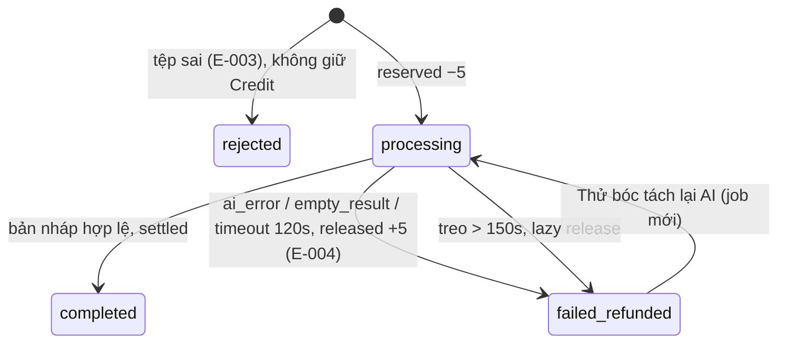

# Plan: TOS-27 — Chặn tệp không hợp lệ và tự hoàn 5 Credit khi AI lỗi/quá hạn

## Overview

AC-004 của US-005 (FR-selfomy-alignment-015/016, BR-selfomy-alignment-004; E-selfomy-alignment-001/003/004):

> **Rule:** Không bao giờ trừ Credit khi tệp không hợp lệ hoặc AI không trả về được bản đề nháp.
> - Tệp PDF 18 MB / 25 trang / có mật khẩu → **chặn tải lên ngay**, báo **E-selfomy-alignment-003**, **không tạm giữ Credit**.
> - Đã giữ 5 Credit, AI lỗi / không trích xuất được ≥ 1 nhóm câu hỏi hợp lệ / quá **120 giây** → **giải tỏa (`released`) đủ 5 Credit** về ví tổ chức, **ghi bản ghi hoàn trả trong sổ cái**, hiển thị **E-selfomy-alignment-004** kèm nút **"Thử bóc tách lại AI"**.

Nguồn: Jira [TOS-27](https://teacher-os.atlassian.net/browse/TOS-27) (subtask của TOS-20 / US-005 · AC-004), `docs/selfomy-alignment/userstories/us-005.md`, UC ext 2a/4a/6a, spec lỗi `docs/selfomy-alignment/srs/selfomy-alignment-spec.md:110-116`, wireframe mục 2, 12 + "Screen Actions & Validation Rules".

## Scope Challenge

- **Phụ thuộc TOS-24:** service `releaseCredits`, catch-all release trong `POST /api/exam-imports`, cột `error_code`, `import_status = failed_refunded`, file gốc trên R2, `EXAM_IMPORT_LIMITS`, `fakeExamExtractor`.
- **Việc còn lại:** kiểm trang/mật khẩu (client + server), phân loại lỗi + mã E-004, dọn job treo, nút thử lại, hộp thoại E-001, thông điệp lỗi chuẩn spec.
- **Mode:** fast + scout, HOLD SCOPE.

## Quyết định

| # | Quyết định | Lý do |
|---|---|---|
| D1 | **Kiểm tệp 2 lớp, đều trước khi giữ Credit.** Client (`pdfjs-dist` đã có từ TOS-24): mime/đuôi ∈ pdf/png/jpg/jpeg, `size ≤ 15 MB`, PDF: `getDocument` → `numPages ≤ 20`, `PasswordException` → mật khẩu. Server: mime + size + với PDF dùng `unpdf` (`getDocumentProxy`, bản pdf.js chạy trên Workers) lấy `numPages` / bắt lỗi mật khẩu; ảnh tính 1 trang. Vi phạm → 400 `{ code: "E-selfomy-alignment-003", reason: "size" | "pages" | "password" | "type" }`, không lưu R2, không tạo job. | AC: "chặn ngay lập tức" (client) + không tin client (server). |
| D2 | **Phân loại lỗi sau reserve** (thay catch-all của TOS-24): `AbortSignal.timeout(120_000)` → `timeout`; extractor ném / JSON sai schema → `ai_error`; `parts` không có câu hỏi hợp lệ nào (mỗi câu cần `stem` + `answer` không rỗng; passage rỗng và 0 câu) → `empty_result`. Cả 3 → `releaseCredits(5)` (dòng `released`, `credit_delta = +5`), job `failed_refunded`, `error_code = "E-selfomy-alignment-004"`, `error_reason` = loại lỗi; response 502 `{ code: "E-selfomy-alignment-004", reason, jobId }`. | Đúng AC + spec E-004; giữ một đường release duy nhất. |
| D3 | **Dọn job treo (lazy release):** `releaseStaleImports(db, orgId)` tìm job `processing` có `started_at < now − 150s` (120s + biên) → release + `failed_refunded` + `E-004` reason `timeout`. Gọi đầu `POST /api/exam-imports`, `GET /api/exam-imports/:id`, `GET /api/credits/wallet`. Idempotency key của release ngăn hoàn 2 lần. | Không có cron/Queue; request bị hủy khi đóng tab có thể để Credit treo — dọn lười đảm bảo "không bao giờ trừ Credit". |
| D4 | **"Thử bóc tách lại AI"** `POST /api/exam-imports/:id/retry` (job `failed_refunded`, cùng org): tạo **job mới** dùng lại `file_key` + `content_fingerprint` (không upload lại), chạy lại toàn bộ luồng reserve → extract → settle/release. | Khóa idempotency `exam_import:<jobId>:*` của TOS-24 giữ nguyên ý nghĩa 1 job = 1 lần thử; job cũ còn làm lịch sử. |
| D5 | **Hộp thoại thiếu Credit (E-001):** `POST` trả 402 `E-selfomy-alignment-001` → `AlertDialog` với thông điệp spec; nút "Đóng" + "Soạn đề thủ công" (về `/assignments/tests/new`). Nút mua gói/Top-up chưa có màn `[10]` → để TOS-43 bổ sung. | Ticket liệt kê E-001; chưa có luồng thanh toán Credit. |
| D6 | **Thông điệp** lấy nguyên văn cột "Thông điệp" của spec cho E-003, E-004, E-001, khai báo trong `packages/api/src/contracts.ts` (`EXAM_IMPORT_ERROR_MESSAGES`), dùng chung web + test. | Một nguồn chữ, test assert được. |

## Non-goals

- Màn mua gói/Top-up `[10]` (TOS-43) và chặn E-006 gói quá hạn (TOS-45).
- Trần Credit cá nhân E-007 (TOS-49 — hook no-op từ TOS-24).
- Tự động thử lại AI phía server (spec E-004 chỉ yêu cầu hoàn Credit + cho người dùng bấm thử lại).

## Phases

| # | Phase | Ước lượng | Trạng thái | Phụ thuộc |
|---|---|---|---|---|
| 1 | [phase-01-server-validation-and-refund.md](phase-01-server-validation-and-refund.md): kiểm trang/mật khẩu server, phân loại lỗi + release, dọn job treo, `POST /:id/retry` | 6h | pending | TOS-24 |
| 2 | [phase-02-client-validation-and-error-ui.md](phase-02-client-validation-and-error-ui.md): chặn tệp ở dropzone (E-003), panel lỗi E-004 + nút thử lại, hộp thoại E-001 | 4h | pending | 1 |
| 3 | [phase-03-e2e-ac-004.md](phase-03-e2e-ac-004.md): E2E 2 scenario | 3h | pending | 2 |

## Acceptance criteria (từ AC-004)

- [ ] PDF 18 MB, PDF 25 trang, PDF có mật khẩu → bị chặn ngay ở dropzone với thông điệp E-003; gọi thẳng API cũng trả 400 E-003; `credit_usage_log` không có dòng mới, không có job.
- [ ] Extractor lỗi / trả 0 nhóm câu hợp lệ / quá 120s → log có cặp `reserved −5` + `released +5`, ví về đúng số dư trước, job `failed_refunded` + `E-selfomy-alignment-004`; UI hiện thông điệp E-004 + nút "Thử bóc tách lại AI".
- [ ] Bấm thử lại → job mới chạy lại không cần upload; thành công thì settled bình thường.
- [ ] Job `processing` quá 150s → lần gọi tiếp theo tự hoàn Credit đúng 1 lần.
- [ ] Ví < 5 Credit → hộp thoại E-001, không có job/log.

## Validation

- `pnpm --filter server test -- exam-imports wallet`, `pnpm --filter web test -- exam-file-dropzone import`, `pnpm check`, `pnpm check-types`.
- `pnpm --filter e2e e2e -- ai-exam-import-ac-004` (port 8100/8101/8103/8104); 3 viewport + focus.

## Rủi ro

- `unpdf` tăng kích thước bundle Worker — đo `wrangler`/alchemy bundle; nếu vượt hạn mức, fallback đọc `/Encrypt` + đếm `/Type /Page` thô.
- Timeout bằng `AbortSignal` chỉ có hiệu lực nếu `env.AI.run` nhận `signal`; nếu không, dùng `Promise.race` với timer và bỏ qua kết quả về muộn (job đã `failed_refunded` → UPDATE có điều kiện `import_status = 'processing'` chặn settle muộn).
