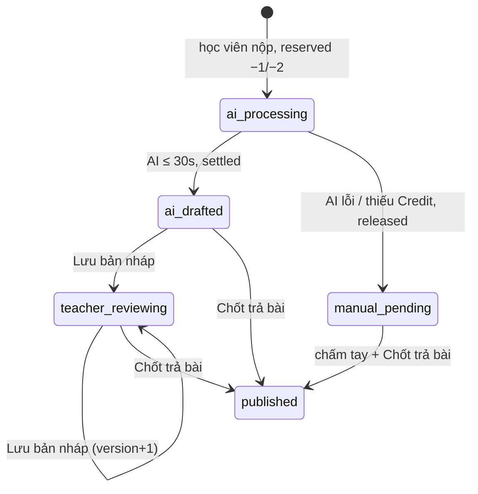

# Plan: TOS-30 — Chấm nháp ngầm Writing/Speaking, chỉ mở khóa khi "Chốt trả bài"

## Overview

AC-001 của US-006 (FR-selfomy-alignment-013/018/019/020, BR-selfomy-alignment-001/004; NFR-selfomy-alignment-002):

> Học viên nộp Writing (hoặc Speaking hợp lệ ≥ 15 từ), ví còn đủ Credit → AI chấm nháp ≤ 30 giây → bài ở trạng thái **`ai_drafted`** với điểm gợi ý 4 tiêu chí IELTS (bước 0.5) + nhận xét trên màn **[7]**. Cổng học viên chỉ thấy **"Đã nộp — Đang chờ giáo viên chấm"**. Chỉ khi Giáo viên bấm **"Chốt trả bài"** bài mới sang **`published`**, mở khóa cho học viên và phát thông báo.

Nguồn: Jira [TOS-30](https://teacher-os.atlassian.net/browse/TOS-30) (subtask của TOS-28 / US-006 · AC-001), `docs/selfomy-alignment/userstories/us-006.md`, máy trạng thái `AiGradingDraft` trong `docs/selfomy-alignment/srs/selfomy-alignment-states.md`, wireframe `ai-grading-review-workspace` `[7]`.

## Scope Challenge (scout 2026-10-28)

- **Đã có:** chấm tay Writing/Speaking (`apps/server/src/routes/grading.ts` — `POST /api/grading/:attemptId/grade` ghi `quiz_attempt.grade_scores` + `graded_at` và phát `grade_returned`), màn `apps/web/src/routes/_auth/grading/$attemptId.tsx`, ví Credit `reserve/settle/release` idempotent (`apps/server/src/lib/credits/wallet.ts`, TOS-24), mẫu adapter AI thuần + fake (`lib/exam-import/extractor.ts`, `fake-extractor.ts`), trình phát media bài nộp.
- **Chưa có:** bất kỳ trạng thái chấm nháp AI nào (`ai_drafted`, `teacher_reviewing`, `published`…), grader AI, kích hoạt chấm khi nộp, chuyển giọng nói thành văn bản (TOS-31), gói tháng (TOS-42).
- **Học viên đọc điểm** từ `quiz_attempt.grade_scores` → nếu bản nháp AI lưu ở bảng riêng thì "ẩn với học viên" được bảo đảm theo cấu trúc, không cần lọc thêm.
- **Mode:** fast + scout, HOLD SCOPE. Ticket này là nền cho TOS-31/32/33.

## Quyết định

| # | Quyết định | Lý do |
|---|---|---|
| D1 | **Bảng mới `ai_grading_draft`** (1 dòng / `quiz_attempt`): `attempt_id` PK, `org_id`, `skill` (`writing`/`speaking`), `status` (`ai_processing` \| `ai_drafted` \| `teacher_reviewing` \| `manual_pending` \| `published`), `ai_scores` JSON 4 tiêu chí, `ai_feedback`, `reviewed_scores` JSON, `reviewed_feedback`, `grading_mode` (`standard`; `quick` do TOS-32), `credit_cost`, `transcript` (TOS-31 dùng), `error_code`, `version` int, `started_at`, `drafted_at`, `published_at`. Migration kế tiếp sau `0053`. | Tách nháp khỏi `quiz_attempt.grade_scores` → học viên không thể thấy điểm AI; giữ bảng attempt gọn. |
| D2 | **`AiGrader` interface thuần** (`apps/server/src/lib/ai-grading/grader.ts`): `grade({ skill, prompt, essay \| transcript }, signal) → { scores, feedback }` — `scores` theo **key tiêu chí chuẩn của contract** (`task/coherence/lexical/grammar` cho Writing, `fluency/lexical/grammar/pronunciation` cho Speaking, tái dùng `criteriaForSkill`), kết quả validate bằng `writingGradeScoresSchema`/`speakingGradeScoresSchema`, điểm làm tròn bước 0.5 trong `[0, 9]` (`isBandStep`). Adapter Workers AI `createWorkersAiGrader` chỉ `index.ts` import; `fakeAiGrader` cho test/e2e. | Theo precedent extractor TOS-24; key scores khớp `parseGradeScores` để publish không phải đổi shape. |
| D3 | **Kích hoạt khi nộp:** route `POST /attempts/:attemptId/submit` trong `apps/server/src/routes/student.ts` — chỉ khi thắng CAS flip (`flipped.length > 0`) và skill Writing/Speaking gọi `scheduleAiGrading(attemptId)` qua `runInBackground` (waitUntil); vắng `runInBackground` → fire-and-forget `void promise.catch(log)` (không bỏ lặng lẽ). Luồng `runAiGrading`: tạo draft `ai_processing` (ON CONFLICT DO NOTHING → đã có draft thì thoát) → Speaking transcript qua `Transcriber` stub rỗng ⇒ `manual_pending` không reserve (D4) → `ensureWallet` + `reserveCredits` (Writing 1, Speaking 2; key `ai_grading:<attemptId>:reserve`, actor `system`) → `InsufficientCreditsError` ⇒ `manual_pending` không gọi AI → `grade` với deadline 20s — **pipeline TỰ race `AbortSignal.timeout`** (grader treo cứng bỏ qua signal vẫn bị cắt; ngân sách nền toàn phần < 30s trần `waitUntil`) → **CAS draft trước, ví sau**: thắng UPDATE `ai_processing → ai_drafted` mới `settleCredits`; thua CAS (cleanup/teacher đã đổi) → `releaseCredits`. Lỗi AI: CAS `ai_processing → manual_pending` rồi `releaseCredits` (key `ai_grading:<attemptId>:release` idempotent). Ví thiếu Credit → `manual_pending` không gọi AI (TOS-32 thêm nhánh Chấm nhanh / E-002). `releaseStaleGradings` (ngưỡng 60s > ngân sách nền) chạy `ai_processing → manual_pending` (CAS) rồi `releaseCredits`, mở rộng trả held kẹt khi crash sau CAS (chỉ khi sổ cái có reserve chưa settle/release — lọc EXISTS/NOT EXISTS trong SQL), gọi ở `GET /api/grading`, `GET /api/grading/:attemptId` **và `GET /api/credits/wallet`**. | Nộp bài không bị chậm; đúng nhánh timeout vẫn kịp release trước trần `waitUntil`; CAS-first chặn settle dùng `held` của job khác và chặn `ai_drafted` đè `published`. |
| D4 | **Speaking ở TOS-30:** chỉ chấm khi đã có transcript; TOS-30 nhận transcript qua `Transcriber` stub trả rỗng → bài Speaking rơi vào `manual_pending` cho tới khi TOS-31 gắn STT thật + quy tắc 15 từ. | Giữ ticket nhỏ; tránh chấm Speaking không có văn bản. |
| D5 | **Màn [7]:** mở rộng `grading/$attemptId.tsx` thành bố cục 2 cột — trái bài làm (essay/annotations hiện có), phải panel "Gợi ý từ AI" (4 ô điểm bước 0.5 điền sẵn từ `ai_scores`, nhận xét, badge trạng thái). Nút **"Lưu bản nháp"** (`PATCH /api/grading/:attemptId/draft` → `teacher_reviewing`, tăng `version`) và **"Chốt trả bài"**. Hàng chờ `/grading` thêm cột/badge trạng thái draft. | FR-020; tái dùng màn chấm có sẵn thay vì tạo route mới. |
| D6 | **"Chốt trả bài" = luồng `POST /:attemptId/grade` hiện có** (ghi `grade_scores`/`grade_feedback`/`graded_at` + phát `grade_returned`), thêm: cập nhật draft `published` + `published_at` trong cùng batch. Bài không có draft (chấm tay cũ) vẫn chạy như trước. | Một đường công bố duy nhất; thông báo tự động đã có từ #454. |
| D7 | **Cổng học viên:** attempt `submitted` chưa có `graded_at` hiển thị nhãn "Đã nộp — Đang chờ giáo viên chấm"; API học viên không bao giờ join `ai_grading_draft`. Thêm test hợp đồng chặn rò rỉ. | BR-001. |

## Non-goals

- STT + quy tắc < 15 từ + nhãn giới hạn phát âm (TOS-31).
- Chấm nhanh 30 bài/tháng, E-001/E-002 (TOS-32).
- Phân quyền TA khóa "Chốt trả bài", 2 lần thử lại + E-004 + "Thử chấm lại AI", chống lưu đè E-011 (TOS-33) — TOS-30 chỉ tạo cột `version` và tăng khi lưu.
- Trần Credit cá nhân (TOS-49), gói tháng/Top-up (TOS-42).

## Điều chỉnh red-team (kongming gate 2026-10-28 — GO với điều kiện)

Gate `ak plan validate` OK + red-team advisory (2 Critical, 3 Important — đã chấp nhận, tổng hợp vào D2/D3 ở trên) + review fixes sau implement. Điều kiện áp dụng:

1. **Ngân sách nền < trần `waitUntil` (~30s):** timeout gọi AI = 20s (`AI_GRADING_TIMEOUT_MS`) — pipeline TỰ race deadline (grader bỏ qua signal vẫn cắt), stale sweep 60s.
2. **CAS draft trước, ví sau:** settle chỉ khi thắng UPDATE `ai_processing → ai_drafted`; release khi thua CAS hoặc lỗi AI; `/grade` publish draft từ **bất kỳ** trạng thái (guard `WHERE (SELECT changes() = 1)`); không chép thứ tự ví-trước-đổi-sau của `release-stale.ts`.
3. **`wallet.ts` mở rộng:** `CreditMutationInput.actionType: "exam_import" | "ai_grading"` (default `exam_import`) quyết prefix idempotency key và cột `action_type`; `ensureWallet` trước reserve (org chưa có ví).
4. **`scheduleAiGrading` fallback:** không có `runInBackground` → fire-and-forget `void promise.catch(...)`, trả promise để test chờ; chỉ gọi khi thắng CAS flip.
5. **Nhãn học viên "Đã nộp — Đang chờ giáo viên chấm":** skill-aware (chỉ Writing/Speaking + `graded_at` null) ở history-list, skill-catalog, assignment-status, chi tiết attempt; Reading/Listening giữ "Đã nộp"; bài đã "Chốt trả bài" (`gradedAt`) → "Đã chấm"/"Điểm: X" — không dính nhãn chờ.
6. **`ai_scores` theo key contract:** `criteriaForSkill(skill)`; validate bằng `writingGradeScoresSchema`/`speakingGradeScoresSchema`; overview chỉ lộ `scores` khi safeParse khớp shape Writing (Speaking dựa `gradedAt`).

Giả định chốt: **bài tự luyện (`mode='practice'`) cũng được chấm AI và trừ Credit org** — hàng chờ đã gộp practice; TOS-31/32 sẽ mở rộng.

## Phases

| # | Phase | Ước lượng | Trạng thái | Phụ thuộc |
|---|---|---|---|---|
| 1 | [phase-01-schema-grader-and-pipeline.md](phase-01-schema-grader-and-pipeline.md): migration `ai_grading_draft`, grader + fake, `runAiGrading` reserve→grade→settle/release, kích hoạt khi nộp | 1d | pending | — |
| 2 | [phase-02-review-workspace-and-publish.md](phase-02-review-workspace-and-publish.md): API draft (GET/PATCH), publish qua `/grade`, màn [7] 2 cột, badge hàng chờ, nhãn chờ chấm phía học viên | 1.25d | pending | 1 |
| 3 | [phase-03-e2e-ac-001.md](phase-03-e2e-ac-001.md): E2E nộp → ai_drafted → học viên không thấy điểm → Chốt trả bài → học viên thấy điểm | 0.75d | pending | 2 |

## Acceptance criteria (từ AC-001)

- [ ] Học viên nộp Writing, ví đủ Credit → trong ≤ 30 giây draft `ai_drafted` có đủ 4 tiêu chí (bội số 0.5, 0–9) + nhận xét; sổ cái có `reserved −1` rồi `settled −1`.
- [ ] Trong lúc `ai_drafted`/`teacher_reviewing`, mọi API + UI cổng học viên chỉ hiện "Đã nộp — Đang chờ giáo viên chấm", không có điểm/lời phê AI.
- [ ] Giáo viên bấm "Chốt trả bài" → draft `published`, `quiz_attempt.grade_scores` có điểm cuối cùng, học viên thấy kết quả và nhận thông báo `grade_returned`.
- [ ] AI lỗi / quá 30 giây → Credit hoàn đủ (`released`), bài `manual_pending`, giáo viên vẫn chấm tay được.
- [ ] Nộp lại cùng attempt / request chạy lại không trừ Credit lần 2.

## Verify

- `pnpm --filter server test -- ai-grading grading student`
- `pnpm --filter web test -- grading`
- `pnpm check && pnpm check-types`
- `pnpm --filter e2e e2e -- ai-grading-ac-001` (port 8100/8101/8103/8104)

## Rủi ro

- Workers AI chấm IELTS chất lượng thấp → giữ grader sau interface, prompt chấm riêng file; fake grader cho e2e.
- `waitUntil` bị hủy giữa chừng → draft kẹt `ai_processing`; dọn lười như TOS-27 (`release-stale.ts`) — thêm `releaseStaleGradings` ở phase 1 với ngưỡng 60 giây.
