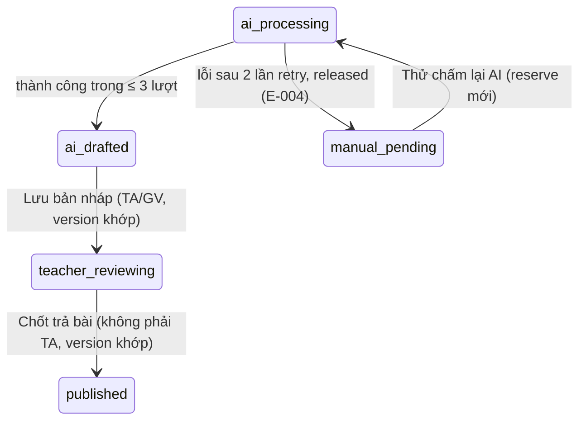

# Plan: TOS-33 — Phân quyền TA, hoàn Credit khi AI lỗi, chống lưu đè / gọi trùng

## Overview

AC-004 của US-006 (FR-selfomy-alignment-018/019/020/029, BR-selfomy-alignment-004; E-selfomy-alignment-004/011):

> - **Trợ giảng (TA)** mở bài thuộc lớp được phân công trên [7], sửa điểm/lời phê → bấm được **"Lưu bản nháp"** (`teacher_reviewing`) nhưng **"Chốt trả bài" bị khóa**.
> - Đã giữ 1 Credit (Writing) / 2 Credit (Speaking), AI lỗi sau **đủ 2 lần tự thử lại** → **hoàn 100%** Credit, bài **`manual_pending`**, hiển thị **E-selfomy-alignment-004** kèm nút **"Thử chấm lại AI"**.
> - TA lưu thành công (version 1 → 2), Giáo viên lưu trên màn cũ (version 1) hoặc bấm gọi chấm AI khi đang xử lý → **chặn**, cảnh báo **E-selfomy-alignment-011** yêu cầu tải lại.

Nguồn: Jira [TOS-33](https://teacher-os.atlassian.net/browse/TOS-33) (subtask của TOS-28 / US-006 · AC-004), spec lỗi E-004/E-011 (`docs/selfomy-alignment/srs/selfomy-alignment-spec.md:113,120`).

## Scope Challenge

- **Phụ thuộc TOS-30:** `ai_grading_draft.version`, `PATCH /:attemptId/draft`, publish qua `POST /:attemptId/grade`, nhánh release cơ bản trong `runAiGrading`.
- **Đã có:** vai trò `ta`, `class_teacher` trong `packages/auth/src/role.ts` (TOS-48), mẫu allowlist `canImportExam`/`canAccessFinance`, mẫu retry + E-004 bên nhập đề (TOS-27).
- **Chưa có mô hình phân công TA ↔ lớp** trong schema (`membership` chỉ có `role`). Plan áp dụng phạm vi **toàn tổ chức** cho TA ở ticket này và ghi nhận giới hạn (câu hỏi mở).
- **Mode:** fast + scout, HOLD SCOPE.

## Quyết định

| # | Quyết định | Lý do |
|---|---|---|
| D1 | **Allowlist `canPublishGrade(role)`** trong `packages/auth/src/role.ts`: `teacher`, `owner`, `admin`, `class_teacher` → được Chốt trả bài; `ta` và giá trị lạ → không. `canReviewGrade(role)` (Lưu bản nháp) = các vai trên + `ta`. `POST /api/grading/:attemptId/grade` trả 403 `GRADE_PUBLISH_FORBIDDEN` cho TA; UI disable nút + tooltip "Chỉ Giáo viên đứng lớp được chốt trả bài". **Gate chỉ đặt trên route GHI** (`PATCH /draft`, `POST /grade`, `POST /ai-retry`); GET (queue, submission, media) giữ staff — TA phải đọc được bài để rà. | Least privilege, theo mẫu TOS-17/TOS-24; không tin UI. |
| D2 | **2 lần tự thử lại** trong `runAiGrading`: tối đa 3 lượt gọi grader (1 + 2 retry, backoff 1s/2s inject qua `retryDelaysMs`) nằm trong **một** lần reserve; tất cả lỗi → `releaseCredits` toàn bộ số đã giữ, draft `manual_pending` + `error_code` giữ MÃ KỸ THUẬT (`AI_GRADING_TIMEOUT`/`AI_GRADING_FAILED` — cột không ghi E-004; tầng contract/UI ánh xạ đúng 2 mã này → thông điệp E-004 + nút retry). Ngân sách thời gian chung ≤ 30s (NFR-002) đo TỪ TRƯỚC reserve — timeout mỗi lượt = min(20s, thời gian còn lại), còn <1s thì dừng không gọi thêm; hết ngân sách xếp `AI_GRADING_TIMEOUT`. Bất biến test: `STALE_GRADING_AFTER_MS` (60s) > 30s + biên. | Một reserve / một release → sổ cái sạch, hoàn đúng 100%. |
| D3 | **"Thử chấm lại AI"** `POST /api/grading/:attemptId/ai-retry` (vai `canPublishGrade`; TA → 403 `AI_RETRY_FORBIDDEN`; draft phải `manual_pending` với `error_code ∈ {AI_GRADING_TIMEOUT, AI_GRADING_FAILED}`): route release idempotent lượt n−1 TRƯỚC khi CAS `manual_pending → ai_processing` + reset `started_at` + `retry_count + 1`; gọi entry retry RIÊNG `runAiGrading(deps, attemptId, { retryCount })` — bỏ bước insert draft (đã tồn tại; luồng thường `onConflictDoNothing` sẽ thoát sớm). Khóa idempotency theo `retry_count` cho CẢ 3 ops — `ai_grading:<attemptId>:r<n>:<op>` với n ≥ 1 (lượt 0 giữ key cũ backward-compat), `ref_id` giữ `attemptId`. Sweep `release-stale.ts` đối chiếu THEO TỪNG LƯỢT: key dựng từ `draft.retry_count` (r0 = key cũ, không parse/LIKE chuỗi), lượt cũ hơn `retry_count` release an toàn, lượt hiện tại chỉ release khi draft đã rời `ai_processing` hoặc sweep thắng CAS nhóm 1. Test bất biến sổ cái theo `ref_id`: tổng reserved = tổng settled + released, held về 0. | Khóa cũ đã dùng cho lần trước; giữ lịch sử từng lượt trong sổ cái; sweep không kẹt held của lần retry. |
| D4 | **Khóa lạc quan theo `version`:** `PATCH /draft` và `POST /grade` nhận `version`; **có draft mà client không gửi `version` → 409 E-011** (không có lối bỏ kiểm). Publish CÓ draft: CAS draft TRƯỚC (`WHERE attempt_id = ? AND version = ? AND status != 'published'`), rồi update `quiz_attempt` với `(SELECT changes() = 1)` — lệch version thì điểm KHÔNG ghi xuống `quiz_attempt`; KHÔNG draft (chấm tay cũ): bỏ kiểm, giữ luồng TOS-30 nguyên (quiz_attempt trước, draft đuổi theo `changes() = 1`). Wire 409 thống nhất mã `E-selfomy-alignment-011` cho PATCH + publish + ai-retry-đang-xử-lý (thay `DRAFT_VERSION_CONFLICT` của TOS-30 — sửa test kèm theo; `DRAFT_NOT_EDITABLE` giữ riêng). UI hiện thông điệp spec + nút "Tải lại bản mới nhất" (refetch, giữ nội dung đang gõ ở vùng tạm để không mất dữ liệu). | Đúng AC "chặn ghi đè", không mất dữ liệu. |
| D5 | **Chặn gọi trùng:** `ai-retry` khi draft đang `ai_processing` → 409 E-011; chuyển trạng thái bằng `UPDATE … WHERE status = 'manual_pending'` (nguyên tử). Nút "Thử chấm lại AI" disable khi đang xử lý. | Không trừ Credit 2 lần. |

## Non-goals

- Mô hình phân công TA ↔ lớp (chưa có trong schema — cần ticket riêng nếu muốn giới hạn TA theo lớp).
- Trần Credit cá nhân (TOS-49).
- Realtime đẩy thay đổi giữa 2 người dùng — chỉ phát hiện xung đột khi lưu.
- Nút "Thử chấm lại AI" khi `error_code` null (thiếu Credit E-001 / Chấm nhanh E-002 của TOS-32) — khác luồng reserve, làm ở ticket riêng.
- Nới quyền retry cho TA khi TOS-49 có trần Credit cá nhân — xem lại lúc đó (kongming advisory #481).

## Phases

| # | Phase | Ước lượng | Trạng thái | Phụ thuộc |
|---|---|---|---|---|
| 1 | [phase-01-server-role-retry-version.md](phase-01-server-role-retry-version.md): `canPublishGrade`/`canReviewGrade`, 2 lần retry + release + E-004, `ai-retry`, khóa version E-011 | 1d | completed | TOS-30 |
| 2 | [phase-02-review-ui-states.md](phase-02-review-ui-states.md): khóa nút cho TA, panel E-004 + Thử chấm lại AI, hộp thoại E-011 + tải lại | 0.5d | completed | 1 |
| 3 | [phase-03-e2e-ac-004.md](phase-03-e2e-ac-004.md): 3 scenario | 0.5d | completed | 2 |

## Acceptance criteria (từ AC-004)

- [x] TA mở [7]: sửa điểm + "Lưu bản nháp" thành công (`teacher_reviewing`), nút "Chốt trả bài" disabled; gọi thẳng API publish bằng TA → 403.
- [x] Grader lỗi 3 lượt liên tiếp → sổ cái `reserved −1` + `released +1` (Speaking −2/+2), draft `manual_pending` + E-004; [7] hiện thông điệp E-004 + nút "Thử chấm lại AI"; bấm → chấm lại và settle bình thường.
- [x] Grader lỗi lượt 1, thành công lượt 2 → chỉ `reserved` + `settled`, không release.
- [x] TA lưu (version → 2), GV lưu với version 1 → 409 E-011, dữ liệu TA không bị ghi đè; UI hiện cảnh báo + tải lại.
- [x] Bấm "Thử chấm lại AI" 2 lần liên tiếp / khi đang `ai_processing` → chỉ 1 lần reserve.

## Verify

- `pnpm --filter server test -- grading ai-grading role`, `pnpm --filter auth test`, `pnpm --filter web test -- grading`, `pnpm check && pnpm check-types`
- `pnpm --filter e2e e2e -- ai-grading-ac-004` (port override)

## Câu hỏi mở

- Giới hạn TA theo "lớp được phân công" cần mô hình phân công TA ↔ lớp chưa tồn tại; plan tạm cho TA rà soát mọi bài trong tổ chức. Xác nhận có chấp nhận tạm thời hay tạo ticket phân công trước.
- `admin` có được Chốt trả bài không? Spec chỉ nêu GV đứng lớp / GV độc lập / GV chủ trung tâm — plan đang cho `admin` theo nhóm quyền quản trị; cần PO xác nhận.

## Red Team Review

### Session — 2026-10-28
**Findings:** 9 (8 accepted, 1 rejected)
**Severity breakdown:** 1 Critical, 4 High, 4 Medium

| # | Finding | Severity | Disposition | Applied To |
|---|---------|----------|-------------|------------|
| 1 | Khóa idempotency credit chỉ đổi cho reserve (D3 gốc) → settle/release theo key cũ sẽ no-op: chấm lại miễn phí + held kẹt khi crash | Critical | Accept | D3, Phase 1 |
| 2 | Sweep `releaseIfReserved` nhóm theo `ref_id=attemptId` — nếu refId đổi thì held của lần retry không bao giờ được dọn; release key cũ đã tồn tại → no-op | Critical→High | Accept | D3, Phase 1 |
| 3 | Gate vai đặt nhầm lên GET sẽ khoá cả TA khỏi màn rà (TA phải đọc bài) | High | Accept | D1, Phase 1 |
| 4 | `ai-retry` cho `canReviewGrade` (gồm TA) = TA tiêu Credit org — không có trong AC-004 | High | Accept (thu hẹp) | D3 |
| 5 | Retry không reset `started_at` → sweep 60s CAS đè draft `ai_processing` ngay sau retry | High | Accept | D3, Phase 1 |
| 6 | 3 lượt × timeout 20s vượt ngân sách 30s waitUntil nếu chỉ cap per-call | High | Accept | D2 (cài: deadline chung, per-call = min(20s, còn lại)) |
| 7 | `E-004` mơ hồ với `DISABLED`/`NO_TRANSCRIPT` (không reserve → retry vô ích/kẹt) | Medium | Accept | D3 (whitelist TIMEOUT/FAILED) |
| 8 | `POST /grade` nhận `version` nhưng bài chấm tay cũ không có draft → phải optional | Medium | Accept | D4 |
| 9 | UI role fallback `"teacher"` (kernel snapshot) có thể lệch API 403 | Medium | Reject | — (role luôn có trong membership; UI vẫn xử lý 403 như defense-in-depth, không đổi plan) |

### Whole-Plan Consistency Sweep
- Files reread: plan.md, phase-01-server-role-retry-version.md, phase-02-review-ui-states.md, phase-03-e2e-ac-004.md
- Decision deltas checked: 4 (D1 gate write-only, D3 canPublishGrade + key r<n> 3 ops + started_at + whitelist, D4 version optional, retryDelaysMs inject)
- Reconciled stale references: phase-01 cập nhật files/tests theo D3/D4 mới; phase-02 giữ nguyên (UI không đổi semantics); phase-03 giữ nguyên (nút retry chỉ GV — scenario 2 chạy với GV)
- Unresolved contradictions: 0

### Kongming advisory — 2026-10-28 (checkpoint sau plan gates)
**Kết luận:** NO-GO có điều kiện → đã vá 6 điểm, sau đó GO. Bổ sung deltas:
1. D2: `error_code` giữ mã kỹ thuật TIMEOUT/FAILED (không ghi E-004 vào cột); ánh xạ E-004 ở UI/contract.
2. Publish CÓ draft: CAS draft trước rồi `quiz_attempt` theo `changes() = 1` (ngược lại 409 nhưng điểm vẫn ghi đè).
3. D4: có draft mà thiếu `version` → 409 E-011 (đóng lối bỏ kiểm).
4. Entry retry riêng `runAiGrading(deps, attemptId, { retryCount })` — luồng thường thoát sớm vì `onConflictDoNothing`.
5. Sweep đối chiếu theo TỪNG LƯỢT, key dựng từ `draft.retry_count` (r0 = key cũ) — nhóm 2 cũ EXISTS/NOT EXISTS bỏ sót lượt r1 treo khi r0 đã released.
6. Wire 409 thống nhất `E-selfomy-alignment-011` (thay `DRAFT_VERSION_CONFLICT`, sửa test TOS-30; `DRAFT_NOT_EDITABLE` giữ).
Kèm: route ai-retry release idempotent lượt n−1 TRƯỚC CAS; test bất biến sổ cái reserved = settled + released; per-call timeout = min(20s, còn lại), còn <1s dừng; role map viết riêng (không copy `canImportExam`); `AI_RETRY_FORBIDDEN` 403 riêng cho TA; TA vẫn thấy panel E-004 với nút disabled + tooltip.
