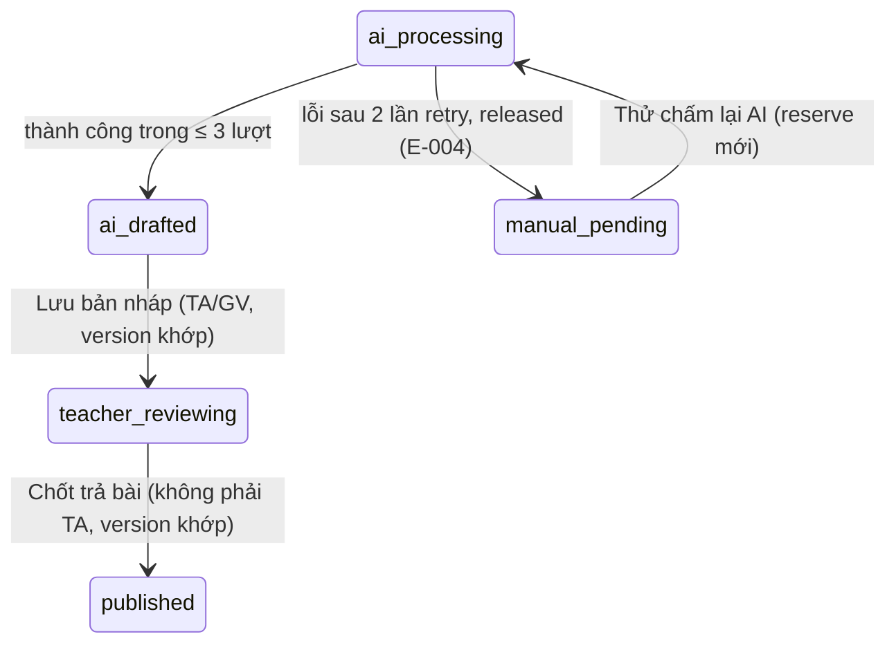

# Plan: TOS-33 — Phân quyền TA, hoàn Credit khi AI lỗi, chống lưu đè / gọi trùng

## Overview

AC-004 của US-006 (FR-selfomy-alignment-018/019/020/029, BR-selfomy-alignment-004; E-selfomy-alignment-004/011):

> - **Trợ giảng (TA)** mở bài thuộc lớp được phân công trên [7], sửa điểm/lời phê → bấm được **"Lưu bản nháp"** (`teacher_reviewing`) nhưng **"Chốt trả bài" bị khóa**.
> - Đã giữ 1 Credit (Writing) / 2 Credit (Speaking), AI lỗi sau **đủ 2 lần tự thử lại** → **hoàn 100%** Credit, bài **`manual_pending`**, hiển thị **E-selfomy-alignment-004** kèm nút **"Thử chấm lại AI"**.
> - TA lưu thành công (version 1 → 2), Giáo viên lưu trên màn cũ (version 1) hoặc bấm gọi chấm AI khi đang xử lý → **chặn**, cảnh báo **E-selfomy-alignment-011** yêu cầu tải lại.

Nguồn: Jira [TOS-33](https://teacher-os.atlassian.net/browse/TOS-33) (subtask của TOS-28 / US-006 · AC-004), spec lỗi E-004/E-011 (`docs/selfomy-alignment/srs/selfomy-alignment-spec.md:113,120`).

## Scope Challenge

- **Phụ thuộc TOS-30:** `ai_grading_draft.version`, `PATCH /:attemptId/draft`, publish qua `POST /:attemptId/grade`, nhánh release cơ bản trong `runAiGrading`.
- **Đã có:** vai trò `ta`, `class_teacher` trong `packages/auth/src/role.ts` (TOS-48), mẫu allowlist `canImportExam`/`canAccessFinance`, mẫu retry + E-004 bên nhập đề (TOS-27).
- **Chưa có mô hình phân công TA ↔ lớp** trong schema (`membership` chỉ có `role`). Plan áp dụng phạm vi **toàn tổ chức** cho TA ở ticket này và ghi nhận giới hạn (câu hỏi mở).
- **Mode:** fast + scout, HOLD SCOPE.

## Quyết định

| # | Quyết định | Lý do |
|---|---|---|
| D1 | **Allowlist `canPublishGrade(role)`** trong `packages/auth/src/role.ts`: `teacher`, `owner`, `admin`, `class_teacher` → được Chốt trả bài; `ta` và giá trị lạ → không. `canReviewGrade(role)` (Lưu bản nháp) = các vai trên + `ta`. `POST /api/grading/:attemptId/grade` trả 403 `GRADE_PUBLISH_FORBIDDEN` cho TA; UI disable nút + tooltip "Chỉ Giáo viên đứng lớp được chốt trả bài". | Least privilege, theo mẫu TOS-17/TOS-24; không tin UI. |
| D2 | **2 lần tự thử lại** trong `runAiGrading`: tối đa 3 lượt gọi grader (1 + 2 retry, backoff 1s/2s) nằm trong **một** lần reserve; tất cả lỗi → `releaseCredits` toàn bộ số đã giữ, draft `manual_pending`, `error_code = "E-selfomy-alignment-004"`. Ngân sách thời gian chung ≤ 30s (NFR-002) — hết ngân sách cũng tính là lỗi. | Một reserve / một release → sổ cái sạch, hoàn đúng 100%. |
| D3 | **"Thử chấm lại AI"** `POST /api/grading/:attemptId/ai-retry` (vai trò `canReviewGrade`, draft phải `manual_pending` với E-004): đặt lại draft `ai_processing`, `retry_count + 1`, chạy lại `runAiGrading` với khóa idempotency mới `ai_grading:<attemptId>:<retry_count>:*`. | Khóa cũ đã dùng cho lần trước; giữ lịch sử từng lượt trong sổ cái. |
| D4 | **Khóa lạc quan theo `version`:** `PATCH /draft` và `POST /grade` nhận `version`; `UPDATE … WHERE attempt_id = ? AND version = ?` → 0 dòng ⇒ 409 `{ code: "E-selfomy-alignment-011" }`. UI hiện thông điệp spec + nút "Tải lại bản mới nhất" (refetch, giữ nội dung đang gõ ở vùng tạm để không mất dữ liệu). | Đúng AC "chặn ghi đè", không mất dữ liệu. |
| D5 | **Chặn gọi trùng:** `ai-retry` khi draft đang `ai_processing` → 409 E-011; chuyển trạng thái bằng `UPDATE … WHERE status = 'manual_pending'` (nguyên tử). Nút "Thử chấm lại AI" disable khi đang xử lý. | Không trừ Credit 2 lần. |

## Non-goals

- Mô hình phân công TA ↔ lớp (chưa có trong schema — cần ticket riêng nếu muốn giới hạn TA theo lớp).
- Trần Credit cá nhân (TOS-49).
- Realtime đẩy thay đổi giữa 2 người dùng — chỉ phát hiện xung đột khi lưu.

## Phases

| # | Phase | Ước lượng | Trạng thái | Phụ thuộc |
|---|---|---|---|---|
| 1 | [phase-01-server-role-retry-version.md](phase-01-server-role-retry-version.md): `canPublishGrade`/`canReviewGrade`, 2 lần retry + release + E-004, `ai-retry`, khóa version E-011 | 1d | pending | TOS-30 |
| 2 | [phase-02-review-ui-states.md](phase-02-review-ui-states.md): khóa nút cho TA, panel E-004 + Thử chấm lại AI, hộp thoại E-011 + tải lại | 0.5d | pending | 1 |
| 3 | [phase-03-e2e-ac-004.md](phase-03-e2e-ac-004.md): 3 scenario | 0.5d | pending | 2 |

## Acceptance criteria (từ AC-004)

- [ ] TA mở [7]: sửa điểm + "Lưu bản nháp" thành công (`teacher_reviewing`), nút "Chốt trả bài" disabled; gọi thẳng API publish bằng TA → 403.
- [ ] Grader lỗi 3 lượt liên tiếp → sổ cái `reserved −1` + `released +1` (Speaking −2/+2), draft `manual_pending` + E-004; [7] hiện thông điệp E-004 + nút "Thử chấm lại AI"; bấm → chấm lại và settle bình thường.
- [ ] Grader lỗi lượt 1, thành công lượt 2 → chỉ `reserved` + `settled`, không release.
- [ ] TA lưu (version → 2), GV lưu với version 1 → 409 E-011, dữ liệu TA không bị ghi đè; UI hiện cảnh báo + tải lại.
- [ ] Bấm "Thử chấm lại AI" 2 lần liên tiếp / khi đang `ai_processing` → chỉ 1 lần reserve.

## Verify

- `pnpm --filter server test -- grading ai-grading role`, `pnpm --filter auth test`, `pnpm --filter web test -- grading`, `pnpm check && pnpm check-types`
- `pnpm --filter e2e e2e -- ai-grading-ac-004` (port override)

## Câu hỏi mở

- Giới hạn TA theo "lớp được phân công" cần mô hình phân công TA ↔ lớp chưa tồn tại; plan tạm cho TA rà soát mọi bài trong tổ chức. Xác nhận có chấp nhận tạm thời hay tạo ticket phân công trước.
- `admin` có được Chốt trả bài không? Spec chỉ nêu GV đứng lớp / GV độc lập / Chủ trung tâm — plan đang cho `admin` theo nhóm quyền quản trị; cần PO xác nhận.
