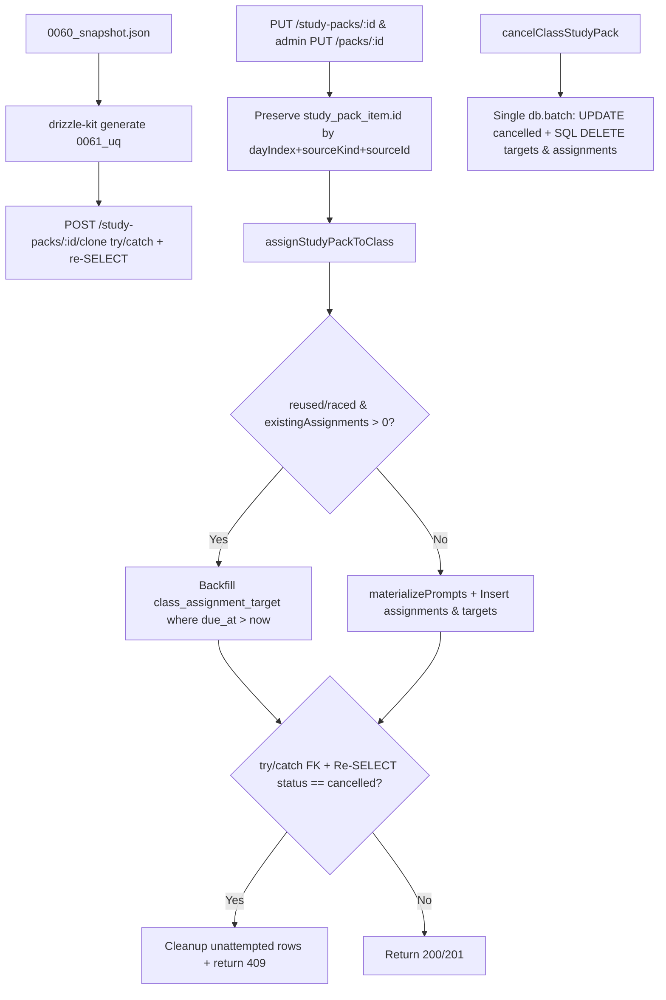

# fix(study-pack): follow-up từ review release #553 (#554)

## Overview

Giải quyết trọn vẹn 5 hạng mục follow-up từ review release PR #553 (`develop -> main`) được theo dõi tại issue #554:

1. **Chống nhân đôi bài giao khi sửa rồi gán lại bộ đề (`reused` & `raced`):** Giữ nguyên `study_pack_item.id` cho các bộ `(dayIndex, sourceKind, sourceId)` giữ lại khi cập nhật qua `PUT /api/study-packs/:id` và `PUT /api/admin/library/packs/:id`; đồng thời trong `assignStudyPackToClass` ở cả nhánh `reused` (từ `existingActive`) lẫn `raced` (`inserted.length === 0`), truy vấn `class_assignment` hiện hữu trước khi materialize — nếu đã có bài giao thì đóng băng tập `class_assignment` và chỉ backfill `class_assignment_target` cho các bài còn hạn (`due_at IS NULL OR due_at > now`) với `activeStudentIds` (vẫn chặn `404` ngay từ đầu nếu admin đã thu hồi system pack về `draft`).
2. **Bổ sung `packages/db/src/migrations/meta/0060_snapshot.json`:** Khôi phục chuỗi snapshot cho migration `0060_study_pack` (`prevId: "4d17ba7a-97d2-436c-917b-406277baccfa"`) trước khi sinh migration `0061` để `drizzle-kit generate` và `drizzle-kit check` sạch hoàn toàn.
3. **Chặn race giữa hủy và gán bộ đề (`cancelClassStudyPack` vs `assignStudyPackToClass`):** Gộp `cancelClassStudyPack` thành một `db.batch` nguyên tử gồm 3 câu lệnh (`UPDATE status = 'cancelled'` bảo toàn `cancelled_at` gốc bằng `COALESCE`, `DELETE class_assignment_target` và `DELETE class_assignment` theo điều kiện SQL `available_at > cutoff` + `NOT EXISTS quiz_attempt` với `cutoff = packRow.cancelledAt ?? now`), chạy tự phục hồi ngay cả khi pack đã ở trạng thái `cancelled`. Trong `assignStudyPackToClass`, bọc `executeBatchedStatements` bằng `try/catch` (bắt gọn lỗi `FOREIGN KEY` trên D1 khi bài cha bị xóa xen kẽ) và đọc lại trạng thái `class_study_pack` — nếu đã `cancelled` thì xóa sạch bài chưa có attempt (xóa toàn bộ kể cả Ngày 1 nếu lượt gán mới `createdFresh` bị hủy giữa chừng; xóa theo `available_at > cancelledAt` nếu là lượt `reused`), trả `{ ok: false, status: 409, error: "study pack was cancelled" }`, và hiển thị đúng thông báo trên `ClassStudyPackSection`.
4. **Khóa unique `(org_id, source_pack_id)` cho clone bộ đề thư viện:** Khai báo `uniqueIndex("study_pack_org_source_pack_uq").on(table.orgId, table.sourcePackId)` trong `packages/db/src/schema/study-pack.ts`, sinh migration `0061_*.sql` thuần DDL, và bọc `db.batch` trong `POST /api/study-packs/:id/clone` bằng `try/catch` đọc lại bản ghi thắng cuộc theo `(orgId, sourcePackId)` để trả `201` idempotent khi đua song song.
5. **Ghi chú rollback vào runbook:** Bổ sung mục `## Bộ đề tự học theo lịch (migrations 0060–0061) — issue #533/#554` vào `docs/production-release-runbook.md` nêu rõ cổng pre-flight kiểm tra & tách liên kết bản trùng `(org_id, source_pack_id)` trước khi auto-deploy `0061`, hệ quả khi revert Worker về trước `0060` (lộ sớm bài `available_at > now`, lọt `class_study_pack_id`/`library_ref` vào `loadSnapshot` & trần 200 bài, `/readyz` trả `503`), tính tương thích ngược của index `0061` với Worker `0060` (cấm `DROP INDEX` thủ công trên D1), và hướng xử lý ưu tiên forward-fix hoặc D1 Time Travel.

Kế hoạch được soạn theo hợp đồng bàn giao `--advice` (`advice-handover-plan.md`): mỗi phase phân rã thành các task độc lập có điều kiện `Verify` cơ học và khối `## Failure Protocol` bắt buộc dừng + tham vấn `kongming` khi kiểm chứng thất bại.

## Advisor Scope Lock (`--advice`)

- **Locked Scope:**
  - `packages/db/src/migrations/meta/0060_snapshot.json` khớp trạng thái schema `0060_study_pack.sql` (`prevId` trỏ về `0059_snapshot.json`).
  - `study_pack_org_source_pack_uq` trên `study_pack(org_id, source_pack_id)` + migration `0061_*.sql` thuần DDL + xử lý xung đột `try/catch` + re-`SELECT` trong `POST /api/study-packs/:id/clone`.
  - Bảo toàn `study_pack_item.id` theo `(dayIndex, sourceKind, sourceId)` trong `PUT /api/study-packs/:id` và `PUT /api/admin/library/packs/:id`; đóng băng tập `class_assignment` khi `reused`/`raced` đã có bài giao (chỉ backfill `class_assignment_target` cho bài `due_at IS NULL OR due_at > now`).
  - `cancelClassStudyPack` nguyên tử 1 `db.batch` theo `packRow.cancelledAt ?? now`; `assignStudyPackToClass` bắt lỗi FK + hậu kiểm `status === "cancelled"` (dọn toàn bộ bài chưa làm nếu `createdFresh`, trả `409`) + phân nhánh thông báo `409` trên `ClassStudyPackSection`.
  - Mục runbook rollback & pre-deploy check trong `docs/production-release-runbook.md` + bộ test TDD bật `PRAGMA foreign_keys = ON`.
- **Explicit Non-Goals:**
  - Không chặn `409` trên `PUT /api/study-packs/:id` hay `PUT /api/admin/library/packs/:id` khi bộ đề đang active trên lớp.
  - Không tự động đồng bộ ngược thay đổi của `study_pack` sang các `class_study_pack` đã gán trước đó.
  - Không đổi định dạng khóa chính `ca_pk_${classPackId}_${itemId}` của `class_assignment` và không sửa fallback `position = 0` trong `loadClassStudyPacks` cho item đã bị xóa khỏi pack.
  - Không tự động xóa dữ liệu trùng `(org_id, source_pack_id)` bên trong file SQL migration `0061` (dùng cổng pre-flight trong runbook).

## Goals

| # | Goal | Priority |
|---|------|----------|
| 1 | Phục hồi chuỗi snapshot `0060_snapshot.json` và bổ sung migration `0061` cho unique index `study_pack_org_source_pack_uq` đồng bộ `/readyz` | P1 |
| 2 | Đảm bảo clone bộ đề song song (`POST /api/study-packs/:id/clone`) an toàn tuyệt đối, không sinh bản ghi nhân đôi | P1 |
| 3 | Chặn nhân đôi `class_assignment` & `class_assignment_target` khi sửa bộ đề (org hoặc admin) rồi gán lại cùng lịch (`reused` / `raced`) | P1 |
| 4 | Triệt tiêu race giữa `cancelClassStudyPack` và `assignStudyPackToClass` ở cả hai chiều xen kẽ dưới `PRAGMA foreign_keys = ON` | P1 |
| 5 | Tài liệu hóa quy trình kiểm tra trước deploy và lưu ý rollback `0060`/`0061` trong `docs/production-release-runbook.md` | P2 |

## Architecture / Flow

## Phases

| # | Phase | Status | Effort | Dependencies |
|---|-------|--------|--------|--------------|
| 1 | [Phase 1: Snapshot 0060, unique index clone 0061 & idempotent clone route](./phase-01-snapshot-and-clone-unique.md) | Pending | 1.5h | — |
| 2 | [Phase 2: Bảo toàn item ID khi sửa, đóng băng nhánh reused & chặn race hủy/gán](./phase-02-reuse-and-cancel-race.md) | Pending | 1.5h | Phase 1 |
| 3 | [Phase 3: Ghi chú rollback trong runbook & cổng kiểm chứng toàn diện](./phase-03-runbook-and-gates.md) | Pending | 1.0h | Phase 1, 2 |

## Success Criteria

- [ ] `packages/db/src/migrations/meta/0060_snapshot.json` tồn tại với `prevId: "4d17ba7a-97d2-436c-917b-406277baccfa"`, và `pnpm --filter @teacher-os/db exec drizzle-kit check` thoát `0` (`Everything's fine`).
- [ ] Migration `0061_*.sql` chỉ chứa đúng câu lệnh `CREATE UNIQUE INDEX \`study_pack_org_source_pack_uq\` ON \`study_pack\` (\`org_id\`,\`source_pack_id\`);`, `/readyz` trả `200 {"ok":true}` sau khi chạy hết chuỗi migration, và hai request `POST /api/study-packs/:id/clone` song song trả cùng `pack.id` với đúng 1 dòng clone trong DB.
- [ ] Sửa bộ đề qua `PUT /api/study-packs/:id` hoặc `PUT /api/admin/library/packs/:id` bảo toàn `study_pack_item.id` cho các mục giữ nguyên `(dayIndex, sourceKind, sourceId)`, và gọi lại `assignStudyPackToClass` cùng `(startDate, releaseTime, dueTime)` (`reused: true`) không tạo thêm dòng `class_assignment` mới mà chỉ backfill `class_assignment_target` còn hạn (`due_at > now`) cho học viên active.
- [ ] `cancelClassStudyPack` chạy nguyên tử trong 1 `db.batch` theo `packRow.cancelledAt ?? now` và `assignStudyPackToClass` bắt lỗi FK + hậu kiểm `status === "cancelled"` dưới `PRAGMA foreign_keys = ON` để dọn sạch bài chưa làm (kể cả Ngày 1 nếu lượt gán mới bị hủy giữa chừng), trả `409`, và hiển thị đúng thông báo trên `ClassStudyPackSection`.
- [ ] `docs/production-release-runbook.md` có mục hướng dẫn pre-flight & rollback chính xác cho migration `0060`–`0061`; toàn bộ `pnpm exec biome check .`, `pnpm check-types`, và `pnpm test` đều pass (exit `0`).

## Red Team Review

### Session — 2026-11-04
**Findings:** 6 deduplicated (6 accepted, 0 rejected) across 3 parallel hostile reviewers (`RedTeamSecurity`, `RedTeamAssumption`, `RedTeamFailure`)
**Severity breakdown:** 4 Critical, 1 High, 1 Medium

| # | Finding | Severity | Disposition | Applied To |
|---|---------|----------|-------------|------------|
| RT-1 | Race hủy/gán trên D1 (`PRAGMA foreign_keys = ON`) nổ `500 FOREIGN KEY constraint failed` khi chèn `class_assignment_target` sau khi bài cha bị xóa, bị ẩn trong Vitest do `libsql` mặc định tắt FK (`packages/db/src/schema/class-assignment.ts:62-64`, `apps/server/src/lib/study-pack-assign.ts:106-115,346-353`) | Critical | Accept | Phase 1, Phase 2 |
| RT-2 | Hậu kiểm hủy của lượt gán mới (`!reused`) chỉ xóa `available_at > cancelledAt` làm rò rỉ bài Ngày 1 (`available_at <= cancelledAt`) dù trả `409`, và `cancelClassStudyPack` gọi lại dùng `now` thay vì `packRow.cancelledAt ?? now` (`apps/server/src/routes/study-pack.test.ts:415-433`, `apps/server/src/lib/assignment-visibility.ts:9-16`) | Critical | Accept | Phase 2 |
| RT-3 | `applyMigrationsUpTo` gọi lần 2 chạy lại từ `0000` gây lỗi `table account already exists`, tên `describe` lệch ở `study-pack.test.ts:77`, dòng `admin-library.ts:1122`, và `drizzle-kit` config `/tmp` sinh rác ở `packages/db/fresh` hoặc lỗi `ENOENT` (`apps/server/src/study-pack-migration.test.ts:34-42`, `packages/db/node_modules/drizzle-kit/bin.cjs:8122,8163`) | Critical | Accept | Phase 1, Phase 2 |
| RT-4 | Runbook Phase 3 chẩn đoán sai `PROBE_QUERY` của `apps/server/src/routes/readiness.ts:76-85` và xúi `DROP INDEX study_pack_org_source_pack_uq` làm gãy deploy kế tiếp, thiếu cách tách liên kết `UPDATE ... SET source_pack_id = NULL` khi vướng `ON DELETE restrict`, và `biome check docs/...md` lỗi dưới `ignoreUnknown: false` (`biome.json:7-8`, `package.json:21-22`) | Critical | Accept | Phase 3, `plan.md` |
| RT-5 | Nhánh `raced` (`inserted.length === 0`) bỏ qua đóng băng `existingAssignments`, nhánh `reused` thiếu lọc `due_at > now` cho học viên vào muộn, và thứ tự kiểm tra `pack.status !== "ready"` chưa tách rõ system pack `draft` (`404`) với org pack (`apps/server/src/lib/study-pack-assign.ts:157-166,262-286,505-511`) | High | Accept | Phase 2, `plan.md` |
| RT-6 | `ClassStudyPackSection` gộp mọi HTTP `409` thành `"Bộ đề này đang chạy trên lớp với lịch khác."` thay vì phân biệt `"study pack was cancelled"` và làm mới danh sách (`apps/web/src/components/classes/class-study-pack-section.tsx:191-198`) | Medium | Accept | Phase 2, `plan.md` |

### Whole-Plan Consistency Sweep
- Files reread: `plan.md`, `phase-01-snapshot-and-clone-unique.md`, `phase-02-reuse-and-cancel-race.md`, `phase-03-runbook-and-gates.md`
- Decision deltas checked: 6 (RT-1 .. RT-6)
- Reconciled stale references: 9 (`applyMigrationsAfter`, `.tmp-snap-0060`, `study-pack.test.ts:77` describe title, `admin-library.ts:1122`, `PRAGMA foreign_keys = ON`, `createdFresh ? null : (latestPack?.cancelledAt ?? now)`, `due_at > now` target backfill, `ClassStudyPackSection` `409`, `readiness.ts` additive index & `pnpm check:fix` / `pnpm test:topology-drift`)
- Unresolved contradictions: 0

## Validation Log

### Session 1 — 2026-11-04
- **Mode:** Autonomous (`ak-vibe --ship --beta --advice` trên issue #554)
- **Questions required:** 0 (mọi điểm phân nhánh kỹ thuật đã có hợp đồng rõ từ mã nguồn hiện hữu, review PR #553, tham vấn Kongming và Red-Team)

### Verification Results
- **Tier:** Standard (3 phases — Fact Checker + Contract Verifier)
- **Claims checked:** 24 across all 3 phases (sau khi áp dụng RT-1 .. RT-6)
- **Verified:** 24 | **Failed:** 0 | **Unverified:** 0
- **Key verified anchors:**
  - `packages/db/src/migrations/meta/0059_snapshot.json:4` (`id: "4d17ba7a-97d2-436c-917b-406277baccfa"`), `packages/db/src/migrations/meta/_journal.json:425-431` (`0060_study_pack`).
  - `packages/db/src/schema/study-pack.ts:49-142` (`studyPack`, `studyPackItem`, `classStudyPack`, `onDelete: "restrict"`).
  - `apps/server/src/routes/study-pack.ts:162-209,247-337,358-412`, `apps/server/src/routes/admin-library.ts:1105-1143`.
  - `apps/server/src/lib/study-pack-assign.ts:139-360,371-538`, `apps/server/src/lib/study-pack-clone.ts:893-919`.
  - `apps/server/src/routes/readiness.ts:23-85,103-109`, `apps/web/src/components/classes/class-study-pack-section.tsx:180-201`, `docs/production-release-runbook.md:927-933`.

### Whole-Plan Consistency Sweep
- Files reread: `plan.md`, `phase-01-snapshot-and-clone-unique.md`, `phase-02-reuse-and-cancel-race.md`, `phase-03-runbook-and-gates.md`
- Decision deltas checked: 6
- Reconciled stale references: 0 remaining
- Unresolved contradictions: 0

<!-- slug: 554-study-pack-followup -->
