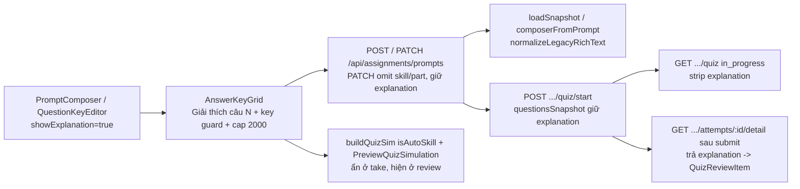

# Plan: #571 — Bật ô giải thích đáp án trong composer giáo viên và bảo toàn round-trip tới học viên

## Outcome

Giáo viên soạn hoặc chỉnh sửa đề chấm tự động (`reading`, `listening`, `grammar`, `vocabulary`) tại `/assignments/new` hoặc Full-Test Builder (`/assignments/tests/new`, `/assignments/tests/$id`) đều có ô rich text `Giải thích câu {n}` ngay trong lưới đáp án; gõ phím trực tiếp trong ô giải thích không bị bắt nhầm phím tắt đáp án; giải thích được giữ nguyên qua lưu nháp, xem trước/mô phỏng, chỉnh sửa lại từ ngân hàng (`Cập nhật đề`), lưu lên server, ẩn trong suốt lúc học viên đang làm bài (`in_progress`) và hiển thị đúng ở mục "Giải thích" sau khi học viên nộp bài.

## Non-goals

- Không xử lý trạng thái rỗng của nút "Xem giải thích chi tiết" phía học viên khi bài không có `explanation` và không có `note` — đó là phạm vi riêng của issue #579.
- Không thêm ô giải thích từng câu cho `writing` và `speaking` (`isAutoSkill === false`, đề tự luận không có lưới câu hỏi chấm tự động).
- Không sửa schema/contract hay route server (`packages/api/src/contracts.ts`, `apps/server/src/routes/*`); riêng `answerSet` của thư viện admin (`#420`) hiện chưa forward qua `snapshot.ts`/`student.ts` nên nằm ngoài phạm vi `#571` (`composerFromPrompt` chỉ giữ lại phòng thủ nếu có trên object).
- Không mở rộng sang thay đổi RBAC của `assignmentRoutes` hay thêm cờ bật/tắt (`feature flag`) quanh `showExplanation`.

## Nguyên nhân gốc & Dấu vết đầu-cuối (đã xác minh qua `/ak-debug`, `kongming` & Red-Team)

1. **Thiếu prop ở composer giáo viên (`apps/web`):**
   - `AnswerKeyGrid` (`packages/ui/src/components/assignments/editor/answer-key-grid.tsx:142,290-302,670-680`) đã có ô rich text `Giải thích câu {number}` sau prop `showExplanation` (mặc định `false`), tự xóa key `explanation` khi plain text rỗng. `QuestionKeyEditor` (`question-key-editor.tsx:50,297`) đã nối prop này xuống grid.
   - `PromptComposer` (`apps/web/src/components/assignments/prompt-composer.tsx:246-263`) render `QuestionKeyEditor` nhưng không truyền `showExplanation`.
2. **Các lỗi tương tác bàn phím, PATCH payload & rơi dữ liệu phát hiện khi truy vết + Red-Team:**
   - **Bắt nhầm phím tắt đáp án khi gõ trong `RichTextEditor` giải thích (`RT-1`):** Trong `AnswerKeyGrid.handleKeyDown` (`answer-key-grid.tsx:331-351`), biến `editingRichText` chỉ chắn `Enter` và `Backspace` nhưng bị thiếu ở dòng `:351` (`if (typing || event.metaKey || ...)`), khiến gõ chữ `t/f/n` (TFNG), `a–h` (MCQ/letter) hay `1–8` (roman) trong ô giải thích bị `preventDefault()` và ghi đè đáp án câu hỏi; đồng thời nhấn `Enter` ở `<input>` chèn link trong `Popover.Portal` của `RichTextEditor` (`rich-text-editor.tsx:371-376`) bubble lên `fieldset` làm thêm câu mới.
   - **Nút `"Cập nhật đề"` trong Full-Test Builder lỗi 400 + `composerFromPrompt` làm rơi `explanation` (`RT-2`):** `handleComposerSave` (`test-builder-shell.tsx:394-401,846-870`) gửi cả `skill` và `part` vào `PATCH /api/assignments/prompts/:id`, bị `assignmentPromptUpdateSchema` (`.omit({ skill: true, part: true }).partial().strict()`) trả 400. Đồng thời `composerFromPrompt` (`assignment-tests.ts:114-124`) bỏ rơi `explanation`. Hàng ngân hàng từ AI Exam Import (`publish-to-bank.ts:340`) lưu plain text có `\n`, nên `composerFromPrompt` và các cửa nạp draft (`new.tsx`, `test-builder-shell.tsx`) phải qua `normalizeLegacyRichText` (có xác nhận `DOMParser` như `RichTextBody` để không cắt nhầm biểu thức `a<b` và `c>d`, `RT-7`) khi `!isEmptyRichText`, không sinh key rỗng.
   - **Tab mô phỏng "Làm thử & Soi bài" bỏ sót `explanation` và chặn `grammar`/`vocabulary` (`RT-5`, `RT-7`):** `buildQuizSim` (`assignment-quiz-sim.ts:63,106-119`) đang chặn `grammar`/`vocabulary` thay vì dùng `isAutoSkill(skillId)` và làm rơi `item.explanation` trên `fullQuestions`; `PreviewQuizSimulation` (`preview-quiz-simulation.tsx:56-67`) chưa truyền `explanation` vào `QuizReviewInfo`; `quizReviewExplanation` (`quiz-review-item.tsx:30-35`) cần dùng `!isEmptyRichText` để `"

"` fallback đúng về `note`.
   - **Thiếu kiểm tra & hiển thị lỗi trần 2000 ký tự ở client (`RT-3`):** Contract `contracts.ts:731` dùng `richTextField(2000)` (raw ≤ 5000, plain ≤ 2000). Cần thêm kiểm tra vào `questionRowError`, thêm `"explanation"` vào tuple `errorEntries` (`answer-key-grid.tsx:400`) để DOM thực sự hiển thị `role="alert"` (và `forceOpen` mở hàng thu gọn), đồng thời chặn lưu ở `clozeRowIssue` (`composer-transitions.ts:222-236`).
   - **Bảo vệ hàng trống, Cloze Apply & autosave draft (`RT-5`, `RT-7`, `RT-11`):** `rowIsEmpty` (`answer-key-grid.tsx:124-127`), `hasItemContent` (`cloze-editor.tsx:37-40`), `hasAuthoringContent` (`composer-transitions.ts:58-65`), `assignment-draft-store.ts` và `assignment-test-draft-store.ts` cần tính cả `explanation` (kiểm kiểu chặt `=== undefined || typeof === "string"`, từ chối `null`).

## Architecture / Data Flow

## Phases

| # | Phase | Status |
|---|---|---|
| 1 | [Phase 1: Shared Grid Guards, Web Composer & State Round-Trip (TDD)](./phase-01-start.md) | Completed |
| 2 | [Phase 2: Server/Student Integration Proof, E2E & UI Verification](./phase-02-e2e-and-ui-verification.md) | Completed |

## Success Criteria

- [x] `PromptComposer` truyền `showExplanation` cho `QuestionKeyEditor`; cả 4 kỹ năng chấm tự động (`reading`, `listening`, `grammar`, `vocabulary`) render `Giải thích câu {n}`, còn `writing`/`speaking` không bị ảnh hưởng.
- [x] Gõ phím trực tiếp (`t/f/n`, `a–h`, `1–8`, `Backspace`, `Enter`, kể cả `Enter` trong Link Popover) trong `Giải thích câu {n}` không ghi đè đáp án hay tự thêm/xóa câu hỏi.
- [x] `composerFromPrompt` giữ nguyên `explanation` (qua `normalizeLegacyRichText` có kiểm chứng `DOMParser`) khi `!isEmptyRichText`, không sinh key thừa khi vắng mặt; bấm `"Cập nhật đề"` trong Full-Test Builder gửi `PATCH /api/assignments/prompts/:id` không kèm `skill`/`part` và giữ nguyên giải thích.
- [x] Draft store (`/assignments/new` và `/assignments/tests/new`), `hasAuthoringContent`, `rowIsEmpty`, `ClozeEditor.hasItemContent`, và `PreviewQuizSimulation` (`buildQuizSim` với `isAutoSkill` + review mode) xử lý đầy đủ `explanation` mà không lộ giải thích ở trạng thái đang làm bài.
- [x] Giải thích vượt trần `richTextField(2000)` (plain > 2000 hoặc raw > 5000) render rõ cảnh báo `role="alert"` tại hàng câu trong `AnswerKeyGrid` và chặn nút lưu trước khi gọi API.
- [x] Integration test server (`GET /api/student/attempts/:attemptId/detail`) + E2E Playwright (tách context cookie giáo viên/học viên, gõ `pressSequentially`) xác nhận trọn vòng đời tạo → xem trước → sửa ở Full-Test Builder → giao lớp → học viên làm bài (không lộ khi `in_progress`) → nộp bài → soi bài thấy đúng giải thích.
- [x] Gate chất lượng xanh: `pnpm exec biome check .`, `pnpm check-types`, `pnpm test`, E2E liên quan, kiểm 3 viewport (1440×900, 768×1024, 375×812) + 320×812 + 2 theme theo `REVIEW.md` (`design:compare` ghi nhận giới hạn RAM/swap máy chia sẻ + `/assignments/new` không thuộc `screens.json`).
## Validation Log

### Session 1 — 2026-11-04
- **Tier:** Light (2 phases — Fact Checker + Contract Verifier spot-check)
- **Claims checked:** 25
- **Verified:** 25 (sau khi cập nhật 10 điểm phát hiện từ Fact Check / Red-Team vào `plan.md`, `phase-01-start.md`, `phase-02-e2e-and-ui-verification.md`) | **Failed:** 0 | **Unverified:** 0
- **Key Decisions Confirmed:**
  1. Giữ nguyên phạm vi `#571` cho giáo viên soạn/sửa/preview + học viên nhận `explanation`; để `#579` xử lý riêng empty-state phía học viên và không mở rộng sang RBAC server.
  2. Chữa dứt điểm 2 lỗi chặn luồng thực tế được phát hiện trong source: `AnswerKeyGrid.handleKeyDown` bắt nhầm phím khi gõ trong `RichTextEditor` và `TestBuilderShell` gửi thừa `skill`/`part` khi `PATCH /api/assignments/prompts/:id`.

### Whole-Plan Consistency Sweep (Validation)
- Files reread: `plan.md`, `phase-01-start.md`, `phase-02-e2e-and-ui-verification.md`
- Decision deltas checked: 10
- Reconciled stale references: 7 (`GET .../attempts/:id` → `GET .../attempts/:id/detail`; bỏ cam kết `answerSet` DB round-trip; `[Unreleased]` → `## 2026-11-04`; thêm `errorEntries` `"explanation"`; mở `buildQuizSim` cho `isAutoSkill`; đồng bộ danh sách `Files to Create / Modify`; tách browser context E2E)
- Unresolved contradictions: 0

## Red Team Review

### Session — 2026-11-04
**Findings:** 11 deduplicated (4 Critical, 4 High, 3 Medium — 10 accepted, 1 rejected)
**Severity breakdown:** 4 Critical, 4 High, 3 Medium

| # | Finding | Severity | Disposition | Applied To |
|---|---|---|---|---|
| RT-1 | `AnswerKeyGrid.handleKeyDown` thiếu `editingRichText` ở cổng phím tắt đáp án + `Enter` từ Link Popover portal tự thêm câu | Critical | Accept | Phase 1 Task 1.1/1.2, Phase 2 Task 2.2 |
| RT-2 | `TestBuilderShell` `"Cập nhật đề"` gửi thừa `skill`/`part` vào `assignmentPromptUpdateSchema` `.strict()` gây HTTP 400 | Critical | Accept | Phase 1 Task 1.3/1.4, Phase 2 Task 2.2 |
| RT-3 | `AnswerKeyGrid` whitelist cứng `errorEntries` không có `"explanation"`, làm lỗi vượt trần 2000 ký tự không render ra DOM | Critical | Accept | Phase 1 Task 1.1/1.2 |
| RT-4 | Task 2.1 gọi nhầm `GET /attempts/:attemptId` thay vì `/attempts/:attemptId/detail` và thiếu fixture teacher/membership/enrollment `org-1` | Critical | Accept | `plan.md`, Phase 2 Task 2.1 |
| RT-5 | `buildQuizSim` chặn `grammar`/`vocabulary` và `ClozeEditor.hasItemContent` bỏ qua `explanation` khi ghi đè | High | Accept | Phase 1 Task 1.1/1.2/1.3/1.4 |
| RT-6 | `snapshot.ts` strip `answerSet` nên không thể cam kết DB round-trip `answerSet` khi giữ Non-goal không sửa route server | High | Accept | `plan.md` Non-goals & Success Criteria, Phase 1 Task 1.3/1.4 |
| RT-7 | `item.explanation == null` lọt `null` qua draft validator, `

` che mất `note`, và `looksLikeHtml` thiếu `DOMParser` check | High | Accept | Phase 1 Task 1.1/1.2/1.3/1.4 |
| RT-8 | RBAC vai trò `ta` và re-validate full `ready` trên `PATCH /api/assignments/prompts/:id` | High | Reject (out-of-scope pre-existing server RBAC/contract; ghi vào Human Next Steps) | `plan.md` Non-goals |
| RT-9 | Đụng độ cookie `localhost` giữa giáo viên/học viên và luồng sign-up/verify học viên trong E2E Task 2.2 | Medium | Accept | Phase 2 Task 2.2 |
| RT-10 | `CHANGELOG.md` dùng heading ngày `## YYYY-MM-DD` (không có `[Unreleased]`) và `design:compare` chạm ảnh tracked | Medium | Accept | Phase 2 Task 2.3/2.4 |
| RT-11 | Đồng bộ danh sách `Files to Create / Modify` (`rich-text-legacy.ts`, `test-builder-shell.test.tsx`, UI files) + chuẩn hóa sớm `bannerDraft.slotDrafts` | Medium | Accept | Phase 1 Files & Task 1.3/1.4 |

### Whole-Plan Consistency Sweep (Red-Team)
- Files reread: `plan.md`, `phase-01-start.md`, `phase-02-e2e-and-ui-verification.md`
- Decision deltas checked: 10 accepted findings
- Reconciled stale references: 7
- Unresolved contradictions: 0

## Handoff Note (`--advice`)

Plan này được biên soạn theo hợp đồng bàn giao `--advice` (`advice-handover-plan.md`) sẵn sàng cho executor cấp dưới thực thi tuần tự từng task kèm điều kiện `Verify` cơ học và khối `Failure Protocol` bắt buộc dừng + tham vấn `kongming` ngay khi bước kiểm chứng lệch kỳ vọng.

<!-- slug: 571-assignment-answer-explanation -->
