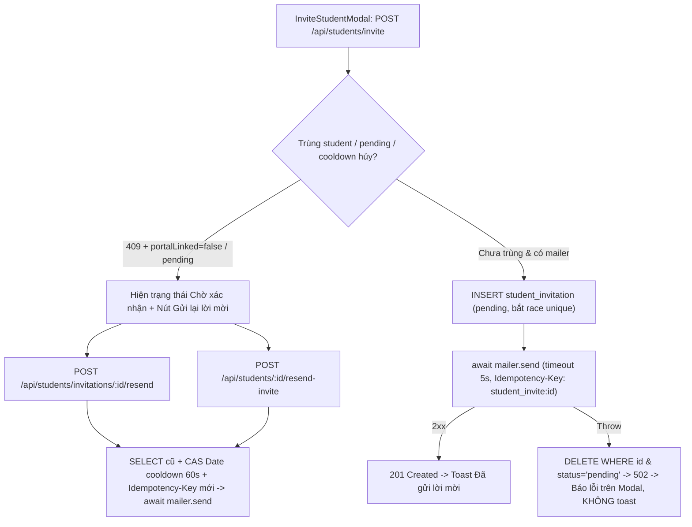

# Plan: #570 — Gửi thư mời học viên thật và hỗ trợ gửi lại lời mời

> **Handover Notice (`--advice` + `--tdd`):** Plan này được biên soạn theo hợp đồng bàn giao cho executor cấp thấp hơn (`advice-handover-plan.md`). Mỗi phase đều tự chứa danh sách task tuần tự kèm điều kiện `Verify` cơ học (so khớp mã thoát / chuỗi đầu ra) và khối `## Failure Protocol` bắt buộc dừng + gọi `kongming` ngay khi bước `Verify` lệch kỳ vọng.

## Overview

Khắc phục triệt để lỗi #570 trên cả hai luồng giáo viên thêm/mời học viên bằng email (**Mời học viên** ở `/students` và **Thêm học viên / Ghi danh lớp** ở `/students`, `/classes/$classId`):
1. **Sửa lỗi định dạng `From` của Resend (`composeFrom`) và giới hạn thời gian chờ đồng bộ:** Chuẩn hóa `composeFrom` trong `packages/auth/src/mail/mailer.ts` tách địa chỉ trần từ `MAIL_FROM="TeacherOS <no-reply@teacheros.io.vn>"` trước khi ghép `fromName` (sửa lỗi `<<...>>` khiến Resend trả `422` trên staging/prod), lọc ký tự điều khiển `\r\n\0`, truyền header `Idempotency-Key`, và giới hạn `timeoutMs` / `Retry-After` để lời gọi đồng bộ luôn hoàn tất trước ngưỡng 15 giây của web bus.
2. **Gửi email thật khi tạo lời mời (`POST /api/students/invite` & `POST /api/students`):** `POST /api/students/invite` gửi email đồng bộ qua `mailer.send`; nếu thiếu mailer (`503`) hoặc gửi lỗi (`502`) thì xóa bù trừ dòng `student_invitation` (trừ khi học viên đã kịp bấm chấp nhận giữa chừng) để modal **không bao giờ** toast `"Đã gửi lời mời"` giả. Ở `POST /api/students` khi có `email !== ""`, gửi email lời mời đồng bộ best-effort, chỉ đóng dấu `lastInviteEmailAt` khi gửi thành công và trả `inviteEmailSent: boolean` trung thực.
3. **Hành động `"Gửi lại lời mời"` có khóa idempotency mới + cooldown nguyên tử 60 giây:** Mở hai route `POST /api/students/invitations/:id/resend` và `POST /api/students/:id/resend-invite` với CAS cooldown trên Drizzle `Date` (`inviteResendCooldownMs`, mặc định `60_000` ms, E2E truyền `0`), hoàn tác mốc thời gian nếu gửi lỗi, chống lách luật hủy-mời-lại trong 60 giây, chặn role `ta` chỉ-đọc, và cập nhật tại chỗ dòng `notification_record` `class_enrolled:<enrollmentId>` (không nhân bản thẻ trùng trong hộp thư học viên) khi gửi lại bằng Resend `Idempotency-Key` mới.
4. **Trạng thái `"Chờ xác nhận"` + nút `"Gửi lại lời mời"` trên giao diện:** Bổ sung `portalLinked?: boolean` (`student.onboardingCompletedAt != null`, an toàn deploy skew khi `undefined`) trên `KernelStudentRow` và body `409` để khi email đã có hồ sơ nhưng `portalLinked === false` (hoặc lời mời đang chờ), các modal và trang danh sách/chi tiết hiện `"Chờ xác nhận"` kèm nút `"Gửi lại lời mời"` thay vì báo lỗi cụt đường.

## Nguyên nhân gốc đã xác minh (`/ak-debug` + Red Team)

1. **`POST /api/students/invite` không gọi mailer (`apps/server/src/routes/kernel.ts:460-531`)**: Route chỉ `INSERT` vào `student_invitation` rồi trả `201`, trong khi `InviteStudentModal` (`apps/web/src/components/modals/invite-student-modal.tsx:40-41`) luôn toast `"Đã gửi lời mời tới ..."`. Truy vấn trùng `student` tại `kernel.ts:470-478` cũng thiếu điều kiện loại trừ `demo-student:%`.
2. **`composeFrom` sinh header `From` lồng ngoặc nhọn không hợp lệ với `MAIL_FROM` của staging/prod (`packages/auth/src/mail/mailer.ts:12-16`)**: Trên staging (`MAIL_FROM="TeacherOS <no-reply@teacheros.io.vn>"`) và mặc định infra (`packages/infra/alchemy.run.ts:220`: `"TeacherOS <onboarding@resend.dev>"`), `MAIL_FROM` đã có dạng `Display <addr>`. Khi đường thông báo lớp `POST /api/students` (`deliver.ts:175`) truyền `fromName: "<orgName> qua Teacher OS"`, `composeFrom` tạo chuỗi `"<orgName> qua Teacher OS" <TeacherOS <no-reply@teacheros.io.vn>>` (hai lớp `<...>`) bị Resend từ chối `422` ở cả 3 lượt thử (trong khi email xác thực tài khoản Better-Auth không truyền `fromName` nên vẫn gửi được!). Trước `2026-11-04T04:07:17Z`, staging còn chạy mặc định `MAILER_IMPL=log` nên cũng không gửi thư thật.
3. **`POST /api/students` bỏ qua gửi thư khi `activateNow === true` và khóa cứng lần thêm lại (`apps/server/src/routes/kernel.ts:355, 425-457`)**: Cả `AddStudentModal` lẫn tab `"Tạo học viên mới"` của `EnrollStudentModal` mặc định `activateNow = true` nên không gửi email nào; lần nhập lại email đó trả `409 STUDENT_ALREADY_IN_ORG`, còn sự kiện `class_enrolled:<enrollmentId>` giữ khóa tĩnh nên không gửi lại được.

## Non-goals (Advisor Scope Lock)

- **Không sửa schema `notification_record.student_id` hay tạo dòng `notification_record` trùng lặp khi gửi lại**: Giữ nguyên bất biến 1 dòng / 1 lời mời lớp của TOS-21/TOS-23; khi gửi lại lời mời lớp `invited`, tái sử dụng dòng `notification_record` `class_enrolled:<enrollmentId>` (chỉ khởi tạo qua `enqueueNotifications` nếu chưa có) và truyền khóa mới `class_enrolled:<enrollmentId>:resend:<uuid>` ở tầng header `Idempotency-Key` của Resend.
- **Không làm hỏng việc tạo học viên thủ công (`POST /api/students`) khi mailer lỗi**: Tạo hồ sơ `student` vẫn trả `201` kèm `inviteEmailSent: false` (trong giới hạn timeout 5s để không chạm ngưỡng 15s `outcome-unknown` của `postKernelCommand`), không đóng dấu `lastInviteEmailAt` khi gửi thất bại để nút `"Gửi lại lời mời"` dùng được ngay.
- **Không phụ thuộc `user.email_verified` để tính `portalLinked`**: Dùng duy nhất `student.onboardingCompletedAt != null` khớp với gate `StudentPageGate` (`apps/student/src/components/layout/student-page-gate.tsx:42`), đồng thời giữ `portalLinked?: boolean` an toàn khi deploy skew (`undefined` trên snapshot cũ không bị coi là `false`).

## Goals

| # | Goal | Priority |
|---|------|----------|
| 1 | Sửa `composeFrom` + `Idempotency-Key` + giới hạn timeout/retry trong `mailer.ts`, thêm migration `student.last_invite_email_at`, mở rộng contracts và bộ dựng email lời mời dùng chung | P1 |
| 2 | Sửa eager getter spread ở `app.ts`, gửi email đồng bộ ở `POST /api/students/invite` + `POST /api/students`, trả `portalLinked` và mở 2 endpoint gửi lại có CAS cooldown 60s + chặn `ta` + khóa idempotency mới | P1 |
| 3 | Cập nhật UI giáo viên (`InviteStudentModal`, `AddStudentModal`, `EnrollStudentModal`, `PendingInvitationsList`, `/students`, `/students/$studentId`, `ClassRosterTab`) + test đơn vị (`jsdom`), E2E và kiểm chứng 3 viewport sáng/tối | P1 |

## Architecture / Flow

## Phases

| # | Phase | Status |
|---|-------|--------|
| 1 | [Phase 1: Contracts, migration và mailer/template lời mời dùng chung](./phase-01-start.md) | Pending |
| 2 | [Phase 2: Route gửi/gửi lại lời mời đồng bộ, cooldown và cờ portalLinked](./phase-02-server-invite-and-resend-routes.md) | Pending |
| 3 | [Phase 3: Trạng thái Chờ xác nhận + Gửi lại lời mời trên Web UI và E2E](./phase-03-web-invite-resend-ui-and-e2e.md) | Pending |

## Success Criteria

- [ ] `composeFrom` xử lý đúng cả địa chỉ trần lẫn `"TeacherOS <no-reply@teacheros.io.vn>"`, lọc `\r\n\0` và escape `\` trước `"`; `createResendMailer` gửi header `Idempotency-Key`, hỗ trợ `timeoutMs` và giới hạn `Retry-After` tối đa 2 giây.
- [ ] `POST /api/students/invite` gọi thật `mailer.send` đồng bộ; khi thiếu mailer (`503`) hoặc gửi lỗi (`502`) thì không để lại dòng `pending` ma và UI không toast `"Đã gửi lời mời"`; chặn lách cooldown 60s qua vòng lặp hủy-mời-lại và chặn role `ta` (`403`).
- [ ] `POST /api/students/invitations/:id/resend` và `POST /api/students/:id/resend-invite` gửi email đồng bộ với `Idempotency-Key` mới mỗi lượt, CAS cooldown 60s bằng Drizzle `Date` tương thích D1 (`429 INVITATION_RESEND_COOLDOWN` + `Retry-After`), hoàn tác mốc thời gian nếu gửi lỗi, và cập nhật tại chỗ dòng `notification_record` `class_enrolled:<enrollmentId>` không làm rác hộp thư học viên.
- [ ] Khi email đã có hồ sơ `student` có `portalLinked === false` hoặc lời mời đang chờ, các modal (`InviteStudentModal`, `AddStudentModal`, `EnrollStudentModal`) cùng `/students`, `/students/$studentId`, `PendingInvitationsList`, `ClassRosterTab` hiển thị trạng thái chờ và nút `"Gửi lại lời mời"` đúng chuẩn `DESIGN.md` / `REVIEW.md`.
- [ ] `pnpm exec biome check .`, `pnpm check-types`, `pnpm test`, `capture.mjs --screens t-students,t-student-detail,t-class-detail` và Playwright E2E liên quan xanh hoàn toàn; có ảnh chụp kiểm chứng 3 viewport (`1440×900`, `768×1024`, `375×812`) sáng/tối.

## Red Team Review

### Session — 2026-11-04
**Reviewers:** Security Adversary, Assumption Destroyer, Failure Mode Analyst (Standard Tier: Fact Checker + Contract Verifier)
**Findings:** 12 deduplicated (12 accepted, 0 rejected)
**Severity breakdown:** 7 Critical, 5 High

| # | Finding | Severity | Disposition | Applied To |
|---|---------|----------|-------------|------------|
| 1 | `composeFrom` tạo `<<...>>` lỗi RFC 5322 với `MAIL_FROM="TeacherOS <...>"` trên staging/prod và thiếu lọc `\r\n\` | Critical | Accept | `plan.md`, Phase 1 |
| 2 | `buildApp` spread `{ ...deps }` kích hoạt sớm getter `deps.mailer` làm sập Worker cold-start và phá test `503` | Critical | Accept | Phase 2 |
| 3 | CAS `UPDATE` trước `SELECT` mất `updatedAt` cũ khi rollback và raw `Date` SQL gây `D1_TYPE_ERROR` trên Cloudflare D1 | Critical | Accept | Phase 2 |
| 4 | `createResendMailer` ngủ `Retry-After` không trần + `2×10s` vượt timeout 15s của web bus và thiếu bắt race unique/accept giữa chừng | Critical | Accept | Phase 1, Phase 2 |
| 5 | Lách cooldown 60s bằng vòng lặp `invite -> DELETE -> invite` và thiếu chặn role chỉ-đọc `ta` trên các route mời/gửi lại | Critical | Accept | Phase 2 |
| 6 | `POST /api/students` nhánh `!activateNow` đóng dấu `lastInviteEmailAt` sớm và trả `inviteEmailSent: true` giả khi gửi nền lỗi | Critical | Accept | Phase 2 |
| 7 | `Boolean(row.portalLinked)` phá deploy skew (`undefined -> false`) và làm gãy 7 file fixture `Student` | Critical | Accept | Phase 3 |
| 8 | `createKernelCommandBus.runOne` làm rơi `inviteEmailSent`, `.toEqual` của `kernel.test.ts` và lỗi đỏ `text-danger` hiện chồng lên `PendingInviteCallout` | Critical | Accept | Phase 3 |
| 9 | `INSERT` dòng `notification_record` mới mỗi lần resend làm rác inbox học viên và nhân bản lệnh gửi lại hàng loạt của TOS-23 | High | Accept | `plan.md`, Phase 2 |
| 10 | Sai tên file `mail.test.ts` / hàm `renderHtml` trong `deliver.ts`, thiếu escape `"` trong `href` và nhãn CTA cứng `"Mở xem"` | High | Accept | Phase 1 |
| 11 | Thiếu `// @vitest-environment jsdom` ở 2 file test modal/list và thiếu chặn `onKeyDown` trên hàng `DataTable` | High | Accept | Phase 3 |
| 12 | Thiếu `idempotencyKey` trong `VerificationEmailEntry` (`helpers.ts`), xung đột `getByText("chờ xác nhận")` ở `ClassRosterTab` và lệnh `design:compare` chưa giới hạn `--screens` | High | Accept | Phase 2, Phase 3 |

### Whole-Plan Consistency Sweep (Red Team)
- Files reread: `plan.md`, `phase-01-start.md`, `phase-02-server-invite-and-resend-routes.md`, `phase-03-web-invite-resend-ui-and-e2e.md`
- Decision deltas checked: 12
- Reconciled stale references: 12 (đồng bộ tên file `mail.test.ts`, `renderHtml`/`renderText`, `parseErrorReason`, `portalLinked === false`, cập nhật tại chỗ `notification_record`, bỏ badge trùng ở `ClassRosterTab`, thêm `helpers.ts` và `--screens`)
- Unresolved contradictions: 0

## Validation Log

### Verification Results (2026-11-04)
- **Tier:** Standard (Fact Checker + Contract Verifier across 3 phases)
- **Claims checked:** 34
- **Verified:** 34 (sau khi cập nhật 12 điểm hiệu chỉnh từ Red Team đối chiếu trực tiếp mã nguồn) | **Failed:** 0 | **Unverified:** 0
- **Key Decisions Confirmed (autonomous `--vibe` mode):**
  1. Giữ bất biến 1 bản ghi `notification_record` cho mỗi lời mời lớp `class_enrolled:<enrollmentId>` và dùng `Idempotency-Key` mới ở tầng HTTP Resend cho mỗi lượt gửi lại.
  2. Giữ `Student.portalLinked?: boolean` optional trên client (`s.portalLinked === false` mới coi là chờ xác nhận) để chịu deploy skew và bảo toàn toàn bộ test fixture hiện hữu.
  3. Giới hạn `timeoutMs: 5_000` và trần `Retry-After <= 2s` cho các đường gửi đồng bộ để không bao giờ vượt ngưỡng 15s `AbortSignal.timeout` của `postKernelCommand`.

### Whole-Plan Consistency Sweep (Validate)
- Files reread: `plan.md`, `phase-01-start.md`, `phase-02-server-invite-and-resend-routes.md`, `phase-03-web-invite-resend-ui-and-e2e.md`
- Decision deltas checked: 12
- Reconciled stale references: 0 remaining
- Unresolved contradictions: 0

<!-- slug: 570-student-invite-email-resend -->
