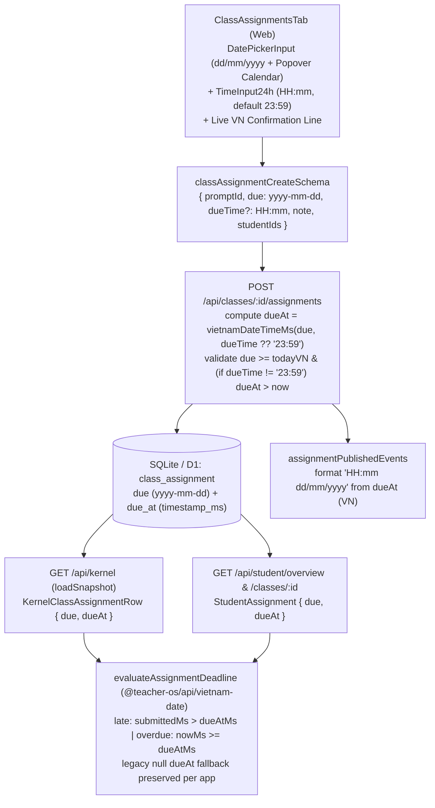

# fix(assignments): ô hạn nộp chuẩn dd/mm/yyyy kèm lịch, chọn giờ 24h và tính quá hạn giờ VN (#572)

## Overview

Giải quyết triệt để lỗi #572 (dòng #4 và #9 từ phản hồi staging của Cô Mỹ):

1. **Hiển thị sai `mm/dd/yyyy` và nhảy con trỏ khi gõ ngày (`06/11` → 11/06, `09/11` → `10/09`):** `ClassAssignmentsTab` đang dùng `<input id="assignment-due-input" type="date">` gốc của trình duyệt (`apps/web/src/components/classes/class-assignments-tab.tsx:553-561`), khiến thứ tự ngày/tháng và cơ chế tự nhảy ô (spinbutton segment) phụ thuộc hoàn toàn vào locale của trình duyệt/hệ điều hành. Giải pháp xây dựng `DatePickerInput` trong `@teacher-os/ui/components/date-picker-input` dùng `<input type="text" inputMode="numeric" autoComplete="off" placeholder="dd/mm/yyyy">` giữ nguyên chuỗi đang gõ trong state cục bộ kèm `lastEmittedRef` (không ép chèn `/` hay ghi đè khi prop `value` dội ngược làm nhảy caret), parse nghiêm ngặt `dd/mm/yyyy` / `d/m/yyyy` / `ddmmyyyy` (từ chối `31/02/2026`), đi kèm nút mở lịch tháng (`@base-ui/react/popover` `modal={true}`, tuần bắt đầu Thứ Hai `T2..CN`) và dòng xác nhận trực quan `"Đã hiểu: Thứ ..., dd/mm/yyyy lúc HH:mm (giờ Việt Nam)"`.
2. **Bổ sung chọn giờ 24h (`HH:mm`) và lưu trữ `dueAt` không cần migration DB:** Bảng `class_assignment` đã có sẵn cột `due_at INTEGER` (`timestamp_ms`, từ `0059_self_study_plan.sql:56`). Mở rộng `classAssignmentCreateSchema` thêm `dueTime: z.string().regex(TIME_REGEX).optional()` (mặc định `"23:59"` khi vắng mặt để tương thích ngược 100% với caller cũ). Trên `POST /api/classes/:id/assignments`, tính `dueAt = new Date(vietnamDateTimeMs(due, dueTime ?? "23:59"))`, từ chối `400` (`reason: "past-time"`) nếu `dueTime` được truyền tường minh (khác mốc cuối ngày `"23:59"` của hôm nay) mà thời điểm hạn nộp đã qua theo giờ Việt Nam (`dueAtMs <= nowMs`), ghi cả `due` (`yyyy-mm-dd`) lẫn `dueAt`, xuất `dueAt` qua `loadSnapshot` (`KernelClassAssignmentRow.dueAt`) và cập nhật nội dung thông báo `assignmentPublishedEvents` sang định dạng tiếng Việt.
3. **Đồng bộ tính quá hạn & nộp trễ theo giờ Việt Nam (`Asia/Ho_Chi_Minh`, UTC+7):** Tạo một helper thuần duy nhất `evaluateAssignmentDeadline` trong `@teacher-os/api/vietnam-date` dùng chung cho cả `apps/web` (`rollupStatus`, `studentSubmissionStatus`, `students/$studentId.tsx`) và `apps/student` (`deriveAssignmentStatus`, kèm truyền `todayISO` + `nowMs` thống nhất từ `StudentOverviewPage` và `ClassDetailView`):
   - Khi `dueAt` khác null: cả ngày hiển thị lẫn mốc so sánh đều suy ra từ `dueAt` theo múi giờ Việt Nam; nộp trễ khi `submittedMs > dueAtMs` (nộp đúng mili-giây hạn vẫn tính đúng hạn); chưa nộp quá hạn khi `nowMs >= dueAtMs`.
   - Khi `dueAt == null` (dữ liệu cũ): bảo toàn 100% hành vi hiện có của từng app (`due < todayISO` cho chưa nộp quá hạn ở cả hai app; `legacyDateLate: true` → `extractDateISO(submittedAt) > due` trên `apps/web` và `legacyDateLate: false` → `isLate: false` trên `apps/student`).

Kế hoạch được biên soạn theo hợp đồng bàn giao `--advice` (`advice-handover-plan.md`) và quy trình `--tdd`: mỗi phase phân rã thành các task độc lập với điều kiện `Verify` cơ học và khối `## Failure Protocol` bắt buộc dừng + tham vấn `kongming` nếu bất kỳ bước kiểm chứng nào thất bại.

## Advisor Scope Lock (`--advice`)

<!-- Updated: Red Team RT-1..RT-9 -->
- **Locked Scope:**
  - Helpers parse/format ngày giờ Việt Nam (`parseViDateInput`, `formatViDateDisplay`, `formatViWeekdayDate`, `parseTimeHHMM`, `evaluateAssignmentDeadline`) trong `packages/api/src/vietnam-date.ts` (+ unit tests `packages/api/src/vietnam-date.test.ts`).
  - Mở rộng `classAssignmentCreateSchema` (`dueTime?: HH:mm`) và `KernelClassAssignmentRow` (`dueAt?: string | null`) trong `packages/api/src/contracts.ts`.
  - Ghi `dueAt` + kiểm tra `past-time` (với `now?: () => Date` có thể inject trên `kernelRoutes`) trong `apps/server/src/routes/kernel.ts`, xuất `dueAt` trong `apps/server/src/routes/snapshot.ts`, định dạng hạn nộp tiếng Việt trong `apps/server/src/lib/notifications/templates.ts` (+ `templates.test.ts` và `apps/server/src/kernel.test.ts`).
  - Component tái sử dụng `DatePickerInput` & `TimeInput24h` trong `packages/ui/src/components/date-picker-input.tsx` (+ re-export `apps/web/src/components/ui/date-picker-input.tsx` và unit tests `packages/ui/src/components/date-picker-input.test.tsx`).
  - Luồng dữ liệu & hiển thị/tính trạng thái theo `dueAt` ở `apps/web` (`mock-data.ts`, `repos/class-assignments.ts`, `repos/class-assignments.test.ts`, `repos/student-assignments.ts`, `repos/student-assignments.test.ts`, `data-actions.ts`, `repos/kernel.ts`, `components/assignments/assignment-status.ts`, `components/assignments/assignment-status.test.ts`, `routes/_auth/students/$studentId.tsx`, `components/classes/class-assignments-tab.tsx`, `components/classes/class-assignments-tab.test.tsx`) và `apps/student` (`lib/assignment-status.ts`, `routes/_auth/index.tsx`, `components/overview/assignment-list.tsx`, `components/overview/assignment-row.tsx`, `components/overview/class-card.tsx`, `components/class/class-detail-view.tsx`, `components/class/class-assignment-table.tsx`, `test/assignment-status.test.ts`, `test/class-detail.test.tsx`).
  - Kiểm chứng E2E dưới locale `en-US` trong `apps/e2e/specs/class-assign.spec.ts`, kiểm tra 3 viewport (`1440×900`, `768×1024`, `375×812`) + reflow `320px`, focus bàn phím, chụp ảnh sáng/tối và chạy `pnpm design:compare`.
- **Explicit Non-Goals:**
  - **Không** thay thế 7 ô `<input type="date">` khác trong PR này (`org-event-modal`, `holiday-modal`, `class-study-pack-section`, `session-actions-modal`, `add-class-modal`, `add-invoice-modal`, `attendance.tsx`) để tránh phá vỡ 12+ spec E2E/unit không liên quan đang gọi `.fill("YYYY-MM-DD")` / `expect(date.type).toBe("date")`; quyết định phạm vi và danh sách bề mặt kế thừa `DatePickerInput` được ghi rõ trong issue/PR.
  - **Không** tạo migration DB mới hay backfill `due_at` cho các dòng `class_assignment` cũ (`due_at IS NULL` tiếp tục hoạt động qua fallback).
  - **Không** đổi chính sách phân quyền RBAC hiện hữu của `POST /api/classes/:id/assignments`, không sửa `apps/server/src/routes/grading.ts`, và không thêm tính năng sửa hạn nộp sau khi đã giao.

## Extension Trace

<!-- Updated: Red Team RT-7 -->
`DatePickerInput` (`packages/ui/src/components/date-picker-input.tsx`) tạo ranh giới component dùng chung mà các màn hình và modal chọn ngày khác (tiêu biểu: `holiday-modal.tsx` đặt bên trong `<Modal>` có `z-100`, truyền `min={today}` và `data-testid="holiday-from"`) sẽ tái sử dụng ở đợt dọn dẹp tiếp theo:
- **Hợp đồng giữ ổn định:** Props controlled `value: string` (ISO `yyyy-mm-dd` hoặc `""`), `onChange: (iso: string) => void`, `onInvalidChange?: (invalid: boolean) => void`, `minDateISO?: string`, `maxDateISO?: string`, `id`, `data-testid`, `disabled`, `aria-invalid`, `aria-describedby`, `ref` trỏ thẳng tới thẻ `<input>` text, `Popover.Root modal={true}` kèm `<Popover.Close>`, chặn nổi bọt `Escape` trên `Popover.Popup` (`e.stopPropagation()`), và `Popover.Positioner` đặt `z-[110]` cao hơn `Modal` (`z-100`).
- **Phần phải đổi khi mở rộng sang `<Modal>` ở PR kế tiếp:** (1) Cập nhật `apps/web/src/components/ui/modal.tsx:34-57` để listener `document` kiểm tra `!e.defaultPrevented` trước khi đóng modal bằng `Escape` và mở rộng focus trap nhận biết popup portal đang mở; (2) Thay `<Input type="date" .../>` tại từng modal bằng `<DatePickerInput .../>` và cập nhật các bài test E2E/unit của riêng modal đó từ `.fill("YYYY-MM-DD")` sang `.fill("DD/MM/YYYY")` + `.blur()`.
- **Cách chứng minh ngay trong plan này:** Phase 2 kiểm tra cơ học `Popover.Positioner` mang class `z-[110]`, `Popover.Popup` chặn nổi bọt `Escape` và không bọc `<form>`, mọi nút tương tác có `focus-visible:shadow-[var(--focus-ring)]`, chuyển tiếp `id`/`data-testid`/`ref` xuống `<input>`, xóa trắng ô phát `onChange("")`, và khóa các ngày `< minDateISO`.

## Goals

| # | Goal | Priority |
|---|------|----------|
| 1 | Bổ sung bộ helper ngày/giờ Việt Nam & `evaluateAssignmentDeadline`, mở rộng contract `dueTime`, lưu và xuất `dueAt` từ server kèm kiểm tra giờ quá khứ và regression study-pack | P1 |
| 2 | Xây dựng `DatePickerInput` (`dd/mm/yyyy` + lịch tháng không nhảy con trỏ) & `TimeInput24h` (`HH:mm`), nối luồng `dueAt` và đồng bộ trạng thái quá hạn/nộp trễ trên `apps/web` và `apps/student` | P1 |
| 3 | Chứng minh bằng Playwright E2E dưới locale `en-US`, kiểm tra 3 viewport + `320px` reflow + bàn phím + theme sáng/tối + `design:compare` và toàn bộ cổng chất lượng repo | P1 |

## Architecture / Flow

## Phases

| # | Phase | Status | Effort | Dependencies |
|---|-------|--------|--------|--------------|
| 1 | [Phase 1: Helpers giờ VN, contract dueTime & server lưu/xuất dueAt](./phase-01-start.md) | Completed | 1.25h | — |
| 2 | [Phase 2: DatePickerInput, TimeInput24h & đồng bộ hạn nộp Web/Student](./phase-02-ui-date-time-picker-and-status.md) | Completed | 1.75h | Phase 1 |
| 3 | [Phase 3: Kiểm chứng E2E locale en-US, 3 viewport, screenshots & cổng CI](./phase-03-e2e-viewports-and-gates.md) | Completed | 1.0h | Phase 1, 2 |

## Success Criteria

- [x] Gõ `"06/11/2027"` hoặc `"09112027"` vào ô hạn nộp trên trình duyệt cấu hình locale `en-US` luôn hiểu đúng ngày 06 tháng 11 và ngày 09 tháng 11 (không bị đảo sang tháng 6, không nhảy con trỏ thành `10/09`), đồng thời hiển thị dòng xác nhận rõ ràng `"Đã hiểu: ..., dd/mm/yyyy lúc HH:mm (giờ Việt Nam)"` (ẩn ngay lập tức nếu người dùng xóa trắng hoặc sửa thành chuỗi chưa hợp lệ).
- [x] Nút `"Chọn ngày"` mở popover lịch tháng (`T2..CN`, đồng bộ tháng theo năm/tháng đang nhập), khóa các ngày trước hôm nay (giờ VN), cho phép chọn ngày cập nhật ô nhập, và đóng bằng `Escape` trả focus về nút mở lịch mà không submit form ngoài.
- [x] Ô giờ nộp 24h (`HH:mm`, mặc định `"23:59"`) cho phép gõ hoặc chọn nhanh mốc giờ (`role="group"`), hiển thị lỗi ngay khi chọn giờ đã qua của ngày hôm nay, kiểm tra lại `Date.now()` lúc bấm submit, hiển thị `submit.error` nếu server trả `400` (`reason: "past-time"`), đồng thời vẫn cho phép giao hạn `"23:59"` hôm nay ở phút `23:59` VN và giữ tương thích `201` cho payload cũ không gửi `dueTime`.
- [x] Cả `apps/web` (danh sách bài đã giao của lớp + tab Bài tập của chi tiết học viên) và `apps/student` (trang tổng quan + chi tiết lớp) dùng chung `evaluateAssignmentDeadline` với cùng `nowMs` trên mỗi lượt render, thống nhất tuyệt đối tại biên `dueAt - 1ms`, `dueAt`, `dueAt + 1ms` và bảo toàn 100% hành vi dữ liệu cũ `dueAt: null`.
- [x] Không phát sinh lỗi tràn ngang hay cắt chữ ở `1440×900`, `768×1024`, `375×812` và `320×812` (cả light và dark theme kích hoạt qua `localStorage.theme = "dark"` + `html.dark`); `pnpm check`, `pnpm check-types`, `pnpm test`, E2E `class-assign.spec.ts` + `notifications-ac-001.spec.ts`, và `pnpm design:compare` đều thoát `0` với working tree sạch.

## Red Team Review

### Session — 2026-11-04
**Findings:** 10 deduplicated (9 accepted, 1 rejected) across 3 parallel hostile reviewers (`RedTeamSecurity`, `RedTeamAssumption`, `RedTeamFailure`)
**Severity breakdown:** 4 Critical, 5 High, 1 Medium

| # | Finding | Severity | Disposition | Applied To |
|---|---------|----------|-------------|------------|
| RT-1 | `DatePickerInput` & `TimeInput24h` bị lệch state `draftText` ↔ `value` khi xóa trắng ô (`""`), khi gõ dở/sai trước `blur` (dòng `"Đã hiểu:"` báo sai giá trị cũ), khi gõ `"9:05"`, khi prop `value` tự dội lại làm nhảy caret, khi mở lịch ở năm khác, và khi reset về cùng ngày mặc định (`class-assignments-tab.tsx:161,305-313`) | Critical | Accept | `plan.md`, Phase 2 (Tasks 2.1, 2.2, 2.4) |
| RT-2 | `ClassAssignmentsTab` chỉ tính `Date.now()` lúc render, ẩn lỗi `past-time` sau nút submit bị `disabled`, không render `submit.error` của `useKernelFormSubmit` (`use-kernel-form-submit.ts:36-44`), và khóa chết ngày hôm nay ở phút `23:59:00..23:59:59` VN khi gửi `dueTime: "23:59"` (`kernel.ts:742`, `contracts.ts:81`) | Critical | Accept | `plan.md`, Phase 1 (Tasks 1.3, 1.4), Phase 2 (Tasks 2.2, 2.3, 2.4) |
| RT-3 | Thiếu `apps/web/src/lib/repos/class-assignments.test.ts` (đang dùng `.toEqual` chặt tại dòng 26), thiếu `// @vitest-environment jsdom` ở `class-assignments-tab.test.tsx:1`, và viết JSX `<ClassAssignmentTable />` vào file `.ts` Node-env `apps/student/test/assignment-status.test.ts` thay vì `apps/student/test/class-detail.test.tsx` (`apps/web/vitest.config.ts:31`, `apps/student/vitest.config.ts:19`) | Critical | Accept | `plan.md`, Phase 2 (Files, Tasks 2.3, 2.4) |
| RT-4 | `t.db` trong `kernel.test.ts:72` có kiểu `LibSQLDatabase` không gán thẳng được cho `backfillStudyPackTargetsForStudent(db: Db)` (`app.ts:35`), `vi.useFakeTimers()` trần chặn macrotask của libSQL/notification (`student-history.test.ts:425`), và `plan.md` lệch với `phase-01-start.md` về `deps.now` trên `kernelRoutes` (`kernel.ts:124`) | Critical | Accept | `plan.md`, Phase 1 (Tasks 1.3, 1.4) |
| RT-5 | `evaluateAssignmentDeadline` làm đổi nhãn lịch sử `dueAt: null` trên `apps/student` (`apps/student/src/lib/assignment-status.ts:110-111` vốn giữ `isLate = false`), và 4 điểm gọi trên Student Overview (`index.tsx:51`, `assignment-list.tsx:46`, `assignment-row.tsx:13`, `class-card.tsx:141`) cùng `ClassAssignmentsTab` / `students/$studentId.tsx` chưa dùng chung `nowMs` | High | Accept | `plan.md`, Phase 1 (Tasks 1.1, 1.2), Phase 2 (Files, Tasks 2.3, 2.4) |
| RT-6 | Ghép giờ từ `dueAt` với ngày từ cột `due` tạo nhãn chimera khi `/__e2e/study-pack-shift` chỉ lùi `due_at` (`apps/e2e/src/boot.ts:243-261`, `apps/student/src/lib/assignment-status.ts:100-103`), và Phase 3 chưa chỉ rõ cách bắt `assignmentId` từ response `POST /api/classes/:id/assignments` | High | Accept | `plan.md`, Phase 1 (Task 1.4), Phase 2 (Task 2.4), Phase 3 (Task 3.1) |
| RT-7 | Popover thiếu `modal={true}` + `<Popover.Close>` + `Escape` `stopPropagation()`, các nút mới thiếu `focus-visible:shadow-[var(--focus-ring)]`, chip giờ thiếu `role="group"` + `aria-pressed`, thừa `aria-live="polite"` thứ hai (`REVIEW.md:30-33`), và Extension Trace cần ghi rõ yêu cầu sửa `modal.tsx:34-57` trước khi đưa vào `<Modal>` | High | Accept | `plan.md`, Phase 2 (Tasks 2.1, 2.2, 2.4) |
| RT-8 | `design:compare` ghi đè 24 ảnh PNG đang được git theo dõi trong `plans/261020-1446-378-redesign-design-v2/screenshots/` (`capture.mjs:54-55,899-908`), và dark mode của repo đọc `localStorage.theme = "dark"` + `<html class="dark">` thay vì `emulateMedia` (`packages/ui/src/lib/theme.ts:10-25`) | High | Accept | `plan.md`, Phase 3 (Tasks 3.1, 3.2) |
| RT-9 | Sort `dueAt` cùng ngày trong `studentAssignmentRows` (`student-assignments.ts:90-98`) cần so sánh số `Date.parse` với `null -> +Infinity`, và thứ tự bấm phím `Tab` -> `Enter`/`Space` trong E2E Task 3.1 cần mở lịch khi đang focus `Chọn ngày` trước khi `Tab` sang ô giờ | Medium | Accept | Phase 2 (Task 2.4), Phase 3 (Task 3.1) |
| RT-10 | Đề xuất thêm cổng chặn `canPublishGrade(ctx.role)` (`ta` -> `403`) vào `POST /api/classes/:id/assignments` (`kernel.ts:710`) | High | Reject (ngoài phạm vi #572; `canPublishGrade` tại `packages/auth/src/role.ts:106-112` chỉ khóa hành vi tiêu Credit AI của TOS-33, đổi RBAC của route giao bài lớp sẽ tự ý thay đổi quyền hiện hành của trợ giảng khi không được yêu cầu) | — |

### Whole-Plan Consistency Sweep
- Files reread: `plan.md`, `phase-01-start.md`, `phase-02-ui-date-time-picker-and-status.md`, `phase-03-e2e-viewports-and-gates.md`
- Decision deltas checked: 9 (RT-1 .. RT-9)
- Reconciled stale references: 11 (`lastEmittedRef` & empty-clear `onChange("")`, `dueTime === "23:59"` minute window, `submit.error` + click-time `Date.now()`, `class-assignments.test.ts` & `class-detail.test.tsx` + `// @vitest-environment jsdom`, `deps.now` + `{ toFake: ["Date"] }` + `t.db as unknown as Db`, `legacyDateLate` + Student Overview shared `nowMs`, `dueAt`-derived VN date/time, `Popover` `modal={true}` + `focus-visible:shadow-[var(--focus-ring)]` + single `aria-live`, `html.dark` + `git checkout` baseline PNGs, `Date.parse` `+Infinity` sort + E2E Tab order & `waitForResponse`)
- Unresolved contradictions: 0

## Validation Log

### Verification Results
- **Tier:** Standard (3 phases — Fact Checker + Contract Verifier)
- **Claims checked:** 30
- **Verified:** 30 | **Failed:** 0 | **Unverified:** 0
- **Key decisions confirmed:**
  1. `class_assignment.due_at` (`integer`, `mode: "timestamp_ms"`) đã tồn tại trong `packages/db/src/schema/class-assignment.ts:37` và `0059_self_study_plan.sql:57` — không cần tạo migration DB mới.
  2. Phạm vi sửa UI khóa chặt ở `ClassAssignmentsTab` (kèm primitive tái sử dụng `DatePickerInput` & `TimeInput24h` trong `@teacher-os/ui`), giữ nguyên 7 ô `<input type="date">` khác để bảo toàn 12+ spec E2E/unit hiện hữu.
  3. Thời hạn nộp mặc định `"23:59"` giờ Việt Nam (`UTC+7`), đồng bộ biên mili-giây qua `evaluateAssignmentDeadline` trên cả `apps/web` và `apps/student` mà không làm đổi trạng thái lịch sử của các dòng `dueAt: null`.

### Whole-Plan Consistency Sweep
- Files reread: `plan.md`, `phase-01-start.md`, `phase-02-ui-date-time-picker-and-status.md`, `phase-03-e2e-viewports-and-gates.md`
- Decision deltas checked: 9
- Reconciled stale references: 0
- Unresolved contradictions: 0

<!-- slug: 572-assignment-due-date-time -->
