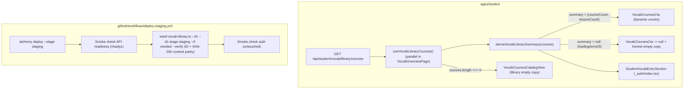

# Fix empty vocab library CTA and automate staging D1 seed (#573)

## Overview

Học viên vào `/practice/vocabulary` trên staging thấy thẻ CTA quảng cáo cố định `"Thư viện từ vựng · 20 khóa · 968 bài"` nhưng khi bấm sang `/practice/vocabulary/courses` lại nhận `"Không tìm thấy khóa học từ vựng phù hợp"`. Kế hoạch này xử lý triệt để cả hai mặt của lỗi: (1) ở `apps/student`, nạp song song `GET /api/student/vocab/library/courses` (`useVocabLibraryCourses`), tính số khóa và số bài thực tế qua `deriveVocabLibrarySummary`, ẩn thẻ `VocabCoursesCta` khi thư viện đang tải/lỗi/rỗng (hoặc tổng số bài bằng `0`), gỡ câu tham chiếu treo ở `vocab-decks-empty`, cập nhật chuỗi cứng `"20 khóa học từ vựng"` ở trang chủ học viên (`_auth/index.tsx`), và tách rõ thông báo thư viện rỗng (`courses.length === 0`) khỏi thông báo lọc không khớp trên `/practice/vocabulary/courses`; (2) ở `packages/db` và `.github/workflows/deploy-staging.yml`, mở rộng `seed-vocab-library.ts` với `--d1-stage staging` (fail-closed, cấm trộn `D1_DATABASE_ID` và chặn cứng `teacher-os-database-prod-*`) và `--if-needed` (đối chiếu cả tập ID lẫn SHA-256 nội dung 3 bảng trước khi bỏ qua upsert) để tự động nạp + kiểm chứng thư viện trên staging mỗi lần deploy `staging`, trong khi **Production (`deploy.yml` và `alchemy.run.ts`) tiếp tục bị chặn tuyệt đối** bởi gate giấy phép và được khóa bằng unit test workflow.

## Root Cause Evidence (`ak-debug` — 2026-11-04)

1. **Staging D1 chưa được seed (`0` dòng trong `vocab_library_course`):** Đã kiểm chứng trực tiếp trên `https://api.staging.teacheros.io.vn` ngày `2026-11-04` (đăng ký tài khoản smoke cổng học viên `POST /api/auth/sign-up/email` với `Origin: https://student.staging.teacheros.io.vn` → HTTP `200`, sau đó gọi `GET /api/student/vocab/library/courses` → HTTP `200` `{"courses":[]}`). Điều này chứng minh migration `0037` đã chạy trên staging nhưng bảng `vocab_library_course` đang trống do `.github/workflows/deploy-staging.yml` chưa có bước seed.
2. **Chuỗi số liệu cố định và thông báo rỗng gây hiểu lầm trên giao diện Student Portal:**
   - `apps/student/src/components/vocab/vocab-courses-cta.tsx:16` hard-code `"Thư viện từ vựng · 20 khóa · 968 bài"` và luôn render bất kể dữ liệu API.
   - `apps/student/src/routes/_auth/practice/vocabulary/index.tsx:215-218` (`vocab-decks-empty`) hard-code `"Mở mục Khóa học từ vựng bên dưới để bắt đầu học ngay..."` — tạo tham chiếu treo khi `VocabCoursesCta` ẩn (như trên Production đang đóng gate giấy phép).
   - `apps/student/src/routes/_auth/index.tsx:213-216` (`StudentVocabEntrySection`) hard-code `"20 khóa học từ vựng"` ngay trên trang chủ học viên `/`.
   - `apps/student/src/routes/_auth/practice/vocabulary/courses/index.tsx:103-109` (`VocabCoursesCatalogView`) hiển thị `"Không tìm thấy khóa học từ vựng phù hợp."` ngay cả khi `courses.length === 0` và không có từ khóa tìm kiếm (khi học viên truy cập trực tiếp URL `/practice/vocabulary/courses` trên môi trường chưa seed như Production).

## Advisor Scope Lock (`--advice` — `KongmingPostDebug` + Red-Team Delta)

- **Locked Scope:**
  - Giữ nguyên contract `GET /api/student/vocab/overview` (`.strict()`); tái sử dụng endpoint có sẵn `GET /api/student/vocab/library/courses` (`useVocabLibraryCourses()`, query key `["student", "vocab-library", "courses"]`) để chia sẻ cache với `/practice/vocabulary/courses`.
  - Gọi `useVocabLibraryCourses()` ngay tại `VocabOverviewPage` song song với `useStudentMe()` và `useVocabOverview()` (tránh waterfall và giật bố cục CLS); chuyển `VocabCoursesCta` sang nhận prop thuần `summary: VocabLibrarySummary | null` từ helper `deriveVocabLibrarySummary(courses)`; dùng chung `summary` cho `vocab-decks-empty` trong `VocabOverviewContent`; cập nhật `StudentVocabEntrySection` trong `apps/student/src/routes/_auth/index.tsx`; phân biệt `courses.length === 0` (`"Thư viện khóa học từ vựng hiện chưa có nội dung."`) với `filteredCourses.length === 0` (`"Không tìm thấy khóa học từ vựng phù hợp."`) trong `VocabCoursesCatalogView`.
  - Thêm `"tsx": "4.23.12"` và `"check-types": "tsc --noEmit"` vào `packages/db/package.json` (cập nhật `pnpm-lock.yaml`, không bao giờ dùng `npx -y` trên CI).
  - Mở rộng `packages/db/src/seed/vocab-library.ts` và `packages/db/scripts/seed-vocab-library.ts` (bọc `main()` bằng guard `isDirectExecution`, export `parseArgs` và `runSeedCli`):
    - `--d1-stage staging`: chỉ chấp nhận `"staging"`, cấm kết hợp với `D1_DATABASE_ID` trong env, lọc qua Cloudflare D1 REST list API theo regex `^teacher-os-database-staging-[a-z2-7]{16}$`, kiểm tra cả `total_pages` lẫn `total_count > result.length`, fail-closed nếu `matches.length !== 1`; đồng thời nhánh `--d1` truyền `D1_DATABASE_ID` trực tiếp cũng tra cứu metadata DB và chặn cứng mọi DB có tên `^teacher-os-database-prod-` trong khi Gate Giấy phép đang đóng.
    - Bảo mật & độ bền mạng: in `::add-mask::<databaseId>\n` ở đầu dòng riêng biệt trước mọi log/request khi `GITHUB_ACTIONS === "true"`, redact `databaseId` và `apiToken` khỏi mọi thông báo lỗi, gắn `AbortSignal.timeout(20_000)` và retry kèm backoff ngắn cho cả `5xx` lẫn `429`.
    - `--if-needed`: đối chiếu cả tập ID (`verifyCounts`) lẫn SHA-256 nội dung toàn bộ cột của 3 bảng (`verifyContentParity`, phân trang `vocab_library_word` theo lô `4000` dòng `ORDER BY id`) để nếu CSV đổi nội dung/URL thì tự động chạy lại `seedVocabLibrary` + `verifyCounts`.
  - Trong `.github/workflows/deploy-staging.yml`, đặt bước `"Seed built-in vocab library (staging only)"` ngay sau `"Smoke check API readiness (/readyz)"` (không gọi `/api/student/vocab/library/courses` bằng tài khoản smoke để tránh `403 NOT_LINKED` trên staging trắng 0-org và tránh bơm học viên rác `Deploy Smoke` vào org QA thật trên mỗi lượt deploy).
  - Khóa cơ học trong `scripts/ci-workflow.test.mjs`: dùng `stripComments` và `splitJobSteps` để kiểm tra đúng thứ tự bước + least-privilege `env:` trong `deploy-staging.yml`, cấm `npx -y`, cấm `/seed-vocab-library|seedVocabLibrary|vocab_library/` trong `deploy.yml`, và cấm `importFiles` trong `packages/infra/alchemy.run.ts`.
- **Explicit Non-Goals:**
  - **Không** chạy hoặc gắn bước seed vào Production (`deploy.yml` / stage `prod`) — Production bị chặn bởi gate giấy phép trong `packages/db/scripts/README-seed-vocab-library.md` cho tới khi chủ dự án xác nhận bằng văn bản.
  - **Không** mở rộng `vocabOverviewSchema` hay sửa endpoint server `/api/student/vocab/*`.
  - **Không** sửa JSDoc/comment nội bộ ở `vocab-course-switcher-dialog.tsx` hoặc `apps/web/src/components/vocab/vocab-library-dialog.tsx`.
  - **Lưu ý ranh giới môi trường (`--beta` → `develop` vs `staging`):** Merge PR này vào `develop` đưa code fix và workflow step vào `develop`; dữ liệu D1 trên `staging` sẽ tự động được nạp ngay ở lần promote kế tiếp (`git push origin develop:staging`) hoặc khi chạy workflow `deploy-staging.yml`.

## Architecture / Flow

## Goals

| # | Goal | Priority |
|---|------|----------|
| 1 | Hiển thị động số khóa + số bài từ API, ẩn `VocabCoursesCta` và gỡ toàn bộ câu quảng cáo/tham chiếu/thông báo lọc sai khi thư viện rỗng | P1 |
| 2 | Tự động hóa seed + verify nội dung thư viện từ vựng chỉ riêng cho `staging` (fail-closed, zero junk rows, empty-org-safe) kèm kiểm thử khóa chặt `deploy.yml` và `alchemy.run.ts` | P1 |

## Test Matrix (`--tdd`)

| Layer | File | Scenarios Covered |
|---|---|---|
| Student UI Unit/Integration | `apps/student/src/components/vocab/vocab-course-catalog.test.tsx` | `deriveVocabLibrarySummary` (`undefined`/`[]`/`lessonCount=0`/valid); `VocabCoursesCta` ẩn khi `summary=null` và hiển thị `N khóa · M bài` khi có dữ liệu; `VocabOverviewContent` + `VocabOverviewPage` song song không flash, ẩn CTA + đổi copy `vocab-decks-empty` khi API trả `{"courses":[]}` hoặc HTTP `500` (sau khi await `fetchMock` settle), hiện đầy đủ khi có khóa; `StudentVocabEntrySection` (với fixture `VocabOverview` `.strict()` đầy đủ + mock `Navigate`) không còn quảng cáo `"20 khóa học"` khi thư viện rỗng/lỗi; `VocabCoursesCatalogView` phân biệt thư viện rỗng (`courses: []`) với lọc không khớp |
| DB Seed & CLI Unit | `packages/db/src/seed/vocab-library.test.ts` | `resolveStagingD1DatabaseId` từ chối mọi stage khác `"staging"`, từ chối `0`/`>1` DB khớp regex `^teacher-os-database-staging-[a-z2-7]{16}$`, từ chối phân trang `total_count > result.length` / `total_pages > 1`, trả đúng UUID; `runSeedCli` từ chối kết hợp `D1_DATABASE_ID` + `--d1-stage`, chặn cứng DB tên `teacher-os-database-prod-*` trên `--d1`, redact UUID/token khỏi lỗi và ghi `::add-mask::` đúng cột 0; `ensureVocabLibrarySeeded` với `--if-needed` bỏ qua `run()` khi cả ID-set lẫn SHA-256 nội dung khớp, tự re-seed khi lệch ID hoặc sửa bất kỳ cột nội dung nào (ví dụ `audioUrl`/`description`), và retry khi gặp HTTP `429`/`500`; smoke CLI `pnpm --filter @teacher-os/db exec tsx scripts/seed-vocab-library.ts --help` |
| Workflow Drift / Gate | `scripts/ci-workflow.test.mjs`, `scripts/topology-drift.test.mjs` | `deploy-staging.yml` đặt bước seed sau `/readyz` chỉ với `CLOUDFLARE_ACCOUNT_ID` + `CLOUDFLARE_API_TOKEN`; cấm `npx -y` trong workflows; `deploy.yml` (sau `stripComments`) tuyệt đối không chứa `/seed-vocab-library|seedVocabLibrary|vocab_library/`; `packages/infra/alchemy.run.ts` không chứa `importFiles`; toàn bộ test drift topology vẫn xanh |
| E2E Regression + 3 Viewports | `apps/e2e/specs/vocab-library-clone.spec.ts` | Học viên vào `/practice/vocabulary` thấy `vocab-courses-cta` hiển thị đúng `"Thư viện từ vựng · 20 khóa · 968 bài"` từ DB E2E đã seed, bấm sang `/practice/vocabulary/courses` thấy đủ 20 khóa và không tràn ngang ở 3 viewport (`1440×900`, `768×1024`, `375×812`) |

## Phases

| # | Phase | Status |
|---|-------|--------|
| 1 | [Phase 1: Dynamic Student Vocab CTA & Empty-State Honesty](./phase-01-student-vocab-cta-and-empty-state.md) | completed |
| 2 | [Phase 2: Staging-Only Vocab Library Seed & CI Guards](./phase-02-staging-vocab-seed-and-smoke.md) | completed |

## Success Criteria

- [x] Khi `GET /api/student/vocab/library/courses` trả `{"courses":[]}`, đang tải, lỗi mạng, hoặc tổng `deckCount === 0`: `VocabCoursesCta` không render (`null`), `vocab-decks-empty` không nhắc tới `"bên dưới"`, `StudentVocabEntrySection` trên `/` không nhắc tới `"khóa học từ vựng"`, và `/practice/vocabulary/courses` khi không có filter hiện thông báo thư viện chưa có nội dung thay vì báo lỗi bộ lọc.
- [x] Khi thư viện có dữ liệu (ví dụ `20` khóa, `968` bài): `VocabCoursesCta` hiển thị `"Thư viện từ vựng · 20 khóa · 968 bài"` lấy trực tiếp từ API mà không gây waterfall hay giật bố cục; `StudentVocabEntrySection` hiển thị đúng số khóa động.
- [x] `pnpm --filter @teacher-os/db exec tsx scripts/seed-vocab-library.ts --d1 --d1-stage staging --if-needed --verify` hoạt động với `tsx` đã khóa trong `pnpm-lock.yaml`, giải mã staging D1 UUID fail-closed (chặn cứng `prod` và xung đột `D1_DATABASE_ID`), mask/redact UUID & token, bỏ qua upsert khi cả tập ID lẫn SHA-256 nội dung khớp CSV, và nạp đủ `20/968/10160` khi DB trống hoặc đổi nội dung.
- [x] `.github/workflows/deploy-staging.yml` chạy seed + `--verify` sau `/readyz` (không tạo dòng `student` rác và không gãy trên staging trắng `0` org); `.github/workflows/deploy.yml` và `packages/infra/alchemy.run.ts` không nạp thư viện lên Production và được khóa bởi `scripts/ci-workflow.test.mjs`.
- [x] Toàn bộ local gates xanh: `pnpm exec biome check .`, `pnpm check-types`, `pnpm test`, `node --test scripts/ci-workflow.test.mjs scripts/topology-drift.test.mjs`, và Playwright E2E `vocab-library-clone.spec.ts` (kèm kiểm tra 3 viewport).

## Red Team Review

### Session — 2026-11-04
**Findings:** 8 deduplicated (8 accepted, 0 rejected)
**Severity breakdown:** 2 Critical, 4 High, 2 Medium

| # | Finding | Severity | Disposition | Applied To |
|---|---------|----------|-------------|------------|
| 1 | `@teacher-os/db` thiếu `tsx` binary và thiếu script `check-types` (cấm dùng `npx -y` trên runner giữ Cloudflare token) | Critical | Accept | `plan.md`, Phase 2 (Files, Task 2.1, 2.2, 2.3) |
| 2 | `D1_DATABASE_ID` trong env vượt mặt `--d1-stage staging`, nhánh `--d1` chưa chặn `teacher-os-database-prod-*`, thiếu kiểm tra `result_info.total_count`, và `main()` chưa có guard để unit-test CLI | Critical | Accept | `plan.md`, Phase 2 (Task 2.1, 2.2) |
| 3 | Gọi `GET /api/student/vocab/library/courses` trong smoke `deploy-staging.yml` kích hoạt `provisionStudentForUser`, gây `403 STUDENT_NOT_LINKED` trên staging mới provision (`0` org) và bơm học viên rác vào org QA thật mỗi lần deploy | High | Accept | `plan.md`, Phase 2 (Task 2.1, 2.3) |
| 4 | `::add-mask::` cần in ở cột 0 dòng riêng trước mọi log/request và cần redact `databaseId` + `apiToken` khỏi mọi thông báo lỗi | High | Accept | `plan.md`, Phase 2 (Task 2.1, 2.2) |
| 5 | `--if-needed` chỉ dùng `verifyCounts` (ID-only) sẽ bỏ qua cập nhật nội dung CSV (URL audio/hình ảnh, mô tả); cần kiểm tra thêm SHA-256 nội dung và tính `counts` từ `data.*.length` | High | Accept | `plan.md`, Phase 2 (Task 2.1, 2.2) |
| 6 | Test Phase 1 thiếu `Navigate` trong `vi.mock("@tanstack/react-router")`, dễ pass giả ở Frame 0 (`isLoading`), cần fixture `VocabOverview` `.strict()` đầy đủ và test riêng cho HTTP `500` | High | Accept | `plan.md`, Phase 1 (Task 1.1, 1.3) |
| 7 | Gọi `useVocabLibraryCourses()` bên trong `VocabOverviewContent` gây waterfall + CLS, và `VocabCoursesCatalogView` khi `courses: []` không filter vẫn báo lỗi lọc `"Không tìm thấy khóa học từ vựng phù hợp."` | Medium | Accept | `plan.md`, Phase 1 (Files, Task 1.1, 1.3) |
| 8 | `ci-workflow.test.mjs` cần dùng `stripComments` + `splitJobSteps` + chặn `importFiles` ở `alchemy.run.ts`, D1 runner cần `AbortSignal.timeout(20_000)` + retry `429`, và lệnh sửa Biome là `pnpm check:fix` | Medium | Accept | `plan.md`, Phase 2 (Task 2.1, 2.2, 2.4) |

### Whole-Plan Consistency Sweep
- Files reread: `plan.md`, `phase-01-student-vocab-cta-and-empty-state.md`, `phase-02-staging-vocab-seed-and-smoke.md`
- Decision deltas checked: 8 (tsx + check-types in `@teacher-os/db`, fail-closed `D1_DATABASE_ID` conflict + prod DB name rejection + `total_count` pagination + `runSeedCli` export, removal of side-effecting `/api/student/vocab/library/courses` workflow curl in favor of post-`/readyz` `--verify`, column-0 `::add-mask::` + error redaction, SHA-256 content parity in `--if-needed`, Phase 1 `Navigate` mock + settled-fetch + HTTP 500 + `.strict()` fixture, parallel `useVocabLibraryCourses` in `VocabOverviewPage` + empty-library message in `VocabCoursesCatalogView`, `stripComments`/`splitJobSteps`/`importFiles`/`429`+timeout/`pnpm check:fix`)
- Reconciled stale references: 9 (removed all references to `runVocabLibrarySeedCliFlow`, `Smoke check student vocab library catalog`, `pnpm check` as write command, `EXPECTED_COUNTS` hardcode in `ensureVocabLibrarySeeded`, and `total_pages`-only check across all 3 files)
- Unresolved contradictions: 0

## Validation Log

### Session 1 — 2026-11-04 (`ak-vibe --advice` Gate)
- **Verification Results:**
  - Claims checked: 20 (across `RedTeamSecurity` and `RedTeamAssumptions` Fact Checkers)
  - Verified: 14 | Failed (pre-fix): 6 | Unverified: 0
  - Tier: Light (2 phases)
  - Resolution: Toàn bộ 6 điểm lệch thực tế so với codebase (`packages/db/package.json` thiếu `tsx`/`check-types`, `result_info.total_count`, `provisionStudentForUser` trên staging `0`-org, mock `Navigate` trong `vocab-course-catalog.test.tsx`, `pnpm check:fix`, và CLI `runSeedCli`) đã được cập nhật đồng bộ vào `plan.md`, `phase-01`, và `phase-02`.
- **Whole-Plan Consistency Sweep:** 0 unresolved contradictions; `ak plan validate` pass `[OK]`.

<!-- slug: vocab-courses-empty-cta -->
