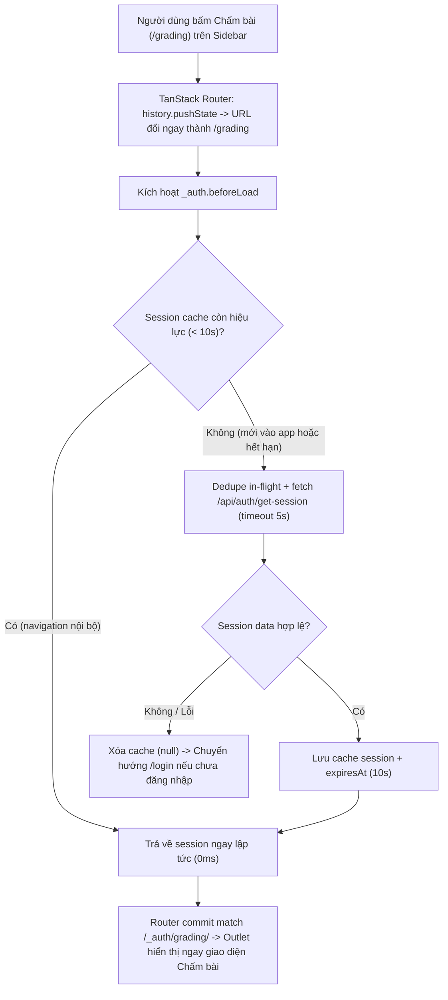

# Plan: #575 — Sửa lỗi đứng hình khi điều hướng menu sang trang Chấm bài

> **Handover Notice (`--advice` + `--tdd`):** Plan này được biên soạn theo hợp đồng bàn giao cho executor cấp thấp hơn (`advice-handover-plan.md`). Mỗi phase đều tự chứa danh sách task tuần tự kèm điều kiện `Verify` cơ học (so khớp mã thoát / chuỗi đầu ra) và khối `## Failure Protocol` bắt buộc dừng + gọi `kongming` ngay khi bước `Verify` lệch kỳ vọng.

## Overview

Khắc phục triệt để lỗi #575 được phản ánh từ môi trường staging (cô Mỹ): bấm "Chấm bài" trên sidebar menu thì URL trên thanh địa chỉ đổi thành `/grading` nhưng nội dung màn hình vẫn giữ nguyên trang cũ, phải F5 mới tải được.

### Nguyên nhân gốc đã được xác minh qua điều tra & tham vấn cố vấn (`kongming`)
1. **`/_auth.beforeLoad` gọi fetch mạng `authClient.getSession()` không cache ở MỌI lượt điều hướng (`apps/web/src/routes/_auth/route.tsx:7-21`)**:
   - Khi người dùng đã đăng nhập và đang ở các trang con của `_auth` (`/dashboard`, `/classes`, `/assignments`, `/grading/$attemptId`...), mỗi cú click chuyển trang đều khiến TanStack Router kích hoạt lại toàn bộ chuỗi `beforeLoad` của nhánh match, trong đó có `_auth`.
   - Lời gọi `authClient.getSession()` là một HTTP fetch thực sự (`GET /api/auth/get-session`) sang origin của API server (trên staging là cross-origin `app.<domain>` → `api.<domain>`), hoàn toàn không có timeout và không có bộ đệm.
2. **Cơ chế `defaultPreload: "intent"` nhân đôi lượt gọi khi hover (`apps/web/src/main.tsx:13`)**:
   - Khi rê chuột qua menu "Chấm bài", TanStack Router khởi động một chuyến preload (`router._flights`), gọi `_auth.beforeLoad` lần 1.
   - Khi click, TanStack Router gọi tiếp `beforeLoad` hoặc gắn vào flight đang bay.
   - TanStack Router ngay lập tức cập nhật URL trình duyệt qua `history.pushState` thành `/grading`, nhưng giữ nguyên màn hình cũ cho tới khi toàn bộ promise `beforeLoad` hoàn tất.
3. **Mạng chậm / worker cold-start / connection stall gây đóng băng UI**:
   - Nếu kết nối mạng chập chờn, độ trễ cross-origin cao, hoặc Worker cold-start mất 2–5 giây, thanh URL đã đổi sang `/grading` nhưng màn hình vẫn là trang cũ.
   - TanStack Router mặc định `defaultPendingMs: 1000` (`main.tsx`), che giấu `<Loader />` trong 1 giây đầu.
   - Nếu kết nối bị stall/treo, UI đứng hình vô hạn vì không có abort timeout. Người dùng tưởng lỗi và buộc phải F5. Khi F5, một request GET `/grading` mới được tải từ đầu và render thành công.

## Goals

| # | Goal | Priority |
|---|------|----------|
| 1 | Bổ sung in-memory session cache (`getCachedSession`) với TTL ngắn (10s), in-flight deduplication, timeout an toàn 5s (`AbortSignal.timeout(5000)`), và tự động xóa cache khi `signOut`, `reauth()`, `updateUser` hoặc khi session trả về rỗng | P1 |
| 2 | Cập nhật `apps/web/src/routes/_auth/route.tsx` sử dụng `getCachedSession`, có try/catch an toàn tránh unhandled rejection, giúp việc chuyển giữa các trang trong shell diễn ra tức thì (0ms network overhead) | P1 |
| 3 | Cấu hình `defaultPendingMs: 200` trong `apps/web/src/main.tsx` để người dùng nhìn thấy spinner nếu có network delay thực sự (> 200ms) thay vì màn hình đơ 1000ms | P1 |
| 4 | Viết bộ test kiểm chứng `getCachedSession` và test điều hướng router độc lập (mock router) chứng minh không còn hiện tượng kẹt trang | P1 |

## Non-goals (Advisor Scope Lock)

- Không thay đổi logic route matching, cấu trúc `createFileRoute("/_auth/grading/")` hay `routeTree.gen.ts`.
- Không thay đổi `TeacherShellLink`, `href: "/grading"` hay `activeOptions`.
- Không thêm `window.location.reload()` ép buộc ở tầng router hay preload error.
- Không sửa logic xác thực trên server Hono (server Better-Auth giữ nguyên contract).

## Architecture / Flow

## Phases

| # | Phase | Status |
|---|-------|--------|
| 1 | [Phase 1: In-memory session cache, deduplication và timeout an toàn](./phase-01-session-cache-and-timeout.md) | Completed |
| 2 | [Phase 2: Áp dụng vào _auth route, pending timer và kiểm chứng bộ test điều hướng](./phase-02-navigation-tests-and-error-boundaries.md) | Completed |

## Success Criteria

- [x] `getCachedSession()` trong `apps/web/src/lib/auth-client.ts` trả kết quả từ cache khi gọi liên tiếp trong vòng 10 giây, deduplicate các promise đang bay đồng thời, áp dụng `AbortSignal.timeout(5000)` khi gửi fetch thật, và có hàm `clearSessionCache()` hoạt động chuẩn xác khi `signOut`, `reauth()`, hoặc `updateUser`.
- [x] `apps/web/src/routes/_auth/route.tsx` dùng `getCachedSession()` bọc trong try/catch fallback an toàn, loại bỏ hoàn toàn các lượt fetch mạng lặp thừa khi hover/click menu chuyển trang bên trong ứng dụng.
- [x] `apps/web/src/main.tsx` cấu hình `defaultPendingMs: 200`.
- [x] Test suite vitest kiểm chứng `getCachedSession` và điều hướng chạy xanh 100%.
- [x] `pnpm check`, `pnpm check-types`, `pnpm --filter web test` đạt 100% pass, không có regression.

## Red Team Review

### Session — 2026-11-04
**Reviewers:** Security Adversary, Assumption Destroyer
**Findings:** 7 deduplicated (7 accepted, 0 rejected)
**Severity breakdown:** 3 Critical, 3 High, 1 Medium

| # | Finding | Severity | Disposition | Applied To |
|---|---------|----------|-------------|------------|
| 1 | `router.invalidate()` sau khi đổi tên/avatar (`profile.tsx:117`, `avatar-section.tsx:50`) bị cache trả dữ liệu cũ | Critical | Accept | Phase 1 (gắn `clearSessionCache` vào `updateUser` và `profile.tsx`) |
| 2 | `AbortSignal.timeout(5000)` ném `TimeoutError` không được bắt gây unhandled rejection crash router | Critical | Accept | Phase 2 (try/catch an toàn trong `_auth.beforeLoad` fallback session trước đó nếu đã đăng nhập) |
| 3 | Task 2.2 mount full `routeTree` kéo theo 36 route và DataProvider gây lỗi un-mocked | Critical | Accept | Phase 2 (dùng isolated test router với stub routes theo pattern repo) |
| 4 | `defaultPendingMs: 1000` của TanStack Router giấu loader khiến user thấy đơ 1s | High | Accept | Phase 2 (cấu hình `defaultPendingMs: 200` trong `main.tsx`) |
| 5 | `reauth()` không dọn cache session và cache không xóa khi session trả về `{ data: null }` | High | Accept | Phase 1 (dọn cache trong `reauth.ts` và gán null khi `!session.data`) |
| 6 | TTL 30s quá dài cho auth authorization guard | High | Accept | Phase 1 (giảm TTL xuống 10s) |
| 7 | Task 2.3 xóa file không tồn tại | Medium | Accept | Phase 2 (bỏ lệnh rm file không tồn tại) |

### Whole-Plan Consistency Sweep (Red Team)
- Files reread: `plan.md`, `phase-01-session-cache-and-timeout.md`, `phase-02-navigation-tests-and-error-boundaries.md`
- Decision deltas checked: 7
- Reconciled stale references: 7
- Unresolved contradictions: 0
