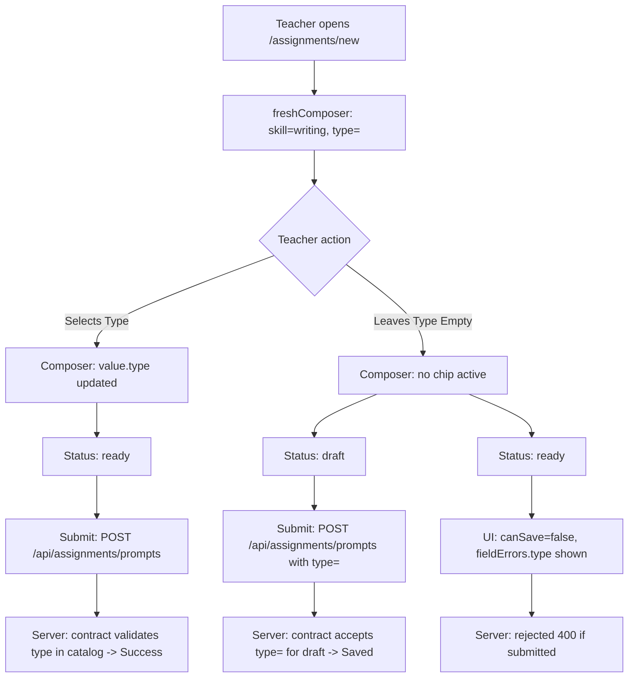

# Plan: Fix Writing Prompt Type Default & Validation (#577)

## Outcome

1. Khi tạo đề Writing mới tại `/assignments/new`, hoặc khi đổi sang kỹ năng Writing hoặc đổi phần thi (Task 1 / Task 2), dạng đề (type) không bị chọn sẵn.
2. Giáo viên không thể lưu ở trạng thái "Sẵn sàng giao" (`status === "ready"`) nếu chưa chọn dạng đề: giao diện hiển thị cảnh báo lỗi rõ ràng và server từ chối với mã 400.
3. Giáo viên có thể lưu bản nháp (`status === "draft"`) lên server ngay cả khi chưa chọn dạng đề (`type: ""`), không bị lỗi validation.
4. Mọi màn hình hiển thị danh sách đề (`/assignments`), xem trước (`prompt-preview-aside`, `student-preview-paper`) hiển thị "Chưa chọn dạng" thay vì tự fallback gán nhãn sai cho đề draft chưa có type.

## Non-goals

- Không thay đổi hành vi chọn sẵn type của các kỹ năng chấm tự động (Reading, Listening, Grammar, Vocabulary) vì type ở các kỹ năng này quyết định cấu trúc câu hỏi/đáp án.
- Không migrate lại các draft cũ trong localStorage của trình duyệt người dùng đã vô tình lưu `type: "discuss"`.

## Architecture & Flow

## Phases

| # | Phase | Trạng thái |
|---|---|---|
| 1 | [Contract & Server Validation](phase-01-contract-and-server.md) | completed |
| 2 | [UI Presets, Composer & Routes](phase-02-ui-presets-and-composer.md) | completed |
| 3 | [Automated Testing & End-to-End Verification](phase-03-tests-and-verification.md) | completed |

## Acceptance Criteria

- [x] `freshComposer()` khởi tạo với `type: ""` cho Writing.
- [x] Chuyển sang Writing hoặc chuyển part trong Writing không tự động chọn `types[0]`.
- [x] ChipFilter không kích hoạt chip nào khi `value.type === ""`.
- [x] Khi `status === "ready"` và `value.type === ""`, `canSave === false`, nút Lưu bị khóa, hiển thị thông báo lỗi yêu cầu chọn dạng đề.
- [x] Khi `status === "draft"` và `value.type === ""`, có thể lưu nháp vào server qua `POST /api/assignments/prompts`.
- [x] `PATCH /api/assignments/prompts/:id` chuyển status từ draft sang ready khi `type === ""` bị từ chối với lỗi 400.
- [x] Màn hình danh sách `/assignments` hiển thị tag "Chưa chọn dạng" cho đề draft chưa có type.
- [x] `pnpm check`, `pnpm check-types` và toàn bộ test suites liên quan đều pass 100%.
