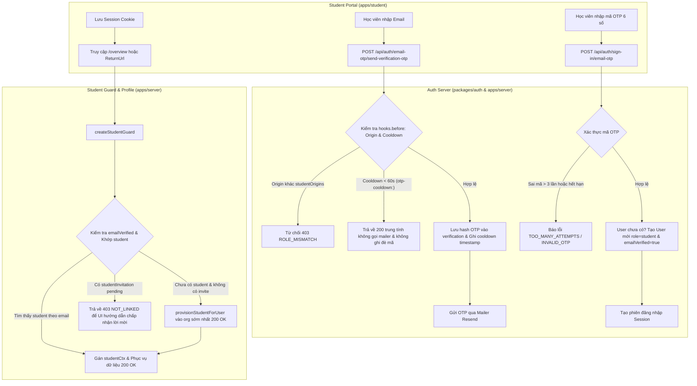

# Plan: Đăng nhập cổng học viên bằng mã qua email (Email OTP)

## Overview

Issue #578 ghi nhận cổng học viên hiện chỉ có đăng nhập bằng mật khẩu hoặc Google. Học viên được giáo viên mời phải tự đăng ký tài khoản mật khẩu khớp đúng email và xác thực email mới vào được hệ thống, dẫn đến trải nghiệm khó khăn và lỗi `EMAIL_UNVERIFIED`.

Giải pháp được lựa chọn (theo tham vấn kiến trúc từ `@kongming`):
- Sử dụng **Email OTP 6 số** (`emailOTP` plugin của Better-Auth 1.7.16) làm phương thức đăng nhập chính cho cổng học viên.
- Không dùng Magic Link ở giai đoạn này để tránh vấn đề mở chéo thiết bị (điện thoại vs máy tính), bộ quét link mail (SafeLinks) làm tiêu thụ token sớm, và thiếu header Origin khi GET navigation.
- Giữ đăng nhập bằng mật khẩu làm phương án phụ cho tài khoản cũ (thêm liên kết "Đăng nhập bằng mật khẩu"), giữ nút Google OAuth. Bỏ tab "Đăng ký" bằng mật khẩu vì OTP vừa đăng ký vừa đăng nhập với email đã được chứng minh (`emailVerified: true`).
- Tự động khớp hồ sơ học viên đã được mời qua `createStudentGuard` và `provisionStudentForUser`.
- Bảo vệ tần suất gửi mail: áp dụng cooldown 60s per email ở `hooks.before` bằng identifier chuyên dụng `otp-cooldown:<email>` (không dựa vào `verification` sau `resolveOTP`), đếm ngược 60s trên UI, và băm mã OTP (`storeOTP: "hashed"`) với tối đa 3 lần thử.
- Bảo mật phân quyền: khóa toàn bộ endpoint OTP chỉ cho phép từ `studentOrigins`, chặn gửi OTP cho email giáo viên/admin, vô hiệu hóa các endpoint reset password OTP để bảo toàn luồng reset password bằng cryptographic token của TeacherOS, và kiểm tra avatar injection khi tạo user mới.

## Architecture & Data Flow

## Advisor Scope Lock & Non-goals

Theo tư vấn từ `@kongming`:
- **Không triển khai Magic Link trong issue này**: Tập trung hoàn toàn vào Email OTP 6 số để đạt độ tin cậy cao nhất trên mọi thiết bị và nền tảng email.
- **Không xóa cơ chế mật khẩu của hệ thống**: Giữ endpoint đăng nhập và đặt lại mật khẩu cho tài khoản cũ; chỉ bỏ tab "Đăng ký" bằng mật khẩu trên giao diện cổng học viên.
- **Không thay đổi hành vi của cổng giáo viên (`apps/web`) và cổng admin (`apps/admin`)**: Cổng giáo viên và admin vẫn giữ nguyên cơ chế xác thực hiện hữu. Các endpoint OTP bị chặn hoàn toàn từ origin giáo viên/admin.
- **Không nới lỏng kiểm tra phân quyền (Role Isolation)**: Email thuộc `TEACHER_EMAILS` hoặc `ADMIN_EMAILS` bị chặn tạo tài khoản hoặc đăng nhập role `student`.

## Phases

| # | Phase | File | Status |
|---|-------|------|--------|
| 1 | Cấu hình Better-Auth Email OTP & Bảo mật Role | [phase-01-backend-email-otp.md](./phase-01-backend-email-otp.md) | completed |
| 2 | Tích hợp Server & Tự động khớp hồ sơ học viên | [phase-02-server-student-integration.md](./phase-02-server-student-integration.md) | completed |
| 3 | Giao diện đăng nhập OTP tại cổng học viên | [phase-03-student-login-ui.md](./phase-03-student-login-ui.md) | completed |
| 4 | Kiểm thử toàn diện & Quality Gates | [phase-04-verification-gates.md](./phase-04-verification-gates.md) | completed |

## Acceptance Criteria

- [x] Plugin `emailOTP` được tích hợp vào `packages/auth/src/index.ts` với `expiresIn: 300`, `storeOTP: "hashed"`, template email tiếng Việt.
- [x] Chặn gửi OTP từ student origin đến các email giáo viên/admin hoặc tài khoản có role khác `student`.
- [x] Khóa các endpoint OTP chỉ cho phép từ origin thuộc `studentOrigins`.
- [x] Vô hiệu hóa các endpoint reset password OTP của Better-Auth để bảo toàn cơ chế reset mật khẩu cryptographic token hiện có.
- [x] Backend có cơ chế cooldown 60 giây an toàn giữa các lần gửi mã OTP bằng bản ghi cooldown độc lập, không làm mất mã đã gửi.
- [x] Học viên mới đăng nhập bằng OTP thành công được tạo tài khoản có `role = 'student'` và `emailVerified = true`.
- [x] `createStudentGuard` tự động nhận diện tài khoản vừa đăng nhập bằng OTP và khớp với hồ sơ học viên đã được mời theo email.
- [x] Giao diện cổng học viên (`apps/student`) hiển thị luồng nhập email -> nhập mã OTP làm mặc định, có nút gửi lại mã đếm ngược 60s, có liên kết phụ "Đăng nhập bằng mật khẩu", giữ nút "Đăng nhập bằng Google".
- [x] Bộ test suites trong `packages/auth`, `apps/server`, và `apps/student` chạy xanh 100%, không hồi quy các test role hiện có.
- [x] `pnpm check` và `pnpm check-types` đạt chuẩn chất lượng.

## Red Team Review

### Session — 2026-11-04
**Findings:** 6 (6 accepted, 0 rejected)
**Severity breakdown:** 2 Critical, 2 High, 2 Medium

| # | Finding | Severity | Disposition | Applied To |
|---|---------|----------|-------------|------------|
| 1 | Fatal Cooldown Race: kiểm tra cooldown trong `sendVerificationOTP` sau khi `resolveOTP` đã ghi đè DB sẽ làm hỏng gửi mail hoặc mất mã | Critical | Accept | Phase 1 (chuyển kiểm tra cooldown vào `hooks.before` với `otp-cooldown:<email>`) |
| 2 | Privilege Escalation qua unhandled password reset OTP endpoints | Critical | Accept | Phase 1 (chặn toàn bộ `/email-otp/*reset-password*` trong `hooks.before`) |
| 3 | Khóa toàn bộ endpoint OTP cho origin ngoài `studentOrigins` | High | Accept | Phase 1 (chặn teacher/admin origin gọi OTP) |
| 4 | Làm rõ phân loại học viên có hồ sơ sẵn vs có `studentInvitation` vs học viên mới tinh | High | Accept | Phase 2 (bổ sung test case cho cả 3 trường hợp) |
| 5 | Avatar/image injection qua `signInEmailOTP` | Medium | Accept | Phase 1 (validate `user.image` qua `validateUpdateUserImage` trong `user.create.before`) |
| 6 | Chặn verify OTP đối với email tài khoản role khác student | Medium | Accept | Phase 1 (chặn trong `sendVerificationOTP` và `hooks.before`) |

### Whole-Plan Consistency Sweep
- Đã đồng bộ toàn bộ thay đổi kỹ thuật từ Red Team vào các phase 1, 2, 3.
- Không còn xung đột giữa các file mô tả.
- Kế hoạch sẵn sàng để triển khai.
