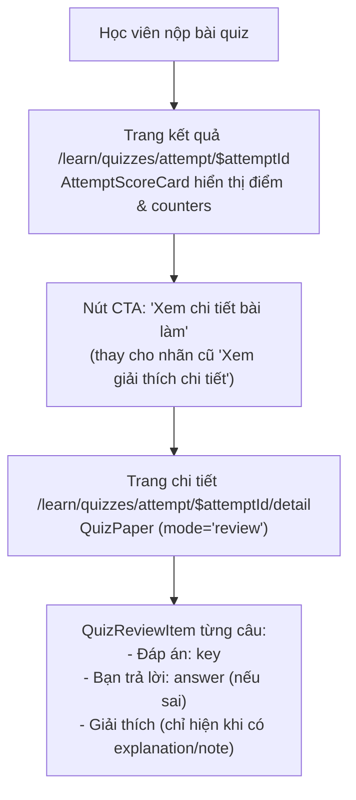

# Plan: #579 — Đổi nhãn nút CTA sang Xem chi tiết bài làm khi bài thi không hứa hẹn giải thích

## Outcome

Học viên sau khi hoàn thành bài tập trắc nghiệm khi nhìn vào màn hình kết quả (`/learn/quizzes/attempt/$attemptId`) sẽ thấy nút CTA chính mang nhãn chuẩn xác **"Xem chi tiết bài làm"** dẫn tới route review (`/learn/quizzes/attempt/$attemptId/detail`). Nút không còn hứa hẹn "giải thích chi tiết" khi đề thi không có dữ liệu `explanation` hay `note`. Khi vào màn hình chi tiết, các câu có giải thích vẫn xem được disclosure "Giải thích", còn các câu không có giải thích hiển thị rõ ràng đáp án đúng và câu trả lời mà không bị ô nhiễm thị giác bởi các dòng thông báo trống lặp đi lặp lại.

## Non-goals

- Không sửa schema hay thêm trường `hasExplanation` / `note` vào `quizAttemptSummarySchema` (`packages/api/src/contracts.ts`) hoặc route `GET /api/student/attempts/:attemptId` (`apps/server/src/routes/student.ts`) vì schema này là `.strict()`, tránh rủi ro vỡ tương thích giữa server và bundle client cũ.
- Không render dòng lặp "Chưa có giải thích" hoặc `
` disabled trên từng câu hỏi trong `QuizReviewItem` (tránh visual clutter trên các đề thi 40 câu reading không có giải thích).
- Không thay đổi logic của `quizReviewExplanation` hay các thuộc tính `data-testid`, `data-source` đang phục vụ test.
- Không sửa code phía giáo viên (phần nhập giải thích đã được hoàn thành độc lập ở #571).

## Nguyên nhân gốc & Dấu vết đầu-cuối (đã xác minh qua điều tra & tham vấn kongming)

1. **Nguyên nhân gốc:**
   - Màn hình kết quả làm bài (`apps/student/src/routes/_auth/learn/quizzes/attempt/$attemptId.tsx:284`): CTA trên `AttemptScoreCard` được đặt chuỗi tĩnh `"Xem giải thích chi tiết"`.
   - Màn hình đích (`apps/student/src/routes/_auth/learn/quizzes/attempt/$attemptId.detail.tsx`): Là trang xem lại toàn bộ bài làm (`QuizPaper` mode="review"). Khối `QuizReviewItem` (`packages/ui/src/components/quiz/quiz-review-item.tsx:114`) chỉ mở disclosure `
` khi `explanation !== null` (câu có `explanation` hoặc đề có `note`).
   - Với các bài tập giáo viên không nhập giải thích (hoặc bài tập tạo trước #571), trang chi tiết hoàn toàn không có nội dung giải thích nào, khiến học viên bấm nút cảm thấy bị hứa hão.
2. **Quyết định thiết kế (Tham vấn kongming):**
   - Đổi nhãn CTA tĩnh thành `"Xem chi tiết bài làm"`. Nhãn này miêu tả chính xác hành động mở trang xem lại bài thi (câu hỏi, đáp án học viên, đáp án đúng, điểm số, và giải thích nếu có), phù hợp với convention UX và route `/detail`.
   - Giữ nguyên `QuizReviewItem` (Phương án A): không thêm dòng "Chưa có giải thích" lặp lại 40 lần gây nhiễu thị giác.
   - Cập nhật toàn bộ các điểm assert nhãn cũ trong `attempt-summary.test.tsx` (7 chỗ) và E2E specs (7 chỗ, đặc biệt là 2 vị trí `toHaveCount(0)` ở Writing và Speaking).

## Architecture / Data Flow

## Phases

| # | Phase | Status |
|---|-------|--------|
| 1 | [Phase 1: Student Route CTA Update & Unit Tests (TDD)](./phase-01-student-cta-and-unit-tests.md) | Completed |
| 2 | [Phase 2: E2E Specs, Quality Gates & Regression Verification](./phase-02-e2e-specs-and-verification.md) | Completed |

## Success Criteria

- [x] Nút CTA trên `AttemptScoreCard` tại `apps/student/src/routes/_auth/learn/quizzes/attempt/$attemptId.tsx` hiển thị nhãn `"Xem chi tiết bài làm"`.
- [x] Không còn bất kỳ chuỗi `"Xem giải thích chi tiết"` nào trong thư mục `apps/` và `packages/`.
- [x] Toàn bộ unit tests tại `apps/student/test/attempt-summary.test.tsx` và `apps/student/test/quiz-review-item.test.tsx` chạy pass.
- [x] 2 vị trí assert phủ định `toHaveCount(0)` trong `student-quiz-take-review.spec.ts` cho Writing và Speaking được cập nhật đúng nhãn mới, không bị xanh giả.
- [x] Các spec E2E (`student-quiz-take-review.spec.ts`, `assignment-prompt-create.spec.ts`) được cập nhật đồng bộ.
- [x] Các lệnh kiểm tra chất lượng code (`biome check`, `check-types`, `pnpm test`) đều pass hoàn toàn.

## Validation Log

### Session 1 — 2026-11-04
- **Tier:** Light (2 phases — Fact Checker + Contract Verifier spot-check)
- **Claims checked:** 12
- **Verified:** 12 | **Failed:** 0 | **Unverified:** 0
- **Key Decisions Confirmed:**
  1. Giữ nguyên API `QuizAttemptSummary` và không thêm trường động (tránh rủi ro strict schema backwards compatibility).
  2. Chọn phương án A cho `QuizReviewItem`: không render "Chưa có giải thích" lặp lại trên mọi câu.
  3. Cập nhật đồng bộ các chỗ assert `toHaveCount(0)` ở nhánh Writing/Speaking trong E2E để tránh assertion xanh giả.

### Whole-Plan Consistency Sweep (Validation)
- Files reread: `plan.md`, `phase-01-student-cta-and-unit-tests.md`, `phase-02-e2e-specs-and-verification.md`
- Decision deltas checked: 3
- Reconciled stale references: 0
- Unresolved contradictions: 0

## Red Team Review

### Session — 2026-11-04
**Findings:** 3 deduplicated (1 High, 2 Medium — 3 accepted)
**Severity breakdown:** 1 High, 2 Medium

| # | Finding | Severity | Disposition | Applied To |
|---|---|---|---|---|
| RT-1 | Hai vị trí `toHaveCount(0)` ở `student-quiz-take-review.spec.ts:1008,1158` sẽ xanh giả nếu chỉ đổi các chỗ `.click()` | High | Accept | Phase 2 Task 2.1 |
| RT-2 | Test `attempt-summary.test.tsx:132` render độc lập với `action` tự truyền, có thể gây lọt lỗi nếu route thực tế không đổi | Medium | Accept | Phase 1 Task 1.1/1.2 |
| RT-3 | Nhãn mới `"Xem chi tiết bài làm"` dài 20 ký tự (ngắn hơn nhãn cũ 22 ký tự), an toàn không tràn trên viewport 375px | Medium | Accept | Success Criteria & Verification |

### Whole-Plan Consistency Sweep (Red-Team)
- Files reread: `plan.md`, `phase-01-student-cta-and-unit-tests.md`, `phase-02-e2e-specs-and-verification.md`
- Decision deltas checked: 3 accepted findings
- Reconciled stale references: 0
- Unresolved contradictions: 0

## Handoff Note (`--advice`)

Plan này được biên soạn theo hợp đồng bàn giao `--advice` (`advice-handover-plan.md`) sẵn sàng cho executor cấp dưới thực thi tuần tự từng task kèm điều kiện `Verify` cơ học và khối `Failure Protocol` bắt buộc dừng + tham vấn `kongming` ngay khi bước kiểm chứng lệch kỳ vọng.

<!-- slug: 579-student-quiz-empty-explanation -->
