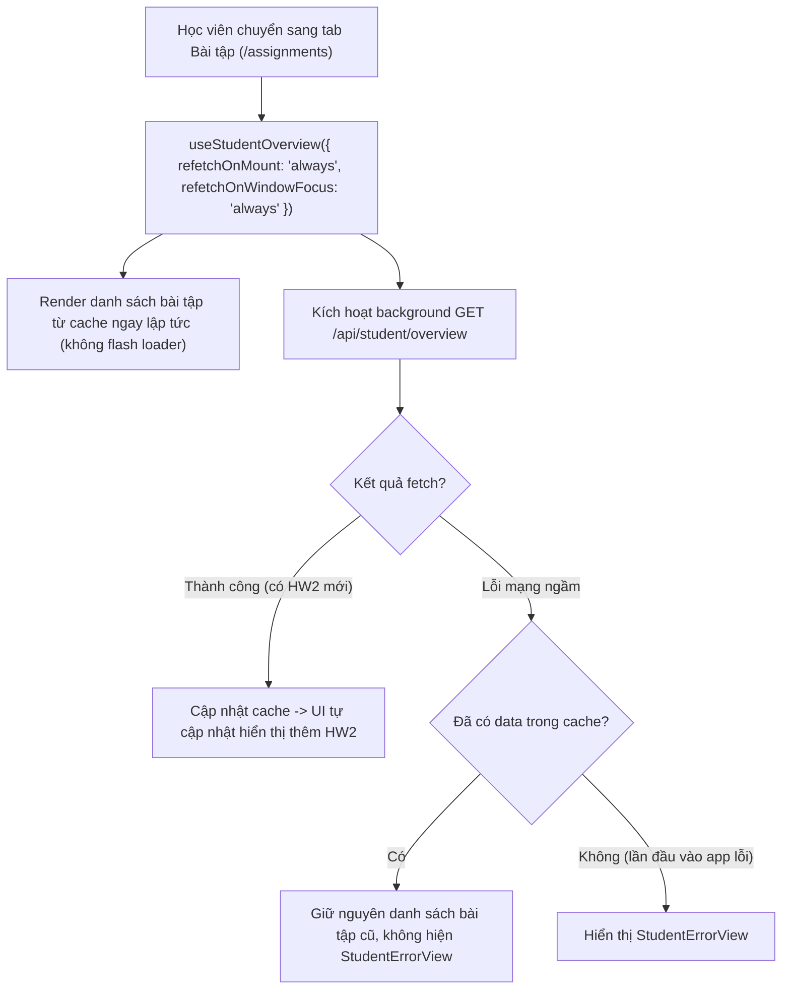

# Plan: #580 — Khắc phục trang Bài tập thiếu bài mới cho tới khi tải lại

> **Handover Notice (`--advice` + `--tdd`):** Plan này được biên soạn theo hợp đồng bàn giao cho executor (`advice-handover-plan.md`). Mỗi phase đều tự chứa danh sách task tuần tự kèm điều kiện `Verify` cơ học (so khớp mã thoát / chuỗi đầu ra) và khối `## Failure Protocol` bắt buộc dừng + gọi `kongming` ngay khi bước `Verify` lệch kỳ vọng.

## Overview

Theo phản ánh từ môi trường staging (dòng #17, Leah, Issue #580): Lần đầu học viên mở trang Bài tập (`/_auth/assignments/`) sau khi xem trang Tổng quan (`/_auth/`) thì chỉ thấy bài tập cũ (Homework 1). Ngay cả khi giáo viên vừa giao thêm Homework 2, học viên vẫn phải F5 tải lại toàn bộ trang thì Homework 2 mới hiển thị.

### Nguyên nhân gốc đã được xác minh qua điều tra & tham vấn cố vấn (`kongming`)
1. **Cache `["student", "overview"]` dùng chung với `staleTime: 60_000` (`apps/student/src/lib/repos/student.ts:331-337`)**:
   - Khi học viên vào Tổng quan (`/_auth/index.tsx`), query `["student", "overview"]` được kích hoạt và nạp danh sách bài tập hiện có vào cache với `staleTime: 60_000` (60 giây).
   - Khi học viên chuyển sang trang Bài tập (`/_auth/assignments/index.tsx`), TanStack Router mount component và gọi `useStudentOverview()`.
   - Vì query key giống hệt nhau và dữ liệu trong cache chưa quá 60 giây (vẫn còn tươi - fresh), TanStack Query mặc định KHÔNG kích hoạt fetch mới (`refetchOnMount` mặc định chỉ refetch khi dữ liệu stale). Do đó học viên không thể nhìn thấy bài mới được giao.
2. **Cấu hình toàn cục `refetchOnWindowFocus: false` (`apps/student/src/lib/query-client.ts:44`)**:
   - Khi học viên chuyển qua tab khác (hoặc app khác) rồi quay lại tab học viên, trang không tự động kiểm tra dữ liệu mới.
3. **Lỗ hổng bảo vệ giao diện khi refetch thất bại (`apps/student/src/routes/_auth/assignments/index.tsx:46-55`)**:
   - Đoạn kiểm tra `if (overviewQuery.error)` hiện tại kiểm tra lỗi mà không để ý `overviewQuery.data` đã tồn tại hay chưa. Nếu kích hoạt refetch ngầm mà gặp sự cố mạng tạm thời, lỗi refetch sẽ làm bay mất danh sách bài tập đang có và thay bằng `StudentErrorView`.

## Goals

| # | Goal | Priority |
|---|------|----------|
| 1 | Tham số hóa `useStudentOverview` trong `apps/student/src/lib/repos/student.ts` cho phép nhận `options` (`refetchOnMount`, `refetchOnWindowFocus`), giữ nguyên mặc định cho các màn hình khác (Tổng quan, Lớp học) để tránh phát sinh request thừa | P1 |
| 2 | Cấu hình `refetchOnMount: "always"` và `refetchOnWindowFocus: "always"` trong `apps/student/src/routes/_auth/assignments/index.tsx` để trang Bài tập luôn kiểm tra bài mới ngầm ngay khi vào trang và khi quay lại tab | P1 |
| 3 | Sửa nhánh xử lý lỗi trong `apps/student/src/routes/_auth/assignments/index.tsx` thành `if (overviewQuery.error && !overviewQuery.data)` để giữ lại dữ liệu hiển thị mượt mà khi background refetch gặp lỗi mạng | P1 |
| 4 | Viết bộ kiểm thử TDD (unit hook test và component test) tái hiện chính xác hiện tượng cache cũ, chứng minh refetch khi mount và window focus, đồng thời kiểm tra tính kiên cố khi background refetch lỗi | P1 |

## Non-goals (Advisor Scope Lock)

- Không thay đổi cấu hình toàn cục `refetchOnWindowFocus: false` hay `staleTime: 60_000` trong `apps/student/src/lib/query-client.ts` (vì ảnh hưởng đến các luồng làm bài thi quiz và các trang khác).
- Không ép buộc `refetchOnMount: "always"` trên trang Tổng quan (`/_auth/index.tsx`) hoặc Lớp học (`/_auth/classes/index.tsx`) để tránh request bão hòa không cần thiết.
- Không thêm polling định kỳ (`refetchInterval`) hay hạ tầng WebSocket/SSE ngoài phạm vi issue.
- Không sửa đổi schema hay API route của server Hono (`/api/student/overview` giữ nguyên).

## Architecture / Flow

## Phases

| # | Phase | Status |
|---|-------|--------|
| 1 | [Phase 1: Tham số hóa hook useStudentOverview và cấu hình trang Bài tập](./phase-01-hook-options-and-assignments-route.md) | Completed |
| 2 | [Phase 2: Bộ kiểm thử TDD và kiểm tra chất lượng mã nguồn](./phase-02-tests-and-verification.md) | Completed |

## Success Criteria

- [x] `useStudentOverview` nhận `options?: UseStudentOverviewOptions` và giữ nguyên mặc định khi không truyền options.
- [x] Trang Bài tập (`/_auth/assignments/index.tsx`) truyền `refetchOnMount: "always"` và `refetchOnWindowFocus: "always"`.
- [x] Khi có dữ liệu trong cache, background refetch chạy ngầm không gây flash loader (`isLoading` vẫn false), và nếu refetch lỗi thì danh sách vẫn hiển thị thay vì sập sang màn hình lỗi.
- [x] Bộ test tự động kiểm chứng tái hiện lỗi khi không có options và giải quyết triệt để khi có options.
- [x] `pnpm check`, `pnpm check-types`, `pnpm --filter student test` đạt 100% pass.

## Red Team Review

### Session — 2026-11-04
**Reviewers:** Security Adversary, Assumption Destroyer, Performance & UX Watcher
**Findings:** 4 deduplicated (4 accepted, 0 rejected)
**Severity breakdown:** 1 High, 2 Medium, 1 Low

| # | Finding | Severity | Disposition | Applied To |
|---|---------|----------|-------------|------------|
| 1 | Background refetch thất bại sẽ xóa danh sách bài tập và thay bằng `StudentErrorView` do `if (overviewQuery.error)` | High | Accept | Phase 1 (Sửa thành `if (overviewQuery.error && !overviewQuery.data)`) |
| 2 | `refetchOnWindowFocus: true` không có tác dụng nếu data chưa stale (< 60s); cần dùng `"always"` | Medium | Accept | Phase 1 (Dùng `"always"` cho cả refetchOnMount và refetchOnWindowFocus) |
| 3 | Tùy chọn `"always"` nếu gắn vào hook gốc sẽ rò rỉ sang Tổng quan và Lớp học làm tăng tải API | Medium | Accept | Phase 1 (Tham số hóa hook, chỉ áp dụng tại trang Bài tập) |
| 4 | Test focus trình duyệt bằng DOM Event `window.dispatchEvent` có thể flaky trong môi trường jsdom | Low | Accept | Phase 2 (Sử dụng `focusManager.setFocused()` từ `@tanstack/react-query`) |

### Whole-Plan Consistency Sweep (Red Team)
- Files reread: `plan.md`, `phase-01-hook-options-and-assignments-route.md`, `phase-02-tests-and-verification.md`
- Decision deltas checked: 4
- Reconciled stale references: 4
- Unresolved contradictions: 0
