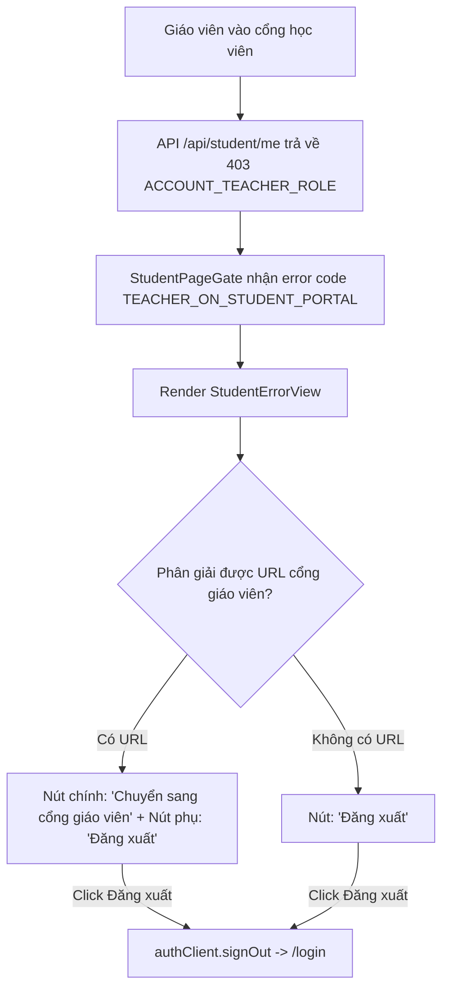

# Plan: Thêm liên kết sang cổng giáo viên và tối ưu hóa lối ra cho tài khoản giáo viên ở cổng học viên

## Outcome
Khi người dùng đang có phiên đăng nhập tài khoản giáo viên truy cập vào cổng học viên (`apps/student`), màn hình chặn `TEACHER_ON_STUDENT_PORTAL` cung cấp:
1. Thông điệp hướng dẫn rõ ràng: nêu rõ tài khoản hiện tại là giáo viên và hướng dẫn cách chuyển sang cổng giáo viên hoặc đăng xuất để dùng tài khoản học viên.
2. Nút/Liên kết trực tiếp sang cổng giáo viên (`app.<domain>` trên prod/staging, `localhost:8001` / `localhost:8101` ở dev/e2e; ẩn an toàn khi không phân giải được host lạ).
3. Nút đăng xuất tài khoản đưa người dùng về thẳng form đăng nhập của học viên (`/login`).

## Architecture & Data Flow

## Phases
| # | Phase | Trạng thái | Ước lượng |
|---|---|---|---|
| 1 | [Bổ sung liên kết cổng giáo viên và kiểm thử StudentErrorView](phase-01-teacher-portal-link-and-guidance.md) | pending | 1h |

## Acceptance Criteria
- [ ] Màn hình `StudentErrorView` khi `code === ACCOUNT_ERROR_CODES.TEACHER_ON_STUDENT_PORTAL` hiển thị liên kết sang cổng giáo viên khi phân giải được URL.
- [ ] URL cổng giáo viên suy luận theo topology: `student.<domain>` -> `app.<domain>`, `localhost:8003` -> `localhost:8001`, `localhost:8103` -> `localhost:8101`; trả về `undefined` với host lạ.
- [ ] Khi URL trả về `undefined`, ẩn nút liên kết và giữ nút Đăng xuất an toàn.
- [ ] Bấm nút "Đăng xuất" thực hiện sign-out và điều hướng về `/login` của cổng học viên.
- [ ] Bổ sung unit tests trong `apps/student/test/teacher-portal-url.test.ts` và `apps/student/test/overview.test.tsx`.
- [ ] Ghi nhận một dòng fix vào `CHANGELOG.md`.
- [ ] Toàn bộ kiểm tra tự động (`pnpm --filter student test`, `pnpm check`, `pnpm check-types`) vượt qua.
