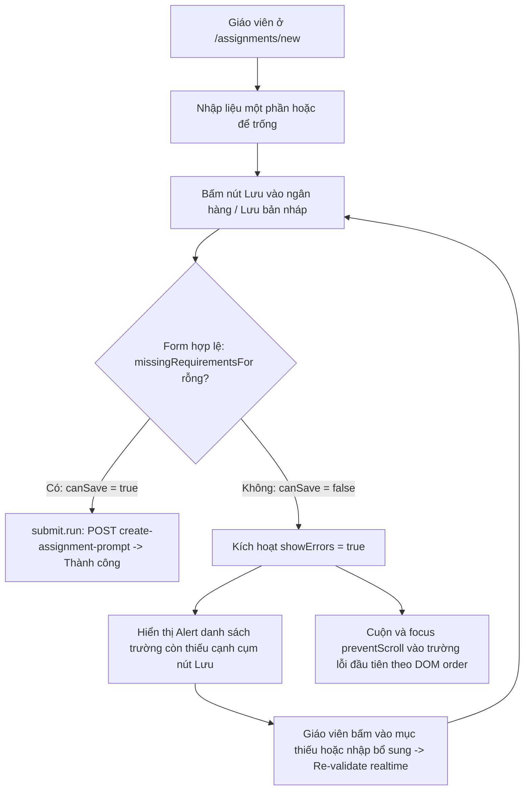

# Plan: Fix Assignment Save Button Disabled & Missing Fields Feedback (#581)

## Outcome

1. **Nút Lưu luôn bấm được:** Nút "Lưu vào ngân hàng" / "Lưu bản nháp" tại `/assignments/new` không còn bị vô hiệu hóa (`disabled`) khi form chưa hoàn chỉnh. Nút chỉ bị disable khi `submit.saving === true` để chống double-submit.
2. **Hiển thị rõ danh sách việc còn thiếu:** Khi giáo viên bấm nút Lưu trong khi dữ liệu chưa đạt điều kiện (`!canSave`), giao diện kích hoạt `showErrors(true)` và hiển thị ngay cạnh cụm nút Lưu trong thanh hành động sticky một danh sách các điều kiện/trường còn thiếu (`missingRequirementsFor`) với `role="alert"` rõ ràng, trực quan.
3. **Đồng bộ tuyệt đối:** `canSave` được định nghĩa trực tiếp từ `missingRequirementsFor(value, status).length === 0` để loại bỏ hoàn toàn nguy cơ lệch điều kiện giữa nút lưu và danh sách cảnh báo.
4. **Tự động focus trường lỗi đầu tiên:** Khi bấm Lưu không thành công, trang tự động cuộn mượt (`scrollIntoView?.({ block: "center" })`) và đặt con trỏ focus (`el.focus({ preventScroll: true })`) vào trường lỗi đầu tiên theo đúng thứ tự DOM (dạng đề, tiêu đề, nội dung bài đọc/viết, audio, câu hỏi...).
5. **Thanh hành động sticky vững chắc:** Thanh hành động dưới đáy được củng cố với `z-20`, hỗ trợ safe-area (`pb-[max(0.75rem,env(safe-area-inset-bottom))]`), layout linh hoạt trên cả 3 viewport (mobile 375px, tablet 768px, desktop 1440px), có giới hạn chiều cao `max-h-36 overflow-y-auto` trên mobile để không choán hết màn hình.

## Non-goals

- Không thay đổi các quy tắc xác thực cốt lõi của đề thi (quy tắc option bank, cloze stem, pin ảnh, audio...).
- Không tự động submit khi chưa thỏa mãn điều kiện hợp lệ.
- Không thay đổi luồng lưu của trang khác ngoài route tạo đề mới (`/assignments/new`).

## Architecture & Flow

## Phases

| # | Phase | Trạng thái |
|---|---|---|
| 1 | [Logic kiểm tra và trích xuất trường còn thiếu đồng bộ](phase-01-validation-and-blockers-logic.md) | completed |
| 2 | [Giao diện thanh sticky, danh sách lỗi cạnh nút và focus trường](phase-02-ui-sticky-bar-and-focus.md) | completed |
| 3 | [Kiểm thử tương tác và xác minh chất lượng](phase-03-tests-and-viewport-verification.md) | completed |

## Acceptance Criteria

- [x] Nút "Lưu vào ngân hàng" và "Lưu bản nháp" không có thuộc tính `disabled` khi form chưa điền đủ (chỉ disable khi `submit.saving`).
- [x] `canSave` đồng bộ tuyệt đối với `missingRequirementsFor(value, status).length === 0`.
- [x] Danh sách `missingRequirementsFor` sắp xếp đúng theo thứ tự hiển thị DOM: dạng đề (nếu ready), tiêu đề, nội dung bài (prompt/passage/cueTopic), audio, câu hỏi/đáp án/ảnh.
- [x] Khi bấm Lưu với form chưa đủ điều kiện, các trường báo lỗi đỏ trong form (`PromptComposer`) được kích hoạt đồng thời.
- [x] Ngay tại thanh sticky bên cạnh cụm nút Lưu xuất hiện hộp cảnh báo `role="alert"` liệt kê cụ thể các mục còn thiếu, click vào từng mục hỗ trợ nhảy tới trường đó.
- [x] Trang tự động cuộn và focus vào input/editor của trường lỗi đầu tiên với `scrollIntoView?.({ block: "center" })` và `focus({ preventScroll: true })`.
- [x] Thanh sticky hiển thị chuẩn xác ở 3 viewport: 375×812 (mobile), 768×1024 (tablet), 1440×900 (desktop), có `z-20` và safe-area padding.
- [x] Bộ test tương tác mới `new-submit.test.tsx` (jsdom) và các unit test cũ đều pass 100%.
- [x] Code check đạt chuẩn: `pnpm check` và `pnpm check-types` không có lỗi.
