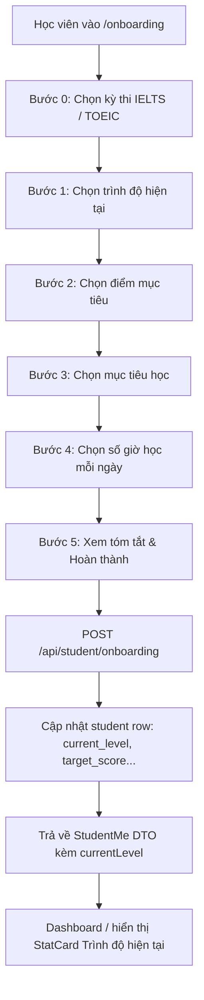

# Plan: Hỏi trình độ hiện tại trong onboarding học viên

## Outcome
Học viên mới khi thực hiện onboarding được hỏi về trình độ hiện tại (tự đánh giá) phù hợp với kỳ thi quan tâm (IELTS / TOEIC), lưu trữ vào hồ sơ học viên (`current_level` trong bảng `student`), và hiển thị trực quan trên Dashboard của học viên. Học viên cũ đã hoàn thành onboarding không bị ép làm lại, giao diện fail-soft an toàn khi chưa có dữ liệu.

## Architecture & Data Flow

## Decisions & Scope Lock (Advisor Supervised)
1. **Thứ tự bước:** Đặt câu hỏi trình độ hiện tại ngay sau bước chọn kỳ thi (Bước 1) và trước bước chọn mục tiêu điểm số (Bước 2). Tổng số bước wizard tăng từ 4 lên 5.
2. **Key hằng số độc lập kỳ thi:** Định nghĩa `CURRENT_LEVEL_OPTIONS = ["beginner", "basic", "intermediate", "upper-intermediate", "advanced", "unsure"] as const`. Key được lưu vào DB (thay vì lưu chuỗi hiển thị).
3. **Nhãn hiển thị theo kỳ thi:**
   - IELTS: beginner ("Mới bắt đầu / Mất gốc"), basic ("Dưới 4.5"), intermediate ("4.5 – 5.5"), upper-intermediate ("6.0 – 6.5"), advanced ("7.0 trở lên"), unsure ("Chưa rõ / Chưa thi").
   - TOEIC: beginner ("Mới bắt đầu / Mất gốc"), basic ("Dưới 350"), intermediate ("350 – 550"), upper-intermediate ("550 – 750"), advanced ("750 trở lên"), unsure ("Chưa rõ / Chưa thi").
4. **Học viên đã hoàn tất onboarding:** Cột `current_level` trong bảng `student` là `text` nullable. Không ép học viên cũ onboarding lại. Không backfill dữ liệu giả.
5. **Hiển thị Dashboard:** Trên `apps/student/src/routes/_auth/index.tsx`, hiển thị `StatCard` "Trình độ hiện tại" khi `me.student.currentLevel && me.student.currentLevel !== "unsure"`. Đặt trước "Band mục tiêu" để tạo thứ tự trực quan: Hiện tại → Mục tiêu.

## Phases

| # | Phase | Trạng thái | Ước lượng |
|---|---|---|---|
| 1 | [Schema, Migration và API Contracts](phase-01-schema-and-contracts.md) | pending | 30m |
| 2 | [Server Route và Onboarding Wizard UI](phase-02-server-api-and-wizard-ui.md) | pending | 45m |
| 3 | [Dashboard Stat Card và Unit Tests](phase-03-dashboard-stat-and-tests.md) | pending | 45m |

## Acceptance Criteria
- [ ] `CURRENT_LEVEL_OPTIONS` được xuất từ `@teacher-os/api/contracts`, payload schema yêu cầu `currentLevel`.
- [ ] Schema `student` có cột `current_level` text nullable, migration Drizzle mới được sinh và verify.
- [ ] Server mapping `buildStudentMe` và POST `/api/student/onboarding` hỗ trợ `currentLevel`.
- [ ] Onboarding wizard mở rộng thành 5 bước với progress indicator `1..5/5`.
- [ ] Khi đổi kỳ thi (IELTS <-> TOEIC), cả `targetScore` và `currentLevel` đều được reset.
- [ ] `OnboardingSummary` hiển thị đầy đủ thông tin kỳ thi, trình độ hiện tại, mục tiêu điểm số, mục tiêu học, thời gian học.
- [ ] Dashboard sinh viên hiển thị StatCard "Trình độ hiện tại" khi có dữ liệu (và không phải `unsure`).
- [ ] Toàn bộ unit tests tại `apps/server` và `apps/student` pass, local gates `pnpm check`, `pnpm check-types` pass.
