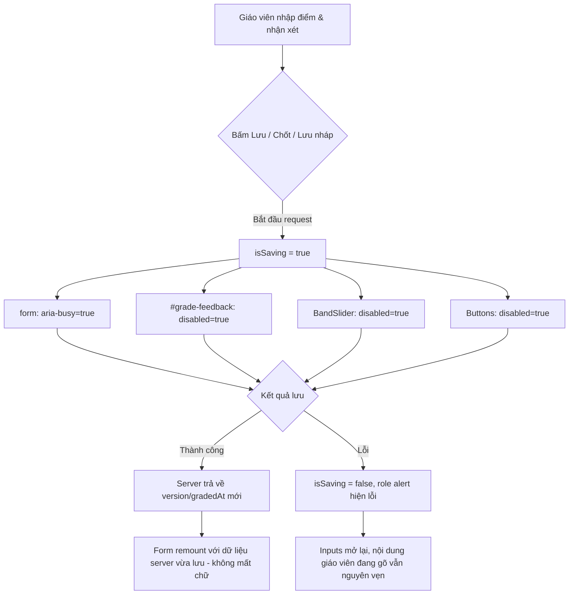

# fix(grading): khóa ô nhận xét và slider khi đang lưu để chống mất chữ (#615)

## Overview

Trong màn hình chấm bài (`/grading/:attemptId`), khi giáo viên nhấn "Chốt trả bài" / "Lưu điểm" hoặc "Lưu bản nháp", request API được gửi đi bất đồng bộ. Trong lúc request đang bay, form vẫn cho phép gõ tiếp vào ô nhận xét `#grade-feedback` và kéo thanh trượt `BandSlider`. Khi request lưu thành công, server trả về `gradedAt` mới hoặc `draft.version` mới, làm đổi `key` của `GradeForm` (`draftActive ? draft-${draft.version} : data.grade?.gradedAt ?? "new"`), khiến React remount form và reset lại toàn bộ state theo dữ liệu server vừa lưu. Chữ gõ thêm trong lúc lưu bị biến mất hoàn toàn không có cảnh báo.

Giải pháp:
1. Đặt `const isSaving = saving || Boolean(savingDraft);` trong `GradeForm`.
2. Gắn `data-testid="grade-form"` và `aria-busy={isSaving}` trên thẻ `<form>`.
3. Gắn `disabled={isSaving}` trên `<Textarea id="grade-feedback">` (ngăn hoàn toàn gõ phím, paste, IME buffer flush và thống nhất trạng thái form disabled theo chuẩn của `GradeModal`).
4. Bổ sung prop `disabled?: boolean` cho `BandSlider` và truyền `disabled={isSaving}` trong `GradeForm`.
5. Bổ sung guard chống mutation state React khi `isSaving` cho cả `BandSlider.onChange` và `Textarea.onChange`.
6. Mở rộng guard submit và disable nút "Chốt trả bài" khi `isSaving` (chống race condition và double-click khi đang lưu).

## Architecture & Flow

## Advisor Scope Lock (Kongming Advisory & Red Team Adjudication)

- **Phạm vi khóa (In-scope):**
  - Khóa ô nhận xét với `disabled={isSaving}` (đồng bộ với `BandSlider` và tiền lệ `GradeModal` `inputsDisabled`, chặn triệt để IME flush và paste trong lúc request đang bay).
  - Khóa `BandSlider` với `disabled={isSaving}`.
  - Thêm guard `if (!isSaving)` trong `onChange` của `BandSlider` và `Textarea` để phòng thủ theo chiều sâu (defense-in-depth).
  - Gắn `data-testid="grade-form"` và `aria-busy={isSaving}` lên `<form>`.
  - Mở rộng guard submit (`isSaving`) cho cả publish và draft save, chống double-click.
  - Viết unit test TDD đầy đủ cho `saving` và `savingDraft` trong `grade-form.test.tsx` cùng integration test trong `index.test.tsx`.
- **Ngoài phạm vi (Non-goals / What to avoid):**
  - Không sửa cơ chế `key` remount ở `$attemptId.tsx` (thiết kế server-authoritative reset là chuẩn của repo).
  - Không sửa cấu trúc role/permission `canPublishGrade` ở kernel (thuộc phạm vi khác).
  - Không thêm spinner overlay che toàn bộ form gây ảnh hưởng a11y.

## Phases
| # | Phase | Status | File |
|---|---|---|---|
| 1 | TDD Red Tests | Completed | [phase-01-tdd-red-tests.md](./phase-01-tdd-red-tests.md) |
| 2 | Lock Inputs on Save | Completed | [phase-02-lock-inputs-on-save.md](./phase-02-lock-inputs-on-save.md) |
| 3 | Verify & Quality Gates | Completed | [phase-03-verify-and-quality-gates.md](./phase-03-verify-and-quality-gates.md) |
## Success Criteria

- [x] `#grade-feedback` có thuộc tính `disabled` khi `saving={true}` hoặc `savingDraft={true}`.
- [x] Tất cả các thanh trượt `BandSlider` có thuộc tính `disabled` khi `saving={true}` hoặc `savingDraft={true}`.
- [x] `<form>` có `data-testid="grade-form"` và `aria-busy="true"` khi `saving={true}` hoặc `savingDraft={true}`.
- [x] Nút "Chốt trả bài" bị disable khi `savingDraft={true}` và `onSubmit` chặn submit khi `isSaving`.
- [x] `BandSlider.onChange` và `Textarea.onChange` không cập nhật state khi `isSaving` là true.
- [x] Khi có lỗi lưu, inputs được mở lại bình thường và giữ nguyên dữ liệu đã nhập.
- [x] Tất cả các unit test và routing tests liên quan pass (exit 0).
- [x] `pnpm check` và `pnpm check-types` pass sạch không có lỗi.
## Red Team Review

### Session — 2026-11-05
**Reviewers:** Security Adversary, Failure Mode Analyst, Assumption Destroyer.
**Findings:** 13 total across 3 lenses.
**Adjudication Summary:** 6 accepted (addressed in Phase 1, Phase 2, Phase 3), 7 rejected (out-of-scope architectural overhaul or non-issue).

| # | Finding | Severity | Disposition | Applied To |
|---|---------|----------|-------------|------------|
| 1 | `readOnly` creates false affordance & is destroyed by key remount anyway | Critical | Accept | Plan Overview, Phase 2 (switch to `disabled`) |
| 2 | Unguarded `onChange` in `BandSlider` & `Textarea` during save | High | Accept | Phase 2 (Task 2.1 & 2.2 defense-in-depth) |
| 3 | False "Red" verify trap in Task 1.2 due to `!complete` | Critical | Accept | Phase 1 (Task 1.2 test setup) |
| 4 | Missing accessible selector `data-testid="grade-form"` | Medium | Accept | Phase 1 & Phase 2 |
| 5 | Missing route-level in-flight pending integration test | Medium | Accept | Phase 3 (Task 3.1) |
| 6 | Double-click on "Lưu bản nháp" before render tick | High | Accept | Phase 2 (Task 2.2 synchronous guard) |
| 7 | Fail-open default `canPublish = true` in GradeForm | Critical | Reject (out-of-scope) | Scope Lock (existing backend role auth intact) |
| 8 | Falsy fallback in `draftInitialGrade` for blanked feedback | High | Reject (out-of-scope) | Scope Lock (separate draft data issue) |
| 9 | Background AI polling remounting form mid-typing | High | Reject (out-of-scope) | Scope Lock (polling only occurs when `ai_processing`) |

### Whole-Plan Consistency Sweep
- All phase files updated to use `disabled` for `#grade-feedback` (matching `BandSlider` and `GradeModal`).
- Verified all phase dependencies, success criteria, and mechanical verify commands.
- Zero unresolved contradictions.

<!-- slug: fix-grading-feedback-loss-on-save -->