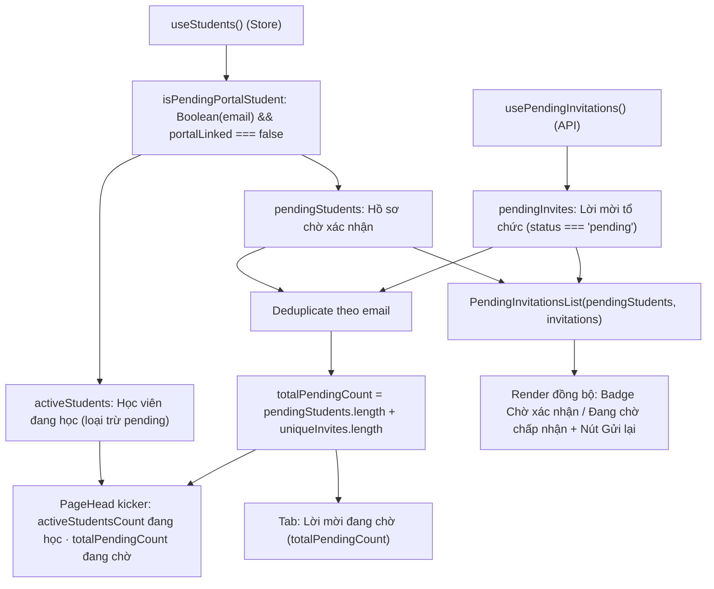

# Plan: #616 — Thống nhất định nghĩa "Đang chờ" và "Đang học"

> **Handover Notice (`--advice` + `--tdd`):** Plan này được biên soạn theo hợp đồng bàn giao cho executor (`advice-handover-plan.md`). Mỗi phase đều tự chứa danh sách task tuần tự kèm điều kiện `Verify` so khớp cơ học và khối `## Failure Protocol` bắt buộc dừng + gọi `kongming` ngay khi bước `Verify` lệch kỳ vọng.

## Overview

Khắc phục triệt để lỗi #616 tại trang quản lý học viên (`/students` — `apps/web/src/routes/_auth/students/index.tsx`):
1. **Thống nhất định nghĩa trạng thái:** Học viên có email và chưa hoàn tất cổng (`Boolean(s.email?.trim()) && s.portalLinked === false`) được xác định là "Chờ xác nhận", thuộc nhóm "Lời mời đang chờ" và **không** tính vào số "Học viên đang học". Học viên không có email (`!s.email`) hoặc đã hoàn tất cổng (`s.portalLinked === true`) tiếp tục được tính vào "Học viên đang học".
2. **Hợp nhất số đếm trên giao diện:** Kicker đầu trang hiển thị chuẩn xác `${activeStudentsCount} học viên đang học · ${totalPendingCount} lời mời đang chờ`. Tab "Lời mời đang chờ" hiển thị badge tổng số `totalPendingCount` (gồm học viên chờ xác nhận + lời mời pending trong bảng `student_invitation`, có deduplicate theo email). Tab "Học viên" giữ nguyên `students.length` phản ánh toàn bộ danh sách hồ sơ trong tổ chức.
3. **Hiển thị danh sách trong tab Lời mời đang chờ:** Mở rộng `PendingInvitationsList` nhận `pendingStudents`, hiển thị cả hồ sơ học viên chờ xác nhận kèm nút "Gửi lại lời mời" (`kind: "student"`, `recipientLabel: s.email`). Trạng thái loading hoặc lỗi của API lời mời không che khuất danh sách học viên đang chờ.

## Nguyên nhân gốc đã xác minh (`/ak-debug` + Red Team)

1. **Hai nguồn dữ liệu phân mảnh:**
   - Khi giáo viên dùng modal "Mời học viên", server ghi nhận vào bảng `student_invitation` (trạng thái `pending`).
   - Khi giáo viên dùng modal "Thêm học viên" với email, server tạo hồ sơ `student` với `onboardingCompletedAt = NULL` (`portalLinked: false`), không tạo dòng `student_invitation`.
2. **Tính toán số đếm và render lệch chuẩn tại `/students` (`index.tsx`):**
   - Kicker đầu trang dùng `${students.length} học viên đang học` (gộp cả học viên `portalLinked === false`) và `${pendingInvites.length} lời mời đang chờ` (chỉ đọc từ `usePendingInvitations()`).
   - Tab "Lời mời đang chờ" chỉ đếm và render từ `usePendingInvitations()`, trong khi `PendingInvitationsList` không nhận dữ liệu học viên từ route cha, dẫn đến tab báo 0 và rỗng dù danh sách học viên có nhãn "Chờ xác nhận".

## Non-goals (Advisor Scope Lock)

- **Không sửa schema DB hay endpoint backend:** Không tạo thêm endpoint gộp hay tự động sinh `student_invitation` khi thêm học viên; logic xử lý nằm trọn vẹn ở client web.
- **Không dùng `!s.portalLinked` lỏng lẻo:** Giữ nguyên quy tắc so khớp chặt chẽ `s.portalLinked === false` để an toàn trước deploy skew (snapshot cũ có `portalLinked === undefined` không bị coi là pending).
- **Không thêm nút "Thu hồi" cho dòng học viên:** Hồ sơ học viên không phải là bản ghi `student_invitation` có thể xóa hủy qua endpoint cancel; chỉ giữ nút "Gửi lại lời mời".
- **Không can thiệp vào bộ lọc hoặc state `activeTab`:** Không tự ý chuyển tab khi số lượng thay đổi; giữ nguyên phân tách các chip filter.

## Goals

| # | Goal | Priority |
|---|------|----------|
| 1 | Tạo helper dùng chung `isPendingPortalStudent`, viết unit test, và nâng cấp `PendingInvitationsList` hỗ trợ `pendingStudents` kèm xử lý loading/error/empty chuẩn mực | P1 |
| 2 | Cập nhật route `/students` tính toán đúng `activeStudentsCount`, `totalPendingCount`, cập nhật kicker và tab label, hoàn tất bộ test route và kiểm tra toàn bộ chất lượng code | P1 |

## Architecture / Flow

## Phases

| # | Phase | Status |
|---|-------|--------|
| 1 | [Phase 1: Helper kiểm tra và nâng cấp PendingInvitationsList](./phase-01-pure-helper-and-component-tests.md) | Completed |
| 2 | [Phase 2: Hợp nhất số đếm tại route /students và kiểm chứng hồi quy](./phase-02-web-ui-unification-and-route-tests.md) | Completed |

## Success Criteria

- [x] Kicker đầu trang `/students` hiển thị `${activeStudentsCount} học viên đang học · ${totalPendingCount} lời mời đang chờ`, không tính học viên có email chưa liên kết cổng vào số đang học.
- [x] Tab "Lời mời đang chờ" hiển thị đúng số tổng `totalPendingCount`, và khi chuyển sang tab sẽ thấy đầy đủ danh sách học viên chờ xác nhận kèm nút "Gửi lại lời mời".
- [x] Empty state của tab "Lời mời đang chờ" chỉ hiển thị khi cả học viên chờ xác nhận lẫn lời mời từ API đều bằng 0.
- [x] Toàn bộ test suite web (`pnpm --filter web test`), kiểm tra kiểu (`pnpm check-types`), và lint (`pnpm check`) pass 100%.

## Red Team Review

### Session — 2026-11-05
**Reviewers:** Security Adversary, Assumption Destroyer (Light Tier: 2 Reviewers, 2 Phases)
**Findings:** 2 deduplicated (2 accepted, 0 rejected)

| # | Finding | Severity | Disposition | Applied To |
|---|---------|----------|-------------|------------|
| 1 | `s.email?.trim().toLowerCase()` có thể crash nếu `email` mang kiểu lạ trong runtime/test cũ; cần `(s.email ?? "").trim().toLowerCase()` | Medium | Accept | Phase 1 (Task 1.1, Task 1.3), Phase 2 (Task 2.2) |
| 2 | `PendingInvitationsList` return early khi `isLoading` hoặc `error` làm giấu mất `pendingStudents`; cần chỉ return early khi `pendingStudents.length === 0` | High | Accept | Phase 1 (Task 1.2, Task 1.3) |

### Whole-Plan Consistency Sweep (Red Team)
- Files reread: `plan.md`, `phase-01-pure-helper-and-component-tests.md`, `phase-02-web-ui-unification-and-route-tests.md`
- Decision deltas checked: 2
- Reconciled stale references: 0
- Unresolved contradictions: 0

## Validation Log

### Verification Results (2026-11-05)
- **Tier:** Light (Fact Checker across 2 phases)
- **Claims checked:** 10
- **Verified:** 10 | **Failed:** 0 | **Unverified:** 0
- **Key Decisions Confirmed (autonomous `--vibe` mode):**
  1. Giữ kiểm tra chặt chẽ `portalLinked === false` để an toàn trước deploy skew (`undefined` không bị coi là chờ xác nhận).
  2. Truyền `pendingStudents` qua props cho `PendingInvitationsList` để đồng bộ hoàn toàn giữa Route Kicker, Tab Label và danh sách hiển thị.
  3. Không thay đổi backend, DB schema hay API contracts; toàn bộ giải pháp nằm ở client Web UI.

### Whole-Plan Consistency Sweep (Validate)
- Files reread: `plan.md`, `phase-01-pure-helper-and-component-tests.md`, `phase-02-web-ui-unification-and-route-tests.md`
- Decision deltas checked: 2
- Reconciled stale references: 0 remaining
- Unresolved contradictions: 0

<!-- slug: 616-pending-invitations-sync -->
