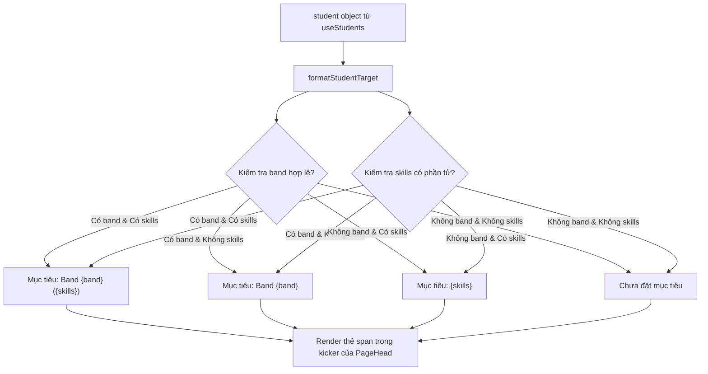

# fix(students): chuẩn hóa định dạng dòng mục tiêu học viên, khắc phục Band — () (#617)

## Overview

Trang chi tiết học viên (`apps/web/src/routes/_auth/students/$studentId.tsx:177`) đang render trực tiếp chuỗi:
`Mục tiêu: Band {student.targetBand} ({student.skills.join(", ")})` mà không kiểm tra dữ liệu.
Trong khi đó, repo khởi tạo học viên từ kernel snapshot (`apps/web/src/lib/repos/students.ts:70-71`) với mặc định `targetBand: "—"` và `skills: []`. Khi xem chi tiết học viên mới tạo hoặc học viên chưa đặt mục tiêu, kicker hiển thị chuỗi bất thường `Mục tiêu: Band — ()`.

Giải pháp:
1. Tạo hàm thuần `formatStudentTarget(student: { targetBand?: string | null; skills?: string[] | null }): string` trong `apps/web/src/lib/format-student-target.ts`.
2. Chuẩn hóa band: trim chuỗi, coi `""`, `"—"`, whitespace hoặc undefined là rỗng (chưa đặt band).
3. Chuẩn hóa skills: lọc các phần tử rỗng hoặc chỉ chứa khoảng trắng.
4. Áp dụng quy tắc định dạng theo tư vấn của `kongming`:
   - Có band, có skills: `Mục tiêu: Band {band} ({skills.join(", ")})`
   - Có band, không skills: `Mục tiêu: Band {band}` (bỏ cặp ngoặc rỗng)
   - Không band, có skills: `Mục tiêu: {skills.join(", ")}`
   - Không band, không skills: `Chưa đặt mục tiêu` (nhất quán với "Chưa có SĐT", "Chưa có email" trong cùng kicker)
5. Tích hợp `formatStudentTarget` vào `apps/web/src/routes/_auth/students/$studentId.tsx:176-178`.
6. Viết bộ unit test TDD đầy đủ cho helper và integration test cho route `$studentId.tsx`.

## Architecture & Flow

## Advisor Scope Lock (Kongming Advisory & Red Team Adjudication)

- **Phạm vi khóa (In-scope):**
  - Tạo helper thuần `formatStudentTarget` tại `apps/web/src/lib/format-student-target.ts`.
  - Viết unit test TDD toàn diện tại `apps/web/src/lib/format-student-target.test.ts`.
  - Thay thế chuỗi render cứng tại `apps/web/src/routes/_auth/students/$studentId.tsx:176-178` bằng `{formatStudentTarget(student)}`.
  - Bổ sung test case kiểm tra hiển thị "Chưa đặt mục tiêu" trong `apps/web/src/routes/_auth/students/$studentId.test.tsx`.
- **Ngoài phạm vi (Non-goals / What to avoid):**
  - Không sửa giá trị mặc định `targetBand: "—"` trong `apps/web/src/lib/repos/students.ts` (tránh ảnh hưởng domino tới search, dashboard, và các màn hình khác).
  - Không sửa `class-roster-tab.tsx:143` (hiển thị "Band —" trong ô bảng của roster là lỗi riêng ngoài phạm vi issue #617, sẽ ghi nhận follow-up trong PR).
  - Không ẩn toàn bộ thẻ chứa mục tiêu khi thiếu dữ liệu (giữ "Chưa đặt mục tiêu" để nhất quán với "Chưa có SĐT" và "Chưa có email" trong cùng kicker).
  - Không sửa đổi schema database hay API backend (chỉ sửa lớp hiển thị giao diện web).

## Phases

| # | Phase | Status | File |
|---|---|---|---|
| 1 | Format Helper TDD | Completed | [phase-01-format-helper-tdd.md](./phase-01-format-helper-tdd.md) |
| 2 | Integrate Student Detail Route | Completed | [phase-02-integrate-student-detail-route.md](./phase-02-integrate-student-detail-route.md) |
| 3 | Verify & Quality Gates | Completed | [phase-03-verify-and-quality-gates.md](./phase-03-verify-and-quality-gates.md) |

## Success Criteria

- [x] `formatStudentTarget` trả về đúng 4 trường hợp theo bảng quy tắc định dạng.
- [x] Học viên DB mặc định (`targetBand: "—"`, `skills: []`) hiển thị `"Chưa đặt mục tiêu"`.
- [x] Không còn xuất hiện chuỗi `"Mục tiêu: Band — ()"` hoặc `"Band —"` hoặc cặp ngoặc rỗng `"()"` trên trang `$studentId`.
- [x] Học viên có band nhưng không có kỹ năng hiển thị `"Mục tiêu: Band {band}"` không có ngoặc rỗng.
- [x] Học viên có đầy đủ band và kỹ năng hiển thị `"Mục tiêu: Band {band} ({skills})"`.
- [x] Unit test và route test pass 100%.
- [x] `pnpm check-types` và `pnpm exec biome check .` pass sạch không có lỗi.

## Red Team Review

### Session — 2026-11-05
**Reviewers:** Security Adversary, Failure Mode Analyst, Assumption Destroyer.
**Findings:** 5 findings evaluated across 3 lenses.
**Adjudication Summary:** 4 accepted (addressed in Phase 1, Phase 2, Phase 3), 1 rejected (out-of-scope).

| # | Finding | Severity | Disposition | Applied To |
|---|---------|----------|-------------|------------|
| 1 | `targetBand` có thể chứa khoảng trắng hoặc `null`/`undefined` gây lọt qua check rỗng | Medium | Accept | Phase 1 (trim và chuẩn hóa nghiêm ngặt) |
| 2 | `skills` có thể chứa mảng với phần tử chuỗi rỗng `["", " "]` gây xuất hiện dấu phẩy thừa | Medium | Accept | Phase 1 (lọc `s.trim()` trước khi join) |
| 3 | Bỏ qua test route `$studentId.tsx` khiến regression có thể xảy ra khi render component thực | High | Accept | Phase 2 (thêm test case trong `$studentId.test.tsx`) |
| 4 | class-roster-tab cũng bị lỗi `Band —` nhưng sửa cùng lúc có thể phá vỡ contract độ rộng cột bảng | Low | Accept (out-of-scope) | Scope Lock (ghi nhận follow-up riêng cho roster) |
| 5 | Khả năng lây lan lỗi nếu sửa mặc định trong `repos/students.ts` | High | Accept | Scope Lock (nghiêm cấm sửa `repos/students.ts`) |

### Whole-Plan Consistency Sweep
- Tất cả các file phase đã đồng bộ quy tắc định dạng và Failure Protocol theo chuẩn advisory handover contract.
- Các lệnh kiểm tra Verify đều so sánh cơ học với mã lỗi hoặc chuỗi kết quả mong đợi.
- Không có mâu thuẫn hay giả định chưa được chứng minh.

<!-- slug: 617-fix-student-target-band-empty -->
