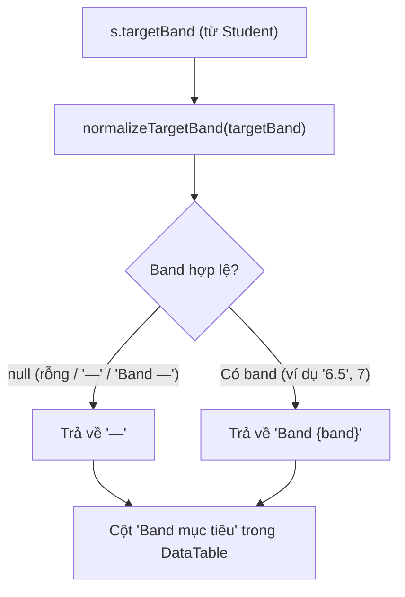

# Plan: #625 — Khắc phục lỗi hiển thị "Band —" trong bảng danh sách lớp học

> **Handover Notice (`--advice` + `--tdd`):** Plan này được biên soạn theo hợp đồng bàn giao cho executor cấp thấp hơn (`advice-handover-plan.md`). Phase tự chứa danh sách task tuần tự kèm điều kiện `Verify` cơ học (so khớp mã thoát / chuỗi đầu ra) và khối `## Failure Protocol` bắt buộc dừng + gọi `kongming` ngay khi bước `Verify` lệch kỳ vọng.

## Overview

Khắc phục lỗi #625 phát sinh tại tab Danh sách học viên của trang chi tiết lớp học (`/classes/:id`):
Cột "Band mục tiêu" đang nối chuỗi thô `Band {s.targetBand}` (`apps/web/src/components/class-detail/class-roster-tab.tsx:143`). Khi học viên chưa đặt mục tiêu (hoặc mang sentinel `"—"` từ DB snapshot), cột hiển thị chuỗi kỳ quặc `Band —`.

Giải pháp:
1. Trích xuất helper nội bộ `normalizeTargetBand` trong `apps/web/src/lib/format-student-target.ts` dùng chung cho cả `formatStudentTarget` và hàm mới `formatTargetBand`.
2. Hàm `normalizeTargetBand` nhận diện chuỗi hoặc số (kiểm tra `Number.isFinite`), loại bỏ tiền tố `Band ` không phân biệt hoa thường (`/^band\s+/i`), trim khoảng trắng, và chuyển đổi chuỗi rỗng hoặc sentinel `"—"` (`EMPTY_BAND_TOKEN`) thành `null`.
3. Hàm mới `export function formatTargetBand(targetBand?: string | number | null): string`:
   - Nếu `normalizeTargetBand` trả về `null`: trả về `EMPTY_BAND_TOKEN` (`"—"`).
   - Nếu có band hợp lệ: trả về `Band ${band}`.
4. Tích hợp `formatTargetBand` vào `apps/web/src/components/class-detail/class-roster-tab.tsx:143`.
5. Bổ sung test case toàn diện trong `apps/web/src/lib/format-student-target.test.ts` và `apps/web/src/components/class-detail/class-roster-tab.test.tsx`.

## Root Cause Analysis (`ak-debug`)

- File: `apps/web/src/components/class-detail/class-roster-tab.tsx:142-144`:
  ```tsx
  <span key="b" className="text-sm tabular-nums">
      Band {s.targetBand}
  </span>
  ```
- Dữ liệu `s.targetBand` của học viên chưa đặt mục tiêu trong kernel snapshot có giá trị `"—"` (`apps/web/src/lib/repos/students.ts:70`), dẫn đến kết quả render là `Band —`.
- Nếu `s.targetBand` rỗng hoặc chỉ có khoảng trắng, kết quả render là `Band `.

## Non-goals (Advisor Scope Lock)

- **Không sửa `repos/students.ts:70` hay thay đổi schema/kiểu dữ liệu `Student.targetBand`**: Giữ nguyên sentinel `"—"` để tránh phá vỡ giao ước kiểu dữ liệu và hàng loạt fixture mock data hiện có.
- **Không thay đổi nhãn cột "Band mục tiêu" trên header bảng**: Giữ nguyên quy ước của issue #391 và `DESIGN.md`.
- **Không thay thế `—` bằng chuỗi dài `Chưa đặt mục tiêu` trong bảng**: `Chưa đặt mục tiêu` chỉ dùng cho kicker trên trang chi tiết học viên; trong ô bảng danh sách lớp, `—` trần là chuẩn mực thị giác gọn gàng và nhất quán với các ô khác (`Đăng ký`, `Học phí`).

## Goals

| # | Goal | Priority |
|---|------|----------|
| 1 | Mở rộng `format-student-target.ts` với `normalizeTargetBand` và `formatTargetBand` | P1 |
| 2 | Cập nhật `class-roster-tab.tsx` hiển thị `formatTargetBand(s.targetBand)` | P1 |
| 3 | Kiểm chứng unit test + component test + typecheck + biome | P1 |

## Architecture & Data Flow



## Phases

- [Phase 1: Format Helper, Class Roster Integration & Tests](phase-01-format-helper-and-class-roster.md)
