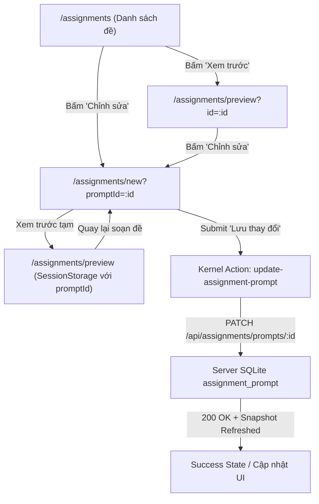

# Plan: Cho phép sửa bài đã lưu trong ngân hàng đề (#614)

## Outcome

Giáo viên có thể mở bất kỳ đề bài nào đã lưu trong ngân hàng đề (`/assignments`) để chỉnh sửa thông tin (tiêu đề, dạng đề, đoạn đọc, câu hỏi, đáp án, band điểm, nguồn, v.v.) trực tiếp từ nút **Chỉnh sửa** ở khung xem trước và trang xem trước, sau đó lưu thay đổi vào ngân hàng đề thông qua endpoint `PATCH /api/assignments/prompts/:id` mà không làm mất bài cũ hoặc ảnh hưởng đến bản nháp tạo mới trong máy.

## Architecture & Data Flow

## How It Works

1. **Khởi tạo và tách bạch State:** Route `/assignments/new` nhận search param `promptId?: string`. Khi `promptId` có giá trị, component wrapper `key={promptId ?? "new"}` bảo đảm remount sạch sẽ. State khởi tạo từ đề trong `data.assignmentPrompts`. Nếu không tìm thấy, hiển thị card thông báo thân thiện. Chế độ edit cách ly hoàn toàn với draft tạo mới trong `localStorage` (không ghi đè, không hiển thị banner phục hồi bản nháp).
2. **Khóa Kỹ năng & Cho phép sửa Dạng đề:** Trong edit mode, `lockPart={true}` khóa cố định `skill` và `part` (do server không cho phép PATCH 2 trường này), nhưng giữ nguyên khả năng đổi `type` (dạng đề), tiêu đề, nội dung câu hỏi và đáp án.
3. **Payload Diff an toàn:** Khi submit, hệ thống chỉ gửi các trường hợp lệ theo `assignmentPromptUpdateSchema` (.strict(), loại bỏ `skill`/`part`). Trường `writing` chỉ được gửi khi thực sự có thay đổi so với ban đầu để tránh gặp lỗi 409 `WRITING_SECTION_LOCKED` đối với các đề đã được giao lớp hoặc đưa vào bài thi.
4. **Đường dẫn Preview vòng tròn:** `PreviewDraft` hỗ trợ `promptId?: string`. Khi giáo viên bấm "Xem trước" từ màn hình chỉnh sửa rồi bấm "Quay lại soạn đề", ngữ cảnh `promptId` cùng các chỉnh sửa chưa lưu vẫn được bảo toàn nguyên vẹn.

## Phases

- **Phase 1: Contracts & Preview Round-Trip** (`phase-01-preview-draft-and-router-contracts.md`): Cập nhật `PreviewDraft`, hàm validator, helper `previewDraftFrom`, tham số `validateSearch` của `/assignments/new` và điều hướng quay lại từ `/assignments/preview`.
- **Phase 2: Composer Edit Mode & Save Pipeline** (`phase-02-composer-edit-mode-and-save-pipeline.md`): Cập nhật logic `NewAssignmentRoute` nạp dữ liệu đề, khóa skill/part, cách ly localStorage draft, submit diff bằng `update-assignment-prompt`, xử lý lỗi 404/409 và màn hình thành công.
- **Phase 3: UI Entry Points & Verification** (`phase-03-ui-entry-points-and-e2e-integration.md`): Thêm nút "Chỉnh sửa" vào `PromptPreviewAside` và `/assignments/preview`, hoàn thiện test suite Vitest unit/integration và kiểm tra toàn diện chất lượng repo.

## Acceptance Criteria

- [x] Mở `/assignments/new?promptId=<valid_id>` nạp đúng dữ liệu đề vào form soạn thảo, `skill` và `part` được khóa bằng static chip, `type` (dạng đề) và các trường nội dung khác có thể chỉnh sửa tự do.
- [x] Bấm "Lưu thay đổi" gửi request `PATCH /api/assignments/prompts/:id` qua action `update-assignment-prompt`, lưu thành công và cập nhật dữ liệu trên giao diện mà không sinh ra đề mới trùng lặp.
- [x] Mở `/assignments/new?promptId=<invalid_id>` hiển thị thông báo "Không tìm thấy đề này" cùng nút quay lại danh sách bài tập, không crash và không fallback thành form tạo mới rỗng.
- [x] Khi đang sửa đề, bản nháp tạo mới (`assignment-draft`) trong `localStorage` không bị ghi đè hay xóa mất.
- [x] Nút "Chỉnh sửa" xuất hiện tại khung xem trước (`PromptPreviewAside`) ở `/assignments` và tại trang `/assignments/preview?id=...`.
- [x] Luồng xem trước vòng tròn: Đang sửa đề -> Bấm "Xem trước" -> Bấm "Quay lại soạn đề" giữ nguyên `promptId` và các nội dung vừa chỉnh sửa.
- [x] Toàn bộ test suite Vitest trong `apps/web` và `apps/server` pass, `pnpm check` và `pnpm check-types` xanh sạch.
