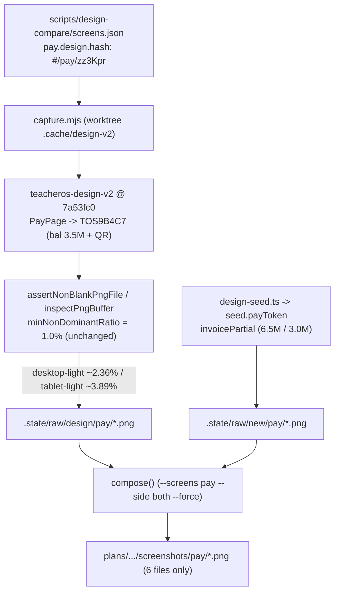

# #653: Align design-compare pay route to payable invoice TOS9B4C7

Tracking: #653

## Overview

Khắc phục lỗi deterministic khiến `pnpm design:compare` luôn thoát mã `1` ở 2 tổ hợp `design pay/desktop-light` (`nonWhite=0.512% nonDominant=0.511%`) và `design pay/tablet-light` (`nonWhite=0.844% nonDominant=0.842%`). Nguyên nhân gốc không phải lỗi tải font hay render chậm mà do `scripts/design-compare/screens.json:39` trỏ màn `pay` bên design sang `#/pay/p7Hq2x` — hóa đơn `TOS7K2Q9` đã thanh toán đủ (`paid === amount === 6_500_000`), chỉ hiển thị một card trắng nhỏ 4 dòng chữ `"Paid in full. Thank you."` trên nền trắng (`--background === --card === oklch(1 0 0)`), làm tỷ lệ pixel khác màu chủ đạo rơi xuống dưới ngưỡng `minNonDominantRatio = 0.01` (`1.0%`) của `#546`. Chuyển `pay.design.hash` sang `#/pay/zz3Kpr` (`TOS9B4C7`, hóa đơn thanh toán một phần `6.5M / 3.0M` có mã QR + bảng thông tin chuyển khoản, khớp với `t-invoice`, `seed.payToken` và mục tiêu `phase-05-auth-public-pages.md:29`) giúp toàn bộ 6 tổ hợp `design pay` đạt `nonDominantRatio >= 2.35%` mà giữ nguyên độ chặt của bộ lọc ảnh trắng/rỗng `#546`.

Kế hoạch này được biên soạn theo hợp đồng bàn giao `--advice` + `--tdd`: mọi phase đều tách thành các task độc lập có điều kiện kiểm chứng cơ học (`Verify`) và khối `Failure Protocol` nguyên văn để executor cấp thấp thực thi an toàn, dừng ngay và hỏi `kongming` nếu bất kỳ bước kiểm tra nào lệch kỳ vọng.

## Root Cause Summary (`ak-debug` verified)

1. **Sai hóa đơn mục tiêu trong `scripts/design-compare/screens.json:39`:**
   - Trong `teacheros-design-v2` (SHA ghim `7a53fc0fcbf415367d245539cedc3855606266a7`, `src/lib/data.ts:48-50`):
     - `p7Hq2x` thuộc `invoices[0]` (`TOS7K2Q9`: `amount: 6500000, paid: 6500000`, `bal = 0`). Khi `bal === 0`, `PayPage` (`src/pages/Teacher.tsx:442-458`) ẩn toàn bộ khối `<QR>` + số dư + bảng ngân hàng, chỉ vẽ card `max-w-sm` gồm 4 dòng chữ ngắn kèm `"Paid in full. Thank you."`.
     - `zz3Kpr` thuộc `invoices[2]` (`TOS9B4C7`: `amount: 6500000, paid: 3000000`, `bal = 3500000 > 0`) — đây chính là fallback mặc định của `PayPage` (`Teacher.tsx:443`), trùng hóa đơn `TOS9B4C7` của màn `t-invoice` (`screens.json:225`), trùng trạng thái `invoicePartial` (`6_500_000 / 3_000_000`) mà `apps/e2e/scripts/design-seed.ts:447,615,617` gán cho `seed.payToken`, và khớp mô tả thiết kế ở `plans/261020-1446-378-redesign-design-v2/phase-05-auth-public-pages.md:29` (*"card căn giữa, QR nền trắng giữ nguyên, mã chuyển khoản `font-mono`"*).
2. **Vì sao lỗi chỉ nổ deterministic ở `desktop-light` và `tablet-light`:**
   - Ở light mode (`src/index.css:9-11`), `--background` và `--card` đều là `oklch(1 0 0)` (`#ffffff`), rơi vào cùng một bucket lượng tử hóa 5-bit của `inspectPngBuffer` (`scripts/design-compare/harness-lib.mjs:280`). Toàn bộ card `"Paid in full. Thank you."` chỉ có ~`6,623` pixel viền 1px + chữ khác màu chủ đạo: trên `1440×900` đạt `0.511%` (`< 1.0%`), trên `768×1024` đạt `0.842%` (`< 1.0%`), còn trên `375×812` đạt `2.165%` (`> 1.0%`). Ở dark mode (`src/index.css:37-40`), `--background` (`oklch(0.145 0 0)`) và `--card` (`oklch(0.205 0 0)`) tách thành 2 bucket khác nhau nên đạt `5.746%`–`24.238%`.
   - Quét thực nghiệm toàn bộ 214 ảnh design (`--screens all --side design --force`) xác nhận 212 ảnh pass (thấp nhất kế tiếp là `login-reset/tablet-light.png` ở `2.066%`) và chỉ đúng 2 ảnh `pay/desktop-light` + `pay/tablet-light` fail. Khi đổi sang `#/pay/zz3Kpr`, `pay` đạt `2.358%` (`desktop-light`), `3.886%` (`tablet-light`), `10.033%` (`phone-light`).

## Scope & Non-Goals (Kongming Advisor Lock)

- **In Scope (Allowlist 9 file mục tiêu + thư mục plan này):**
  - Cập nhật `scripts/design-compare/screens.json:39` từ `"#/pay/p7Hq2x"` sang `"#/pay/zz3Kpr"`.
  - Đồng bộ bảng ánh xạ gốc trong `plans/261020-1446-378-redesign-design-v2/phase-01-visual-harness-baseline.md:37` và ghi chú đối chiếu màn `pay` trong `plans/261020-1446-378-redesign-design-v2/screenshots/verdict.md:19-24`.
  - Chụp và ghép lại **chỉ đúng 6 file** `plans/261020-1446-378-redesign-design-v2/screenshots/pay/{desktop,tablet,phone}-{light,dark}.png` qua `--screens pay --side both --force` trên cache `.cache/design-v2` cô lập riêng của worktree.
  - Cập nhật `CHANGELOG.md` (mục `## 2026-11-11` → `### CI/Infra`) ghi nhận bản sửa `#653`.
- **Explicit Non-Goals:**
  - **Không** hạ ngưỡng `minNonDominantRatio = 0.01` hoặc thêm ngoại lệ vùng trung tâm trong `inspectPngBuffer` (`scripts/design-compare/harness-lib.mjs:254-292`) — Kongming cảnh báo ngoại lệ vùng trung tâm sẽ bỏ lọt trang lỗi/treo chỉ có spinner hoặc chữ `"Đang tải…"` căn giữa (`apps/web/src/routes/pay.$token.tsx:83-85`).
  - **Không** sửa `PAY_TOKEN_RE` trong `harness-lib.mjs:77` hay chuỗi mẫu `p7Hq2xSecret` trong `scripts/design-compare.test.mjs:263,270` và tài liệu lịch sử `plans/261103-1111-546-design-compare-shared-host-hardening/phase-01-harness-lib-and-tests.md:35`.
  - **Không** sửa `apps/web/src/routes/pay.$token.tsx`, `apps/e2e/scripts/design-seed.ts`, `scripts/design-compare/capture.mjs`, `scripts/design-compare/fetch-design.sh`, hay nâng SHA ghim của `teacheros-design-v2`.
  - **Không** truyền `DESIGN_CACHE_DIR` sang thư mục của checkout khác (luôn dùng `.cache/design-v2` cô lập ngay trong worktree để tránh race `.vite`/`.git` và đảm bảo cổng `pgrep` bắt được mọi tiến trình con).
  - **Không** chạy `--screens all --side both` (có hoặc không `--force`) trên worktree mới vì raw mới sinh có `mtimeMs > outFile.mtimeMs` của checkout sẽ làm `shouldCompose` ghi đè lan sang 210 ảnh composite của 35 màn không liên quan. Để kiểm toàn bộ phía design mà không chạm composite màn khác, dùng `--screens all --side design --force`.
  - **Không** chạy `pnpm check:fix` toàn repo (vì `biome.json` đặt `vcs.enabled: false` sẽ quét sửa cả file ngoài phạm vi); chỉ format đúng file trong allowlist nếu cần.
  - **Bảo mật repo public:** `teacher-os` là repo public còn `teacheros-design-v2` là repo private — mọi comment/PR/POT đăng lên GitHub phải redact token, cookie, đường dẫn tuyệt đối nội bộ và không dán nguyên văn mã nguồn từ `teacheros-design-v2`.

## Goals

| # | Goal | Priority |
|---|------|----------|
| 1 | Đưa toàn bộ 6 tổ hợp `design pay` và toàn bộ 214 ảnh `--screens all --side design --force` về trạng thái pass (`0 lỗi`) bằng hóa đơn `#/pay/zz3Kpr` (`TOS9B4C7`) trên cache `.cache/design-v2` cô lập của worktree | P1 |
| 2 | Cập nhật đúng 6 ảnh composite `screenshots/pay/*.png` + tài liệu ánh xạ/verdict/changelog theo allowlist chặt mà không làm bẩn màn khác, dọn sạch toàn bộ artifact tạm chứa token/cookie, và giữ nguyên 100% độ chặt của `inspectPngBuffer` | P1 |

## Architecture / Flow

## Phases

| # | Phase | Status |
|---|-------|--------|
| 1 | [Phase 1: TDD Red→Green Alignment of Pay Design Route](./phase-01-start.md) | Completed |
| 2 | [Phase 2: Regenerate Pay Composites, Visual Audit & Quality Gates](./phase-02-composites-and-gates.md) | Completed |

## Success Criteria

- [x] Bước TDD Red xác nhận `pnpm design:compare --screens pay --side design --force` trước khi sửa thoát mã khác `0` với đúng 2 lỗi `pay/desktop-light` và `pay/tablet-light` đều có `nonDominant < 1.0%`.
- [x] Sau khi cập nhật `scripts/design-compare/screens.json:39` sang `"#/pay/zz3Kpr"` và đồng bộ `phase-01-visual-harness-baseline.md:37`, `pnpm design:compare --screens pay --side design --force` thoát `0` (`6 ảnh, 0 lỗi`) và `pnpm design:compare --screens all --side design --force` thoát `0` (`214 ảnh, 0 lỗi`).
- [x] 2 lần chạy liên tiếp `pnpm design:compare --screens pay --side both --force` (`18 ảnh, 0 lỗi` mỗi lượt) và 1 lần chạy kế tiếp `pnpm design:compare --screens pay --side both` không `--force` (`0 ảnh, 0 lỗi`) đều thoát `0`, chỉ đúng 6 file PNG dưới `plans/261020-1446-378-redesign-design-v2/screenshots/pay/` thay đổi.
- [x] Kiểm tra trực quan 6 ảnh composite `screenshots/pay/{desktop,tablet,phone}-{light,dark}.png` (không có bất kỳ lệnh chụp nào chạy đè sau bước duyệt): cột `Design v2` hiển thị card `Tuition payment` của `TOS9B4C7` có mã QR, số dư `3.500.000 ₫` và thông tin Vietcombank; cột `App mới` hiển thị card `PayPage` v2 căn giữa của `invoicePartial`; không tràn ngang ở `375×812`.
- [x] Allowlist kiểm tra Git xác nhận ngoài thư mục plan/journal hiện tại chỉ chạm đúng 9 file mục tiêu (`screens.json`, `phase-01-visual-harness-baseline.md`, `verdict.md`, `CHANGELOG.md`, và 6 file `screenshots/pay/*.png`); `pnpm test:design-compare` pass 23/23 test; `pnpm exec biome check .`, `pnpm check-types`, `pnpm test` đều xanh; `.state`, `.mail-log.jsonl`, `local.db*`, `.pid-*` đã được dọn sạch và 0 tiến trình mồ côi.

## Validation Log

### Verification Results (Fact Checker — Light tier, 2 reviewers)
- **Tier:** Light (2 phases, ≥7 claims/phase kiểm tra độc lập mỗi reviewer)
- **Claims checked:** 29 (15 bởi Security Adversary + 14 bởi Assumption Destroyer)
- **Verified:** 24 | **Failed:** 5 (3 trùng lặp giữa 2 reviewer → 3 điểm gãy thực tế, đã sửa triệt để bên dưới) | **Unverified:** 0
- **Failures resolved:**
  1. `Phase 2 Verification` gọi lại `pnpm design:compare --screens pay --side both` sau khi `Task 2.3` đã xoá `.state`, gây chụp mới + ghi đè 6 ảnh đã duyệt mắt và tái tạo `.state` → Đã bỏ lệnh chụp lặp ở cuối `Phase 2 Verification` và bổ sung `test ! -e scripts/design-compare/.state`.
  2. Truyền `DESIGN_CACHE_DIR` sang checkout chính làm lộ race `.vite`/`.git` giữa các agent và làm mù biểu thức `pgrep` theo tên worktree → Đã chuyển sang dùng `.cache/design-v2` cô lập ngay trong worktree (mode `0700`, SHA `7a53fc0fcbf415367d245539cedc3855606266a7`), bỏ hẳn `DESIGN_CACHE_DIR`, và bổ sung kiểm tra không còn `.cache/design-v2/.pid-*`.
  3. Denylist 2 file với `git diff --name-only origin/develop` không chặn được `pnpm check:fix` toàn repo hay các file khoá khác trong Scope Lock → Đã đổi sang allowlist chặt trên cả `merge-base` lẫn `git status --porcelain` và bỏ `pnpm check:fix` toàn repo.

### Whole-Plan Consistency Sweep (Post-Validation)
- Files reread: `plan.md`, `phase-01-start.md`, `phase-02-composites-and-gates.md`
- Decision deltas checked: 8
- Reconciled stale references: 8 (xoá toàn bộ `DESIGN_CACHE_DIR=<main-checkout>/...`, đồng bộ thứ tự duyệt mắt → xoá `.state`/artifact tạm → cổng chất lượng, đồng bộ allowlist 9 file mục tiêu ở cả `plan.md` và `phase-02`).
- Unresolved contradictions: 0

## Red Team Review

### Session — 2026-11-11
**Reviewers:** Security Adversary (`code-reviewer`) + Assumption Destroyer (`code-reviewer`), mỗi reviewer kèm vai trò Fact Checker (Light tier).
**Findings:** 8 distinct sau khi gộp trùng (2 Critical, 2 High, 4 Medium) — **8 accepted (7 Accept, 1 Accept modified), 0 rejected**.
**Severity breakdown:** 2 Critical, 2 High, 4 Medium

| # | Finding | Severity | Disposition | Applied To |
|---|---------|----------|-------------|------------|
| 1 | Khối `Verification` cuối Phase 2 gọi lại `design:compare --side both` sau khi Task 2.3 xoá `.state` → chụp mới ghi đè 6 ảnh đã duyệt mắt và tái tạo `.state` chứa cookie/mật khẩu | Critical | Accept | `phase-02` Task 2.3 & `Verification` (bỏ lệnh chụp lặp sau xoá `.state`; assert `! -e .state`) |
| 2 | Hardcode `DESIGN_CACHE_DIR` trỏ ra ngoài worktree gây race `node_modules/.vite` & `.git` trên máy nhiều agent và làm mù cổng `pgrep` bắt orphan `design-v2` | Critical | Accept | `plan.md`, `phase-01`, `phase-02` (dùng `<worktree>/.cache/design-v2` cô lập mode `0700`, bỏ `DESIGN_CACHE_DIR`, kiểm thêm `.pid-*`) |
| 3 | `Task 1.1 Verify` khoá cứng `nonDominant=0.511%` (dung sai ~7px) trong khi `design-v2` nạp font Geist từ Google Fonts CDN | High | Accept | `plan.md` Success Criteria, `phase-01` Task 1.1 `Verify` (kiểm exit khác `0`, `4 ảnh, 2 lỗi`, cả 2 dòng lỗi `desktop-light`/`tablet-light` có `nonDominant=0.`) |
| 4 | `Task 2.1` lặp lại 3 lệnh `--side both` ở cả `Steps` và `Verify` làm nhân đôi thành 6 chu kỳ boot full stack + `design-seed.ts` trên máy chia sẻ | High | Accept | `phase-02` Task 2.1 (chạy 3 lượt 1 lần ghi log tạm `.state/run{1..3}.log`, `Verify` kiểm cơ học trên log + trạng thái Git) |
| 5 | `Task 2.3` gợi ý `pnpm check:fix` toàn repo (`vcs.enabled: false`) và dùng denylist 2 file với `git diff origin/develop` dễ false-fail / bỏ lọt vi phạm Scope Lock | Medium | Accept | `plan.md`, `phase-02` Task 2.1 & Task 2.3 (chỉ format `screens.json` nếu cần; kiểm allowlist chặt qua `merge-base` + `git status --porcelain`) |
| 6 | `Task 1.2 Verify` chưa kiểm `phase-01-visual-harness-baseline.md:37`; `Task 2.2 Verify` chưa neo đầu dòng `\| pay \|` (chống nối trùng 12 dòng / sót `sidebar-07`) và mục `## 2026-11-11` | Medium | Accept | `phase-01` Task 1.2 `Verify`, `phase-02` Task 2.2 `Verify` |
| 7 | `Task 2.3` xoá `.state` nhưng để sót `apps/e2e/.mail-log.jsonl`, `apps/e2e/local.db*` và `.cache/design-v2/.dev-*.log` chứa raw verify/pay token | Medium | Accept | `phase-02` Task 2.3 Steps & `Verify` (xoá sạch và assert không còn tồn tại) |
| 8 | Repo `teacher-os` là public còn `teacheros-design-v2` là private: báo cáo lỗi/POT không được dán raw log chứa token, đường dẫn máy trạm hay mã nguồn repo private | Medium | Accept (modified) | `plan.md` Scope Lock, `phase-01` & `phase-02` Handover Note (giữ nguyên văn khung `Failure Protocol` chuẩn, bổ sung quy tắc redact khi ghi comment/POT lên GitHub) |

### Whole-Plan Consistency Sweep
- Files reread: `plan.md`, `phase-01-start.md`, `phase-02-composites-and-gates.md`
- Decision deltas checked: 8 (toàn bộ 8 findings đã áp xuyên suốt 3 file)
- Reconciled stale references: 8
- Unresolved contradictions: 0

### Post-plan-gates Kongming counsel — 2026-11-11
- **GO** cho bước cập nhật issue `#653` (`ready to cook` → `in progress`) và chạy `/ak-fix --auto plans/261111-0257-653-design-compare-pay-blank/plan.md --advice`.
- Hai tinh chỉnh nhỏ đã áp vào `phase-02`: (1) đồng bộ tên log `.state/run{1..3}.log` (bỏ chữ `task-2-1.log` sót lại); (2) ghi `sha256sum` của 6 ảnh `screenshots/pay/*.png` ra `/tmp/pay-composites-653.sha256` lúc duyệt mắt ở Task 2.2 rồi đối chiếu `sha256sum -c` + dọn file `/tmp/pay-composites-653.sha256` ở Task 2.3 `Verify` để bảo chứng cơ học không có bước nào ghi đè ảnh sau khi duyệt.
- Rủi ro thực thi cần canh: 3 lượt `--side both` trên máy chia sẻ đều boot full stack (`api`/`web`/`student` + `design-seed.ts`); nếu bất kỳ lượt nào fail thì tuân thủ `Failure Protocol`, không tự retry mù; trích đoạn Red/Green khi đăng POT phải xoá đường dẫn tuyệt đối nội bộ.

### Implementation notes (`ak-fix --advice`, 2026-11-11)
- Phase 1 đạt TDD Red → Green trọn vẹn: `pay` phía design đạt `6 ảnh, 0 lỗi`, toàn bộ 36 màn phía design đạt `214 ảnh, 0 lỗi`, `pnpm test:design-compare` đạt `23/23 pass`.
- Phase 2 Task 2.1: lượt `run1` đạt `18 ảnh, 0 lỗi`; lượt `run2` lần đầu vấp đúng flake tồn tại sẵn `#652` (`design-seed.ts:552` `verify-email` `TimeoutError` khi máy chịu tải `load average > 3`, trước khi chạm bước chụp `pay`). Đã dừng ngay theo `Failure Protocol` và tham vấn `kongming` (`KongmingFailureProtocol21`): xác nhận `#652` độc lập ngoài phạm vi, giữ nguyên `design-seed.ts`, lưu `run2.fail1.log` và tiếp tục chạy `run2` + `run3` không sửa code.
- Lượt `run2` kế tiếp đã pass toàn bộ `design-seed.ts` + 12 ảnh chụp (`6 app` + `6 design` đều pass `assertNonBlankPngFile`), nhưng gặp `page.screenshot: Timeout 30000ms` ở bước `compose()` khi máy vọt `loadavg = 40.76` (do phiên agent song song `#652` chạy `vitest` + `tsc` + dev servers trên VM 4 core). Đã leo thang lần 2 lên `kongming` (`KongmingFailureProtocol21b`): giữ nguyên `capture.mjs`, cài cổng chờ `loadavg < 4.5` trước khi chạy `run2` + `run3`.

### Code review fixes (`ak-code-review --pending --advice`, 2026-11-11)
- Verdict từ reviewer độc lập `LocalCodeReview653`: **Approved** (`0 Critical / 0 Important / 2 Minor`).
- Đã xử lý trọn vẹn `2/2` Minor: (1) thay đường dẫn mẫu trong log đối soát dòng 101 bằng `<main-checkout>/...`; (2) cập nhật `status: completed` cho plan + 2 phase và tick `[x]` đầy đủ các mục `Success Criteria`.

<!-- slug: 653-design-compare-pay-blank -->
