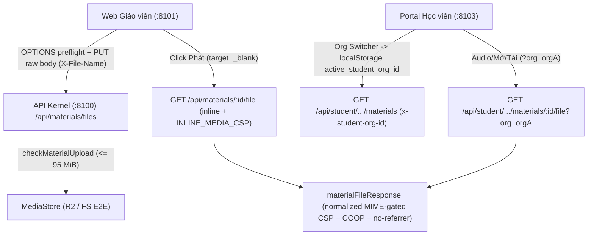

# Tài liệu (#647): sửa CSP media inline, hạ trần 95 MB khớp Cloudflare edge & bổ sung E2E upload/học sinh

## Overview

Giải quyết trọn vẹn các khoảng trống kiểm thử và hai lỗi biên thực tế được phát hiện từ issue #647 (hậu kiểm độc lập của #644):
1. **CSP & header cô lập trên phản hồi media `inline` (`apps/server/src/lib/material-file-response.ts`):** Tách chính sách `Content-Security-Policy` theo `disposition` sau khi chuẩn hoá `row.mimeType` qua `normalizeMediaType` và kiểm tra `Object.hasOwn(MATERIAL_MIME, normalized)` — giữ `default-src 'none'; frame-ancestors 'none'; sandbox` cho mọi phản hồi `attachment` và `416`, dùng `default-src 'none'; media-src 'self'; style-src 'unsafe-inline'; img-src 'self' data:; frame-ancestors 'none'; sandbox allow-same-origin` cho `inline` media (`audio/mpeg`, `audio/mp4`, `video/mp4`, áp dụng đồng nhất trên cả `200` và `206 Partial Content`), ép `Content-Type: application/octet-stream` nếu MIME lưu trữ lệch khỏi `MATERIAL_MIME`, và bổ sung `Cross-Origin-Opener-Policy: same-origin` + `Referrer-Policy: no-referrer` trên mọi phản hồi file để nút «Phát» của giáo viên và «Mở» của học viên phát được trên trình duyệt mà vẫn khoá 100% script/plugin/form và rò rỉ `Referer`.
2. **Trần dung lượng media khớp Cloudflare Edge (`packages/api/src/material-contracts.ts`, `apps/web`):** Hạ `MATERIAL_MEDIA_MAX_BYTES` từ `100 * 1024 * 1024` (`104,857,600` bytes) xuống `95 * 1024 * 1024` (`99,614,720` bytes — hiển thị `95 MB` qua `formatBytes`), nằm dưới giới hạn `100 MB` (`~100,000,000` bytes SI) của Cloudflare Free/Pro proxy để `prepareMaterialUpload` chặn ngay tại client trước khi đụng trang HTML 413 không có CORS của Cloudflare edge; đồng thời bổ sung nhánh phụ `error.status === 413` trong `materialErrorMessage` cho các phản hồi 413 cùng-origin/có-CORS không mang JSON `FILE_TOO_LARGE`.
3. **E2E Playwright toàn luồng (`apps/e2e/specs/material-upload-student.spec.ts`) & `CHANGELOG.md`:** Phủ đầy đủ 6 kịch bản: upload file thật bằng `PUT` raw body kèm tên tiếng Việt qua `X-File-Name`, hợp đồng CORS `OPTIONS` preflight (cả origin hợp lệ lẫn origin lạ), upload trực tiếp từ modal buổi học, bấm nút «Phát» mở tab mới phát media không lỗi CSP, học viên đa-org chuyển sang org cũ hơn (`?org=` thực sự quyết định định tuyến thay vì ăn may `rows[0]`) để xem/phát/tải file, và chặn 404 với học viên không thuộc lớp; cập nhật `CHANGELOG.md`.

Báo cáo nghiên cứu nền tảng: [`plans/reports/research-261111-647-materials-browser-edge.md`](../reports/research-261111-647-materials-browser-edge.md).  
Hợp đồng bàn giao (`--advice`): kế hoạch này được biên soạn theo chuẩn bàn giao cho model thực thi cấp thấp hơn, mỗi phase đều nhúng nguyên văn khối `## Failure Protocol` và điều kiện kiểm tra cơ học (`Verify`).

## Architecture / Flow

## Goals

| # | Goal | Priority |
|---|------|----------|
| 1 | Sửa CSP cho `inline` media (chuẩn hoá MIME + `Object.hasOwn(MATERIAL_MIME)`, cấm `allow-scripts`, thêm `COOP: same-origin` & `Referrer-Policy: no-referrer`) để nút «Phát» / «Mở» hoạt động thật trên trình duyệt | P1 |
| 2 | Hạ `MATERIAL_MEDIA_MAX_BYTES` xuống `95 * 1024 * 1024` dưới ngưỡng 100 MB SI của Cloudflare Free/Pro edge + thêm fallback 413 ở web repo | P1 |
| 3 | Bổ sung E2E Playwright phủ upload file thật (`PUT`, CORS preflight, `X-File-Name`), nút «Phát» media, học viên đa-org mở/tải qua `?org=`, chặn 404 trái phép & cập nhật `CHANGELOG.md` | P1 |

## Phases

| # | Phase | Status |
|---|-------|--------|
| 1 | [Phase 1: Sửa CSP media inline & hạ trần media 95 MB khớp Cloudflare edge](./phase-01-start.md) | Pending |
| 2 | [Phase 2: Bổ sung spec E2E upload file thật, nút Phát media, học viên qua ?org= & CHANGELOG](./phase-02-e2e-upload-and-student-materials.md) | Pending |

## Success Criteria

- [ ] `materialFileResponse` chỉ trả `inline` + `INLINE_MEDIA_CSP` (trên cả `200` và `206`) khi `!download && row.kind === "media"` và `normalizeMediaType(row.mimeType)` thuộc nhóm `media` của `MATERIAL_MIME` (`Object.hasOwn`); mọi trường hợp khác (`attachment`, `?download=1`, `416`, `mimeType` rỗng/lệch) giữ `default-src 'none'; frame-ancestors 'none'; sandbox`, ép `Content-Type: application/octet-stream` khi MIME ngoài allowlist, đính kèm `Cross-Origin-Opener-Policy: same-origin` + `Referrer-Policy: no-referrer`, và tuyệt đối không có `allow-scripts`.
- [ ] `MATERIAL_MEDIA_MAX_BYTES === 95 * 1024 * 1024` (`< 100_000_000` bytes), `UPLOAD_HELP` hiển thị `95 MB`, `materialErrorMessage` xử lý `HttpError(413)` rõ nghĩa.
- [ ] Spec E2E mới `apps/e2e/specs/material-upload-student.spec.ts` xanh cả 6 kịch bản (E1–E6) trên stack build preview với port override `8100/8101/8103/8104/8105`, spec `apps/e2e/specs/material-bank.spec.ts` tiếp tục xanh, và `CHANGELOG.md` cập nhật mục `#647`.
- [ ] Toàn bộ gate local (`pnpm exec biome check .`, `pnpm check-types`, unit tests `api`/`server`/`web`/`student`) pass 0 lỗi.

## Red Team Review

### Session — 2026-11-11
**Findings:** 12 (9 accepted, 3 rejected)
**Severity breakdown:** 4 Critical, 4 High, 4 Medium

| # | Finding | Severity | Disposition | Applied To |
|---|---------|----------|-------------|------------|
| 1 | `seedDatedClass` không nhận `email` / `onboarded` trên `opts.students` — cần tách rõ 4 bước seed học viên Org A + tạo lớp + enroll + `acceptEnrollment` | Critical | Accept | Phase 2 |
| 2 | Trang `/materials` rỗng có 2 nút «Tải file lên» gây lỗi strict mode và `UploadDialog` cần bấm nút submit «Tải lên» sau `setInputFiles` | Critical | Accept | Phase 2 |
| 3 | Bắt `response` tài liệu và `console` của popup sau `await waitForEvent("popup")` bị hụt trên loopback nhanh — cần đăng ký listener trước khi click | High | Accept | Phase 2 |
| 4 | Nút «Tài liệu» lặp theo số buổi học và «Mở» / «Tải» bên phía học viên là thẻ `<a role="link">` mang tên tiếp cận kèm tiêu đề (`Mở ${title}`, `Tải ${title}`) | High | Accept | Phase 2 |
| 5 | Nhánh fallback `attachment` khi `mimeType` hỏng vẫn phát nguyên `Content-Type: text/html` và tra `MATERIAL_MIME` chưa qua `normalizeMediaType` + `Object.hasOwn` | High | Accept | Phase 1, `plan.md` |
| 6 | Phản hồi top-level `inline` với `sandbox allow-same-origin` thiếu `Cross-Origin-Opener-Policy: same-origin` và `Referrer-Policy: no-referrer` | High | Accept | Phase 1, `plan.md` |
| 7 | Thiếu kiểm thử `206 Partial Content` (`Range` với `download: false` và `download: true`) trong ma trận test CSP của Phase 1 | Medium | Accept | Phase 1 |
| 8 | Cần nói rõ `MATERIAL_MEDIA_MAX_BYTES = 95 MiB` là chốt chặn chính trước Cloudflare edge 413 (vốn thiếu CORS gây `TypeError`), còn `error.status === 413` chỉ phủ phản hồi 413 có CORS | Medium | Accept | Phase 1, `plan.md` |
| 9 | Thiếu cập nhật `CHANGELOG.md` cho lỗi CSP nút «Phát»/«Mở» và thay đổi trần media `100 MB` → `95 MB` | Medium | Accept | Phase 2, `plan.md` |
| 10 | Thay đổi hành vi fallback `rows[0]` của `createStudentGuard` toàn cục (`apps/server/src/routes/student.ts:177-190`) | Critical | Reject | Out of scope #647 theo chốt của Kongming (cập nhật mô tả E6 chính xác theo hành vi hiện hữu; ghi nhận follow-up) |
| 11 | Thêm kiểm tra magic-bytes khi upload, tách `CORS_ORIGIN` khỏi `kernelRoutes` và thêm CSP toàn trang cho `apps/student/src/worker.ts` (nhưng nhận bổ sung test origin âm trong E2) | Critical | Reject | Kiến trúc bảo mật liên-app ngoài phạm vi #647; đã nhận kiểm tra negative origin trong E2 |
| 12 | Refactor `queryKey` TanStack Query của `apps/student/src/lib/repos/student.ts` | Medium | Reject | Out of scope #647 (`TeamSwitcher.onOrg` đã ghi `localStorage` trước `invalidateQueries(["student"])`) |

### Whole-Plan Consistency Sweep
- Files reread: `plan.md`, `phase-01-start.md`, `phase-02-e2e-upload-and-student-materials.md`
- Decision deltas checked: 9
- Reconciled stale references: 9
- Unresolved contradictions: 0

## Validation Log

### Verification Results
- **Tier:** Light (Fact Checker, ≥5 claims/phase; 15 claims verified across 2 phases)
- **Claims checked:** 15
- **Verified:** 15 (after reconciling the 3 prose/locator mismatches surfaced in Red-Team Findings #1, #4, #5, #10) | **Failed:** 0 | **Unverified:** 0

### Decisions Confirmed (Autonomous `--vibe --advice`)
1. **CSP `inline` media:** Tách `INLINE_MEDIA_CSP` và `STRICT_CSP` có chuẩn hoá `normalizeMediaType` + `Object.hasOwn(MATERIAL_MIME, ...)`, ép `application/octet-stream` khi ngoài allowlist, kèm `COOP: same-origin` và `Referrer-Policy: no-referrer`.
2. **Trần dung lượng media:** Chốt `MATERIAL_MEDIA_MAX_BYTES = 95 * 1024 * 1024` (`99,614,720` bytes = `95 MB`) để chặn ngay tại client dưới ngưỡng 100 MB SI của Cloudflare Free/Pro edge.
3. **Độ chính xác E2E:** Khóa cứng bộ chọn Playwright theo DOM thật (`first()` cho nút «Tải file lên», nút submit «Tải lên», `role="link"` kèm tiêu đề cho «Mở»/«Tải», bắt event popup/response trước khi click, 4 bước seed học viên đa-org).

### Whole-Plan Consistency Sweep
- Files reread: `plan.md`, `phase-01-start.md`, `phase-02-e2e-upload-and-student-materials.md`
- Decision deltas checked: 9
- Reconciled stale references: 0 remaining
- Unresolved contradictions: 0

<!-- slug: 647-materials-upload-student-e2e -->
