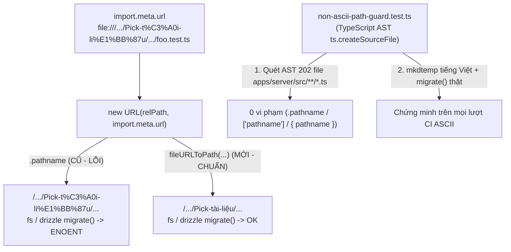

# #656: Use fileURLToPath for import.meta.url paths in server test suite

Tracking: #656

## Overview

Khắc phục lỗi khiến toàn bộ server test suite đỏ ảo (`Error: Can't find meta/_journal.json file` hoặc `ENOENT: no such file or directory`) khi clone hoặc chạy `pnpm --filter server exec vitest run` bên trong thư mục có ký tự tiếng Việt / non-ASCII (ví dụ `.../Pick-tài-liệu-ở-page-tạo-buổi-học`). Thay toàn bộ `91` vị trí dùng `.pathname` trên `new URL(..., import.meta.url)` trong `88` file `.test.ts` của `apps/server/src` bằng `fileURLToPath(...)` từ `node:url`, đồng thời bổ sung bài test canh cổng `apps/server/src/non-ascii-path-guard.test.ts` (kiểm thử thực tế `migrate()` trên đường dẫn tiếng Việt tạm thời + quét AST TypeScript toàn bộ `apps/server/src/**/*.ts` chống tái phạm).

Kế hoạch này được biên soạn theo hợp đồng bàn giao `--advice` + `--tdd` cho executor độc lập: mỗi phase tách thành các task nhỏ có mục tiêu quan sát được, danh sách file/symbol tường minh, câu lệnh `Verify` cơ học so sánh được bằng mã thoát/chuỗi output, và khối `Failure Protocol` nguyên văn yêu cầu dừng ngay để tham vấn `kongming` nếu bất kỳ `Verify` nào lệch kỳ vọng.

## Root Cause Summary (`ak-debug` verified)

1. **Cơ chế lỗi RFC-3986 percent-encoding vs `node:fs`:**
   - Khi đường dẫn thư mục chứa ký tự ngoài ASCII (ví dụ `Pick-tài-liệu-ở-page-tạo-buổi-học`), `import.meta.url` là `file://` URL đã mã hóa phần trăm (`file:///.../Pick-t%C3%A0i-li%E1%BB%87u-%E1%BB%9F-page-t%E1%BA%A1o-bu%E1%BB%95i-h%E1%BB%8Dc/...`).
   - Thuộc tính `.pathname` của `URL` giữ nguyên chuỗi percent-encoded (`/.../Pick-t%C3%A0i-li%E1%BB%87u-.../packages/db/src/migrations`), trong khi các hàm hệ thống tệp của Node (`fs.readFileSync`, `fs.readdirSync`, `fs.promises.readFile` và `readMigrationFiles` bên trong `drizzle-orm/libsql/migrator`) coi tham số kiểu `string` là đường dẫn hệ điều hành nguyên nghĩa (không giải mã `%XX`).
   - Tái hiện thực nghiệm trong thư mục thật có tên tiếng Việt xác nhận:
     - Các test dùng `MIGRATIONS_DIR = new URL(..., import.meta.url).pathname` thất bại ngay ở ms-level với `Error: Can't find meta/_journal.json file` (hoặc `ENOENT` ở `readdirSync(MIGRATIONS_DIR)`).
     - Các test đọc fixture/source bằng `readFileSync(new URL(..., import.meta.url).pathname)` hoặc `<urlVar>.pathname` (`lead-catalog-drift.test.ts:15-19,65-69`, `student-projection-lock.test.ts:14`, `kernel-occurrence.test.ts:509`, `routes/exam-imports.test.ts:485-488`, `lib/exam-import/fingerprint.test.ts:7-10`, `lib/exam-import/validate-file.test.ts:41-44`) thất bại với `Error: ENOENT: no such file or directory`.
2. **Kiểm kê chính xác trong `apps/server/src`:**
   - Tổng số file hiện có trong `apps/server/src`: `106` file `.test.ts` và `95` file `.ts` không phải `.test.ts` (`201` file `.ts` tổng cộng; sau khi thêm guard test là `202` file `.ts`, gồm `107` file `.test.ts`).
   - Số file `.ts` không phải `.test.ts` dùng `import.meta`: **`0` file**.
   - Số file `.test.ts` bị ảnh hưởng trong `apps/server/src`: **`88` file** với tổng cộng **`91` vị trí `.pathname`** trên `file:` URL từ `import.meta.url`:
     - `84` vị trí `MIGRATIONS_DIR = new URL("...packages/db/src/migrations", import.meta.url).pathname`
     - `5` vị trí trực tiếp đọc fixture/source: `kernel-occurrence.test.ts:509`, `student-projection-lock.test.ts:14`, `routes/exam-imports.test.ts:485-488`, `lib/exam-import/fingerprint.test.ts:7-10`, `lib/exam-import/validate-file.test.ts:41-44`
     - `2` vị trí gián tiếp qua biến `URL` trong `lead-catalog-drift.test.ts:15-19,65-69` (`profileHtmlPath.pathname`, `questionsPath.pathname`), trong khi `leadGateUrl.href` ở dòng `85-89` phục vụ dynamic ESM `await import(leadGateUrl.href)` **phải giữ nguyên `.href`**.
   - Các vị trí `.pathname` còn lại trong `apps/server/src/lib/bank-hub/bank-hub-client.test.ts:487,533,569` đều là HTTP URL (`new URL(c.url).pathname`, `const { pathname } = new URL(req.url)`, `new URL(create.url).pathname`) — hợp lệ và giữ nguyên.

## Scope & Non-Goals (Advisor Scope Lock)

- **In Scope (Allowlist chặt):**
  - Tạo mới `1` file test canh cổng hồi quy: `apps/server/src/non-ascii-path-guard.test.ts`.
  - Chuyển đổi đúng `88` file `.test.ts` hiện hữu trong `apps/server/src/**/*.test.ts` (tổng `91` vị trí `.pathname` trên `URL` dẫn xuất từ `import.meta.url`) sang `fileURLToPath(...)` import từ `"node:url"`.
  - Cập nhật `CHANGELOG.md` (mục `## 2026-11-11` → `### Fixed`) ghi nhận bản sửa `#656`.
  - Các file kế hoạch và nhật ký phiên làm việc dưới `plans/261111-0520-656-migrations-dir-non-ascii-path/` và `plans/journals/`.
- **Explicit Non-Goals (Tuân thủ ràng buộc "Không đổi code/migration nào khác" của #656):**
  - **Không** chạm bất kỳ file code sản phẩm hay test helper không phải `.test.ts` (`95` file `.ts` còn lại trong `apps/server/src`) hoặc bất kỳ file SQL/meta migration nào trong `packages/db/src/migrations/`.
  - **Không** sửa `leadGateUrl.href` ở `apps/server/src/lead-catalog-drift.test.ts:85-89` (ESM `import()` bắt buộc nhận URL string `file://...`, không nhận đường dẫn hệ điều hành).
  - **Không** sửa HTTP URL `.pathname` ở `apps/server/src/lib/bank-hub/bank-hub-client.test.ts:487,533,569`.
  - **Không** mở rộng phạm vi sang các workspace khác ngoài `apps/server` trong PR này (`packages/auth/src/*.test.ts` — `7` file test; `packages/db` — `2` file test `vocab.test.ts:11`, `vocab-library.test.ts:23` cùng code non-test `packages/db/src/seed/vocab-library.ts:86-89`; `apps/e2e` — ~`41` file chứa `.pathname` gồm cả `apps/e2e/src/boot.ts:94-97` `MIGRATIONS_DIR`, `apps/e2e/scripts/design-seed.ts:35`, các đường dẫn `mkdirSync`/screenshot trong `apps/e2e/specs/*.spec.ts`, và URL `file:` của `@libsql/client`; `apps/landing/serve.mjs:5`; `apps/profile/serve.mjs:6`). Ghi nhận rõ các hạng mục ngoài `apps/server` ở phần Follow-ups để giữ đúng phạm vi `test(server):` và `"Không đổi code/migration nào khác"`.
  - **Không** chạy `pnpm check:fix` toàn repo hay `biome check --write apps/server/src` trên cả thư mục (vì `biome.json` đặt `vcs.enabled: false` sẽ quét cả `95` file runtime và `18` file test không liên quan); chỉ chạy `biome check --write` trên đúng `89` file `.test.ts` thuộc allowlist rồi kiểm chứng toàn repo bằng `pnpm check` (read-only).
  - **Bảo mật & vệ sinh GitHub (`teacher-os` là repo public):** Không dùng đường dẫn `/tmp` cố định dễ đoán (luôn dùng `mktemp -d` + `trap ... EXIT`); không sao chép file gitignored (`.env*`, `local.db*`) sang `/tmp`; không đăng đường dẫn tuyệt đối nội bộ của máy trạm, secret hay token vào issue comment, PR body hoặc POT.

## Goals

| # | Goal | Priority |
|---|------|----------|
| 1 | Thiết lập bài test canh cổng TDD (`non-ascii-path-guard.test.ts`) dùng AST parser `ts.createSourceFile` để (a) chứng minh cơ học cả lỗi `migrate()` với `.pathname` lẫn thành công với `fileURLToPath` trên đường dẫn tiếng Việt thật trong `os.tmpdir()`, và (b) chặn vĩnh viễn mọi biến thể truy cập/destructure `pathname` trên `new URL(..., import.meta.url)` trong toàn bộ `apps/server/src/**/*.ts` | P1 |
| 2 | Chuyển toàn bộ `91` vị trí ở `88` file `.test.ts` của `apps/server` sang `fileURLToPath`, đảm bảo 100% server test suite (`107/107` file test với `VITEST_SKIP_SLOW=0`) pass ở cả worktree ASCII lẫn bản sao workspace cài đặt đầy đủ trong thư mục tiếng Việt tạm thời và vượt qua toàn bộ cổng chất lượng (`pnpm check`, `pnpm check-types`, `pnpm test`) | P1 |

## Architecture / Flow

## Phases

| # | Phase | Status |
|---|-------|--------|
| 1 | [Phase 1: TDD Red Non-ASCII Path Guard for Server Tests](./phase-01-start.md) | Completed |
| 2 | [Phase 2: Migrate 88 Server Test Files to fileURLToPath & Verify Non-ASCII Suite](./phase-02-migrate-and-verify.md) | Completed |

## Success Criteria

- [x] Bước TDD Red (Phase 1): `apps/server/src/non-ascii-path-guard.test.ts` phân tích AST bằng `ts.createSourceFile` (không bị nhiễu bởi comment hay string literal trong chính Test 1), kiểm thử runtime `fileURLToPath` vs `.pathname` với `migrate()` trên thư mục tạm tiếng Việt pass, và bài kiểm quét tĩnh báo đỏ chính xác `OFFENDING_COUNT=88` file `.test.ts` chưa chuyển đổi trong `apps/server/src`.
- [x] Bước TDD Green (Phase 2): Toàn bộ `88` file `.test.ts` (`91` vị trí) trong `apps/server/src` chuyển sang `fileURLToPath(new URL(..., import.meta.url).href)` từ `"node:url"`, giữ nguyên `leadGateUrl.href` (`lead-catalog-drift.test.ts:85-89`) và HTTP URL `.pathname` (`bank-hub-client.test.ts:487,533,569`); `non-ascii-path-guard.test.ts` pass xanh hoàn toàn (`0` vi phạm trên toàn bộ `202` file `.ts` của `apps/server/src`).
- [x] Toàn bộ `107` file test của `apps/server` (`VITEST_SKIP_SLOW=0 CI=1 pnpm --dir "$VN_DIR/apps/server" exec vitest run` sau khi `pnpm install --offline --frozen-lockfile --dir "$VN_DIR"` để `@teacher-os/*` trỏ thật vào cây tiếng Việt) pass `100%` (`Test Files  107 passed (107)`, `1394 passed | 1 expected fail`), và thư mục tạm `mktemp -d` được dọn sạch tự động qua `trap ... EXIT`.
- [x] Cổng chất lượng toàn repo xanh (`pnpm check`, `pnpm check-types`, `pnpm test`), `CHANGELOG.md` cập nhật mục `#656`, và kiểm tra allowlist Git NUL-delimited (`-z -uall`) xác nhận đúng `89` file `.test.ts` trong `apps/server/src` + `CHANGELOG.md` + `plans/` (`0` file code sản phẩm hay migration bị chạm).

## Validation Log

### Verification Results (Fact Checker — Light tier, 2 reviewers)
- **Tier:** Light (`2` phases, `18` claims kiểm tra độc lập mỗi reviewer)
- **Claims checked:** `36` (`19` bởi Security Adversary + `17` bởi Assumption Destroyer)
- **Verified:** `28` | **Failed:** `8` (trùng lặp thành `5` điểm gãy thực tế, đã sửa triệt để bên dưới) | **Unverified:** `0`
- **Failures resolved:**
  1. `Task 2.3 Verify` gọi `.trim()` trên toàn bộ stdout `git status --porcelain` làm mất dấu cách đầu của `" M CHANGELOG.md"` → `l.slice(3)` ra `"HANGELOG.md"` gây exit `1` 100% → Đã chuyển sang đọc NUL-delimited `git status --porcelain=v1 -z -uall` và `git diff --name-status -z`, cấm `R`/`C`/`D` ngoài allowlist và đối chiếu đúng tập `89` file `.test.ts`.
  2. `Task 1.1` mô tả xóa comment bằng regex (`//...`, `/*...*/`) nhưng không tách string literal làm (a) hỏng các file chứa `"http://..."` hoặc `"/api/student/*"`, và (b) khiến Test 3 tự bắt chính các mẫu chuỗi dương tính trong Test 1 của `non-ascii-path-guard.test.ts` (`89` thay vì `88`) → Đã chuyển sang phân tích AST thật bằng `ts.createSourceFile` từ `"typescript"`, quét toàn bộ `apps/server/src/**/*.ts`, và phủ thêm `["pathname"]`, destructuring `{ pathname }` cùng `new URL(import.meta.url)`.
  3. `Task 2.2` dùng đường dẫn `/tmp` cố định, `tar` cả file gitignored và symlink `apps/server/node_modules` làm `@teacher-os/*` nhảy ngược về worktree ASCII → Đã chuyển sang `mktemp -d` + `trap ... EXIT`, chỉ đóng gói file `git ls-files -co --exclude-standard -z` (loại trừ `plans/`), và chạy `pnpm install --offline --frozen-lockfile --dir "$VN_DIR"`.
  4. `Task 1.1 Verify` thiếu `--no-color` / `NO_COLOR=1` và chưa kiểm số đếm `88` → Đã gắn thông điệp `OFFENDING_COUNT=${offendingFiles.length}` vào `expect(...)`, dùng `mktemp` + `trap ... EXIT` + `NO_COLOR=1 FORCE_COLOR=0` + `--no-color`, và kiểm `OFFENDING_COUNT=88`.
  5. Bổ sung `VITEST_SKIP_SLOW=0` ở `Task 2.2` để không bỏ sót `ledger-invariants.test.ts`, hạn chế `biome check --write` chỉ trên đúng `89` file allowlist, và chuẩn hóa toàn bộ dải số dòng multi-line + mô tả follow-up `apps/e2e`.

### Whole-Plan Consistency Sweep (Post-Validation)
- Files reread: `plan.md`, `phase-01-start.md`, `phase-02-migrate-and-verify.md`
- Decision deltas checked: `8`
- Reconciled stale references: `8` (xóa toàn bộ hướng dẫn regex comment-stripping, đường dẫn `/tmp/Pick-tài-liệu-ở-page-tạo-buổi-học-656` cố định, lệnh `biome check --write apps/server/src` toàn thư mục, và `.trim()` trên porcelain output).
- Unresolved contradictions: `0`

## Red Team Review

### Session — 2026-11-11
**Reviewers:** Security Adversary (`code-reviewer`) + Assumption Destroyer (`code-reviewer`), mỗi reviewer kèm vai trò Fact Checker (Light tier).
**Findings:** `8` distinct sau khi gộp trùng (`3` Critical, `2` High, `3` Medium) — **`8` accepted, `0` rejected**.
**Severity breakdown:** `3` Critical, `2` High, `3` Medium

| # | Finding | Severity | Disposition | Applied To |
|---|---------|----------|-------------|------------|
| 1 | `Task 2.3 Verify` gọi `.trim()` trước `.split("\n")` trên `git status --porcelain` làm biến `" M CHANGELOG.md"` thành `"HANGELOG.md"` (exit `1` 100%) và hở mũi tên rename / thư mục untracked gộp | Critical | Accept | `plan.md` Success Criteria, `phase-02` Task 2.3 (`git status --porcelain=v1 -z -uall` + `git diff --name-status -z`, không `.trim()`, cấm `R`/`C`/`D`) |
| 2 | Xóa comment bằng regex trong `non-ascii-path-guard.test.ts` làm hỏng chuỗi `"http://..."` / `"/api/student/*"` và khiến Test 3 tự bắt chính string fixture trong Test 1 (`89` file thay vì `88`) | Critical | Accept | `plan.md`, `phase-01` Task 1.1 (dùng TypeScript AST `ts.createSourceFile` từ `"typescript"` có sẵn trong `apps/server`) |
| 3 | `Task 2.2` dùng `/tmp` cố định (`CWE-377`), `tar` lọt file gitignored (`.env*`, `local.db*`), bỏ dọn khi fail, và symlink `apps/server/node_modules` làm `@teacher-os/*` thoát ngược về worktree ASCII | Critical | Accept | `plan.md`, `phase-02` Task 2.2 (`mktemp -d` + `trap ... EXIT`, `git ls-files -co --exclude-standard -z`, `pnpm install --offline --frozen-lockfile --dir "$VN_DIR"`) |
| 4 | Quét chỉ `*.test.ts` và `.pathname` bỏ lọt test helper `.ts` dùng chung cũng như `["pathname"]`, `{ pathname }` destructuring và `new URL(import.meta.url)` 1 đối số | High | Accept | `plan.md`, `phase-01` Task 1.1 (quét AST toàn bộ `202` file `apps/server/src/**/*.ts`, bắt cả `["pathname"]`, `{ pathname }`, và `new URL(import.meta.url)`) |
| 5 | `Task 1.1 Verify` thiếu `NO_COLOR=1` / `--no-color`, dễ gãy bởi cắt ngắn diff Chai 88 phần tử, để sót log `/tmp` khi fail và không kiểm tra con số `88` | High | Accept | `phase-01` Task 1.1 (`OFFENDING_COUNT=${offendingFiles.length}` trong message của `expect`, `mktemp` + `trap`, `NO_COLOR=1 FORCE_COLOR=0`, `--no-color`, grep `OFFENDING_COUNT=88`) |
| 6 | `Task 2.1` chạy `biome check --write apps/server/src` quét tràn sang `95` file runtime và `18` file test ngoài phạm vi khi `biome.json` đặt `vcs.enabled: false` | Medium | Accept | `plan.md`, `phase-02` Task 2.1 (chỉ truyền đúng danh sách `89` file `.test.ts` allowlist vào `biome check --write`, sau đó `biome check` read-only toàn thư mục) |
| 7 | `VITEST_SKIP_SLOW=1` trong môi trường sẽ loại `ledger-invariants.test.ts` (`vitest.config.ts:12-17`), làm giảm tổng số file từ `107` xuống `106` và bỏ sót 1 file vừa sửa | Medium | Accept | `plan.md`, `phase-02` Task 2.2 (`VITEST_SKIP_SLOW=0` tường minh và kiểm `Test Files  107 passed (107)`) |
| 8 | Trích dẫn dòng đơn thay vì dải dòng multi-line ở 5 file và ghi nhận chưa đầy đủ số lượng/cơ chế lỗi `.pathname` trong `apps/e2e` ở Non-Goals | Medium | Accept | `plan.md`, `phase-02` danh sách file (cập nhật đúng dải dòng `26-29`, `54-57`, `485-488`, `7-10`, `41-44`, `86-89` và mô tả `apps/e2e` gồm cả `boot.ts` `MIGRATIONS_DIR` + `mkdirSync`) |

### Whole-Plan Consistency Sweep
- Files reread: `plan.md`, `phase-01-start.md`, `phase-02-migrate-and-verify.md`
- Decision deltas checked: `8` (toàn bộ `8` findings đã áp đồng nhất trên cả `3` file)
- Reconciled stale references: `8`
- Unresolved contradictions: `0`

### Implementation notes (`ak-fix --advice`, 2026-11-11)
- Phase 1 đạt TDD Red trọn vẹn: sau khi bỏ từ khóa `export` khỏi helper nội bộ trong `non-ascii-path-guard.test.ts` (`lint/suspicious/noExportsInTest`), `vitest run` bắt chính xác `1 failed | 2 passed (3)` với `OFFENDING_COUNT=88`.
- Phase 2 chuyển toàn bộ `91` vị trí ở `88` file `.test.ts` sang `fileURLToPath(new URL(..., import.meta.url).href)` theo đúng tiền lệ `packages/infra/src/flat-migrations.test.ts:13` để tương thích đồng thời `@cloudflare/workers-types` và `node:url` dưới `tsc -b` (`12/12` package `check-types` pass).
- Đặt `CI=1` khi chạy toàn bộ `107` file test của `apps/server` trong bản sao workspace tiếng Việt tạm thời để `vitest.config.ts` giới hạn `maxWorkers: 2` trên máy chia sẻ 4 core: đạt `Test Files  107 passed (107)` (`1394 passed | 1 expected fail`), `ALLOWLIST_OK 89`, và toàn bộ `pnpm check`, `pnpm check-types`, `pnpm test` đều xanh.

### Code review fixes (`ak-code-review --pending --advice`, 2026-11-11)
- Verdict từ reviewer độc lập `LocalCodeReview656`: **Approved** (`0 Critical / 0 Important / 3 Minor`).
- Đã xử lý trọn vẹn `3/3` Minor: (1) mở rộng AST guard bắt thêm `new globalThis.URL(...)`, type assertion wrappers (`as` / `satisfies` / `!`), computed property destructuring `{ ["pathname"]: ... }` và quản lý biến theo phạm vi khối lexical (tránh báo giả khi biến nội bộ che bóng biến ngoài); (2) bọc `client?.close()` trong `try/finally` riêng trước `rmSync(vnRoot)` ở Test 2; (3) bỏ dòng tiêu đề/footer trùng trong 2 file journal và đồng bộ `status: completed` + `[x]` trên `plan.md` và 2 file phase.

<!-- slug: 656-migrations-dir-non-ascii-path -->
