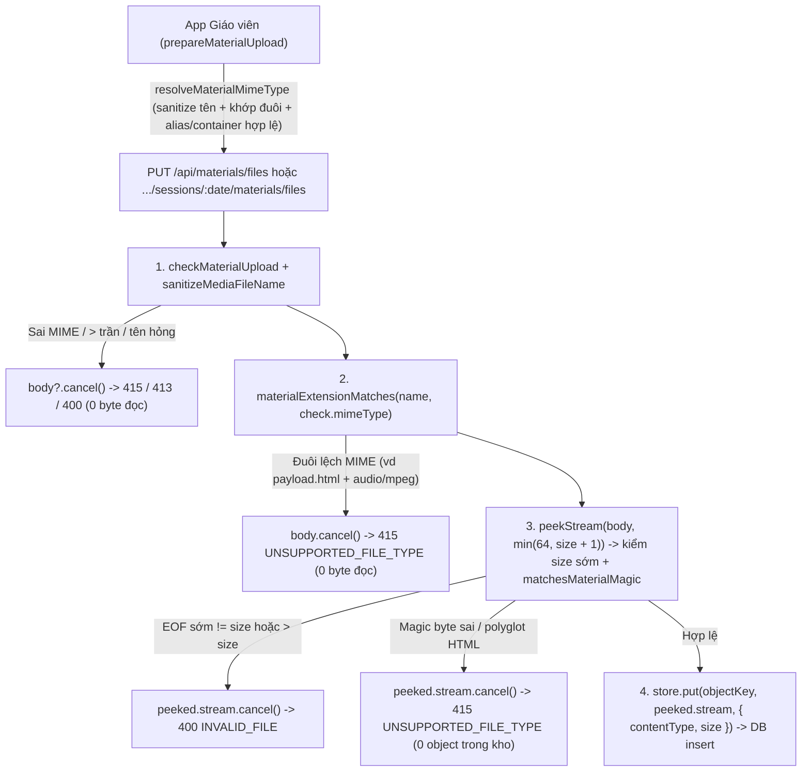

# Bảo mật upload tài liệu (#676): đối chiếu extension ↔ MIME & kiểm tra magic-byte streaming trước khi lưu kho

## Overview

Khép kín lỗ hổng xác thực upload tài liệu phát sinh từ hậu kiểm độc lập #644/#647 (issue #676) mà không phá vỡ kiến trúc streaming 95 MiB trên Cloudflare Workers:
1. **Nguồn sự thật thuần tại `@teacher-os/api/material-contracts` (`packages/api/src/material-contracts.ts`):**
   - Chuẩn hoá tên file qua `sanitizeMediaFileName(fileName)` ngay trong `extensionMime(fileName)` và chặn các tên bắt đầu bằng dấu chấm (`clean.startsWith(".")`, ví dụ `.pdf`, `..pdf`, `.hidden.pdf`) để đồng nhất 100% quy tắc tên file giữa client và server; mọi tra cứu bảng (`MATERIAL_EXTENSION_TYPES`, `MATERIAL_MIME_ALIASES`, `MATERIAL_MIME`) dùng `Object.hasOwn` kèm fallback `?? null` / `?? normalized` tương thích `noUncheckedIndexedAccess: true`.
   - Siết `resolveMaterialMimeType(fileName, browserType)`: chỉ fallback thẳng theo đuôi khi `normalizeMediaType(browserType)` là `""` hoặc `"application/octet-stream"`; mở rộng `MATERIAL_MIME_ALIASES` cho các bí danh trình duyệt/OS phổ biến (`audio/mp4a-latm`, `audio/x-mp3`, `audio/mpeg3`, `audio/x-mpeg-3`, `image/pjpeg`, `image/x-png`, `application/x-pdf`) và cho phép tương thích container hợp lệ (`.m4a` với `video/mp4` → `audio/mp4`; `.docx`/`.pptx`/`.xlsx` với `application/zip` hoặc `application/x-zip-compressed` → MIME OOXML của đuôi); từ chối mọi `browserType` nguy hiểm/lệch đuôi (`text/html`, `image/svg+xml`, `audio/mpeg` trên `.pdf`…).
   - Xuất thêm `MATERIAL_MAGIC_PEEK_BYTES = 64`, `materialExtensionMatches(fileName, mimeType)` và `matchesMaterialMagic(mimeType, head)` kiểm chữ ký nhị phân chống polyglot HTML cho đủ 10 MIME trong `MATERIAL_MIME`:
     - PDF (`application/pdf`): `>= 8` byte, `%PDF-` tại `0..4` + phiên bản `[12]\.[0-9]` tại `5..7` (chặn `%PDF-<html>`).
     - PNG (`image/png`): `>= 8` byte `89 50 4E 47 0D 0A 1A 0A`.
     - JPEG (`image/jpeg`): `>= 3` byte `FF D8 FF`.
     - WEBP (`image/webp`): `>= 16` byte, `RIFF` tại `0..3` + `WEBP` tại `8..11` + chunk FourCC `VP8 ` / `VP8L` / `VP8X` tại `12..15` (chặn `RIFF<!--WEBP--><html>`).
     - OOXML DOCX/PPTX/XLSX: `>= 30` byte ZIP Local File Header (`50 4B 03 04` tại `0..3`, compression method uint16LE tại `8..9` thuộc `{0, 8}`, `fileNameLength` uint16LE tại `26..27` `> 0`, chặn `PK\x03\x04<html>`).
     - MP3 (`audio/mpeg`): hoặc header ID3v2 10 byte (`49 44 33` tại `0..2`, major version `2..4` tại `[3]`, revision `< 0xff` tại `[4]`, 4 synchsafe byte `[6..9]` có MSB `0` — chặn `ID3<html>`), hoặc MPEG Layer III sync frame 4 byte (`b0 === 0xff`, `(b1 & 0xe0) === 0xe0`, version `(b1 & 0x18) !== 0x08`, Layer III `(b1 & 0x06) === 0x02` — chặn triệt để UTF-16LE BOM `FF FE`, bitrate `(b2 & 0xf0) !== 0x00 && (b2 & 0xf0) !== 0xf0`, samplerate `(b2 & 0x0c) !== 0x0c`).
     - M4A/MP4 (`audio/mp4`, `video/mp4`): `>= 12` byte ISO-BMFF `ftyp` box với `boxSize` uint32BE tại `0..3` thoả `boxSize === 1 || (boxSize >= 16 && boxSize <= 4096)` (chặn `<!--ftyp--><html>`), `66 74 79 70` tại `4..7`, và `major_brand` ASCII in được tại `8..11` không thuộc nhóm phi-MP4 (`qt  `, `heic`, `heix`, `hevc`, `hevx`, `mif1`, `msf1`, `avif`, `avis`, `jp2 `).
2. **Kiểm tra streaming an toàn trước `store.put` trên server (`apps/server/src/lib/peek-stream.ts`, `apps/server/src/routes/materials.ts`):**
   - Tạo helper `peekStream(body, maxBytes)` dùng một `ReadableStreamDefaultReader` duy nhất với tách bạch trạng thái `cancelled` / `sourceDone` / `releaseReader()` idempotent (không bao giờ gọi `controller.close()` sau `cancel()`, luôn giải phóng khoá reader khi EOF/lỗi/huỷ, và giới hạn tối đa 16 chunk 0 byte liên tiếp chống CPU spin).
   - Trong `storeUpload` (dùng chung cho `PUT /api/materials/files` và `PUT /api/classes/:classId/sessions/:date/materials/files`), huỷ `c.req.raw.body?.cancel()` sạch trên mọi nhánh trả lỗi sớm (`415`/`413`/`400`), kiểm `materialExtensionMatches(name, check.mimeType)` → sai trả `415 UNSUPPORTED_FILE_TYPE` không đọc body; gọi `peekStream(body, Math.min(MATERIAL_MAGIC_PEEK_BYTES, size + 1))` (dừng ngay ở byte `size + 1` chống Slowloris khi `size < 64`): nếu `(peeked.ended && peeked.readBytes !== size) || peeked.readBytes > size` thì huỷ stream và trả `400 INVALID_FILE`; nếu `!matchesMaterialMagic(check.mimeType, peeked.head)` thì huỷ stream và trả `415 UNSUPPORTED_FILE_TYPE` trước khi chạm `store.put` (0 object rác trong kho).
3. **Kiểm thử TDD toàn diện, E2E case âm trên cả 2 route & tạo issue follow-up (`packages/api`, `apps/server`, `apps/web`, `apps/e2e`, `CHANGELOG.md`):**
   - Bổ sung unit test cho bảng chữ ký magic (gồm các vector polyglot HTML/UTF-16LE BOM), `materialExtensionMatches`, `resolveMaterialMimeType`, `peekStream` (chunk 1 byte, race `pull`/`cancel`, giới hạn chunk rỗng), route test âm/dương trên `materials.test.ts` (gồm cả lệch `Content-Length` `> 64` byte đi xuyên qua `store.put`), cập nhật test `prepareMaterialUpload` trên `apps/web`, thêm kịch bản E2E âm cho **cả `PUT /api/materials/files` lẫn `PUT /api/classes/:classId/sessions/:date/materials/files`** + kiểm chặn bấm nút `"Tải lên"` trên `UploadDialog`, cập nhật `CHANGELOG.md`, và tạo issue follow-up mang nhãn `ai-handle` cho các route raw-PUT còn lại.

Hợp đồng bàn giao (`--advice`): kế hoạch này tuân thủ chuẩn bàn giao cho model thực thi cấp thấp hơn (`advice-handover-plan.md`), mỗi phase đều phân rã thành các task độc lập có điều kiện kiểm tra cơ học (`Verify`) và nhúng nguyên văn khối `## Failure Protocol`.

## Advisor Scope Lock (`--advice`)

- **Locked Scope:**
  - `packages/api/src/material-contracts.ts` & `packages/api/src/material-contracts.test.ts`
  - `apps/server/src/lib/peek-stream.ts` & `apps/server/src/lib/peek-stream.test.ts`
  - `apps/server/src/routes/materials.ts` & `apps/server/src/routes/materials.test.ts`
  - `apps/web/src/lib/repos/materials.test.ts`
  - `apps/e2e/specs/material-upload-student.spec.ts`
  - `CHANGELOG.md` & tạo issue follow-up `ai-handle` trên GitHub
- **Explicit Non-Goals (được tạo thành issue follow-up `ai-handle` bằng task cơ học ở Phase 2 Task 2.2):**
  - Không sửa route Speaking (`PUT /api/student/attempts/:attemptId/media` + `resolveQuizMediaType` vốn có 12 container WAV/OGG/WebM/AAC/MOV và hành vi test đang ghim ở `apps/student/test/quiz-media.test.ts:43-45`).
  - Không sửa Library audio (`PUT /api/admin/library/tests/:id/parts/:part/audio`), Placement audio (`PUT /api/placement-test/audio`), Vocab audio (`PUT /api/vocab/words/:wordId/audio`), hay Exam-imports PNG/JPEG.
  - Không sửa chiều đọc tải về `apps/server/src/lib/material-file-response.ts` (đã được cứng hoá CSP/MIME ở #647) và không chuyển `prepareMaterialUpload` ở client sang `async`.
  - Không thêm mã lỗi mới vào `MATERIAL_ERROR_CODES` (dùng thống nhất `415 UNSUPPORTED_FILE_TYPE` cho lệch đuôi/magic và `400 INVALID_FILE` cho lệch kích thước/tên rỗng).

### Extension Trace

Khi mở rộng sang các route raw-PUT âm thanh/video khác (Speaking, Library audio, Placement audio, Vocab audio) ở issue follow-up:
- **Hợp đồng giữ nguyên:** `apps/server/src/lib/peek-stream.ts` (`peekStream`) hoàn toàn độc lập domain và tái sử dụng nguyên bản trước `store.put` trên mọi route dùng `MediaStore`.
- **Phần thay đổi theo domain:** `packages/api/src/lib/quiz-media.ts` / `library-contracts.ts` bổ sung bảng chữ ký riêng cho WAV (`RIFF....WAVE`), OGG (`OggS`), WebM (`1A 45 DF A3`), AAC ADTS (`FF F1`/`FF F9`), QuickTime MOV (`ftyp qt  ` / `moov`) mà không làm phình `material-contracts.ts`.

## Architecture / Flow

## Goals

| # | Goal | Priority |
|---|------|----------|
| 1 | Chuẩn hoá đối chiếu đuôi file ↔ MIME (kèm sanitize tên file + alias trình duyệt) và chữ ký magic-byte chống polyglot trong `@teacher-os/api/material-contracts` | P1 |
| 2 | Triển khai `peekStream` an toàn trạng thái/khoá reader (không đệm toàn bộ body, chống Slowloris/0-byte spin) và chặn `415`/`400` trước `store.put` trong `storeUpload` | P1 |
| 3 | Phủ kiểm thử TDD đơn vị/tích hợp, bổ sung kịch bản E2E âm trên cả 2 route upload + `UploadDialog`, cập nhật `CHANGELOG.md` và mở issue follow-up `ai-handle` | P1 |

## Phases

| # | Phase | Status |
|---|-------|--------|
| 1 | [Phase 1: Hợp đồng MIME/extension/magic-byte, peekStream & xác thực storeUpload (TDD)](./phase-01-start.md) | Pending |
| 2 | [Phase 2: Kiểm thử E2E case âm trên stack thật, CHANGELOG & issue follow-up](./phase-02-e2e-negative-and-changelog.md) | Pending |

## Success Criteria

- [x] `resolveMaterialMimeType(fileName, browserType)` chuẩn hoá tên qua `sanitizeMediaFileName`, chặn dotfile bắt đầu bằng `.` (`.pdf`, `..pdf`), chỉ fallback tự do khi `browserType` là `""` hoặc `"application/octet-stream"`, hỗ trợ các bí danh trình duyệt/container hợp lệ (`.m4a` + `video/mp4`, OOXML + `application/x-zip-compressed`), và từ chối mọi `browserType` nguy hiểm/lệch đuôi (`("doc.pdf", "text/html") -> null`, `("payload.html", "audio/mpeg") -> null`, `("a.bin", "application/pdf") -> null`, `("a.toString", "") -> null`).
- [x] `matchesMaterialMagic(mimeType, head)` nhận đúng chữ ký của cả 10 MIME trong `MATERIAL_MIME` và chặn triệt để các mẫu giả mạo/polyglot (`<html>`, UTF-16LE BOM `\uFEFF <html>` giả MP3, `ID3<html>`, `<!--ftyp--><html>`, `RIFF<!--WEBP--><html>`, `%PDF-<html>`, `PK\x03\x04<html>`, HEIC/AVIF/MOV `ftyp` giả MP4).
- [x] `peekStream(body, maxBytes)` đọc vòng lặp tối đa `maxBytes` (chịu chunk 1 byte), phát lại byte-identical toàn bộ stream, giải phóng khoá reader trên mọi nhánh EOF/lỗi/`cancel()` mà không ném `Controller is already closed`, và chặn vòng lặp chunk rỗng vô hạn.
- [x] `storeUpload` (`PUT /api/materials/files` và `PUT /api/classes/:classId/sessions/:date/materials/files`) huỷ `body` sạch khi từ chối sớm, trả `415 UNSUPPORTED_FILE_TYPE` khi lệch đuôi hoặc sai magic-byte (để lại 0 object trong `MediaStore`), và giữ nguyên `400 INVALID_FILE` khi lệch `Content-Length` ở cả ngưỡng `<= 64` byte lẫn `> 64` byte.
- [x] Spec E2E `apps/e2e/specs/material-upload-student.spec.ts` xanh trọn vẹn (bao gồm E2E âm trên cả ngân hàng lẫn buổi học và kiểm bấm `"Tải lên"` trên `UploadDialog`), `CHANGELOG.md` có mục `#676`, issue follow-up `ai-handle` cho các route raw-PUT còn lại đã được tạo, và toàn bộ gate local (`pnpm exec biome check .`, `pnpm check-types`, `pnpm test`) xanh 0 lỗi.

## Red Team Review

### Session — 2026-11-11
**Findings:** 9 (8 accepted, 1 rejected)
**Severity breakdown:** 5 Critical, 2 High, 2 Medium

| # | Finding | Severity | Disposition | Applied To |
|---|---------|----------|-------------|------------|
| 1 | `matchesMaterialMagic("audio/mpeg")` để lọt HTML UTF-16LE BOM (`FF FE 20 00...`) qua Layer I `0xFE` và payload ASCII `ID3<html>` 3 byte | Critical | Accept | `plan.md`, Phase 1 (Tasks 1.1, 1.2, 1.3) |
| 2 | Lỗ hổng polyglot HTML ASCII ở MP4 (`<!--ftyp-->`), WebP (`RIFF<!--WEBP-->`), PDF (`%PDF-<html>`), OOXML (`PK\x03\x04<html>`) và `ftyp` phi-MP4 (`heic`/`avif`/`qt  `) | Critical | Accept | `plan.md`, Phase 1 (Tasks 1.1, 1.2, 1.3) |
| 3 | Biểu thức `Object.hasOwn` và chỉ số `Uint8Array` / `chunks[i]` vi phạm `noUncheckedIndexedAccess: true`, thiếu `check-types` ở Task 1.2 `Verify` | Critical | Accept | `plan.md`, Phase 1 (Tasks 1.2, 1.4) |
| 4 | Race `pull()`/`cancel()` trong `peekStream` gây `Controller is already closed`, rò khoá `reader`, kẹt Slowloris khi `size < 64`, spin chunk 0 byte và thiếu `body.cancel()` khi trả lỗi sớm | Critical | Accept | `plan.md`, Phase 1 (Tasks 1.3, 1.4) |
| 5 | `plan.md` hứa tách issue follow-up `ai-handle` cho Speaking/Library/Placement/Vocab audio nhưng thiếu task cơ học tạo issue (giữ Scope Lock Materials theo chốt của Kongming) | Critical | Accept | `plan.md`, Phase 2 (Task 2.2) |
| 6 | Lệch chuẩn hoá tên file (`sanitizeMediaFileName`, dotfile `..pdf`) giữa client/server và thiếu alias trình duyệt/OS (`.m4a` `video/mp4`, OOXML `application/x-zip-compressed`…) làm chặn nhầm file thật | High | Accept | `plan.md`, Phase 1 (Tasks 1.1, 1.2) |
| 7 | Phase 2 bỏ sót E2E âm trên route buổi học `/api/classes/:classId/sessions/:date/materials/files` và quên bấm nút submit `"Tải lên"` trên `UploadDialog` | High | Accept | `plan.md`, Phase 2 (Task 2.1) |
| 8 | Toàn bộ test lệch `Content-Length` trong Task 1.3 đều `< 64` byte nên không đi qua `store.put` → `MediaSizeMismatchError` | Medium | Accept | `plan.md`, Phase 1 (Task 1.3) |
| 9 | Sửa thêm đường tải về `materialFileResponse` để viết lại đuôi `row.originalName` cũ trên `?download=1` | Medium | Reject | Ngoài phạm vi #676 (vé chỉ yêu cầu kiểm thực đầu vào trước khi lưu kho; đường tải về vừa được khóa `application/octet-stream` + `STRICT_CSP` + `nosniff` ở #647) |

### Whole-Plan Consistency Sweep
- Files reread: `plan.md`, `phase-01-start.md`, `phase-02-e2e-negative-and-changelog.md`
- Decision deltas checked: 8
- Reconciled stale references: 8
- Unresolved contradictions: 0

## Validation Log

### Verification Results
- **Tier:** Light (Fact Checker, ≥5 claims/phase; 14 claims verified across 2 phases)
- **Claims checked:** 14
- **Verified:** 14 (sau khi đồng bộ 3 điểm lệch phát hiện ở Red-Team Findings #3, #5, #7) | **Failed:** 0 | **Unverified:** 0

### Decisions Confirmed (Autonomous `--vibe --advice`)
1. **Phạm vi & Follow-up:** Khóa phạm vi code #676 vào hệ thống Tài liệu (`material-contracts`, `peek-stream`, `materials.ts`, `web`, `e2e`) theo tư vấn của Kongming, đồng thời bắt buộc tạo issue follow-up mang nhãn `ai-handle` bằng bước cơ học trong Phase 2 cho các route raw-PUT còn lại (Speaking, Library, Placement, Vocab, Exam-imports).
2. **Chữ ký Magic-Byte chống Polyglot:** Kiểm đủ cấu trúc header (ID3v2 10 byte + MPEG Layer III không trùng UTF-16LE BOM `FF FE`, `ftyp` `boxSize` hợp lệ + loại trừ `qt  `/`heic`/`avif`, WebP `VP8 `/`VP8L`/`VP8X`, PDF `%PDF-[12].[0-9]`, OOXML ZIP Local Header 30 byte).
3. **An toàn luồng & Tương thích Client:** `peekStream` đọc tối đa `min(64, size + 1)` byte với cờ `cancelled` tách rời + `releaseLock()` idempotent; `resolveMaterialMimeType` dùng chung `sanitizeMediaFileName` và chấp nhận các alias OS/trình duyệt hợp lệ mà vẫn chặn mọi MIME nguy hiểm.

### Whole-Plan Consistency Sweep
- Files reread: `plan.md`, `phase-01-start.md`, `phase-02-e2e-negative-and-changelog.md`
- Decision deltas checked: 8
- Reconciled stale references: 0 remaining
- Unresolved contradictions: 0

<!-- slug: 676-upload-extension-magic-bytes -->
