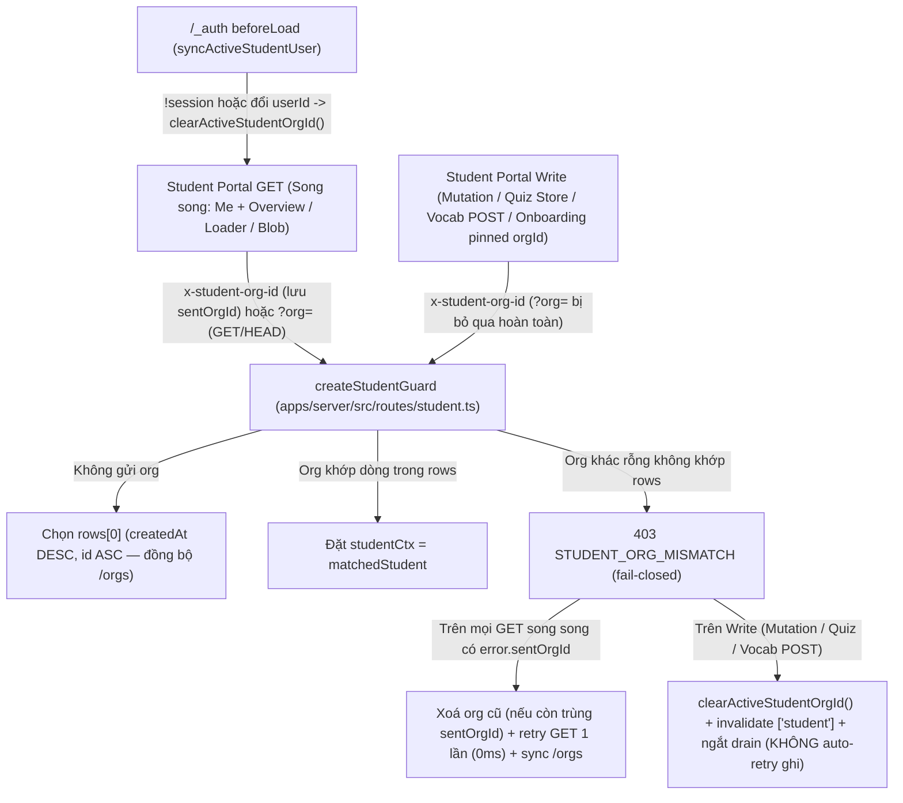

# Bảo mật (#675): khoá fail-closed `createStudentGuard`, tự phục hồi org học viên & rà soát `mediaObjectResponse`

## Overview

Giải quyết trọn vẹn lỗ hổng fail-open toàn cục trên `createStudentGuard` cùng rủi ro tương thích ngược ở cổng học viên và hạng mục rà soát `mediaObjectResponse` từ issue #675 (hậu kiểm red-team độc lập của #644 / #647):

1. **Server fail-closed trên `createStudentGuard` & đồng bộ `GET /api/student/orgs` (`packages/api/src/contracts.ts`, `apps/server/src/routes/student.ts`):** Thêm mã lỗi chuyên biệt `STUDENT_ERROR_CODES.ORG_MISMATCH = "STUDENT_ORG_MISMATCH"`. Chuẩn hoá thứ tự đọc định danh tổ chức: ưu tiên header `x-student-org-id` (đã `trim()`, chuỗi rỗng/khoảng trắng coi như vắng mặt), chỉ đọc query `?org=` dự phòng khi phương thức HTTP là `GET` hoặc `HEAD` (loại bỏ hoàn toàn bề mặt `?org=` trên `POST`/`PUT`/`PATCH`/`DELETE`, kể cả khi `?org=` trỏ tới một org phụ hợp lệ). Khi có `requestedOrgId` khác rỗng mà không khớp bất kỳ dòng `student` nào của phiên đăng nhập (`rows`), trả ngay `403` `{ error: STUDENT_ERROR_CODES.ORG_MISMATCH, code: STUDENT_ERROR_CODES.ORG_MISMATCH }` thay vì rơi im lặng về `rows[0]`. Đồng bộ `.trim()` header và thứ tự sắp xếp `.orderBy(desc(student.createdAt), asc(student.id))` trên `GET /api/student/orgs` để `defaultOrgId` luôn trùng khớp tuyệt đối với `rows[0]` của `createStudentGuard`.
2. **Tự phục hồi `active_student_org_id` an toàn đa truy vấn song song & cô lập phiên đa tài khoản trên Student Portal (`apps/student`):**
   - **Gắn `sentOrgId` trên `HttpError` để chống race truy vấn song song:** Khi nhiều truy vấn song song (`useStudentMe` + `useStudentOverview` trên `/`, hoặc parent/child quiz loaders) cùng gửi đi `x-student-org-id` cũ, mỗi `HttpError` lưu lại `sentOrgId` thực tế đã phát trên request đó. Trong `defaultOptions.queries.retry`, mọi truy vấn có `failureCount < 1 && isStudentOrgMismatchError(error) && Boolean(error.sentOrgId)` đều được retry ngay lập tức (`retryDelay: 0`) đúng 1 lần sau khi xoá `localStorage` nếu vẫn đang mang `error.sentOrgId`, đảm bảo không truy vấn song song nào bị bỏ sót trên màn hình lỗi `403`.
   - **Thao tác ghi không bao giờ tự retry sang tổ chức khác:** `MutationCache.onError`, các hàm ghi trực tiếp trong `quiz.ts` (`request()` cho `POST`/`PATCH`/`DELETE`, `uploadQuizMedia`) kèm ngắt sớm vòng lặp `drain()` của `quiz-attempt-store.ts` khi gặp `STUDENT_ORG_MISMATCH`, và helper `parseWriteErrorAndThrow` dành riêng cho các hàm `POST` trong `vocab.ts` (tách biệt khỏi `parseErrorAndThrow` thuần cho `GET`) sẽ xoá org cũ + `invalidateQueries(["student"])` nhưng tuyệt đối không tự động thực thi lại lệnh ghi; riêng `submitOnboarding` / `OnboardingWizard` khoá cứng `explicitOrgId` theo `meQuery.data.student.orgId` để ngay cả khi người dùng bấm lại nút lưu trước lúc trang chuyển hướng cũng không thể ghi nhầm sang `rows[0]`.
   - **Cô lập phiên đa tài khoản & đồng bộ phản ứng (`useSyncExternalStore`):** Module lá `student-org-storage.ts` phát sự kiện in-tab qua `subscribeActiveStudentOrg` (cho `OrgSwitcher`, `GreetingHeader`, `MaterialRow`, `useStudentSchedule`) và gắn `syncActiveStudentUser(userId)` tại `/_auth/route.tsx` `beforeLoad` (xoá `active_student_org_id` ngay khi hết phiên `!session.data` hoặc khi `session.data.user.id` đổi sang tài khoản khác), kết hợp xoá khi đăng xuất (`avatar-menu.tsx`, `student-error-view.tsx`) và `reauth()`.
3. **Rà soát & khoá hợp đồng bảo mật `mediaObjectResponse` (`apps/server/src/lib/media-response.ts`, `apps/server/src/app.ts`, E2E E6 & `CHANGELOG.md`):** Xác nhận 7 route gọi `mediaObjectResponse` không mở tab điều hướng cấp cao nhất (`target="_blank"`), đặc biệt `exam-imports` trả `inline` cho file PDF/ảnh tải lên nên bắt buộc giữ `Content-Security-Policy: default-src 'none'; sandbox` (không nới `allow-same-origin` như `materialFileResponse` ở #647/#674). Bổ sung chuẩn hoá & allowlist MIME an toàn trong `mediaObjectResponse` (`audio/*`, `video/*`, `application/pdf`, `image/png`, `image/jpeg`, `image/webp`, `DOCX`; ngoài allowlist hoặc rỗng/khoảng trắng bị ép về `application/octet-stream` + `attachment`), thêm `Cross-Origin-Opener-Policy: same-origin`, đăng ký `Cross-Origin-Resource-Policy: same-site` + `Referrer-Policy: no-referrer` trước `secureHeaders` trong `app.ts` cho 4 route media còn thiếu, kiểm tra `audio/*` trước khi bọc `Blob` trong `fetchVocabAudioObjectUrl`, cập nhật E2E E6 (`403 STUDENT_ORG_MISMATCH` + kiểm thử tự phục hồi trình duyệt thật) và `CHANGELOG.md`.

Hợp đồng bàn giao (`--advice`): kế hoạch được biên soạn theo chuẩn bàn giao cho model thực thi cấp thấp hơn (`advice-handover-plan.md`); mỗi phase chứa danh sách task độc lập theo thứ tự TDD Red → Green kèm điều kiện kiểm tra cơ học (`Verify`) và khối nguyên văn `## Failure Protocol`.

## Architecture / Flow

## Extension Trace

`createStudentGuard` là ranh giới phân tách tenant/org dùng chung cho toàn bộ các router con dưới `/api/student/*` (`studentRoutes`, `studentClassmatesRoutes`, `studentHistoryRoutes`, `studentMaterialRoutes`, `studentPracticeRoutes`, `registerVocabRoutes`). Khi bổ sung một tính năng cổng học viên mới trong tương lai (ví dụ `/api/student/certificates`):
- **Hợp đồng giữ ổn định:** Chỉ cần gắn `createStudentGuard(deps)` ở server và dùng `useQuery`/`useMutation` với `getStudentHeaders()` kèm truyền `sentOrgId` vào `HttpError` trên `studentQueryClient` ở client — cơ chế chặn fail-closed `403 STUDENT_ORG_MISMATCH`, giới hạn `?org=` cho `GET`/`HEAD`, cô lập đa tài khoản ở `/_auth`, và tự phục hồi đa truy vấn song song tự động có hiệu lực.
- **Phần phải tuân thủ khi mở rộng:** Nếu tính năng mới gọi `fetch`/`XMLHttpRequest` trực tiếp bên ngoài `useQuery`/`useMutation`, hàm đọc `GET` chỉ retry 1 lần dựa trên `sentOrgId` (và kiểm tra allowlist MIME trước khi tạo `Blob`), còn hàm ghi phải gọi `healStudentOrgMismatch()` mà không tự retry; màn hình ghi không có `OrgSwitcher` phải ghim `orgId` tường minh từ dữ liệu đã tải.
- **Chứng minh trong kế hoạch:** Kiểm chứng đồng thời trên route JSON (`/api/student/me`, `HEAD /api/student/me`, `POST /api/student/onboarding`), route file nhị phân (`/api/student/classes/.../materials/.../file` trong E2E E6), truy vấn song song `Promise.all` trên `QueryClient`, `MutationCache`, `QuizAttemptStore.drain()`, và các hàm gọi trực tiếp trong `quiz.ts`, `vocab.ts`.

## Goals

| # | Goal | Priority |
|---|------|----------|
| 1 | Chuyển `createStudentGuard` sang fail-closed (`403 STUDENT_ORG_MISMATCH`), bỏ qua `?org=` trên mọi phương thức ghi, và đồng bộ thứ tự mặc định với `GET /api/student/orgs` | P1 |
| 2 | Tự phục hồi mượt mà `active_student_org_id` cũ trên Student Portal (chống race truy vấn song song qua `sentOrgId`, không tự retry lệnh ghi, ghim `orgId` cho onboarding, cô lập đa tài khoản ở `/_auth` + đăng xuất, phản ứng tức thời qua `useSyncExternalStore`) | P1 |
| 3 | Khoá hợp đồng bảo mật `mediaObjectResponse` (giữ `sandbox` chặt, allowlist MIME chống `blob:` HTML/SVG, gắn `COOP: same-origin` & `CORP: same-site` + `Referrer-Policy: no-referrer` trên `app.ts`), cập nhật E2E E6 & `CHANGELOG.md` | P1 |

## Phases

| # | Phase | Status |
|---|-------|--------|
| 1 | [Phase 1: Khoá fail-closed `createStudentGuard`, đồng bộ `/orgs` & chuẩn hoá bảo mật `mediaObjectResponse`](./phase-01-start.md) | Completed |
| 2 | [Phase 2: Tự phục hồi `active_student_org_id` đa truy vấn & đa tài khoản trên Student Portal, cập nhật E2E E6 & CHANGELOG](./phase-02-student-org-self-heal-and-e2e.md) | Completed |

## Success Criteria

- [x] `STUDENT_ERROR_CODES.ORG_MISMATCH` (`"STUDENT_ORG_MISMATCH"`) được xuất từ `@teacher-os/api/contracts`; mọi request tới route gắn `createStudentGuard` mang `x-student-org-id` (hoặc `?org=` trên `GET`/`HEAD`) khác rỗng nhưng không khớp `rows` đều bị từ chối `403` với `code: "STUDENT_ORG_MISMATCH"`; `GET /api/student/orgs` dùng cùng `.trim()` và `.orderBy(desc(student.createdAt), asc(student.id))` với `createStudentGuard`.
- [x] Tham số `?org=` chỉ có hiệu lực trên `GET`/`HEAD` và bị bỏ qua hoàn toàn trên `POST`/`PUT`/`PATCH`/`DELETE` (kể cả khi `?org=` mang ID của một org phụ hợp lệ); giá trị header/query chỉ gồm khoảng trắng được coi như không truyền.
- [x] Trên `apps/student`, mọi truy vấn `GET` song song mang `sentOrgId` cũ đều tự retry đúng 1 lần (`retryDelay: 0`) về org hợp lệ không hiện màn lỗi `403`; mọi thao tác ghi (`MutationCache`, `quiz.ts` `request()`/`uploadQuizMedia`, `QuizAttemptStore.drain()`, `vocab.ts` `parseWriteErrorAndThrow`) xoá org cũ + `invalidateQueries(["student"])` mà không tự thực thi lại lệnh ghi sang org khác; `submitOnboarding` ghim `orgId` tường minh; `/_auth` `beforeLoad`, đăng xuất và `reauth()` cô lập hoàn toàn `active_student_org_id` giữa các tài khoản; các component đọc org cập nhật tức thì qua `useSyncExternalStore`.
- [x] `mediaObjectResponse` giữ nguyên `Content-Security-Policy: default-src 'none'; sandbox` (không có `allow-same-origin`/`allow-scripts`), gắn `Cross-Origin-Opener-Policy: same-origin`, chuẩn hoá & allowlist MIME (ép `application/octet-stream` + `attachment` khi ngoài allowlist hoặc rỗng), kèm đăng ký `Cross-Origin-Resource-Policy: same-site` + `Referrer-Policy: no-referrer` trên `app.ts` cho đủ các route media và kiểm tra `audio/*` trong `fetchVocabAudioObjectUrl`.
- [x] Spec E2E `apps/e2e/specs/material-upload-student.spec.ts` (gồm E5, E6 `403 STUDENT_ORG_MISMATCH` & kiểm thử tự phục hồi trình duyệt thật với `orgBId`), `pnpm exec biome check .`, `pnpm check-types`, và các bộ unit test liên quan đều xanh 0 lỗi; `CHANGELOG.md` cập nhật mục `#675`.

## Red Team Review

### Session — 2026-11-11
**Findings:** 11 deduplicated from 2 reviewers (`RedTeamSecurityAdversary` + `RedTeamAssumptionDestroyer`) — 11 accepted (10 full, 1 modified scope), 0 rejected
**Severity breakdown:** 5 Critical, 4 High, 2 Medium

| # | Finding | Severity | Disposition | Applied To |
|---|---------|----------|-------------|------------|
| 1 | Race giữa các truy vấn `GET` song song (`useStudentMe` + `useStudentOverview` trên `/`, parent+child quiz loaders, blob GET) khi cổng kiểm tra `getActiveStudentOrgId() !== null` lúc nhận lỗi khiến truy vấn thứ hai kẹt ở `403` | Critical | Accept (`HttpError.sentOrgId` theo từng request + test `Promise.all`) | `plan.md`, Phase 2 |
| 2 | Biến `orgBId` chưa được khai báo trong `apps/e2e/specs/material-upload-student.spec.ts:292-304` gây lỗi `TS2304` / `ReferenceError` ở Task 2.3 | Critical | Accept (khai báo `const orgBId = await orgIdForTeacherEmail(teacherBEmail)`) | `plan.md`, Phase 2 |
| 3 | Payload mẫu của `POST /api/student/onboarding` trong Task 1.2 dùng giá trị enum sai schema (`"ielts"`, `"5.0-5.5"`, `"1-2h"`) gây lỗi `400` và thiếu khôi phục cột fixture `student-amb-1` trong `finally` | Critical | Accept (dùng đúng enum hợp lệ + reset fixture trong `finally`) | Phase 1 |
| 4 | Gọi `healStudentOrgMismatch()` bên trong `parseErrorAndThrow` dùng chung của `vocab.ts` làm ảnh hưởng tới 4 hàm `GET` dùng trong `useQuery` | Critical | Accept (tách riêng `parseWriteErrorAndThrow` chỉ cho 4 hàm `POST`) | `plan.md`, Phase 2 |
| 5 | `localStorage.active_student_org_id` không gắn với `userId` và không xoá khi hết phiên tự nhiên (`/_auth` `beforeLoad`) hoặc khi đăng nhập tài khoản khác có dòng dormant trùng org | Critical | Accept (`syncActiveStudentUser(userId)` + xoá khi `!session.data` ở `/_auth/route.tsx`) | `plan.md`, Phase 2 |
| 6 | Bỏ sót các lệnh ghi trực tiếp qua `quiz.ts:request()` (`patchQuizAnswer`, `patchQuizEssay`, `deleteQuizMedia`) và wave 2 của `QuizAttemptStore.drain()` có thể tự gửi lại `PATCH` không header sang org mặc định | High | Accept (xử lý trong `quiz.ts:request()` + ngắt `drain()` khi `isStudentOrgMismatchError`, bảo toàn test `F1b` `400`) | `plan.md`, Phase 2 |
| 7 | Khi `POST /api/student/onboarding` bị `403 STUDENT_ORG_MISMATCH` và xoá `localStorage`, cú bấm lưu lại của học viên trên màn `/onboarding` (không có `OrgSwitcher`) sẽ ghi nhầm sang `rows[0]` | High | Accept (ghim `orgId` tường minh từ `meQuery.data.student.orgId` vào `submitOnboarding` + cảnh báo rõ) | `plan.md`, Phase 2 |
| 8 | Import `clearActiveStudentOrgId` từ `@/lib/repos/student` trong `avatar-menu.tsx` / `student-error-view.tsx` làm vỡ mock đóng `vi.mock("@/lib/repos/student")` ở `overview.test.tsx` & `student-shell.test.tsx`; test click đăng xuất thiếu `waitFor` | High | Accept (bắt buộc import từ `@/lib/student-org-storage` + dùng `waitFor` & stub `location`) | Phase 2 |
| 9 | `secureHeaders` ghi đè `CORP: cross-origin` và `Referrer-Policy` trên 4/7 route `mediaObjectResponse` trong `app.ts`; `mediaObjectResponse` & `fetchVocabAudioObjectUrl` chưa chặn MIME nguy hiểm (`text/html`, `image/svg+xml`) trước khi tạo `blob:` | High | Accept (modified: thêm 4 route vào pre-`secureHeaders` `app.ts`, allowlist MIME trong `mediaObjectResponse` & kiểm tra `audio/*` trong `fetchVocabAudioObjectUrl`; giữ ngoài scope việc sửa `apps/web` `exam-imports` / `proxyRemoteAudio` CDN) | `plan.md`, Phase 1, Phase 2 |
| 10 | `GET /api/student/orgs` dùng `desc(student.id)` và không `.trim()` header, lệch với `asc(student.id)` + `.trim()` của `createStudentGuard` khi 2 hồ sơ cùng `createdAt` | Medium | Accept (đồng bộ `.trim()` + `asc(student.id)` ở `GET /orgs` và kiểm tra `HEAD` + `POST ?org=org-2` ở Phase 1) | `plan.md`, Phase 1 |
| 11 | `getActiveStudentOrgId()` không có subscription khiến `useStudentSchedule`, `MaterialRow`, `GreetingHeader`, `OrgSwitcher` không tự render lại khi `localStorage` đổi trong cùng tab; thiếu `?? data.error` ở 3 hàm invite/enrollment | Medium | Accept (`subscribeActiveStudentOrg` với `useSyncExternalStore` + `?? data.error` và sửa số dòng `862`) | `plan.md`, Phase 2 |

### Whole-Plan Consistency Sweep
- Files reread: `plan.md`, `phase-01-start.md`, `phase-02-student-org-self-heal-and-e2e.md`
- Decision deltas checked: 11
- Reconciled stale references: 11
- Unresolved contradictions: 0

## Validation Log

### Verification Results
- **Tier:** Light (Fact Checker, ≥5 claims/phase; 13 claims verified across 2 phases)
- **Claims checked:** 13
- **Verified:** 13 (after reconciling onboarding enum values, `orgBId` declaration, `repos/student.ts:862` line number, `vocab.ts` helper split, `quiz.ts:request()`, and `GET /orgs` sort order) | **Failed:** 0 | **Unverified:** 0

### Decisions Confirmed (Autonomous `--vibe --advice`)
1. **Hợp đồng fail-closed server:** `403 STUDENT_ORG_MISMATCH` cho mọi `requestedOrgId` khác rỗng không khớp hồ sơ; `?org=` chỉ đọc trên `GET`/`HEAD`; `GET /api/student/orgs` đồng bộ thứ tự `asc(student.id)` + `.trim()` với `createStudentGuard`.
2. **Tự phục hồi & cô lập phía client:** Lưu `sentOrgId` trên từng `HttpError` để retry an toàn cho mọi truy vấn `GET` song song; không bao giờ tự retry lệnh ghi (kể cả trong `QuizAttemptStore.drain()`); ghim `orgId` cho `submitOnboarding`; cô lập `userId` tại `/_auth/route.tsx` `beforeLoad`.
3. **Bảo mật `mediaObjectResponse`:** Giữ nguyên `default-src 'none'; sandbox`, thêm `COOP: same-origin` + allowlist MIME (ép `application/octet-stream` + `attachment` nếu lệch), và bổ sung `CORP: same-site` + `Referrer-Policy: no-referrer` trước `secureHeaders` trên `app.ts` cho đủ 7 route dùng `mediaObjectResponse`.

### Whole-Plan Consistency Sweep
- Files reread: `plan.md`, `phase-01-start.md`, `phase-02-student-org-self-heal-and-e2e.md`
- Decision deltas checked: 11
- Reconciled stale references: 0 remaining
- Unresolved contradictions: 0

<!-- slug: 675-student-guard-fail-closed -->
