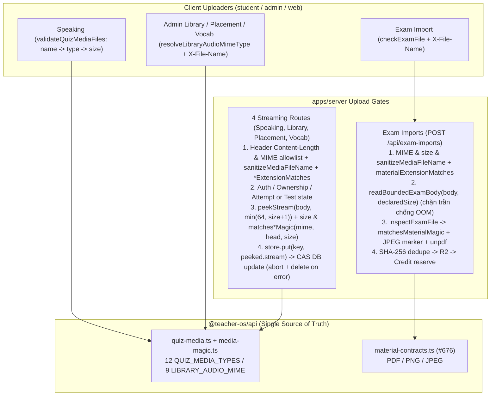

# Bảo mật upload media & đề thi (#681): đối chiếu extension ↔ MIME & kiểm tra magic-byte trên Speaking, Library, Placement, Vocab và Exam-imports

## Overview

Khép kín hợp đồng xác thực 3 lớp (`X-File-Name` đuôi file ↔ `Content-Type` ↔ chữ ký magic-byte 64 byte đầu) cho cả 5 bề mặt upload nhị phân còn lại sau #676 (PR #682), tuân thủ nguyên tắc một nguồn sự thật tại `@teacher-os/api` và đọc sớm không đệm RAM qua `peekStream` (`apps/server/src/lib/peek-stream.ts`):

1. **Nguồn sự thật dùng chung tại `@teacher-os/api` (`packages/api/src/lib/media-magic.ts` & `packages/api/src/lib/quiz-media.ts`):**
   - Tách module thuần `packages/api/src/lib/media-magic.ts` xuất `QUIZ_MEDIA_MAGIC_PEEK_BYTES = 64`, `matchesQuizMediaMagic(mimeType, head, totalSize?)` và `matchesLibraryAudioMagic(mimeType, head, totalSize?)` cho đủ 12 MIME của `QUIZ_MEDIA_TYPES` (và 9 MIME audio của `LIBRARY_AUDIO_MIME`) qua 7 bộ nhận diện họ container chống polyglot HTML / UTF-16 BOM (mọi `DataView` khởi tạo với `(head.buffer, head.byteOffset, head.byteLength)` chống lệch vùng nhớ Node `Buffer` slab pool, tương thích `noUncheckedIndexedAccess: true`):
     - **MP3 (`audio/mpeg`):** ID3v2 10 byte (`ID3`, major `2..4`, `rev <= 0x02`, cờ dự trữ bằng `0` theo version: `v2` `(b5 & 0x3f) === 0`, `v3` `(b5 & 0x1f) === 0`, `v4` `(b5 & 0x0f) === 0`, 4 byte synchsafe MSB `0`, và khi `head.byteLength >= 14` mà không bật extended header thì `head[10..13]` là `\x00` padding hoặc frame ID `[A-Z0-9]{3,4}` — chặn cả `ID3<html>` lẫn `ID3\x04<html><script>`) hoặc MPEG Layer III sync 4 byte (`0xff`, `(b1 & 0xe0) === 0xe0`, version `!== 0x08`, Layer III `(b1 & 0x06) === 0x02` — chặn UTF-16LE BOM `FF FE`, bitrate `!== 0x00`/`0xf0`, samplerate `!== 0x0c`).
     - **WAV (`audio/wav`, `audio/x-wav`, `audio/wave`):** `>= 20` byte, `RIFF` hoặc `RF64` tại `0..3` (với `RIFF` kiểm `12 <= riffSize <= cap` theo `uint32LE` tại `4..7`; với `RF64` kiểm `riffSize === 0xffffffff` và subchunk `ds64`), `WAVE` tại `8..11`, subchunk FourCC đầu tiên tại `12..15` thuộc `[A-Za-z0-9 ]{4}` (nhận `fmt `, `JUNK`, `FLLR`, `bext`, `LIST`, `ds64`), và `subchunkSize` (`uint32LE` tại `16..19`) `<= cap` (riêng `fmt ` bắt buộc `16 <= subchunkSize <= 1024` — chặn triệt để cả `RIFF<!--WAVE<html>` lẫn `RIFF<a  WAVEfmt ><script>`).
     - **OGG (`audio/ogg`):** `>= 27` byte (header trang Ogg RFC 3533), `OggS` tại `0..3`, `version === 0x00` tại `[4]`, `(flags & 0xf8) === 0`, trang đầu BOS `(flags & 0x02) === 0x02` và `(flags & 0x01) === 0`, `page_sequence_number === 0` (`uint32LE` tại `18..21`), và `page_segments >= 1` tại `[26]` (chặn cả `OggS<html>` lẫn `OggS\x00\x02<html>`).
     - **WebM (`audio/webm`, `video/webm`):** `>= 16` byte, EBML ID `1A 45 DF A3` tại `0..3`, VINT độ dài hợp lệ tại `head[4] !== 0`, phần tử con EBML đầu tiên ngay sau VINT mở đầu bằng `0x42` / `0xec` / `0xbf`, và chứa phần tử EBML `DocType` `[0x42, 0x82]` kèm chuỗi `"webm"` hoặc `"matroska"` trong `head` (chặn `\x1a\x45\xdf\xa3<html><!--webm-->`).
     - **AAC (`audio/aac`):** ADTS `>= 7` byte (`0xff`, `(b1 & 0xf6) === 0xf0` — chặn `FF FE`, `sfIndex < 13`, `frameLength >= 7`), hoặc header ID3v2 hợp lệ, hoặc ISO-BMFF `ftyp` audio hợp lệ (`allowQtBrand = false`).
     - **ISO-BMFF MP4/M4A (`audio/mp4`, `audio/x-m4a`, `video/mp4`):** `>= 16` byte, `ftyp` tại `4..7`, `boxSize` chia hết cho 4 trong `16..4096` (hoặc `boxSize === 1` với `largesize` `24..4096` tại `8..15`) và `<= totalSize` khi có `totalSize` (chặn `<!--ftyp--><html>`), `major_brand` thuộc `[A-Za-z0-9 ]{4}`, loại trừ các brand ảnh (`heic`, `heix`, `hevc`, `hevx`, `mif1`, `msf1`, `avif`, `avis`, `jp2 `), và chỉ cho phép `qt  ` trên `video/*`.
     - **QuickTime MOV (`video/quicktime`):** khớp ISO-BMFF `ftyp` (cho phép `qt  `) hoặc atom QuickTime truyền thống tại offset `0` (`>= 16` byte, `cap = totalSize !== undefined ? Math.min(totalSize, QUIZ_MEDIA_MAX_BYTES) : QUIZ_MEDIA_MAX_BYTES`): `wide` bắt buộc `size === 8` + `mdat` tại `12..15` + `mdatSize` tại `8..11` thoả ràng buộc `mdat`; `moov` bắt buộc `16 <= size <= cap` + atom con `{"mvhd", "cmov", "trak", "udta", "meta"}` tại `12..15`; `mdat` bắt buộc `size === 0`, `size === 1` có `largesize <= cap`, hoặc `8 <= size <= cap`; `free`/`skip`/`pnot`/`junk` bắt buộc `8 <= size <= cap` và nếu `size <= head.byteLength - 8` thì FourCC kế tiếp tại `size + 4 .. size + 7` cũng thuộc tập atom QuickTime hợp lệ (chặn `<!--mdat--><html>`, `\x00\x00\x00\x08wide<!--mdat--><html>`, `\x00\x00\x00\x08free<html>` nhưng vẫn nhận `.mov` có `free` đệm > 4 KiB của `qt-faststart`).
   - Trong `packages/api/src/lib/quiz-media.ts`, đưa bước kiểm `sanitizeMediaFileName(file.name) === null` lên trước `resolveQuizMediaType` trong `validateQuizMediaFiles` (bảo toàn `reason: "name"` cho tên > 200 ký tự), siết `resolveQuizMediaType` & `resolveLibraryAudioMimeType` (chặn dotfile, chỉ fallback tự do khi `browserType` là `""` hoặc `"application/octet-stream"`, bổ sung đầy đủ alias Windows/Linux/macOS/Android gồm `audio/vnd.dlna.adts`/`audio/adts`/`audio/x-hx-aac-adts` cho `.aac`, `audio/opus`/`audio/x-opus+ogg`/`audio/x-vorbis+ogg`/`audio/x-speex+ogg` cho `.opus`/`.ogg`, chuẩn hoá `.m4a` + `video/mp4` → `audio/mp4` trên cả hai resolver và `.webm` + `video/webm` → `audio/webm` trên `resolveLibraryAudioMimeType`), và xuất `quizMediaExtensionMatches` / `libraryAudioExtensionMatches` (không mở ngoại lệ `.m4a` + `video/mp4` trong `quizMediaExtensionMatches` để không lọt `qt  `).
2. **Đồng bộ client uploaders & khóa 5 route upload trên server (`apps/student`, `apps/admin`, `apps/web`, `apps/server`):**
   - Cập nhật `speaking-submission-panel.tsx` (`MEDIA_ACCEPT` thêm `.opus,.wave,.qt`), `audio-uploader.tsx` (`admin`), `clip-audio-field.tsx` (kèm ánh xạ `PlacementHttpError.code` và tách lỗi `0 B`), `vocab-deck-editor.tsx` + `vocab-word-row.tsx` (gửi `X-File-Name`, khóa hàng đang upload, phân nhánh `onReject(reason)` theo `QuizMediaRejectReason`).
   - Bổ sung hàm `abort(reason?)` trên `PeekedStream` (`apps/server/src/lib/peek-stream.ts`) để huỷ `reader` gốc an toàn ngay cả khi `peeked.stream` đã bị `pipeThrough` khóa; bọc `peekStream` trong `try/catch` đồng nhất trên cả 4 route streaming (`student.ts`, `admin-library.ts` — đưa kiểm header/đuôi rẻ lên trước `loadTestRow`, `placement-test.ts`, và `vocab-teacher.ts` — bắt buộc `X-File-Name`, chuẩn hoá `audio/mp3` → `audio/mpeg`, kèm CAS + `try/catch` dọn `newKey` khi `db.update` lỗi/đua tranh); riêng `student.ts` chuẩn hoá `contentType` của `.m4a` + `video/mp4` về `audio/mp4` trước khi kiểm đuôi/magic.
   - Trên Exam-imports (`exam-imports.ts` & `validate-file.ts`), kiểm `materialExtensionMatches(fileName, mimeType)` trước khi đọc body, đọc `c.req.raw.body` qua bộ đọc giới hạn cứng `declaredSize` (ngắt ngay tại byte `declaredSize + 1`, chống OOM 128 MB trên Worker khi khai gian `Content-Length`), và trong `inspectExamFile` kiểm `matchesMaterialMagic(mimeType, head)` + marker JPEG `0xc0..0xfe` tại `head[3]` (chặn `\xff\xd8\xff<html>`, fail-closed `{ ok: false, reason: "type" }`).
3. **Di chuyển fixture sang byte thật, kiểm thử âm/dương, E2E âm/dương & tài liệu (`apps/server`, `apps/e2e`, `docs/system-architecture.md`, `CHANGELOG.md`):**
   - Tạo `apps/server/src/lib/test-media-fixtures.ts`, nâng cấp toàn bộ fixture byte giả trong 6 file test server (kể cả `enforceDeclaredSize` trong `vocab-teacher.test.ts` và ca `409` dòng 684 của `student-quiz-media.test.ts`), bổ sung spec E2E kiểm chứng âm thực tế `apps/e2e/specs/media-upload-magic-bytes.spec.ts` trên cả 5 route server cùng bộ E2E dương đầy đủ, và cập nhật `docs/system-architecture.md` + `CHANGELOG.md`.

Hợp đồng bàn giao (`--advice`): kế hoạch này tuân thủ chuẩn bàn giao cho model thực thi cấp thấp hơn (`advice-handover-plan.md`); mọi phase đều phân rã thành các task độc lập có điều kiện kiểm tra cơ học (`Verify`) và nhúng nguyên văn khối `## Failure Protocol`.

## Advisor Scope Lock (`--advice`)

- **Locked Scope:**
  - `packages/api/src/lib/media-magic.ts` (mới), `packages/api/src/lib/quiz-media.ts`, `packages/api/src/lib/quiz-media.test.ts` (mới)
  - Client uploaders & tests: `apps/student/src/components/quiz/speaking-submission-panel.tsx`, `apps/student/test/quiz-media.test.ts`, `apps/admin/src/components/library/audio-uploader.tsx` (+ `.test.tsx`), `apps/web/src/components/placement-test/clip-audio-field.tsx` (+ `.test.ts`), `apps/web/src/components/vocab/vocab-deck-editor.tsx`, `apps/web/src/components/vocab/vocab-word-row.tsx`, `apps/web/src/components/vocab/vocab-audio-upload.test.ts` (mới)
  - Server stream helper, upload routes & validator: `apps/server/src/lib/peek-stream.ts` (+ `.test.ts`), `apps/server/src/routes/student.ts`, `apps/server/src/routes/admin-library.ts`, `apps/server/src/routes/placement-test.ts`, `apps/server/src/routes/vocab-teacher.ts`, `apps/server/src/routes/exam-imports.ts`, `apps/server/src/lib/exam-import/validate-file.ts`
  - Server test fixture helper, route tests & E2E negative spec: `apps/server/src/lib/test-media-fixtures.ts` (mới), `apps/server/src/routes/student-quiz-media.test.ts`, `apps/server/src/routes/admin-library-audio.test.ts`, `apps/server/src/routes/placement-test.test.ts`, `apps/server/src/routes/vocab-teacher.test.ts`, `apps/server/src/lib/exam-import/validate-file.test.ts`, `apps/server/src/routes/exam-imports.test.ts`, `apps/e2e/specs/media-upload-magic-bytes.spec.ts` (mới)
  - Tài liệu & nhật ký: `docs/system-architecture.md` & `CHANGELOG.md`
- **Explicit Non-Goals:**
  - Không sửa `apps/server/src/routes/materials.ts`, `packages/api/src/material-contracts.ts` hay `packages/ui/src/components/quiz/media-dropzone.tsx`.
  - Không sửa `apps/web/src/lib/exam-file-check.ts` ở client (giữ nguyên kiểm tra MIME/size/`pdfjs-dist` hiện hữu theo chốt của Kongming Q4; `.jfif` hiếm gặp bị từ chối ở server là đánh đổi đã chấp nhận).
  - Không đổi header phục vụ `GET` (`public-placement-test.ts`, `student.ts`, `admin-library.ts`, `vocab-teacher.ts`, `vocab.ts`), không đổi RBAC chung của `vocab-teacher.ts` hay route `POST /exam-imports/:id/retry`, không đổi CORS (`X-File-Name` đã có trong `allowHeaders` tại `apps/server/src/app.ts:388`).
  - Không thêm container ngoài 12 MIME của `QUIZ_MEDIA_TYPES`, không mở MPEG Layer II hay AAC ADIF, không parse sâu toàn bộ thân container bằng `ffprobe`, không backfill dữ liệu cũ trên R2/D1.

### Extension Trace

Khi về sau bổ sung một bề mặt upload media mới dùng `MediaStore`:
- **Hợp đồng giữ nguyên:** `apps/server/src/lib/peek-stream.ts` (`peekStream` + `peeked.abort()`) và `packages/api/src/lib/media-magic.ts` + `packages/api/src/lib/quiz-media.ts` được tái sử dụng trực tiếp không sửa đổi.
- **Phần thay đổi theo domain:** Chỉ route mới chọn tập allowlist phù hợp (`QUIZ_MEDIA_TYPES` hay `LIBRARY_AUDIO_MIME`) và ánh xạ sang mã lỗi HTTP/domain riêng của route đó.

## Architecture / Flow

## Goals

| # | Goal | Priority |
|---|------|----------|
| 1 | Xây dựng module thuần `media-magic.ts` + mở rộng `quiz-media.ts` phủ đủ 12 MIME audio/video (chống polyglot chặt & đầy đủ alias OS/trình duyệt) và đồng bộ các uploader ở client (`student`, `admin`, `web`) | P1 |
| 2 | Khóa xác thực đuôi file + `peekStream` 64 byte (`abort()` an toàn khoá) + chữ ký magic-byte + CAS/bounded-read trước khi lưu kho/giữ Credit trên cả 5 route server kèm nâng cấp toàn bộ fixture test sang byte thật | P1 |
| 3 | Bổ sung E2E âm thực tế trên cả 5 route server + chạy trọn vẹn các E2E dương liên quan, cập nhật `docs/system-architecture.md` + `CHANGELOG.md`, và vượt toàn bộ cổng chất lượng local | P1 |

## Phases

| # | Phase | Status |
|---|-------|--------|
| 1 | [Phase 1: Hợp đồng magic-byte/extension dùng chung tại `@teacher-os/api` & đồng bộ client uploaders (TDD)](./phase-01-start.md) | Pending |
| 2 | [Phase 2: Server 5 upload routes, magic-byte streaming & test fixtures (TDD)](./phase-02-server-5-upload-routes-magic-byte-streaming-test-fixtures-tdd.md) | Pending |
| 3 | [Phase 3: E2E negative & smoke verification, architecture docs & changelog](./phase-03-e2e-smokenegative-verification-architecture-docs-changelog.md) | Pending |

## Success Criteria

- [ ] `matchesQuizMediaMagic(mimeType, head, totalSize?)` và `matchesLibraryAudioMagic(mimeType, head, totalSize?)` nhận đúng mẫu thật của đủ 12 MIME trong `QUIZ_MEDIA_TYPES` và chặn triệt để mọi vector polyglot (`<html>`, UTF-16LE BOM `FF FE`, `ID3<html>`, `ID3\x04<html>`, `RIFF<!--WAVE<html>`, `RIFF<a  WAVEfmt ><script>`, `OggS<html>`, `OggS\x00\x02<html>`, `\x1a\x45\xdf\xa3<html><!--webm-->`, `<!--ftyp--><html>`, `<!--mdat--><html>`, `\x00\x00\x00\x08wide<!--mdat--><html>`, `\x00\x00\x00\x08free<html>`, `ftyp` ảnh `heic`/`avif`, và `qt  ` trên `audio/*`).
- [ ] `validateQuizMediaFiles` giữ nguyên `reason: "name"` cho tên file > 200 ký tự; `resolveQuizMediaType` và `resolveLibraryAudioMimeType` nhận đầy đủ alias Windows/Linux/macOS/Android (`.aac` `audio/vnd.dlna.adts`, `.opus` `audio/opus`/`audio/x-opus+ogg`, `.m4a` `video/mp4` → `audio/mp4`, `.webm` `video/webm` → `audio/webm` cho audio), từ chối `("answer.mp3", "text/html") -> null` & `("payload.html", "audio/mpeg") -> null`, và được gắn đồng bộ vào `audio-uploader.tsx`, `clip-audio-field.tsx`, `vocab-deck-editor.tsx` + `vocab-word-row.tsx`.
- [ ] Cả 4 route streaming (`student.ts`, `admin-library.ts`, `placement-test.ts`, `vocab-teacher.ts`) lọc header/đuôi rẻ trước, bọc `peekStream` trong `try/catch`, dùng `peeked.abort()` giải phóng khoá reader sạch, thực thi CAS/cleanup không để lại object mồ côi khi lỗi/đua tranh, trả `415` khi lệch đuôi/magic và `400` khi lệch `Content-Length` (`<= 64B` lẫn `> 64B`).
- [ ] `POST /api/exam-imports` kiểm `materialExtensionMatches` trước khi đọc body, đọc luồng giới hạn cứng theo `declaredSize` chống OOM, và `inspectExamFile` kiểm `matchesMaterialMagic` + marker JPEG `0xc0..0xfe` fail-closed cho cả PDF, PNG, JPEG (`400 INVALID_FILE` `reason: "type"`, 0 job, 0 object R2, ví nguyên vẹn).
- [ ] Spec E2E âm mới `apps/e2e/specs/media-upload-magic-bytes.spec.ts` cùng toàn bộ E2E dương liên quan (`student-quiz-take-review`, `teacher-grade-submission`, `admin-library-listening`, `placement-test-editor`, `profile-placement-test`, `vocab-srs`, `ai-exam-import-ac-001`, `ai-exam-import-ac-004`) và 3 cổng local (`pnpm exec biome check .`, `pnpm check-types`, `pnpm test`) đều xanh 0 lỗi; `docs/system-architecture.md` và `CHANGELOG.md` được cập nhật đầy đủ.

## Red Team Review

### Session — 2026-11-11
**Findings:** 12 deduplicated from 3 parallel reviewers (`Security Adversary`, `Assumption Destroyer`, `Failure Mode Analyst`) — **11 accepted, 1 rejected**
**Severity breakdown:** 6 Critical, 5 High, 1 Medium

| # | Finding | Severity | Disposition | Applied To |
|---|---------|----------|-------------|------------|
| 1 | `cleanExtension` gọi `sanitizeMediaFileName` bên trong `resolveQuizMediaType` làm chết nhánh `reason: "name"` của `validateQuizMediaFiles` và gãy `apps/student/test/quiz-media.test.ts:128-133` | Critical | Accept | `plan.md`, Phase 1 (Tasks 1.1, 1.2) |
| 2 | Lệnh Verify của Phase 1 dùng sai tên workspace `--filter @teacher-os/admin` thay vì `--filter admin` (`apps/admin/package.json:2`) gây lỗi `ERR_PNPM_NO_MATCHING_PROJECTS` | Critical | Accept | Phase 1 (Task 1.3, Verification) |
| 3 | Lỗ hổng polyglot HTML thế hệ 2 trong 64 byte đầu trên `ID3v2` (`ID3\x04<html>`), `WAV` (`RIFF<a  WAVEfmt ><script>`), `WebM` (`\x1a\x45\xdf\xa3<html><!--webm-->`), `Ogg` (`OggS\x00\x02<html>`), `QuickTime` (`wide<!--mdat-->` / `free<html>`) và `JPEG` (`\xff\xd8\xff<html>` tại `inspectExamFile`) | Critical | Accept | `plan.md`, Phase 1 (Tasks 1.1, 1.2), Phase 2 (Tasks 2.1, 2.2) |
| 4 | Thiếu alias MIME thực tế của OS/trình duyệt (`.aac` `audio/vnd.dlna.adts`/`audio/adts` trên Windows, `.opus` `audio/opus`/`audio/x-opus+ogg` trên Windows/Linux/Android, `.webm` từ ổ đĩa mang `video/webm` trên audio uploader, thiếu `.opus,.wave,.qt` trong `speaking-submission-panel.tsx`) | Critical | Accept | `plan.md`, Phase 1 (Tasks 1.1, 1.2, 1.3) |
| 5 | `createMemoryMediaStore` tại `vocab-teacher.test.ts:31-49` thiếu `enforceDeclaredSize` làm ca lệch `Content-Length > 64B` trả `200`, và `student-quiz-media.test.ts:684` (`409` CAS) dùng byte giả `bytesOf(10, 9)` bị chặn `415` sớm | Critical | Accept | `plan.md`, Phase 2 (Task 2.1) |
| 6 | `POST /api/exam-imports` gọi `c.req.raw.arrayBuffer()` không chặn trần byte thật trước khi kiểm kích thước, dễ gây OOM 128 MB trên Worker khi khai gian `Content-Length` nhỏ nhưng gửi stream lớn | Critical | Accept | `plan.md`, Phase 2 (Tasks 2.1, 2.2) |
| 7 | Ngoại lệ `.m4a` + `video/mp4` trong `quizMediaExtensionMatches` cho phép lách luật cấm brand `qt  ` trên `.m4a` và lưu `mediaType = "video/mp4"` | High | Accept | `plan.md`, Phase 1 (Tasks 1.1, 1.2), Phase 2 (Task 2.2) |
| 8 | `vocab-teacher.ts` thiếu CAS + `try/catch` dọn `newKey` khi `db.update` lỗi/đua tranh & thiếu `code: INVALID_AUDIO` ở `size mismatch`; `placement-test.ts`/`vocab-teacher.ts` thiếu `try/catch` quanh `peekStream`; `peeked.stream.cancel()` bị khoá sau `pipeThrough`, và `admin-library.ts` đọc D1 trước khi lọc header rẻ | High | Accept | `plan.md`, Phase 2 (Tasks 2.1, 2.2) |
| 9 | Mâu thuẫn `MediaDropzone` ngoài Scope Lock, `VocabWordRow` bắn 1 toast sai lý do cho mọi `onReject(reason)`, và `ClipAudioField` hiện lỗi thô `HTTP 415` / báo `0 B` là `> 20 MB` thiếu unit test | High | Accept | `plan.md`, Phase 1 (Task 1.3) |
| 10 | Bẫy `noUncheckedIndexedAccess: true`, `new DataView(head.buffer)` thiếu `(byteOffset, byteLength)` trên Node `Buffer` slab pool, và trần `free` `4096B` chặn nhầm `.mov` có `qt-faststart` padding | High | Accept | `plan.md`, Phase 1 (Task 1.2) |
| 11 | Phase 3 thiếu kiểm chứng âm E2E chạm tới 5 route server thật, cắt đứt Test 2 phát lại audio của `vocab-srs.spec.ts` do `-g`, và bỏ sót `ai-exam-import-ac-001`, `profile-placement-test`, `teacher-grade-submission` | High | Accept | `plan.md`, Phase 3 (Task 3.1, Verification) |
| 12 | Mở rộng sửa sang `exam-file-check.ts` / `material-contracts.ts` (`.jfif`), đổi tên file tải về của `GET /vocab/audio/:wordId`, thêm RBAC `ta` toàn `vocab-teacher.ts`, và thêm timer `peekTimeoutMs` | Medium | Reject | Trái với Kongming Scope Lock (Q4/Q5 khoá cứng không sửa `material-contracts.ts`, `exam-file-check.ts` và các route `GET`; RBAC Vocab và idle socket timeout thuộc phạm vi riêng ngoài #681) |

### Whole-Plan Consistency Sweep
- Files reread: `plan.md`, `phase-01-start.md`, `phase-02-server-5-upload-routes-magic-byte-streaming-test-fixtures-tdd.md`, `phase-03-e2e-smokenegative-verification-architecture-docs-changelog.md`
- Decision deltas checked: 11
- Reconciled stale references: 11 (xoá toàn bộ `--filter @teacher-os/admin`, xoá ngoại lệ `.m4a` + `video/mp4` khỏi `quizMediaExtensionMatches`, xoá gợi ý `validateFiles` trên `VocabWordRow`, đồng bộ quy tắc polyglot thế hệ 2, `peeked.abort()`, CAS Vocab, bounded stream Exam Import và spec E2E âm `media-upload-magic-bytes.spec.ts`)
- Unresolved contradictions: 0

## Validation Log

### Verification Results
- **Tier:** Standard (Fact Checker + Contract Verifier, ≥10 claims/phase; 31 claims & caller chains verified across 3 phases)
- **Claims checked:** 31
- **Verified:** 31 (sau khi đồng bộ các điểm lệch được phát hiện bởi Red-Team & Contract Verifier) | **Failed:** 0 | **Unverified:** 0

### Decisions Confirmed (Autonomous `--vibe --advice`)
1. **Một nguồn sự thật magic-byte & tương thích OS/trình duyệt:** Gom 7 họ container vào `packages/api/src/lib/media-magic.ts` + `quiz-media.ts`, bảo toàn thứ tự kiểm `reason: "name"` trước `reason: "type"` trong `validateQuizMediaFiles`, phủ đủ alias Windows/Linux/macOS/Android (`.aac` `audio/vnd.dlna.adts`, `.opus` `audio/opus`/`audio/x-opus+ogg`, `.webm` `video/webm` → `audio/webm` cho audio), và chặn polyglot thế hệ 2 ngay trong 64 byte đầu.
2. **An toàn luồng, CAS & chống OOM trên Server:** Mở rộng `PeekedStream.abort()` để giải phóng khoá reader kể cả sau `pipeThrough`, bọc `peekStream` trong `try/catch` trên cả 4 route streaming, bổ sung CAS + cleanup cho `vocab-teacher.ts`, và đọc body giới hạn cứng `declaredSize` trên `POST /api/exam-imports`.
3. **Kiểm chứng thực chất đầu-cuối:** Nâng cấp `createMemoryMediaStore` trong `vocab-teacher.test.ts` dùng `enforceDeclaredSize`, thêm E2E spec âm `apps/e2e/specs/media-upload-magic-bytes.spec.ts` đánh trực tiếp vào cả 5 route server trên stack thật, và chạy trọn vẹn chuỗi E2E dương liên quan.

### Whole-Plan Consistency Sweep
- Files reread: `plan.md`, `phase-01-start.md`, `phase-02-server-5-upload-routes-magic-byte-streaming-test-fixtures-tdd.md`, `phase-03-e2e-smokenegative-verification-architecture-docs-changelog.md`
- Decision deltas checked: 11
- Reconciled stale references: 0 remaining
- Unresolved contradictions: 0

<!-- slug: 681-media-upload-magic-bytes -->
