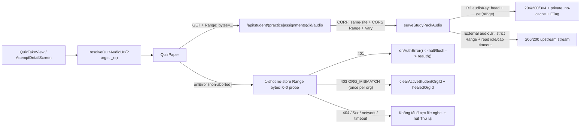

# Fix listening audio loading hang via Range streaming and error recovery (#878)

## Overview

Issue [#878](https://github.com/vinh19410/teacher-os/issues/878) báo lỗi P0 trên staging (`https://lms.staging.teacheros.io.vn`): khi học viên mở bài tự luyện Listening (*Talking about the history of bikes*, *City Health Services*), trang đứng ở `"Đang tải file nghe…"` hơn 20 giây, không có phần tử `<audio>`, console không báo lỗi, và lặp lại sau reload cũng như trên trang xem lại bài làm.

Kiểm chứng trực tiếp trên staging và phân tích mã nguồn xác nhận file MP3 trên R2 hợp lệ (4.58–5.19 MB, `200 audio/mpeg`), nhưng pipeline hiện tại có 5 lỗi cộng hưởng:
1. `useQuizAudioObjectUrl` (`apps/student/src/lib/repos/quiz.ts`) bắt buộc `fetch().blob()` tải 100% file vào RAM trước khi gắn `audioSrc` và mount `<audio>`.
2. `serveStudyPackAudio` (`apps/server/src/lib/study-pack-audio.ts`) không hỗ trợ HTTP `Range` (`206 Partial Content`) cho R2 và không hỗ trợ `ETag`/`304`, khiến mỗi lần reload hoặc sang `/attempt/$attemptId/detail` phải tải lại toàn bộ 5 MB từ đầu.
3. `fetchStudentAudioObjectUrl` không có timeout, và nhánh `.catch` trong `useQuizAudioObjectUrl` bỏ qua mọi `DOMException("AbortError")` kể cả khi không phải cleanup, khiến `audioLoading` kẹt `true` vĩnh viễn mà không báo lỗi.
4. `QuizPaper` (`packages/ui/src/components/quiz/quiz-paper.tsx`) thiếu `onError` trên `<audio>` và thiếu nút `"Thử lại"`.
5. `apps/server/src/app.ts` bỏ sót `/api/student/practice/:testId/audio` khỏi danh sách `Cross-Origin-Resource-Policy: same-site` + `Referrer-Policy: no-referrer`, thiếu `"Range"` trong `cors.allowHeaders` và `exposeHeaders`, và `QuizTakeView` dùng object literal `source` trong `useEffect` deps.

## Advisor Scope Lock (`--advice`)

- **Locked Scope:**
  - `apps/server`: thêm `head?(key)` + `StoredMediaMeta` (gồm optional `etag`) vào `MediaStore` (`media-store.ts`, re-export từ `app.ts`, triển khai trên `r2-media-store.ts` và `apps/e2e/src/fs-media-store.ts` kèm clamp `range`); hỗ trợ HTTP `Range` (`206`/`416`/`Accept-Ranges: bytes`) + opt-in `Cache-Control: private, no-cache` kèm `ETag`/`If-None-Match` (`304`) và `Vary: Cookie, x-student-org-id` cho 2 route audio học viên (giữ mặc định `private, no-store` trong `serveStudyPackAudio` cho 3 route giáo viên); tách idle read timeout (`15s` chỉ bật khi đang chờ upstream `fetch`/`reader.read()`) + wall-clock cap (`120s`) và Range/Content-Range validation chặt trong `streamStudyPackAudio`; bổ sung `/api/student/practice/:testId/audio` vào CORP `same-site` + `Referrer-Policy: no-referrer`, thêm `Range` vào `cors.allowHeaders` và `["Accept-Ranges", "Content-Range", "Content-Length", "ETag"]` vào `cors.exposeHeaders` trong `app.ts`.
  - `packages/ui`: mở rộng `QuizPaper` thêm optional `audioCrossOrigin`, `onAudioError`, `onAudioRetry`, hiển thị `"Không tải được file nghe."` kèm nút `"Thử lại"` khi lỗi.
  - `apps/student`: chuyển `QuizTakeView` và `AttemptDetailScreen` sang direct streaming `<audio crossOrigin="use-credentials">` dùng URL kèm `?org=` (`useActiveStudentOrgId()`); xử lý `onAudioError` bằng 1-shot diagnostic probe (`cache: "no-store"`, `Range: bytes=0-0`, URL sạch không `?org=`/`?_r=`, tách `disposed` khỏi `timedOut`, theo dõi `healedOrgId: string | null`, bỏ qua `MEDIA_ERR_ABORTED`, callback `onAuthError` để `QuizTakeView` halt/flush trước `reauth()`, so sánh `ACCOUNT_ERROR_CODES.TEACHER_ON_STUDENT_PORTAL`); gia cố timeout cho `fetchPracticeAudioObjectUrl` / `fetchAssignmentAudioObjectUrl` và chỉ bỏ qua `AbortError` khi `controller.signal.aborted === true` ở `useQuizAudioObjectUrl`; ổn định `useEffect` deps ở `QuizTakeView` (dựng `QuizTakeSource` từ primitive trong thân effect).
  - Tests & E2E: unit/integration tests server/UI/student + cập nhật `apps/e2e/src/boot.ts` (stub MP3 hợp lệ hỗ trợ `Range` 206) và `apps/e2e/specs/study-pack.spec.ts`.
- **Explicit Non-Goals:**
  - Không sửa `apps/web` (`StudyPackItemViewer`, `PreviewQuizSimulation`, `apps/web/src/security-headers.ts`).
  - Không đổi mặc định `Cache-Control: private, no-store` của `mediaObjectResponse` hay 3 route giáo viên gọi `serveStudyPackAudio`.
  - Không refactor Speaking `QuizMediaPlayer`, Vocab audio, hoặc Admin library audio preview.
  - Không gom các issue QA khác (#887, #890, #892) hay kiến trúc multi-part audio (`parts[1..3]`).
  - Không chạy full E2E local.

## Goals

| # | Goal | Priority |
|---|------|----------|
| 1 | Hỗ trợ HTTP Range 206/416, `Accept-Ranges: bytes`, `ETag`/`304` (`private, no-cache`) cho học viên và CORP/CORS đúng trên server | P0 |
| 2 | Render `<audio>` ngay lập tức bằng direct streaming URL, tự hồi phục 401/403 ORG_MISMATCH an toàn đa-org và cung cấp trạng thái lỗi + nút Thử lại rõ ràng | P0 |
| 3 | Bao phủ đầy đủ bằng unit/integration tests và E2E `study-pack.spec.ts` (kèm stub MP3 hỗ trợ Range 206), vượt toàn bộ local gates | P0 |

## Phases

| # | Phase | Status |
|---|-------|--------|
| 1 | [Phase 1: Server Range Streaming & CORS/CORP Headers](./phase-01-start.md) | Completed |
| 2 | [Phase 2: Student Streaming UI & Error Recovery](./phase-02-student-streaming-ui-and-recovery.md) | Completed |
| 3 | [Phase 3: E2E & Regression Verification](./phase-03-e2e-and-regression-verification.md) | Completed |

## Architecture / Flow

## Success Criteria

- [x] `GET /api/student/practice/:testId/audio` và `GET /api/student/assignments/:assignmentId/audio` trả `Accept-Ranges: bytes`, `206 Partial Content` với `Content-Range` + `Content-Length` đúng độ dài slice khi có header `Range` hợp lệ, `416` khi `Range` vượt biên, `ETag` + `Cache-Control: private, no-cache` + `Vary: Origin, Cookie, x-student-org-id` và trả `304 Not Modified` khi khớp `If-None-Match` (giữ nguyên `private, no-store` cho 3 route giáo viên và mọi caller `mediaObjectResponse` khác).
- [x] `GET /api/student/practice/:testId/audio` trả `Cross-Origin-Resource-Policy: same-site` và `Referrer-Policy: no-referrer`; `OPTIONS` cho phép `Range` trong `Access-Control-Allow-Headers` và expose `Accept-Ranges`, `Content-Range`, `Content-Length`, `ETag`.
- [x] `streamStudyPackAudio` kiểm tra chặt outbound `Range` và upstream `206`/`Content-Range`, giữ đủ security headers + hủy body trên `416`, chỉ chạy idle timeout 15s trong lúc chờ upstream `fetch`/`reader.read()` kèm trần stream 120s.
- [x] `QuizTakeView` và `AttemptDetailScreen` mount `<audio data-testid="quiz-audio-player">` ngay khi `hasAudio` là `true` với `crossOrigin="use-credentials"` và URL streaming của API.
- [x] Khi `<audio>` gặp lỗi: probe `no-store` (tách `disposed` khỏi `timedOut`) gọi `onAuthError` khi `401`, tự chữa `403 STUDENT_ORG_MISMATCH` 1 lần theo `healedOrgId`, và hiển thị `"Không tải được file nghe."` kèm nút `"Thử lại"` hoạt động thật cho mọi lỗi khác.
- [x] `pnpm exec biome check .`, `pnpm check-types`, unit tests liên quan ở `apps/server`, `packages/ui`, `apps/student`, và spec E2E `apps/e2e/specs/study-pack.spec.ts` đều pass.

## Red Team Review

### Session — 2026-11-24
**Reviewers:** Security Adversary, Assumption Destroyer, Failure Mode Analyst (3 parallel hostile reviewers)
**Findings:** 8 deduplicated (5 Critical, 2 High, 1 Medium — 8 accepted, 0 rejected)

| # | Finding | Severity | Disposition | Applied To |
|---|---------|----------|-------------|------------|
| 1 | `Cache-Control: private, max-age=3600` thiếu `Vary` & revalidation gây bypass thu hồi quyền trên máy dùng chung, đè 3 route giáo viên và vô hiệu hóa probe `onAudioError` | Critical | Accept | Phase 1, Phase 2 |
| 2 | `armTimeout()` trong `pull()` tự ngắt stream khi học viên pause/buffer đồng thời không có wall-clock cap chống Slow-Loris | Critical | Accept | Phase 1 |
| 3 | `streamStudyPackAudio` Range/Content-Range thiếu kiểm biên (`bytes=-`, `206` lệch `Content-Length`/`maxBytes`), `416` thiếu security headers & chạy trước kiểm SSRF | Critical | Accept | Phase 1 |
| 4 | Stub `fetchExternalAudio` trong `apps/e2e/src/boot.ts` bỏ qua `Range` (trả 200) và MP3 giả 256 byte có thể kích hoạt `onError` trên Chromium; thiếu phủ đường FS/R2 | Critical | Accept | Phase 3 |
| 5 | `useQuizAudioStream` dùng chung 1 `AbortController` cho timeout và cleanup sẽ nuốt timeout và treo lỗi vĩnh viễn; probe cũ không hủy khi `retry()`/`activeOrgId` đổi | Critical | Accept | Phase 2 |
| 6 | Race condition khi `activeOrgId` đổi, khóa chết `omitOrgQuery`, sai chữ ký `isTeacherOnStudentPortalError`, thiếu định nghĩa `probeUrl`, và gọi thẳng `reauth()` làm mất đáp án chưa lưu | High | Accept | Phase 2 |
| 7 | TOCTOU kích thước giữa `head` và `get(range)`, thiếu clamp `range` ở R2/FS store, thiếu re-export `StoredMediaMeta`, và tránh buffer 50 MB RAM khi `!object.range` | High | Accept | Phase 1 |
| 8 | Lệch fixture 6 vs 7 byte & mock store ở `student-practice-library-sync.test.ts`, thiếu `Range` test cho assignments, thiếu MIME map đủ `LIBRARY_AUDIO_MIME`, `fetchStudentAudioObjectUrl` không export, và Biome `useExhaustiveDependencies` ở `QuizTakeView` | Medium | Accept | Phase 1, Phase 2 |

## Validation Log

### Session 1 — 2026-11-24
- **CLI Structure Check:** `ak plan validate` passed (`valid: true, errors: null`).
- **Verification Results:** All 8 red-team findings verified against live codebase files (`study-pack-audio.ts`, `media-response.ts`, `r2-media-store.ts`, `fs-media-store.ts`, `app.ts`, `quiz.ts`, `quiz-take-view.tsx`, `query-client.ts`, `boot.ts`, `study-pack.spec.ts`, `student-practice-library-sync.test.ts`) and applied inline across Phases 1–3. Failed claims remaining: 0.
- **Whole-Plan Consistency Sweep:** Pass — all phase dependencies, target file lists, symbol names, and mechanical verification commands are aligned with the actual codebase and Advisor Scope Lock.

<!-- slug: 878-fix-listening-audio-streaming -->
