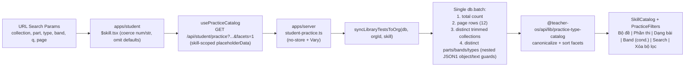

# Fix Student Practice Catalog Facets and Add Part / Type / Band Filters (#884)

## Overview

Fix issue [#884](https://github.com/vinh19410/teacher-os/issues/884): on `/student/practice/:skill`, the **"Bộ đề"** (`collection`) dropdown currently derives its options from `catalog.items` (the 12 items of the current page only), causing options to mutate per page (e.g. Listening page 1 only shows `"Other sources"` / `"Unknown"` while page 42 only shows `"Actual Test"`) and trapping users in a single option after selection. The catalog also lacks filters for **Phần thi** (`part`), **Dạng bài** (`type`), and **Band / Độ khó** (`band`), lacks a `"Xóa bộ lọc"` action, and displays an inaccurate empty state when filters return 0 results.

### Outcome Contract & Advisory Scope Lock (`kongming` Checkpoint 1)

- **Locked Scope:**
  - Opt-in `?facets=1` on `GET /api/student/practice` returning catalog-wide `facets: { collections, types, parts, bands }` across all `ready` tests (with ≥1 valid part) of `(orgId, skill)`, independent of `page`, `q`, and active filters, with `Cache-Control: no-store` and `Vary: Cookie, x-student-org-id`, while preserving backward compatibility for legacy `.strict()` clients that omit `facets=1`.
  - Shared skill-aware type canonicalization, labeling, and strict page/filter bounds (`packages/api/src/lib/practice-type-catalog.ts` & `packages/api/src/contracts.ts`) collapsing duplicate-label aliases (`mcq`/`mcq1`/`mcq3` → `mcq`, `note`/`notes` → `notes`, `sent`/`sent4` → `sent`, `flowchart`/`flow` → `flow`, `match`/`match2`/`matching` → `matching`) and providing skill-accurate labels for Reading, Listening, Writing, and Speaking (`map` = `"Map labelling"` in Listening vs `"Bản đồ"` in Writing).
  - Server-side filtering for `collection` (trimmed match, blank `""` excluded from facets), `part`, `type` (alias-expanded across `prompt.type`, `groups[*].type`, and fallback `questions[*].type` only when `groups` is empty — using nested `CASE` JSON1 guards on both outer arrays AND inner element `type = 'object'` / `json_type(..., '$.type') = 'text'` with `IN ('', '[]')` fast-path), and `band` (replacing the baseline valid-part `EXISTS` with ONE combined correlated `EXISTS` on `(assignment_test_part, assignment_prompt)` so multi-part tests match on the same part without duplicate subqueries).
  - Student UI URL-synced filters (`collection`, `part`, `type`, `band`, `q`, `page`) handling TanStack Router's default `JSON.parse` numeric coercion (`band=6.0` → `"6.0"`, `q=18` → `"18"`), omitting empty params and `page <= 1`, enforcing `PRACTICE_FILTER_MAX_LENGTH` (`200`) on `<Input>` and `validateSearch`, keeping `placeholderData` scoped by `skill` so dropdowns never unmount/flicker during fetches, conditional display rules (`Band` shown only when `facets.bands.length >= 2 || Boolean(band)`), synchronous `"Xóa bộ lọc"` clearing search draft from both filter bar and empty state without debounce/stale-closure/skill-switch races, distinct filtered empty state, `aria-live="polite"` total counter, and page auto-clamp whenever `!isPlaceholderData && catalog && catalog.page === page && page > catalog.pages` (including `total === 0`).
- **Explicit Non-Goals:**
  - Do NOT fabricate or backfill fake difficulty/band values onto the 849 imported Reading/Listening tests.
  - Do NOT refactor `syncLibraryTestsToOrg` query count in this bugfix.
  - Do NOT add a second `/facets` HTTP endpoint (avoids double-running `syncLibraryTestsToOrg`).
  - Do NOT alter quiz take/submit/grading flows or teacher/admin library routes.

## Goals

| # | Goal | Priority |
|---|------|----------|
| 1 | Add shared `practiceCatalogFacetsSchema` (optional for deploy-skew safety), strict `parsePracticePageParam` (`1..100_000`), `PRACTICE_FILTER_MAX_LENGTH` (`200`), and skill-aware type canonicalization/labeling helper in `packages/api` | P1 |
| 2 | Add catalog-wide facets (`?facets=1`), safe nested SQLite JSON1 element guards, `part`/`type`/`band`/trimmed-`collection` filtering (replacing duplicate `EXISTS`) in one `db.batch`, and `Cache-Control: no-store` / `Vary` headers to `GET /api/student/practice` | P1 |
| 3 | Upgrade `apps/student` practice route (`validateSearch` numeric coercion + clean URLs), repo hook (`facets=1` + skill-scoped `placeholderData`), `PracticeFilters` (`onSearchRef`, `key={skill}`, `resetSignal`, `maxLength`, 320px truncation), `SkillCatalog` (canonical `typeValue`, conditional visibility, `"Xóa bộ lọc"`, filtered empty state, `aria-live`, full auto-clamp), and isolated-org E2E + POT verification | P1 |

## Phases

| # | Phase | Status |
|---|-------|--------|
| 1 | [Phase 1: Contracts and Skill-Aware Type Catalog](./phase-01-start.md) | Completed |
| 2 | [Phase 2: Server Catalog Facets and Filters](./phase-02-server-catalog-facets-and-filters.md) | Completed |
| 3 | [Phase 3: Student UI Filters, A11y, and Verification](./phase-03-student-ui-filters-and-verification.md) | Completed |

## Architecture / Data Flow

## Success Criteria

- [x] On `/student/practice/reading?page=1` and `/student/practice/listening?page=42`, **"Bộ đề"** lists every distinct non-empty collection across the entire `(orgId, skill)` catalog regardless of current page or active selection.
- [x] **"Phần thi"** filters by `Passage 1–3` / `Section 1–4` / `Task 1–2` / `Part 1–3`; **"Dạng bài"** lists deduplicated, skill-accurate labels with zero duplicate `"Multiple choice"` options and matches secondary question groups inside `assignment_prompt.groups` (and per-question `questions[*].type` when `groups` is empty), while never crashing on malformed JSON or scalar array elements (`groups = '["corrupt"]'`).
- [x] **"Band"** automatically hides when `< 2` distinct bands exist and URL has no `band` param, and renders + filters accurately whenever `>= 2` bands exist or `band` is in URL (including TanStack Router numeric `?band=6.0` coercion).
- [x] Legacy calls to `GET /api/student/practice?skill=reading` without `facets=1` continue returning `{ items, page, pages, total }` without `facets` (zero deploy-skew breakage on `.strict()` clients); responses set `Cache-Control: no-store` and `Vary: Cookie, x-student-org-id`.
- [x] `"Xóa bộ lọc"` (both filter bar and empty state) synchronously clears all active filters and search input (no stale `onSearch` closure, no 300ms debounce resurrection, no cross-skill teleport, clean URL without `?page=1`), dropdowns do not unmount/flicker during fetches, filtered 0-result state differs from empty org state, total line has `aria-live="polite"`, and out-of-range `?page=` auto-clamps (including when `total === 0`).
- [x] All unit/integration tests (`packages/api`, `packages/ui`, `apps/server`, `apps/student`), `pnpm exec biome check .`, `pnpm check-types`, and targeted E2E spec `apps/e2e/specs/student-practice.spec.ts` (with isolated org for multi-page filter test) pass, with responsive 4-viewport (1440×900, 768×1024, 375×812, 320px) + Light/Dark visual verification.

## Red Team Review

### Session — 2026-11-25
**Reviewers:** 3 parallel adversarial `code-reviewer` agents (Security Adversary, Assumption Destroyer, Failure Mode Analyst) with Standard-tier verification roles (Fact Checker + Contract Verifier).
**Findings (deduplicated):** 11 total (11 accepted, 0 rejected)
**Severity breakdown:** 3 Critical, 5 High, 3 Medium

| # | Finding | Severity | Disposition | Applied To |
|---|---------|----------|-------------|------------|
| 1 | SQLite `json_extract(g.value, '$.type')` crashes `malformed JSON` (HTTP 500) on valid JSON arrays containing scalar/string elements (`groups = '["corrupt"]'`) | Critical | Accept | Phase 2 |
| 2 | TanStack Router default `JSON.parse` `parseSearch` coerces `?band=6.0` → `6` (number, dropping `.0`) and `?q=18` → `18`, breaking `validateSearch` string checks | Critical | Accept | Phase 3 |
| 3 | Stale `onSearch` closure, empty-state `"Xóa bộ lọc"` skipping `draft` reset, and skill tab switch not unmounting `PracticeFilters` cause 3 debounce races | Critical | Accept | Phase 3 |
| 4 | `$skill.tsx` `validateSearch` injects `?page=1` (`search.page ?? "1"`), contradicting clean URL reset invariant | High | Accept | Phase 3 |
| 5 | Unbounded `page` parameter overflows int64 `OFFSET` (HTTP 500) instead of bounded `1..100_000` validation | High | Accept | Phase 1, Phase 2, Phase 3 |
| 6 | Dropdowns unmount/flicker and break keyboard Tab flow on every fetch because `usePracticeCatalog` lacks skill-scoped `placeholderData` | High | Accept | Phase 3 |
| 7 | Redundant dual `EXISTS` and repeated JSON parsing on `groups`/`questions` amplify D1 query cost | High | Accept | Phase 2 |
| 8 | Seeding 13 Reading tests into shared `fixture.orgId` in `student-practice.spec.ts` pushes `"The Falkirk Wheel"` off page 1 under CI `--fully-parallel` / retries | High | Accept | Phase 3 |
| 9 | `PRACTICE_FILTER_MAX_LENGTH` mismatch between Server (400 after trim) and Client (no `maxLength` / `validateSearch` clamp) | Medium | Accept | Phase 2, Phase 3 |
| 10 | Auto-clamp gated by `catalog.total > 0` leaves `"0 đề — trang 5 / 1"` when `total === 0` and lacks `isPlaceholderData`/ref guards | Medium | Accept | Phase 3 |
| 11 | Legacy alias `?type=mcq1` needs `typeValue={canonicalType}`, deploy-skew fallback must strip `collection: ""`, `<label>` needs `max-w-full min-w-0`, and `GET /api/student/practice` needs `Cache-Control: no-store` + `Vary: Cookie, x-student-org-id` | Medium | Accept | Phase 2, Phase 3 |

### Whole-Plan Consistency Sweep
- Files reread: `plan.md`, `phase-01-start.md`, `phase-02-server-catalog-facets-and-filters.md`, `phase-03-student-ui-filters-and-verification.md`
- Decision deltas checked: 11 (nested SQLite JSON1 element guards, `IN ('', '[]')` fast-path + single `EXISTS`, `Cache-Control`/`Vary`, `PRACTICE_CATALOG_MAX_PAGE`/`parsePracticePageParam`, raw-param length check + client `maxLength`/clamp, `validateSearch` numeric coercion & clean `page > 1`, skill-scoped `placeholderData`, `onSearchRef`/`key={skill}`/`resetSignal`, `typeValue={canonicalType}` + deploy-skew empty collection strip + `<label>` truncation, full auto-clamp including `total === 0`, isolated E2E org)
- Reconciled stale references: 4 (removed `catalog.total > 0` clamp guard, replaced dual `EXISTS` wording, updated `validateSearch` wording from string-only to coerced string/number + `page > 1`, updated Task 3.4 E2E fixture strategy to isolated `test.describe`)
- Unresolved contradictions: 0

## Validation Log

### Session 1 — 2026-11-25
**Trigger:** Automated Vibe pipeline plan gate (`ak-plan validate` + `ak-plan red-team` + `kongming` advisory supervision)
**Questions asked:** 0 (no unresolved product/business ambiguities; all 11 red-team findings are pure technical defect/hardening fixes within locked scope)

### Verification Results
- **Tier:** Standard (3 phases: Fact Checker + Contract Verifier)
- **Claims checked:** 30+ (every cited file path, line range, schema, caller of `usePracticeCatalog` / `PracticeFilters` / `practiceCatalogResponseSchema`, Drizzle `Db` type, TanStack Router `parseSearch` config, and Playwright CI `--fully-parallel` config verified by 3 independent reviewers)
- **Verified:** 30+ | **Failed:** 0 (all 11 flaws surfaced by Red-Team were patched into phases 1–3) | **Unverified:** 0

<!-- slug: 884-practice-catalog-facets-and-filters -->
