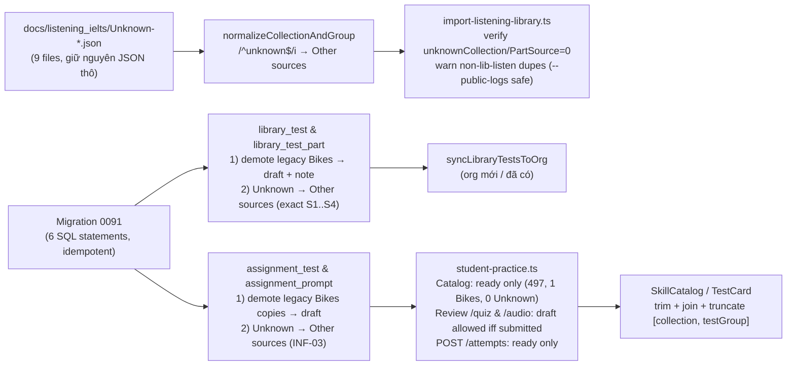

# Plan #887 — Khắc phục đề Listening "Talking about the history of bikes" bị trùng trang 1 & 42 và chuẩn hóa nhãn nguồn

- **Issue:** [#887](https://github.com/vinh19410/teacher-os/issues/887)
- **Branch:** `vinh19410/fix-listening-talking-about-the-history-of-bikes` → PR vào `develop` (`--ship --beta --advice`)
- **Route:** Bugfix (`/ak-fix --auto --advice`)
- **Handover-ready:** Có — mỗi phase phân rã thành các task tự chứa với `Goal`, `Target files and symbols`, `Steps`, `Success criteria`, lệnh `Verify` cơ học (gồm rõ điều kiện Red/Green cho `--tdd`) và khối `## Failure Protocol` nguyên văn buộc dừng khi verify thất bại.

## Overview

Khắc phục triệt để 2 nhóm nguyên nhân gốc rễ của issue [#887](https://github.com/vinh19410/teacher-os/issues/887) cùng ràng buộc bảo toàn màn xem lại bài nộp lịch sử:

1. **RC1 — Bản đề thủ công legacy trùng với bản bulk-import trên Staging (`library_test` + `assignment_test`):**
   - Trước khi workflow `import-listening-staging.yml` (run `45310049866`, 2026-11-24) nhập 498 đề `lib-listen-*` (497 `ready` + 1 `draft`) từ `docs/listening_ielts/`, `library_test` trên Staging đã có sẵn 1 đề Listening thủ công `"Talking about the history of bikes"` từ đợt PR #843 (id UUID ngẫu nhiên không mang tiền tố `lib-listen-`, `collection` và `test_group` rỗng/`NULL`, chỉ có 1 part `s4`; đối chiếu khớp phép tính 1 + 497 = 498 của issue #894 và fixture `apps/server/src/routes/student-practice-library-sync.test.ts:103-108`).
   - Do `Unknown-S4-talking-about-the-history-of-bikes.json` (`id = 83a7d7c9-ff79-47c3-80a2-b8bd4250a6b3`) là file thứ 498/498 theo thứ tự bảng chữ cái, bản canonical `lib-listen-83a7d7c9-ff79-47c3-80a2-b8bd4250a6b3` được `syncLibraryTestsToOrg` (`apps/server/src/lib/library-test-sync.ts:19,48-51,118-136`) chèn ở batch 8 dòng cuối cùng → nhận `created_at` mới nhất → lên **trang 1** (`ORDER BY created_at DESC, id DESC`, `apps/server/src/routes/student-practice.ts:532`) với nhãn `"Unknown · Section 4"`. Trong khi đó bản thủ công tạo sớm hơn không trùng `id` nên không bị `ON CONFLICT(id)` ghi đè, tiếp tục sync sang mọi org và nằm cuối **trang 42** (`ceil(498/12) = 42`) với nhãn nguồn trống.
   - Giải pháp an toàn dữ liệu:
     - **Demote về `'draft'`** (tuyệt đối không `DELETE`) trên cả `library_test` legacy (kèm ghi chú `[Duplicate of lib-listen-83a7d7c9-ff79-47c3-80a2-b8bd4250a6b3]` vào `description` để tránh admin vô tình bấm xuất bản lại) lẫn các bản `assignment_test` copy liên quan qua Drizzle migration `0091`. Cổng an toàn `EXISTS` bắt buộc xác minh cả bản canonical `library_test` đang `ready` **lẫn** `library_test_part` (`s4`) tồn tại và có `audio_key` khác rỗng.
     - **Bảo toàn màn xem chi tiết bài làm lịch sử (`$attemptId.detail.tsx`):** Vì `/learn/quizzes/attempt/$attemptId/detail` (`apps/student/src/routes/_auth/learn/quizzes/attempt/$attemptId.detail.tsx:63-65,92-108`) tải chrome & audio qua `GET /api/student/practice/:testId/quiz` và `/audio`, mở rộng có điều kiện 2 route đọc này trong `apps/server/src/routes/student-practice.ts` để cho phép truy xuất đề `draft` **chỉ khi** học viên hiện tại đã có ít nhất một `quiz_attempt` `mode = 'practice'` và `status = 'submitted'` cho đúng `(orgId, studentId, testId)`. Học viên chưa từng nộp bài vẫn nhận `404` (bảo toàn quyền riêng tư đề nháp), và `POST /api/student/practice/:testId/attempts` luôn yêu cầu `status = 'ready'` (chặn tuyệt đối lượt làm mới trên đề đã hạ nháp).

2. **RC2 — Nhãn nguồn `"Unknown"` không thống nhất giữa importer, D1 và UI thẻ học viên:**
   - `normalizeCollectionAndGroup` trong `packages/db/src/seed/listening-library.ts:240-260` ánh xạ nguồn thiếu/rỗng về `"Other sources"`, nhưng giữ nguyên chuỗi `"Unknown"` từ 9 file `docs/listening_ielts/Unknown-*.json` (trong đó có `Unknown-S4-talking-about-the-history-of-bikes.json`), tạo nhãn `"Unknown"` rời rạc cạnh 17 đề Listening và 7 đề Reading đang dùng `"Other sources"`.
   - `syncLibraryTestsToOrg` giữ bất biến INF-03 không ghi đè `collection`/`source` trên các bản sao `assignment_test`/`assignment_prompt` đã clone cho org, nên phải cập nhật đồng bộ cả `normalizeCollectionAndGroup` + `verifyListeningLibraryInDb` (kiểm cả `library_test.collection` lẫn `library_test_part.source`) lẫn migration `0091` trên 4 bảng (`library_test`, `library_test_part`, `assignment_test`, `assignment_prompt` — tôn trọng INF-03, khóa đúng mẫu `"Unknown"` / `"Unknown — Section 1..4"`, không tràn Zod `max(200)`, và không chạm `updated_at` trên `assignment_prompt`).
   - Đồng thời `TestCard` trong `apps/student/src/components/practice/skill-catalog.tsx:83-88` chỉ render badge khi `item.collection` truthy (không trim khoảng trắng nên `"   "` hiện badge lỗi `"    · TEST 1"`, ẩn `testGroup` khi `collection` rỗng, và thiếu `truncate`/`max-w` chống tràn trên card hẹp) — cần đồng bộ theo công thức trim & join `[item.collection, item.testGroup]` của `PracticeIntroScreen` (`apps/student/src/components/quiz/practice-intro-screen.tsx:115-118`) và `TestPreviewPaper` (`apps/web/src/components/assignment-tests/test-preview-paper.tsx:66-69`; lưu ý Admin `TestTable` tại `apps/admin/src/components/library/test-table.tsx:71-73` hiện chỉ `.filter(Boolean).join(" · ")` chưa trim).

## Advisor Scope Lock (`--advice`)

- **Locked Scope:**
  1. **Migration `0091` + Drizzle metadata + Historical Attempt Review Safety + Tests:**
     - Sinh migration tùy chỉnh `packages/db/src/migrations/0091_fix_listening_bikes_dedup_and_unknown_source.sql` (6 statement kết thúc `;`, ngăn bằng `--> statement-breakpoint`), cập nhật `packages/db/src/migrations/meta/_journal.json` (`idx: 91`, `when > 1795583597884`, `breakpoints: true`) và `packages/db/src/migrations/meta/0091_snapshot.json` nối `prevId` từ `0090_snapshot.json` (`4bcf36e4-8fca-4892-8977-32e72f366b67`).
     - Statement 1–2: demote bản `library_test` legacy (`skill = 'listening'`, `status = 'ready'`, `SUBSTR(id, 1, 11) <> 'lib-listen-'`, chuẩn hóa tab/CR/LF/NBSP khi so `LOWER(TRIM(...)) = 'talking about the history of bikes'`, `COALESCE(TRIM(collection), '') = ''`, `LOWER(TRIM(COALESCE(test_group, ''))) IN ('', 'section 4', 's4')`, không có part ngoài `s4`, gắn ghi chú `[Duplicate of lib-listen-83a7d7c9-ff79-47c3-80a2-b8bd4250a6b3]` trong `description` <= 2000 ký tự, không dư dấu cách khi rỗng) và các bản `assignment_test` copy tương ứng (kể cả dangling `library_ref` có `collection` rỗng, `test_group` rỗng/`Section 4`/`S4`, không có part ngoài `s4`) về `status = 'draft'`, chỉ chạy khi canonical `lib-listen-83a7d7c9-ff79-47c3-80a2-b8bd4250a6b3` tồn tại ở trạng thái `ready` **cùng** `library_test_part` `s4` có `audio_key` hợp lệ. Tuyệt đối không chạm đề org tự soạn (`library_ref IS NULL` hoặc rỗng).
     - Statement 3–6: chuẩn hóa `'Unknown'` → `'Other sources'` (INF-03 safe, khóa chính xác `'unknown'` và `'unknown — section ' || SUBSTR(part, 2)` cho `part IN ('s1','s2','s3','s4')`, kiểm khớp `lt.collection = 'Other sources'` ở Statements 4–6 và `ltp.part = assignment_prompt.part` + `ltp.source` ở Statement 6, không dùng `LIKE` wildcard `_` trên `library_test_part:`, không chạm `updated_at` trên `assignment_prompt`).
     - Cập nhật `apps/server/src/routes/student-practice.ts`: cho phép `GET /practice/:testId/quiz` và `GET /practice/:testId/audio` tải `assignment_test` ở trạng thái `draft` **chỉ khi** học viên hiện tại đã có `quiz_attempt` `mode = 'practice'` và `status = 'submitted'` cho `testId` đó; giữ `POST /practice/:testId/attempts` và mọi học viên chưa nộp bài ở mức chặn cứng `404`.
     - Viết `apps/server/src/listening-bikes-dedup-unknown-source-migration.test.ts` + bổ sung test trong `apps/server/src/routes/student-practice.test.ts` kiểm chứng `client.executeMultiple(rawSql)` (Alchemy D1), `drizzle-orm/libsql/migrator` từ `0090` → `0091`, negative gate (thiếu canonical / canonical `draft` / thiếu part / rỗng `audio_key`), dangling `library_ref`, INF-03 tách `org_id` (gồm giáo viên tự đặt `collection = 'Unknown'` trên đề Cambridge, tự đặt `source = 'Unknown — Ghi chú riêng'`, chuỗi 200 ký tự, đề custom cùng tiêu đề có `collection`), trực tiếp gọi `/quiz` + `/audio` + `POST /attempts` **trước** `/api/student/practice`, bảo toàn `/history` + review detail cho học viên đã nộp, idempotency với sentinel `updated_at = 500 → 1000`, và `study-pack-migration.test.ts` (`#554`).
  2. **Listening Importer & Verification (`packages/db/src/seed/listening-library.ts`, `packages/db/scripts/import-listening-library.ts`):**
     - `normalizeCollectionAndGroup`: chuẩn hóa nguồn rỗng hoặc khớp `/^unknown$/i` về `"Other sources"`.
     - `verifyListeningLibraryInDb`: bổ sung cả `unknownCollectionMatches` (`library_test.collection`) lẫn `unknownPartSourceMatches` (`library_test_part.source`) và đưa cả hai `=== 0` vào `ok`.
     - `import-listening-library.ts`: in cả `unknownCollectionMatches` & `unknownPartSourceMatches` trong dòng log verify, cập nhật thông điệp lỗi tại dòng 426 cho đúng nguyên nhân, và trong pre-flight check (`if (runner.queryRows)`, trước dòng 337) truy vấn `ORDER BY id ASC LIMIT 500` với hằng `LISTENING_TEST_ID_PREFIX` để ghi cảnh báo non-fatal về đề non-`lib-listen-%` `ready` trùng tiêu đề — tôn trọng cờ `--public-logs` (ẩn `id`/`title`, chỉ in số lượng) và làm sạch ký tự điều khiển (`\r\n\t` / ASCII control) + `redactSensitive` khi không đặt `--public-logs`.
     - Cập nhật/bổ sung tests trong `packages/db/src/seed/listening-library.test.ts` (dùng `--data-dir` tạm, phủ `--public-logs`, log injection, `unknownPartSourceMatches`) và `apps/server/src/listening-library-import.test.ts`.
  3. **Student UI `TestCard` (`apps/student/src/components/practice/skill-catalog.tsx`) + Tests + Visual Verification:**
     - Đồng bộ badge nguồn của `TestCard` dùng `[item.collection, item.testGroup].map((v) => v?.trim()).filter(Boolean).join(" · ")` kèm `max-w-[calc(100%-1.25rem)] truncate` chống tràn trên viewport hẹp.
     - Bổ sung unit test trong `apps/student/src/components/practice/practice-catalog.test.tsx` (dùng `within(cards[i])` cho từng thẻ).
     - Kiểm chứng trực quan 3 viewport (1440×900, 768×1024, 375×812) Light/Dark (`pnpm design:compare` hoặc Playwright capture phục vụ POT theo `AGENTS.md` & `REVIEW.md`).
- **Explicit Non-Goals:**
  - Không xóa hay gộp 6 cặp đề trùng tiêu đề có sẵn trong `docs/listening_ielts/` (gồm 4 cặp cùng source và 2 cặp khác source; `listening-library-import.test.ts:98-100` ghim 498 file / 497 ready / 1 draft).
  - Không sửa issue `#894` (bộ đếm Admin Listening 1 vs 498).
  - Không sửa hay đổi tên 9 file `docs/listening_ielts/Unknown-*.json` hay `docs/listening_ielts/_index.json`.
  - Không sửa `quiz_attempt.questions_snapshot` (RT#3) hay đề org tự soạn (`library_ref IS NULL`).
  - Không chạy full E2E local (tuân thủ `AGENTS.md`).

## Goals

| # | Goal | Priority |
|---|---|---|
| 1 | Loại bỏ hoàn toàn bản trùng legacy `"Talking about the history of bikes"` khỏi catalog học viên bằng migration `0091` (demote sang `draft` có cổng canonical `ready` + part + audio, gắn ghi chú deprecation, bảo toàn `/history`, review detail, audio review và `study_pack_item`) | P1 |
| 2 | Chuẩn hóa đồng nhất nhãn nguồn `"Unknown"` → `"Other sources"` tại `normalizeCollectionAndGroup`, `verifyListeningLibraryInDb` (`library_test` + `library_test_part`), và cả 4 bảng D1 qua migration `0091` (an toàn INF-03, không tràn `max(200)`, idempotent) | P1 |
| 3 | Đồng bộ cách hiển thị badge nguồn của `TestCard` với `PracticeIntroScreen` (trim, join, truncate) và vượt 100% local quality gates + kiểm chứng 3 viewport Light/Dark | P1 |

## Architecture / Data Flow

## Phases

| # | Phase | Status |
|---|---|---|
| 1 | [Phase 1: Drizzle Migration 0092 (originally 0091) & Historical Review Safety](./phase-01-start.md) | Completed |
| 2 | [Phase 2: Listening Importer Normalization & Verification Hardening](./phase-02-listening-importer-normalization-and-verification.md) | Completed |
| 3 | [Phase 3: Student UI Badge Alignment & Full Verification Gates](./phase-03-student-ui-badge-alignment-and-verification.md) | Completed |

> **Cập nhật rebase `origin/develop`:** PR `#940` (`31b113fd`) đã merge migration `0091_fix_reading_shares_duplicated_title.sql` lên `develop` trong lúc triển khai, nên migration của plan này được đánh số kế tiếp thành `0092_fix_listening_bikes_dedup_and_unknown_source.sql` (`idx: 92`, `prevId: "93f0b276-45e5-4723-84a4-8f64b365ff12"` từ `0091_snapshot.json`) sau khi fast-forward `origin/develop`.

## Success Criteria

- [x] Migration `0092_fix_listening_bikes_dedup_and_unknown_source.sql` (đổi số từ `0091` sau khi `#940` lên `develop`) có 6 statement kết thúc `;` + `--> statement-breakpoint`, đủ entry `idx: 92` (entry cuối, `when > 1795615686664`, `breakpoints: true`) trong `meta/_journal.json` và `meta/0092_snapshot.json` (`id` hợp lệ khác `0091`, `prevId: "93f0b276-45e5-4723-84a4-8f64b365ff12"`), pass `study-pack-migration.test.ts` (`#554`) và `packages/infra/src/flat-migrations.test.ts`.
- [x] Migration `0092` demote bản legacy `"Talking about the history of bikes"` (`library_test` kèm ghi chú `[Duplicate of lib-listen-83a7d7c9-ff79-47c3-80a2-b8bd4250a6b3]` + `assignment_test` copy kể cả dangling `library_ref` có `collection`/`test_group` rỗng) về `'draft'` chỉ khi canonical `lib-listen-83a7d7c9-ff79-47c3-80a2-b8bd4250a6b3` đang `ready` và có part `s4` mang `audio_key` khác rỗng; giữ nguyên đề org tự tạo (`library_ref IS NULL`) và đề Listening custom có `collection`/multi-part; chuẩn hóa `'Unknown'` / `'Unknown — Section 1..4'` → `'Other sources'` / `'Other sources — Section 1..4'` trên 4 bảng (`library_test`, `library_test_part`, `assignment_test`, `assignment_prompt` không `updated_at`), bảo vệ INF-03 và không tràn `max(200)`, idempotent với sentinel `updated_at`, pass cả `client.executeMultiple(rawSql)` lẫn `drizzle-orm/libsql/migrator`.
- [x] `GET /api/student/practice/:testId/quiz` và `GET /api/student/practice/:testId/audio` vẫn trả 200 cho học viên đã có `quiz_attempt` `submitted` trên đề `draft` (luôn trả `attempt: null` cho đề `draft` để bảo toàn `/learn/quizzes/attempt/$attemptId/detail` + audio review và chặn resume lượt `in_progress` cũ), trả `404` cho học viên chưa từng nộp bài trên đề `draft`, và `POST /api/student/practice/:testId/attempts` luôn trả `404` trên đề `draft`.
- [x] `normalizeCollectionAndGroup` biến `"Unknown"` (không phân biệt hoa/thường, có khoảng trắng) thành `"Other sources"` (`collection`, `partSource`), `verifyListeningLibraryInDb` kiểm tra cả `unknownCollectionMatches === 0` lẫn `unknownPartSourceMatches === 0`, và `import-listening-library.ts` log cả hai giá trị + cảnh báo non-fatal (tôn trọng `--public-logs`, chống log injection, `ORDER BY id ASC LIMIT 500`).
- [x] `listening-library-import.test.ts` xác nhận sau full import 498 file + sync org: `"Talking about the history of bikes"` xuất hiện đúng 1 lần với `collection === "Other sources"`, `testGroup === "Section 4"`, và `facets.collections` không chứa `"Unknown"`.
- [x] `TestCard` trong `apps/student/src/components/practice/skill-catalog.tsx` trim & join `[item.collection, item.testGroup]` kèm `max-w-[calc(100%-1.25rem)] truncate` và `title`, không render badge rác khi `collection` chỉ có khoảng trắng, và hiển thị `testGroup` khi `collection` rỗng.
- [x] Toàn bộ local gates pass 100%: `pnpm exec biome check .`, `pnpm check-types --concurrency=1`, các suite Vitest (`@teacher-os/db`, `@teacher-os/infra`, `server`, `student`), và kiểm chứng 3 viewport Light/Dark phục vụ POT (`plans/reports/887-listening-catalog-*.png`).

## Red Team Review

### Session — 2026-11-25
**Reviewers:** Security Adversary, Failure Mode Analyst, Assumption Destroyer — 3 parallel hostile `code-reviewer` subagents (Standard tier: Fact Checker + Contract Verifier)
**Findings:** 10 deduplicated from 20 raw findings (10 accepted, 0 rejected)
**Severity breakdown:** 1 Critical, 7 High, 2 Medium

| # | Finding | Severity | Disposition | Applied To |
|---|---|---|---|---|
| 1 | Statements 4–6 vi phạm INF-03 (ghi đè `collection = 'Unknown'` do giáo viên đặt trên đề Cambridge, ghi đè `source = 'Unknown — <custom>'`) và có thể vượt trần Zod `max(200)` khi nối `'Other sources — '` | Critical | Accept | Plan, Phase 1 |
| 2 | Demote `assignment_test` legacy về `'draft'` khiến màn `/learn/quizzes/attempt/$attemptId/detail` và audio review trả 404 cho các `quiz_attempt` đã nộp trước migration (`student-practice.ts:201` khóa `status = 'ready'`) | High | Accept | Plan, Phase 1 |
| 3 | Cổng an toàn canonical `EXISTS` trong Statements 1–2 fail-open nếu bản canonical `library_test` là `ready` nhưng thiếu `library_test_part` (`s4`) hoặc rỗng `audio_key` | High | Accept | Plan, Phase 1 |
| 4 | Điều kiện demote chỉ dựa theo `title` ở Statements 1–2 quá rộng (có thể hạ nhầm đề Listening custom cùng tên có `collection`/multi-part) và `TRIM()` không chuẩn hóa NBSP/tab/newline | High | Accept | Plan, Phase 1 |
| 5 | Cảnh báo pre-flight trùng tiêu đề trong `import-listening-library.ts` vi phạm cờ `--public-logs` (lộ UUID/title ra public CI log), mở nguy cơ GitHub Actions workflow-command/log injection (`\n::error::`), và thiếu `ORDER BY`/`LIMIT` | High | Accept | Plan, Phase 2 |
| 6 | `verifyListeningLibraryInDb` bỏ sót `library_test_part.source` (`unknownPartSourceMatches`) và giữ message lỗi cũ tại `import-listening-library.ts:426` | High | Accept | Plan, Phase 2 |
| 7 | Case 6 bị `syncLibraryTestsToOrg` che lấp lỗi Statements 2/5/6 (phantom test) và chưa gọi trực tiếp `/quiz`, `/audio`, `POST /attempts` trước khi gọi catalog | High | Accept | Phase 1 |
| 8 | Bỏ sót `apps/server/src/study-pack-migration.test.ts` (`#554` snapshot chain) khỏi Verify gates; badge `TestCard` thiếu `max-w-* truncate` và Phase 3 thiếu bước visual verification 3 viewport Light/Dark (`REVIEW.md` / `AGENTS.md`) | High | Accept | Plan, Phase 1, Phase 3 |
| 9 | Demote `library_test` legacy đẩy bản trùng lên đầu Admin Library (`ORDER BY updated_at DESC`) không kèm ghi chú deprecation, dễ bị admin bấm xuất bản lại làm revive bản sao org | Medium | Accept | Plan, Phase 1 |
| 10 | Nguy cơ flaky `updated_at` cùng millisecond ở Case 4, thiếu `within(cards[i])` ở Phase 3 Task 3.1, trích sai Admin `TestTable` ở `plan.md:30` & dòng `337` của `import-listening-library.ts`, thiếu `Risk & Rollback` (ghim 9 UUID và lưu ý vòng đời one-shot trên Production) | Medium | Accept | Plan, Phase 1, Phase 2, Phase 3 |

### Whole-Plan Consistency Sweep
- Files reread: `plan.md`, `phase-01-start.md`, `phase-02-listening-importer-normalization-and-verification.md`, `phase-03-student-ui-badge-alignment-and-verification.md`
- Decision deltas checked: 10 (khóa Statements 4–6 theo mẫu chính xác `'unknown'` / `'unknown — section N'` + `lt.collection = 'Other sources'` + `ltp.part`/`ltp.source`; mở đọc `draft` trên `/quiz` & `/audio` chỉ cho học viên đã có `submitted` attempt; thêm `INNER JOIN library_test_part` + `audio_key` vào cổng canonical `EXISTS`; siết Statement 1 & nhánh dangling Statement 2 theo `collection`/`test_group` rỗng + part `s4` + chuẩn hóa NBSP/tab/newline + ghi chú deprecation vào `description`; tôn trọng `--public-logs` + sanitize control chars + `ORDER BY id ASC LIMIT 500` + `LISTENING_TEST_ID_PREFIX`; thêm `unknownPartSourceMatches` vào `verifyListeningLibraryInDb` + sửa message dòng 426; test trực tiếp `/quiz`/`/audio`/`POST /attempts` trước `/api/student/practice` ở Case 6; thêm `study-pack-migration.test.ts` + `max-w-* truncate` + visual check 3 viewport; seed `updated_at = 500` + `within(cards[i])` + temp `--data-dir` + đính chính `TestTable`/line `327-336` + thêm `Risk & Rollback` 9 UUID & lưu ý Production)
- Reconciled stale references: 10/10 (0 tham chiếu hoặc predicate cũ còn sót)
- Unresolved contradictions: 0

## Validation Log

### Session 1 — 2026-11-25
**Trigger:** Automated Vibe pipeline plan gate (`ak plan validate` + `ak-plan red-team` + `kongming` advisory supervision)
**Questions asked:** 0 (không có mơ hồ sản phẩm/nghiệp vụ chưa giải quyết; toàn bộ 10 phát hiện Red-Team là các lỗ hổng kỹ thuật/hợp đồng bên trong phạm vi đã khóa)
- `ak plan validate`: `valid: true`, `errors: null`.
- Kongming post-plan-gates counsel: **Conditional GO applied** — mở rộng `test_group` ở Statement 1–2 thành `LOWER(TRIM(COALESCE(test_group, ''))) IN ('', 'section 4', 's4')` (vì `TestCard` cũ ẩn cả `testGroup` khi `collection` rỗng), thêm `NOT EXISTS (... part <> 's4')` cho nhánh dangling Statement 2, thêm `CHAR(13)` vào chuẩn hóa `title`, và thêm `CASE` không dư dấu cách khi `description` rỗng.

### Verification Results
- **Tier:** Standard (3 phases: Fact Checker + Contract Verifier across 3 independent adversarial reviewers)
- **Claims checked:** 24
- **Verified:** 24 | **Failed:** 0 (2 sai lệch nhỏ ở bản nháp đầu — `test-table.tsx` không gọi `.trim()` và line `337` của `import-listening-library.ts` — đã được đính chính hoàn toàn) | **Unverified:** 0 (trạng thái live Staging D1 được ghi nhận rõ trong `Assumptions` / `Risk & Rollback` là chỉ xác minh post-deploy vì VM không giữ Cloudflare credential theo `AGENTS.md`)

<!-- slug: 887-fix-listening-bikes-duplicate-and-unknown-source -->
