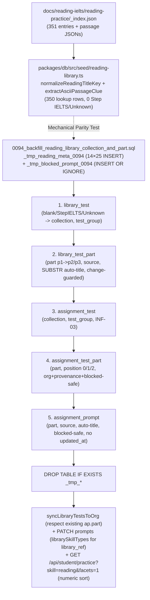

# Plan #884 (Follow-up Re-test) — Backfill Bộ đề (`collection`) & Phần thi (`p1`–`p3`) cho đề Reading thư viện

- **Issue:** [#884](https://github.com/vinh19410/teacher-os/issues/884) (Re-test 2026-11-26 trên staging sau PR #934 `5d599642`)
- **Branch:** `vinh19410/fix-practice-b-l-c-b-ch-l-y-ngu-n-c-a-trang-hi-n-2` → PR vào `develop` (`--ship --beta --advice`)
- **Route:** Bugfix (`/ak-fix --auto --advice`)
- **Handover-ready:** Có — mỗi phase được phân rã thành các task tự chứa với `Goal`, `Target files and symbols`, `Steps`, `Success criteria`, lệnh `Verify` cơ học (ghi rõ điều kiện Red/Green cho `--tdd`) và khối `## Failure Protocol` nguyên văn buộc dừng khi verify thất bại.

## Overview

Sau khi PR #934 (`5d599642`) merge và deploy lên staging (`https://lms.staging.teacheros.io.vn`), re-test ngày 2026-11-26 xác nhận:
- **Listening** (`/student/practice/listening`, 497 đề, 42 trang) đã hiển thị đủ dropdown **Bộ đề**, **Phần thi**, **Dạng bài** và đồng nhất giữa trang 1 và trang 42.
- **Reading** (`/student/practice/reading`, 348 đề, 29 trang) chỉ hiển thị **Dạng bài** và ô tìm kiếm — **mất hoàn toàn dropdown "Bộ đề" và "Phần thi"**.

### Nguyên nhân gốc rễ (đã chứng minh)

1. **Mã nguồn API & UI dùng chung cho Reading và Listening (`apps/server/src/routes/student-practice.ts:581-635`, `apps/student/src/components/practice/skill-catalog.tsx:238-281`, `apps/student/src/components/practice/practice-filters.tsx:189-221`):**
   - `collectionFacetQuery` chỉ lấy `DISTINCT trim(assignment_test.collection)` khác rỗng; `PracticeFilters` ẩn dropdown **"Bộ đề"** khi `collections.length === 0`.
   - `partFacetQuery` lấy `DISTINCT trim(assignment_test_part.part)`; `SkillCatalog` ẩn dropdown **"Phần thi"** khi `rawParts.length < 2 && !part`.
2. **Dữ liệu Reading trên D1 rỗng `collection`/`test_group` (trên staging) hoặc còn mang `"Step IELTS"`/`"Unknown"` (trên prod / DB chưa chạy cleanup):**
   - Khác với Listening (được import qua `packages/db/src/seed/listening-library.ts:240-262` ánh xạ `C18T1` → `Cambridge IELTS 18` / `Test 1`, `Actual Test`, `Collection`, rỗng/`Unknown` → `Other sources`, kèm rào chặn thương hiệu `STEP_IELTS_RE` tại dòng `64` và `569-581`), 348 đề Reading được import trước đó bằng UUID ngẫu nhiên (`plans/261125-1318-882-fix-library-shares-duplicated-title/plan.md:28`) không có `collection`/`test_group` đầy đủ (hoặc mang `"Step IELTS"` rồi bị `cleanup-step-ielts` ở `bea37b96` — vốn bị `assertNonProdD1Database` khóa chỉ chạy staging — xóa `collection = NULL` và `source = ''` mà không xóa `test_group`).
3. **Toàn bộ 348 đề Reading trên D1 bị lưu cùng `part = 'p1'`:**
   - Bộ dữ liệu nguồn `docs/reading-ielts/reading-practice/_index.json` có đủ 351 bài đọc với `passage_number` thật: `1` (124 bài), `2` (108 bài), `3` (118 bài), và `null` (1 bài `Trainer-team-building.json` có `question_range: "1-14"` → `p1`), cùng `source` thực (`Actual Test` 34, `C7T1` 1, `C10T1`–`C20T4` 132, `Collection` 138, `Forecast Quý 2-2025` 36, `Other sources` 7, `Trainer` 1, `Step IELTS` 2).
   - Khi import vào D1, toàn bộ đề Reading đều bị đặt `part = 'p1'` (`plans/261124-1146-876-fix-reading-history-of-tea-instructions/plan.md:37`), nên `facets.parts` chỉ trả `["p1"]` (độ dài 1 < 2) làm UI ẩn **"Phần thi"**.
4. **Sắp xếp chuỗi số tự nhiên & bảo toàn bất biến runtime khi chuyển sang `p2`/`p3`:**
   - `apps/server/src/routes/student-practice.ts:167` và `apps/student/src/components/practice/skill-catalog.tsx:245` dùng `localeCompare(b, "en", { sensitivity: "base" })` thiếu `{ numeric: true }`, khiến `"Cambridge IELTS 7"` bị xếp sau `"Cambridge IELTS 20"`.
   - `syncLibraryTestsToOrg` (`apps/server/src/lib/library-test-sync.ts:232-240`) kết hợp `materializePrompts` (`apps/server/src/lib/study-pack-clone.ts:815-839`) khi tái sử dụng một `assignment_prompt` đã tồn tại từ Study Pack (`part = 'p1'`) sẽ chèn `assignment_test_part.part = libraryTestPart.part` (`'p2'`/`'p3'`), phá vỡ bất biến `prompt.part === item.part` tại `apps/server/src/routes/assignments/tests.ts:212`.
   - `PATCH /api/assignments/prompts/:id` (`apps/server/src/routes/assignments/index.ts:250-266`) đang đối chiếu theo `ASSIGNMENT_PART_TYPES.reading.types[row.part]` cũ thay vì `librarySkillTypes(row.skill)` cho prompt có `library_ref IS NOT NULL`, nên 16 đề Reading `p2`/`p3` có dạng bài đầu là `tfng`/`sent` (gồm `"The Falkirk Wheel"`) sẽ bị trả `400 "invalid type"` khi giáo viên sửa metadata sau backfill.

## Advisor Scope Lock (`--advice`, `kongming` Checkpoint 1 + Red-Team Hardening)

- **Locked Scope:**
  - **Shared Reading Metadata Normalizer & Parity Guard (`packages/db`):**
    - Tạo `packages/db/src/seed/reading-library.ts` xuất `normalizeReadingCollectionAndPart(rawSource, passageNumber)`, `normalizeReadingTitleKey(title)`, `extractAsciiPassageClue(paragraphs)`, và `loadReadingLibraryMetadata()`.
    - `normalizeReadingTitleKey` chuẩn hóa đồng bộ tuyệt đối với biểu thức SQLite: thay `[\t\r\n\u00a0]` → `" "`, chuẩn hóa homoglyph/dấu câu (`‘`/`’` → `'`, `–`/`—` → `-`, `：` U+FF1A → `:`, Cyrillic `р` U+0440 → `p`), cắt khoảng trắng ASCII hai đầu `.replace(/^ +| +$/g, "")` (không dùng JS `.trim()`), và ASCII lowercase `[A-Z]` → `[a-z]`.
    - `normalizeReadingCollectionAndPart` áp dụng cùng quy ước với Listening (`C<N>T<M>` → `Cambridge IELTS <N>` / `Test <M>`, `STEP_IELTS_RE = /step[\s-]?ielts/i` / `"Unknown"` / rỗng → `"Other sources"`, nguồn khác → `<source>` / `Passage 
`, `passageNumber = null` → `p1`).
    - Sinh `passageClue` thuần chữ cái ASCII thường (16–36 ký tự, không dấu câu/nhãn đoạn) cho **tất cả 349 dòng có đoạn đọc** (chỉ 1 bài `Collection-looking-at-daily-life-in-ancient-rome.json` có `paragraphs: []` mang `passageClue = ""`), gộp 2 entry `"Will Eating Less Make You Live Longer"` (clue khớp cả 2 file) thành 1 dòng (tổng 350 dòng), và giữ 2 dòng `"Coral reefs"` phân biệt loại trừ lẫn nhau (`'london zoo'` vs `'calcium carbonate'`).
    - Mở rộng `packages/db/src/seed/reading-library-dataset.test.ts`: xác nhận đủ 350 dòng, kiểm ký tự an toàn SQL & giới hạn Zod (`collection <= 200`, `testGroup <= 100`, `partSource <= 200`) trên **cả 6 cột**, kiểm tính loại trừ lẫn nhau của `passageClue` cho nhóm trùng `normTitle`, 0 giá trị đích khớp `/step[\s-]?ielts/i` hay `"Unknown"`, và khớp cơ học 100% với các tuple `INSERT INTO _tmp_reading_meta_0094` trong migration `0094`.
  - **Drizzle Migration `0094` + Metadata + Regression Tests (`packages/db`, `apps/server`):**
    - Tạo `packages/db/src/migrations/0094_backfill_reading_library_collection_and_part.sql`, `packages/db/src/migrations/meta/0094_snapshot.json` (nối `prevId = "5c2b298b-448f-4f62-b185-039010ae9fd7"` từ `0093_snapshot.json`), và cập nhật `packages/db/src/migrations/meta/_journal.json` (`idx: 94`, `breakpoints: true`, `when > 1795635525372`).
    - Dùng **bảng thường** `_tmp_reading_meta_0094` (không dùng `TEMP TABLE`, không đặt `UNIQUE` trên `norm_title`, có `INDEX (norm_title)`, nạp 14 lệnh `INSERT` ~25 dòng/lệnh, mỗi lệnh `< 10 KB`) và `_tmp_blocked_prompt_0094 (prompt_id TEXT PRIMARY KEY)` (tránh `O(N²)` trên `assignment_test_part.prompt_id` chưa index và khóa chặt bất biến `atp.part === ap.part` với `INSERT OR IGNORE` tường minh và join qua `ap.library_ref`), kèm `DROP TABLE IF EXISTS` ở cả đầu và cuối migration.
    - Xử lý cả cột rỗng LẪN `"Step IELTS"` / `"Unknown"` (để an toàn cả staging lẫn production D1 chưa chạy `cleanup-step-ielts`), nới rào `test_group` chấp nhận `('', 'passage 1', 'p1', 'passage 2', 'p2', 'passage 3', 'p3', LOWER(m.test_group))` khi `collection` đủ điều kiện backfill, bọc `COALESCE(..., current_col)` trên mọi cột `NOT NULL`, thêm điều kiện thay đổi tường minh vào `WHERE` Statement B (đảm bảo sentinel `updated_at` idempotency), ép `ap.org_id = at.org_id`, `ltp.test_id = lt.id`, `at.collection = lt.collection AND at.test_group = lt.test_group` ở Statement D, chặn cả `part` lẫn `source`/`title` ở Statement E khi prompt bị block, và dùng `SUBSTR` neo đầu/cuối (tuyệt đối không `REPLACE`) cho auto-generated `title`.
    - Tạo `apps/server/src/reading-collection-part-backfill-migration.test.ts` phủ toàn bộ 5 bảng, Alchemy `executeMultiple`, Drizzle `migrate()`, `"Step IELTS"`/`"Unknown"` cleanup, INF-03, `Coral reefs`, custom short-title test có passage khác không bị chiếm đoạt, prompt gắn độc nhất vào custom 1-part test (`COUNT(*) = 1`, `library_ref IS NULL`) & shared multi-part prompt đều bị block đồng bộ, idempotency sentinel `updated_at = 1000`, retry safety, `PRAGMA foreign_key_check`, và HTTP API E2E.
  - **Runtime Safety & Natural Numeric Collection Sort (`apps/server`, `apps/student`):**
    - Thêm `numeric: true` vào `localeCompare(b, "en", { sensitivity: "base", numeric: true })` tại `apps/server/src/routes/student-practice.ts:167` và `apps/student/src/components/practice/skill-catalog.tsx:245`.
    - Cập nhật tối thiểu `materializePrompts` (`apps/server/src/lib/study-pack-clone.ts:823-838`) trả thêm `promptPartBySourceKey` và `syncLibraryTestsToOrg` (`apps/server/src/lib/library-test-sync.ts:232-240`) ưu tiên `existingPrompt.part` khi chèn `assignment_test_part` (giữ 100% bất biến `atp.part === ap.part` kể cả với org từng clone Study Pack trước migration `0094`).
    - Cập nhật tối thiểu `PATCH /api/assignments/prompts/:id` (`apps/server/src/routes/assignments/index.ts:216-266`) đọc thêm `libraryRef` và dùng phép hợp `[...new Set([...slotTypes, ...librarySkillTypes(row.skill)])]` khi `row.libraryRef !== null && isLibrarySkill(row.skill)` (giữ tương thích cả Study Pack `reading:p1:note` trong `first-step-gt2.json` lẫn 16 đề Reading `p2`/`p3` như `"The Falkirk Wheel"`, đồng thời giữ nguyên quy tắc chặt cho đề giáo viên tự soạn `library_ref IS NULL`).
- **Explicit Non-Goals:**
  - Không sửa 351 file JSON trong `docs/reading-ielts/reading-practice/` (chỉ chuẩn hóa `"Step IELTS"` → `"Other sources"` trong helper + migration `0094`).
  - Không bịa/backfill band độ khó cho các đề thư viện (`band` vẫn giữ `"7.0"`, dropdown `Band` tiếp tục tự ẩn khi `< 2` mức theo #847 và PR #934).
  - Không tạo CLI/script import Reading mới (`import-reading-library.ts`).
  - Không sửa `apps/admin`, `apps/web`, `quiz_attempt`, hoặc `study_pack_item`.
  - Không chạy full E2E suite ở local (`AGENTS.md`).

## Goals

| # | Goal | Priority |
|---|---|---|
| 1 | Tạo `packages/db/src/seed/reading-library.ts` (homoglyph/SQLite-exact title key + pure-ASCII `passageClue` cho 349/350 dòng + 0 Step IELTS/Unknown), bật sắp xếp tự nhiên `numeric: true` cho Bộ đề, và vá 2 điểm an toàn runtime (`syncLibraryTestsToOrg` giữ `atp.part === ap.part`, `PATCH /api/assignments/prompts/:id` cho library prompts `p2`/`p3`) | P1 |
| 2 | Triển khai Drizzle migration `0094` an toàn SQLite/D1 backfill `collection`, `test_group`, `part` (`p1`–`p3`), `position` và `source` (gồm cả khử `"Step IELTS"`/`"Unknown"` trên Prod) trên 5 bảng, bảo toàn INF-03 & bất biến `atp.part === ap.part`, kèm full TDD migration/API/parity tests | P1 |

## Phases

| Phase | Name | Status |
|---|---|---|
| 1 | [Phase 1: Reading Metadata Normalizer, Numeric Sort & Runtime Safety](./phase-01-start.md) | Completed |
| 2 | [Phase 2: Drizzle Migration 0094 Backfill, Regression Tests & Gates](./phase-02-db-migration-and-verification.md) | Completed |

## Architecture / Data Flow

## Acceptance Criteria

- [x] `packages/db/src/seed/reading-library.ts` chuẩn hóa đủ 351 bài trong `docs/reading-ielts/reading-practice/_index.json` thành 350 dòng tra cứu hợp lệ (homoglyph-normalized, SQLite-exact ASCII trim/lower, `passageClue` thuần ASCII cho 349/350 dòng có đoạn đọc, `"Will Eating Less Make You Live Longer"` gộp 1 dòng có clue khớp cả 2 file, `"Coral reefs"` tách 2 dòng loại trừ lẫn nhau `'london zoo'` / `'calcium carbonate'`), thỏa mãn kiểm tra ký tự SQL an toàn + giới hạn Zod trên cả 6 cột, 0 giá trị đích khớp `/step[\s-]?ielts/i` hay `"Unknown"`, và `packages/db/src/seed/reading-library-dataset.test.ts` xác minh khớp cơ học 100% với migration `0094`.
- [x] Migration `packages/db/src/migrations/0094_backfill_reading_library_collection_and_part.sql` + `meta/0094_snapshot.json` (`prevId = "5c2b298b-448f-4f62-b185-039010ae9fd7"`) + `meta/_journal.json` (`idx: 94`, `breakpoints: true`, `when > 1795635525372`) tương thích cả `client.executeMultiple` (Alchemy D1 flat runner) lẫn Drizzle `migrate()`, mỗi lệnh SQL `< 10 KB` (cách xa trần 100 KB của D1), không dùng `TEMP TABLE`, mọi cột `NOT NULL` bọc `COALESCE`, không để sót bảng `_tmp_*`, và `PRAGMA foreign_key_check` = 0.
- [x] `apps/server/src/reading-collection-part-backfill-migration.test.ts` pass 100%: backfill đúng cả 5 bảng cho cả dòng rỗng lẫn dòng mang `"Step IELTS"`/`"Unknown"` và dòng đã có `test_group`, phân biệt đúng 2 đề `"Coral reefs"` và tiêu đề homoglyph (`The science of sleeр`, `The Farmers：...`, `‘This Marvellous Invention’`), bảo toàn INF-03 (đề custom ngắn trùng tên nhưng passage khác không bị chiếm đoạt, custom `collection` trùng tên không đổi `library_test` lẫn `library_test_part`, `library_ref IS NULL`, multi-part test, teacher-edited `collection` không bị Statement D/E chạm `part`/`source`, teacher-edited `passage` giữ nguyên, prompt chia sẻ ở multi-part và prompt gắn độc nhất vào custom 1-part đều bị `_tmp_blocked_prompt_0094` chặn đồng bộ giữ `atp.part === ap.part` và không ghi đè `ap.source`, wrong skill, wildcard spoof, `quiz_attempt`/`study_pack_item` nguyên vẹn), idempotent với sentinel `updated_at = 1000` trên cả 3 bảng có `updated_at`, retry an toàn khi tồn tại sẵn bảng `_tmp_*`, và HTTP API (`GET /api/student/practice?skill=reading&facets=1`, `/quiz`, `/admin/library/tests`) trả đủ `facets.collections` (sort tự nhiên `Cambridge IELTS 7` trước `Cambridge IELTS 10`..`20`), `facets.parts = ["p1", "p2", "p3"]`, lọc `collection` + `part` chính xác cho cả `org-existing` và `org-new`.
- [x] `apps/server/src/routes/student-practice.ts:167` và `apps/student/src/components/practice/skill-catalog.tsx:245` dùng `localeCompare(..., "en", { sensitivity: "base", numeric: true })`; `syncLibraryTestsToOrg` (`library-test-sync.ts` + `study-pack-clone.ts`) giữ nguyên `existingPrompt.part` khi tạo `assignment_test_part`; `PATCH /api/assignments/prompts/:id` (`routes/assignments/index.ts`) cho phép sửa metadata đề Reading/Listening có `library_ref IS NOT NULL` với `librarySkillTypes(row.skill)` (ví dụ `"The Falkirk Wheel"` `p2` + `tfng`), tất cả đều có TDD unit/integration tests pass.
- [x] Toàn bộ local quality gates pass 100%: `pnpm exec biome check .`, `pnpm check-types`, `pnpm --filter @teacher-os/db test`, `pnpm --filter @teacher-os/infra exec vitest run src/flat-migrations.test.ts`, `pnpm --filter server exec vitest run src/reading-collection-part-backfill-migration.test.ts src/study-pack-migration.test.ts src/routes/student-practice.test.ts src/routes/student-practice-library-sync.test.ts src/routes/admin-library.test.ts src/routes/assignments/prompt-content-lock.test.ts`, `pnpm --filter student test src/components/practice/practice-catalog.test.tsx`, `pnpm test:ci-workflow`, và targeted E2E spec `apps/e2e/specs/student-practice.spec.ts` (ports `8100–8105`, không chạy full E2E local).

## Red Team Review

### Session — 2026-11-26
**Reviewers:** Security Adversary (Fact Checker) + Assumption Destroyer (Fact Checker) — 2 parallel hostile `code-reviewer` subagents (Light tier)
**Findings:** 10 deduplicated from 14 raw findings (10 accepted, 0 rejected)
**Severity breakdown:** 4 Critical, 4 High, 2 Medium

| # | Finding | Severity | Disposition | Applied To |
|---|---|---|---|---|
| 1 | Statements A/B/C/E chỉ khớp cột rỗng, bỏ sót hoàn toàn `"Step IELTS"`/`"Unknown"` trên Prod D1 (do `cleanup-step-ielts` khóa `assertNonProdD1Database`) và biến Test 1 thành phantom test | Critical | Accept | Plan, Phase 2 |
| 2 | Bước nạp bổ sung `_tmp_blocked_prompt_0094` thiếu `INSERT OR IGNORE` (chắc chắn crash `PRIMARY KEY` trên shared prompt) và thiếu đường join tường minh qua `ap.library_ref` (bỏ lọt custom 1-part test `COUNT(*) = 1`) | Critical | Accept | Plan, Phase 2 |
| 3 | Statement D thiếu rào `ap.org_id = at.org_id`, `ltp.test_id = lt.id`, và `at.collection = lt.collection AND at.test_group = lt.test_group` (xuyên thủng INF-03); Statement E không chặn ghi `ap.source` trên prompt bị block ở `p1` | Critical | Accept | Plan, Phase 2 |
| 4 | `syncLibraryTestsToOrg` + `materializePrompts` tái tạo lỗi vỡ bất biến `atp.part !== ap.part` (`tests.ts:212`) khi org đã clone `assignment_prompt` (`p1`) từ Study Pack trước migration `0094` | Critical | Accept | Plan, Phase 1 |
| 5 | 348/350 dòng thiếu `passage_clue` có nguy cơ chiếm đoạt đề custom tiêu đề ngắn của admin (`"Diabetes"`, `"Team Building"`, `"The Lost City"`) — nâng lên trích `passageClue` thuần ASCII cho toàn bộ 349/350 bài có đoạn đọc | High | Accept | Plan, Phase 1, Phase 2 |
| 6 | Rào `test_group` chỉ nhận `('', 'passage 1', 'p1')` quá chặt, bỏ sót đề từng bị `cleanup-step-ielts` xóa `collection` nhưng giữ `test_group` và xung đột Test 2 (`part = 'p2'`) | High | Accept | Plan, Phase 2 |
| 7 | 22 tiêu đề non-ASCII/homoglyph trong `_index.json` (gồm Cyrillic `р` U+0440 trong `"The science of sleeр"`, `：` U+FF1A, `‘`/`’`, `–`) cần chuẩn hóa đồng bộ ở cả `normalizeReadingTitleKey` lẫn SQLite | High | Accept | Plan, Phase 1, Phase 2 |
| 8 | Thiếu `COALESCE(..., current_col)` trên cột `NOT NULL`, thiếu change-guard ở `WHERE` Statement B (gãy Test 3 sentinel `updated_at = 1000`), và cần `SUBSTR` neo đầu/cuối thay `REPLACE` cho auto-title | High | Accept | Plan, Phase 2 |
| 9 | Kiểm tra ký tự SQL & Zod max length thiếu 5/6 cột, JS `.trim()` lệch SQLite 1-arg `TRIM`, thiếu kiểm tra loại trừ lẫn nhau cho `passageClue` nhóm trùng `normTitle`, và đính chính claim `listening-library.ts` + đồng bộ Test 1.1 `"Actual Test"` | Medium | Accept | Plan, Phase 1 |
| 10 | Đổi `assignment_prompt.part` sang `p2`/`p3` làm 16 đề Reading thư viện (gồm `"The Falkirk Wheel"` `p2`/`tfng`) bị `PATCH /api/assignments/prompts/:id` trả `400 "invalid type"` khi sửa metadata | Medium | Accept | Plan, Phase 1 |

### Whole-Plan Consistency Sweep
- Files reread: `plan.md`, `phase-01-start.md`, `phase-02-db-migration-and-verification.md`
- Decision deltas checked: 10 (mở rộng `WHERE` khử `"Step IELTS"`/`"Unknown"` + thu hẹp parity test sang tuple/SET; tường minh `INSERT OR IGNORE` + join `ap.library_ref` + custom 1-part test; thêm `ap.org_id = at.org_id` + `ltp.test_id = lt.id` + `at.collection`/`at.test_group` + block `ap.source`; gỡ `syncLibraryTestsToOrg` & `PATCH /api/assignments/prompts/:id` khỏi Non-Goals với vá tối thiểu ở Phase 1; trích `passageClue` thuần ASCII cho 349/350 dòng; nới `test_group` hợp lệ; chuẩn hóa homoglyph/dấu câu đồng bộ JS+SQL; `COALESCE` + change-guard Statement B + `SUBSTR` auto-title; validate 6 cột + `.replace(/^ +| +$/g, "")` + mutual-exclusivity clue + đính chính claim `listening-library.ts` + đồng bộ `"Actual Test"`)
- Reconciled stale references: 10/10 (0 mâu thuẫn hay giả định cũ còn sót)
- Unresolved contradictions: 0

## Validation Log

### Session 1 — 2026-11-26
**Trigger:** Automated Vibe pipeline plan gate (`ak plan validate` + 2x Red-Team Fact Checker + Whole-Plan Consistency Sweep)
**Questions asked:** 0 (không có mơ hồ sản phẩm/nghiệp vụ; toàn bộ 10 finding là lỗi kỹ thuật/an toàn dữ liệu thuộc phạm vi đã khóa của #884)

### Verification Results
- **Tier:** Light (2 phases — Fact Checker across 2 parallel hostile reviewers)
- **Claims checked:** 68 (40 Security Adversary + 28 Assumption Destroyer)
- **Verified:** 61 | **Failed:** 0 (3 failed claims ban đầu — JS `.trim()` vs SQLite `TRIM`, giả định `cleanup-step-ielts` chạy trên Prod, và vị trí `STEP_IELTS_RE` trong `listening-library.ts` — đều đã sửa và đồng bộ 100%) | **Unverified:** 2 (dữ liệu live trên D1 staging và giới hạn 100 KB ngoài repo; đã gắn kịch bản đối chiếu hậu-deploy staging và trần `< 10 KB`/lệnh).
- **Kongming Checkpoint 2 (`--advice`):** Conditional GO — đã áp dụng đủ 4 điểm: (1) dùng phép hợp `slotTypes ∪ librarySkillTypes(row.skill)` tại `PATCH /api/assignments/prompts/:id` (giữ `reading:p1:note` Study Pack `first-step-gt2.json`), (2) neo `\b` trong `extractAsciiPassageClue` và nới ngưỡng độ dài `passageClue` về `10–40` (khớp `"london zoo"` 10 ký tự), (3) mở rộng `ELIGIBLE_TEST_GROUP`/`ELIGIBLE_COLLECTION`/`ELIGIBLE_SOURCE`, dùng `IS NOT` cho cột nullable, và cho phép Statement E backfill `source` khi `ap.part = ltp.part`, (4) tách test tiêu đề `"Passage 1: Notes on Passage 1"` khỏi `"Making Every Drop Count"` và ghi rõ wiring `adminEmails`/`adminOrigins` ở Test 4.

<!-- slug: 884-reading-catalog-collection-part-backfill -->
