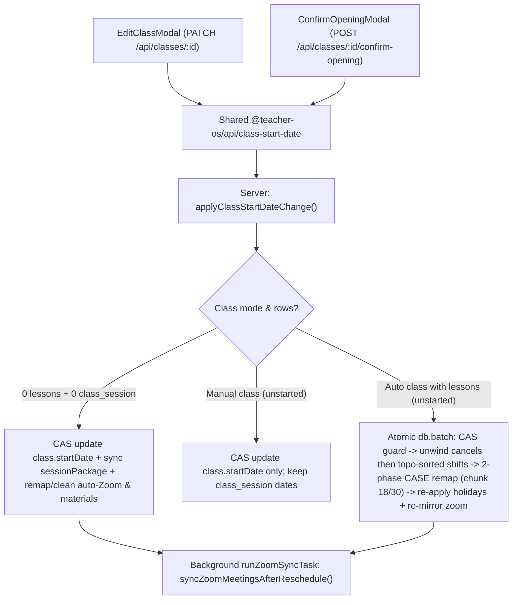

# Cho phép giáo viên thay đổi ngày khai giảng khi lớp chưa bắt đầu

## Overview

Hiện tại, cả `PATCH /api/classes/:id` (`EditClassModal`) lẫn `POST /api/classes/:id/confirm-opening` (`ConfirmOpeningModal`) đều khóa trường **Ngày khai giảng (`startDate`)** ngay khi lớp có bất kỳ dòng `lesson` hoặc `class_session` nào (`hasRealClassSessions` → `409 CLASS_SCHEDULE_LOCKED`). Vì `activateEnrollment` tự động sinh toàn bộ dòng `lesson` (`status = 'upcoming'`) ngay khi học viên đầu tiên được kích hoạt vào lớp, giáo viên bị chặn đổi ngày khai giảng ngay cả khi lớp hoàn toàn chưa dạy buổi nào.

Kế hoạch này tách riêng **khóa cấu trúc lịch** (`schedule`, `sessionsTotal`, `curriculum` giữ nguyên theo `hasRealSessions`) khỏi **khóa ngày khai giảng** (`startDate`, chỉ khóa khi lớp đã bắt đầu hoặc không thể dời lịch an toàn), đồng thời bổ sung dịch vụ đồng bộ nguyên tử trên server (D1/SQLite `db.batch` + `CAS` + two-phase collision-safe date remap với chunk tôn trọng trần 100 binds của D1) cho cả hai endpoint.

## Scope Challenge

- **Existing code:** Tái sử dụng `parseStoredSchedule`, `parseStartDateStrict`, `skeletonOf`, `isoToLessonWeekday`, `scheduleDurationMinutes` (`packages/api/src/skeleton.ts`), `planHolidayShift` (`packages/api/src/holiday-plan.ts`), `loadClassHolidays` / `loadClassShifts` / `loadClassCancels` (`apps/server/src/routes/enrollment-activation.ts`), `deriveScheduledOccurrences` / `resolveZoomClient` (`apps/server/src/lib/zoom/session-zoom-service.ts`), `canManageClassStatus` (`packages/auth/src/role.ts`), và `EditClassModal` / `ConfirmOpeningModal`.
- **Requested scope:** Mở khóa thay đổi `startDate` khi lớp chưa bắt đầu ở cả `EditClassModal` và `ConfirmOpeningModal`, đồng bộ toàn bộ dữ liệu phụ thuộc ngày buổi học (`lesson`, `holiday_session_shift`, `holiday_session_cancel`, `lesson_material`, `class_session_meeting` + Zoom API).
- **Complexity:** 3 phases, ~13 files (2 new domain/service files + edits to existing contracts/routes/modals/tests). Không cần migration DB mới.
- **Selected mode:** `HOLD SCOPE` (full requested scope, no unrequested additions).

## Confirmed Product Decisions

1. **Định nghĩa "lớp vẫn chưa bắt đầu":** Lớp chưa có bất kỳ buổi học nào đã điểm danh/diễn ra/hủy tay — cụ thể không có dòng `lesson` nào có `status IN ('completed', 'absent')`, `attendance IS NOT NULL`, `attendanceNote IS NOT NULL && attendanceNote !== ""`, hoặc `status = 'cancelled'` mà không thuộc `holiday_session_cancel` (không khóa theo mốc ngày hôm nay để hỗ trợ hoãn khai giảng sát giờ/trễ 1–2 ngày; ngày khai giảng **mới** vẫn bắt buộc `>= vietnamTodayISO()`).
   - Lớp legacy undated (`lesson.date IS NULL`), lớp `auto` có `lesson` với `schedule` không parse được, `sessionsTotal <= 0 || sessionsTotal > 52`, có dòng `holiday` mồ côi, hoặc số ngày gốc sau unwind lệch `sessionsTotal` / lệch giữa các enrollment (sau `moveDate` xen kẽ kích hoạt) đều khóa fail-closed `409 CLASS_START_DATE_LOCKED` (đồng nhất Web ↔ Server).
   - Lớp `auto` đã có `lesson` không được xóa rỗng `startDate: ""` (`400`). Lớp 0 `lesson` vẫn được xóa rỗng `startDate: ""` (dọn kèm auto-provisioned Zoom meetings nếu có).
2. **Lớp lịch thủ công (`manual`, không gắn giáo trình):** Khi chưa bắt đầu, chỉ cập nhật `class.startDate` hiển thị (metadata), **giữ nguyên ngày các `class_session` và `lesson` thủ công** đã tự tạo.
3. **Thông báo cho học viên:**
   - `EditClassModal` (`PATCH /api/classes/:id`): **không tự gửi** email/thông báo; hiển thị gợi ý nhẹ nếu lớp đã từng chốt khai giảng để giáo viên chủ động bấm **"Thông báo khai giảng"** khi sẵn sàng.
   - `ConfirmOpeningModal` (`POST /api/classes/:id/confirm-opening`, mode `initial` / `all`): cập nhật `startDate` + dời lịch nguyên tử **trước** khi gửi email HTML.
4. **Phân quyền vai trò `ta` (Trợ giảng):** <!-- Updated: Validation Session 1 & Red-Team RT-4 --> Chặn `ta` đổi `startDate` trên `PATCH /api/classes/:id` (`403 FORBIDDEN`, dùng `canManageClassStatusInKernel(ctx.role)`) và khóa ô `Ngày khai giảng` trên `EditClassModal` khi `!canManageClassStatus`, đồng nhất với `POST /classes/:id/confirm-opening` và quyền ghi `lesson_material`.

## Explicit Non-Goals

- Không mở khóa `schedule` (thứ/giờ học) hay `sessionsTotal` khi đã có `lesson` hoặc `class_session`.
- Không sửa `session_package.start`, `session_package.total` (trên lớp đã có buổi học), `class_study_pack.startDate`, hay luồng `CurriculumManagementSection` / `syncCurriculumHandler`.
- Không tự dịch ngày các buổi thủ công (`class_session`) của lớp `manual`.
- Không tự động gửi email hoặc `schedule_changed` notification từ `EditClassModal`.

## Extension Trace

- **Credible next variant:** Trong tương lai nếu mở rộng cho phép đổi `schedule` (thứ/giờ học) trước khi lớp bắt đầu:
  - **Contract giữ nguyên:** `evaluateClassStartDateEditability` (tầng quyết định "lớp chưa bắt đầu"), hai-pha `CASE WHEN` remap theo bijection `oldBaseDates[k] -> newBaseDates[k]` trong giới hạn D1 bind, và cơ chế CAS + retry chống race với `activateEnrollment` / `holidays` ở `applyClassStartDateChange`.
  - **Phần cần đổi:** Truyền thêm `nextSchedule` vào `planUnstartedStartDateShift` ở chế độ `materialized` (cập nhật thêm `lesson.time` và `lesson.dur` cùng lúc với `date`/`day`, đồng thời truyền `time`/`dur` cho Zoom `updateMeeting`).
  - **Chứng minh:** `planUnstartedStartDateShift` đã nhận tường minh `(oldSchedule, newSchedule, oldSessionsTotal, newSessionsTotal, oldStartDate, newStartDate)` (sẵn cho nhánh `projected`), đủ sạch mà không thêm abstraction thừa.

## Architecture / Flow

## Goals

| # | Goal | Priority |
|---|---|---|
| 1 | Tách rạch ròi điều kiện "lớp chưa bắt đầu" dùng chung cho server & web (`@teacher-os/api/class-start-date`) kèm mã lỗi `CLASS_START_DATE_LOCKED` | P1 |
| 2 | Đồng bộ nguyên tử `class.startDate`, `lesson`, `holiday_session_shift`/`cancel`, `lesson_material`, và `class_session_meeting` (+ Zoom sync) trên cả `PATCH /classes/:id` và `POST /classes/:id/confirm-opening` | P1 |
| 3 | Mở khóa ô "Ngày khai giảng" trên `EditClassModal` và `ConfirmOpeningModal` khi lớp chưa bắt đầu, kèm UX copy rõ ràng, role gate `ta`, và kiểm chứng 3 viewport + light/dark + E2E | P1 |

## Phases

| # | Phase | Status |
|---|---|---|
| 1 | [Phase 1: Shared Domain Contracts & Pure Helpers](./phase-01-start.md) | Done |
| 2 | [Phase 2: Server Atomic Rescheduler & Route Integration](./phase-02-server-atomic-rescheduler.md) | Done |
| 3 | [Phase 3: Web UI, Tests & Verification](./phase-03-web-ui-and-verification.md) | Done |

## Success Criteria

- [x] Pure helpers ở `@teacher-os/api/class-start-date` quyết định đồng nhất khả năng sửa `startDate` (kể cả `sessionsTotal <= 52`, topological unwind, và per-enrollment date parity) và tính kế hoạch dời ngày 1-1 an toàn, có unit tests đầy đủ (TDD).
- [x] `PATCH /api/classes/:id` và `POST /api/classes/:id/confirm-opening` cho phép đổi `startDate` khi lớp chưa bắt đầu (kể cả đã có học viên `active` và `lesson` `upcoming`, hoặc đã có `holiday_session_shift`/`holiday_session_cancel`, `lesson_material`, `class_session_meeting`), chặn vai trò `ta` (`403 FORBIDDEN`), và trả `409 CLASS_START_DATE_LOCKED` khi lớp đã bắt đầu, legacy undated, hoặc phân mảnh lịch.
- [x] Lớp `auto` sau khi đổi `startDate` có toàn bộ `lesson.date` / `lesson.day` khớp `skeletonOf(schedule, newStartDate, sessionsTotal)` (sau khi tái áp kỳ nghỉ hiện hành), bảo toàn `lesson.id` / `topic` / `zoom`, dịch theo `lesson_material` và `class_session_meeting` (mọi câu SQL đều `<= 100` bound params của D1, không lỗi PK/UNIQUE khi gối ngày), dọn sạch Zoom nếu rơi vào holiday `cancel`, và đồng bộ Zoom API nền.
- [x] Lớp `manual` chưa bắt đầu đổi được `class.startDate` mà không làm đổi ngày các `class_session` đã thêm.
- [x] `schedule` và `sessionsTotal` trên `PATCH /api/classes/:id` vẫn trả `409 CLASS_SCHEDULE_LOCKED` khi lớp đã có `lesson` hoặc `class_session` (và lớp 0 buổi có sẵn auto-Zoom vẫn đổi đồng thời `schedule`/`sessionsTotal`/`startDate` + xóa rỗng `startDate: ""` + sync `session_package.total` an toàn).
- [x] `EditClassModal` và `ConfirmOpeningModal` mở khóa ô "Ngày khai giảng" khi lớp chưa bắt đầu (khóa cho `ta`), hiển thị ghi chú rõ ràng theo từng trạng thái, cảnh báo trùng lịch realtime hiển thị đúng khi đổi ngày khai giảng (`showScheduleConflicts`), và giữ nguyên không tự gửi email từ `EditClassModal`.
- [x] Tất cả local gates xanh (`pnpm exec biome check .`, `pnpm check-types`, `pnpm test`, spec E2E `edit-class.spec.ts`), ảnh POT 3 viewport + light/dark đạt `REVIEW.md`.

## Validation Log

### Session 1 — 2026-11-26
**Trigger:** Pre-implementation validation gate + Red-Team findings adjudication (`/ak-vibe --ship --beta --advice`).
**Questions asked:** 6 (3 scope intake + 3 validation/red-team confirmation).

#### Verification Results
- **Tier:** Standard (3 phases — Fact Checker + Contract Verifier via 3 parallel reviewers)
- **Claims checked:** 32
- **Verified:** 22 | **Failed:** 10 (all 10 reconciled via Red-Team adjudication below) | **Unverified:** 0

#### Questions & Answers

1. **[Scope]** Tiêu chí xác định "lớp vẫn chưa bắt đầu" để cho phép sửa Ngày khai giảng?
   - Options: Chưa có buổi nào đã điểm danh/hủy (completed, absent, cancelled hoặc có attendance) — không khóa theo ngày hôm nay (Recommended) | Khóa khi date <= hôm nay VN hoặc đã điểm danh/hủy | Chỉ khóa completed/absent/attendance (cho sửa khi cancelled)
   - **Answer:** Chưa có buổi nào đã điểm danh/hủy — không khóa theo ngày hôm nay (ngày khai giảng mới vẫn `>= hôm nay VN`, ngoại trừ `cancelled` từ `holiday_session_cancel`).
   - **Rationale:** Hỗ trợ tình huống phổ biến nhất là hoãn khai giảng sát giờ hoặc trễ 1–2 ngày khi chưa dạy buổi nào.
2. **[Scope]** Xử lý lớp lịch thủ công (`manual`) đã tạo sẵn buổi dự kiến nhưng chưa dạy buổi nào?
   - Options: Chỉ cập nhật Ngày khai giảng hiển thị của lớp, giữ nguyên ngày các buổi thủ công đã tự tạo (Recommended) | Tịnh tiến toàn bộ buổi thủ công theo delta | Giữ khóa trên lớp manual
   - **Answer:** Chỉ cập nhật Ngày khai giảng hiển thị, giữ nguyên ngày các buổi thủ công.
   - **Rationale:** Buổi thủ công chọn ngày rời rạc không theo công thức tuần.
3. **[Scope]** Đổi Ngày khai giảng qua `EditClassModal` có tự động gửi thông báo cho học viên không?
   - Options: Không tự gửi — giáo viên chủ động bấm "Thông báo khai giảng" (Recommended) | Tự động gửi `schedule_changed`
   - **Answer:** Không tự gửi (giữ thiết kế #874, thêm ghi chú nhắc trên UI khi lớp đã từng chốt khai giảng).
   - **Rationale:** Tránh spam học viên khi chỉnh nháp.
4. **[Security]** Chính sách phân quyền cho Trợ giảng (`ta`) khi đổi `startDate` qua `PATCH /api/classes/:id`?
   - Options: Chặn `ta` (`403 FORBIDDEN`) khi đổi `startDate` và khóa ô trên `EditClassModal` (Recommended) | Cho phép `ta` sửa
   - **Answer:** Chặn `ta` (`403 FORBIDDEN`) và khóa ô trên `EditClassModal`.
   - **Rationale:** Ngăn `ta` vượt cổng `canManageClassStatus` (`confirm-opening`) và `canWriteMaterials` (`lesson_material` / Zoom API).
5. **[Assumptions]** Xử lý lớp legacy `sessionsTotal > 52` hoặc bị `moveDate` làm lệch tập ngày giữa các học viên?
   - Options: Khóa fail-closed (`CLASS_START_DATE_LOCKED`, đồng bộ Web & Server) (Recommended) | Map theo hợp nhất bất kể khác `sessionsTotal`
   - **Answer:** Khóa fail-closed đồng bộ Web & Server.
   - **Rationale:** Đảm bảo bất biến lịch sau dời luôn khớp `skeletonOf(schedule, newStartDate, sessionsTotal)` giữa học viên cũ và học viên mới.

#### Confirmed Decisions
- Unstarted predicate: hoạt động điểm danh/hủy tay (loại trừ `holiday_session_cancel`), không khóa theo ngày hôm nay; fail-closed cho legacy undated, `sessionsTotal > 52`, orphan holiday, và lệch tập ngày giữa các enrollment.
- Manual classes: chỉ sửa metadata `class.startDate`, giữ nguyên `class_session`.
- Notifications: `EditClassModal` không tự gửi; `ConfirmOpeningModal` gửi email HTML sau khi rescheduler commit nguyên tử.
- Role gate: `canManageClassStatusInKernel` chặn `ta` khi đổi `startDate` trên cả hai endpoint.

## Red Team Review

### Session — 2026-11-26
**Findings:** 10 deduplicated (10 accepted, 0 rejected)
**Severity breakdown:** 5 Critical, 3 High, 2 Medium

| # | Finding | Severity | Disposition | Applied To |
|---|---|---|---|---|
| 1 | D1 100-bind limit overflow in Step B `CASE WHEN` (`chunkSize=35` → 177/107 binds) | Critical | Accept | Phase 1, Phase 2 |
| 2 | Step A unwind order (`cancels` after `shifts` revives cancelled makeup) & topological sort for chained shifts (`A→B→C`) | Critical | Accept | Phase 1, Phase 2 |
| 3 | Statement 0 CAS missing `moveDate` date-set guard, `lesson_material` count, `organization_holiday` count, `syllabus` guard, and 0-row deleted-class check | Critical | Accept | Phase 2 |
| 4 | Missing `ta` role gate on `PATCH /api/classes/:id` when `startDateChanged` | Critical | Accept | Plan, Phase 2, Phase 3 |
| 5 | 0-lesson Online `auto` class with auto-Zoom breaks `startDate: ""`, simultaneous `schedule`/`sessionsTotal` edit, and `sessionPackage` sync | Critical | Accept | Phase 1, Phase 2 |
| 6 | Holiday `newCancels` missing Zoom cleanup, Step A missing `lesson.zoom` re-mirror, Pass 1.5 missing deleted `zoomMeetingId` capture | High | Accept | Phase 2 |
| 7 | Web ↔ Server parity in `evaluateClassStartDateEditability` (`sessionsTotal > 52`, enrollment date divergence, orphan `holiday`) | High | Accept | Phase 1, Phase 2, Phase 3 |
| 8 | `paused` class holiday re-apply invariant (`#694`) & uncaught `planHolidayShift` `SCAN_CAP_DAYS` error | High | Accept | Phase 2 |
| 9 | SQLite `LIKE '__shift__:%'` wildcard `_` hazard → use `substr(date, 1, 10) = '__shift__:'` | Medium | Accept | Phase 2 |
| 10 | `showScheduleConflicts` gated by `!hasRealSessions`, inconsistent `isManual` across modals, stale `cls` in `confirm-opening` email after retry, symbol name drift in plan | Medium | Accept | Plan, Phase 1, Phase 2, Phase 3 |

### Whole-Plan Consistency Sweep
- Files reread: `plan.md`, `phase-01-start.md`, `phase-02-server-atomic-rescheduler.md`, `phase-03-web-ui-and-verification.md`
- Decision deltas checked: 10
- Reconciled stale references: 10 (chunk sizes `18`/`30`, symbol names `chunkDateMappings`/`planUnstartedStartDateShift`/`applyClassStartDateChange`, unwind order `cancels` before topo-sorted `shifts`, `ta` role gate, `showScheduleConflicts`, `isManual`, `substr` prefix check, `paused` holiday scope, `projected` dual old/new params, `sessionPackage` sync in both branches)
- Unresolved contradictions: 0

<!-- slug: edit-unstarted-class-start-date -->
