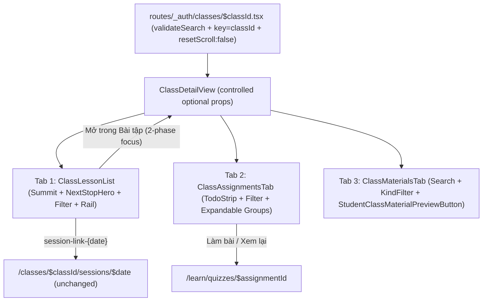

# Redesign 3 tab trang chi tiết lớp học viên (`/classes/$classId`)

## Overview

Triển khai lại giao diện và tương tác của 3 tab (**Hành trình học**, **Bài tập**, **Tài liệu chung**) trên trang chi tiết lớp học viên (`apps/student/src/routes/_auth/classes/$classId.tsx`) bám sát prototype `open-design/student-classes.html` và hệ thống token design v2 (`packages/ui/src/styles/globals.css`), xây dựng trực tiếp trên nền PR #1008 (#998, `670c9274`). Toàn bộ shell phía trên `<Tabs>`, backend, DB schema và `@teacher-os/api` contracts giữ nguyên để không làm trôi projection-lock hay gãy hợp đồng.

## Advisor Scope Lock (`--advice`)

- **Locked Scope:**
  1. Đồng bộ state tab/bộ lọc/tìm kiếm lên URL qua `validateSearch` (bỏ giá trị mặc định để URL gốc `/classes/$classId` giữ nguyên; luôn truyền `resetScroll: false` và functional updater tránh race async `_auth.beforeLoad`) với props controlled tùy chọn trên `ClassDetailView` và `key={classId}` tại route.
  2. Tab 1 (`Hành trình học`): `JourneySummitCard` + `JourneyNextStopHero` + Toolbar (`Lộ trình chinh phục` + filter `Tất cả | Đã đi qua | Phía trước` + `Vị trí hiện tại` 2 pha) + Vertical Journey Rail 32px co/mở (`nextLesson` mở sẵn mặc định), giữ nhóm Module giáo trình (#998), sibling `session-link-${date}` tới `/classes/$classId/sessions/$date`, bài tập gắn buổi (`Mở trong Bài tập`), Zoom join (30 phút trước giờ học, luôn bấm được, tách riêng `zoomNowMs`) & Recording (`rel="noopener noreferrer"`).
  3. Tab 2 (`Bài tập`): Component mới `ClassAssignmentsTab` (giữ `ClassAssignmentTable` nguyên vẹn cho `SessionDetailView`) gồm Todo Priority Strip (chỉ gắn CTA cho `source === "class_assignment"`) + Toolbar (`Bài tập của bạn` + filter `Tất cả | Cần làm | Đã nộp | Đã chấm` kèm badge đếm `aria-hidden="true"`) + 3 nhóm co/mở có link 1-click tới `/learn/quizzes/$assignmentId` và panel chi tiết thật (link buổi học chỉ khi khớp buổi non-holiday, bảng 4 tiêu chí IELTS khi `scores != null`, nhánh `gradedAt != null && scores == null`). Cập nhật selector `role="row"` → `role="listitem"` tại `apps/e2e/specs/student-practice.spec.ts:546` do Tab 2 đổi từ `<table>` sang `<ul><li>`.
  4. Tab 3 (`Tài liệu chung`): `ClassMaterialsTab` với ô tìm kiếm tiếng Việt không dấu (debounce ~300ms + cleanup + nút xóa chỉ hiện khi có filter/query), filter loại (`Tất cả | Tài liệu | Audio – Video | Liên kết`), nhóm theo `kind` thật, xem trước PDF/ảnh on-demand qua `StudentClassMaterialPreviewButton` (tái dùng `StudentPreviewDialog` với focus restore an toàn & bảo vệ 403 self-heal/logout), giữ `useSyncExternalStore(subscribeActiveStudentOrg, ...)`, inline `<audio>`/`<video>` và link tải nguyên vẹn.
  5. Kiểm chứng toàn diện: `biome`, `check-types`, unit tests `apps/student`, 8 spec E2E mục tiêu (gồm `student-practice.spec.ts`), 4 viewport (1440×900, 768×1024, 375×812, 320px reflow) Light/Dark, `pnpm design:compare --screens s-class-detail --force`, cập nhật `DESIGN.md` và ảnh POT.
- **Explicit Non-Goals:**
  - Không thay đổi shell phía trên `<Tabs>` (`BackHomeLink`, `TodoBanner`, `<header>`, `class-paused-banner`, `ClassInfoCard`, 4 `RingStat`, và `<Tabs>`).
  - Không thay đổi backend, DB schema, hay `@teacher-os/api` contracts (`GET /api/student/classes/:classId` và `GET /api/student/classes/:classId/materials`).
  - Không sửa `SessionDetailView`, `ClassAssignmentTable`, `StudentClassMaterialPreview`, `StudentInlineMaterialPreview`, `LessonMaterials`, hay `LESSON_STATUS` export dùng chung bởi `SessionDetailView`.
  - Không dựng dữ liệu giả từ prototype (`BRIEF`, file PDF đề bài giả, `Ghim`, `Mới`, `Đăng dd/mm`, `pages`, `duration`, band mốc giả, modal nộp bài giả).

## Goals

| # | Goal | Priority |
|---|------|----------|
| 1 | Chuẩn hóa URL search params (`resetScroll: false`, lọc Bidi/control, `JSON.parse` số) + pure helpers cho 3 tab trên `/classes/$classId` | P1 |
| 2 | Redesign tab Hành trình học giữ trọn tính năng giáo trình/buổi chi tiết #998 và hợp đồng Zoom/Recording/Holiday/Paused | P1 |
| 3 | Redesign tab Bài tập thành `ClassAssignmentsTab` với nhóm ưu tiên, lọc trạng thái, 1-click làm/xem bài và cập nhật `student-practice.spec.ts:546` | P1 |
| 4 | Redesign tab Tài liệu chung với tìm kiếm không dấu, lọc theo loại, nhóm theo `kind` và `StudentClassMaterialPreviewButton` on-demand | P1 |
| 5 | Bảo đảm 100% gates local, 8 spec E2E mục tiêu xanh và thẩm định 4 viewport Light/Dark + `design:compare --force` | P1 |

## Phases

| # | Phase | Status |
|---|-------|--------|
| 1 | [Phase 1: Route URL Search & Pure Helpers](./phase-01-start.md) | Completed |
| 2 | [Phase 2: Redesign Tab Hành trình học](./phase-02-journey-tab-redesign.md) | Completed |
| 3 | [Phase 3: Redesign Tab Bài tập](./phase-03-assignments-tab-redesign.md) | Completed |
| 4 | [Phase 4: Redesign Tab Tài liệu chung](./phase-04-materials-tab-redesign.md) | Completed |
| 5 | [Phase 5: Kiểm thử, E2E & Thẩm định hình ảnh](./phase-05-verification-e2e-and-visual-audit.md) | Completed |

## Architecture & Invariants

- **E2E & Unit Test invariants được khóa cứng:**
  - `student-classmates.spec.ts`: giữ nguyên 3 tab (`Hành trình học`, `Bài tập`, `Tài liệu chung`) và không dùng `tabIndex={-1}` trên `<Tabs>` để `Tab` đi từ `Bài tập` sang `Tài liệu chung`.
  - `student-class-detail.spec.ts`: `<section>` chứa heading level 2 `"Buổi học"` chỉ có đúng `N` phần tử `<li>` bằng số buổi học (không `milestoneLi`, không `<ul><li>` trong `.stop-detail`); giữ nhãn `"Buổi tới"` + `aria-current="true"`; trên Tab `Bài tập` có sẵn `<Link>` truy cập trực tiếp với `aria-label="Làm bài: <title>"`.
  - `student-session-detail.spec.ts`: giữ `data-testid="journey-syllabus-header"`, tiêu đề các module (`data-testid="journey-module-<id>"` được kiểm ở `class-lesson-list.test.tsx` & `class-detail-view.test.tsx`), `data-testid="session-link-<date>"` duy nhất trên hàng buổi, và chỉ hiển thị chuỗi `"N bài giảng"` / `"M bài tập"` 1 lần trên hàng buổi (không lặp trong `.stop-detail` để tránh strict-mode violation).
  - `student-practice.spec.ts:546`: kiểm tra bài luyện tập không lọt danh sách bài tập lớp trên `class-tab-assignments` — cập nhật selector `body.getByRole("row")` sang `body.getByRole("listitem")` cho đúng cấu trúc `<ul><li>` mới của Tab 2 (giữ nguyên mọi assertion nghiệp vụ).
  - `zoom-meeting.spec.ts`: `Vào lớp (Zoom)` không bị `disabled` trước `openAt` (`ZOOM_EARLY_JOIN_MINUTES = 30`), truyền `zoomNowMs` riêng không đóng băng `now`; `nextLesson` mở sẵn để `Vào lớp (Zoom)`, `Xem recording`, `Mật khẩu:` và passcode đều hiển thị và chạm được qua `Tab`.
  - `class-shared-materials.spec.ts`: giữ `data-testid="class-material"`, link tải `Tải <title>`, inline `<audio>` nạp metadata, không có control ghi/xóa, và `reflow320` ≤ 1px; đồng thời giữ `useSyncExternalStore(subscribeActiveStudentOrg, ...)` để `?org=` reactive cho `<audio>`/`<video>`/download (kiểm chặt trong `class-materials-tab.test.tsx` và kiểm E2E bấm `"Xem trước"` PDF).
  - `class-status.spec.ts`: lớp `paused` ẩn hoàn toàn `"Buổi tới"`, Next Stop Hero, và `Vào lớp (Zoom)`; hiện `"Tạm hoãn"`.

## Red Team Review

### Session — 2026-11-26
**Reviewers (3 parallel hostile lenses, Full Tier):** Security Adversary (Fact Checker), Failure Mode Analyst (Flow Tracer), Assumption Destroyer (Scope Auditor & Contract Verifier).
**Findings (deduplicated):** 14 (14 accepted, 0 rejected)
**Severity breakdown:** 5 Critical, 6 High, 3 Medium

| # | Finding | Severity | Disposition | Applied To |
|---|---------|----------|-------------|------------|
| 1 | Bỏ sót E2E `student-practice.spec.ts:546` query `role="row"` trên Tab 2 | Critical | Accept | `plan.md`, Phase 3, Phase 5 |
| 2 | `StudentClassMaterialPreviewButton` abort theo `activeOrgId` giết retry 403 `STUDENT_ORG_MISMATCH` và không đóng dialog khi logout | Critical | Accept | Phase 4 |
| 3 | Thiếu `useSyncExternalStore(subscribeActiveStudentOrg)` trong `ClassMaterialsTab` & `StudentClassMaterialPreviewButton` + sửa chú thích E2E | Critical | Accept | `plan.md`, Phase 4, Phase 5 |
| 4 | `navigate({ replace: true })` thiếu `resetScroll: false` đụng `scrollRestoration: true` (`main.tsx:16`) | Critical | Accept | `plan.md`, Phase 1 |
| 5 | Strict-mode collision `"1 bài giảng"` / `"3 bài tập"` trên `student-session-detail.spec.ts:368-369` do `nextLesson` mở sẵn | Critical | Accept | `plan.md`, Phase 2 |
| 6 | `parseClassDetailSearch` thiếu lọc Bidi/control `[\p{Cc}\p{Cf}]`, thiếu xử lý `JSON.parse` số (`?mq=18`), thiếu dọn param lệch tab | High | Accept | Phase 1 |
| 7 | Rò state khi đổi `classId` + race async `_auth.beforeLoad` + debounce tìm kiếm Tab 3 đè `mk`/kéo ngược tab | High | Accept | `plan.md`, Phase 1, Phase 2, Phase 3, Phase 4 |
| 8 | Focus restore `Escape` bị hỏng nếu nút `"Xem trước"` bị `disabled` + rò `blob:` URL / lỗi giả `AbortError` | High | Accept | Phase 4 |
| 9 | Scroll/focus 1 pha cho `"Vị trí hiện tại"` (`jf=done`) và `"Mở trong Bài tập"` (nhóm `Đã chấm` đang gập) chạy trước DOM commit | High | Accept | Phase 2, Phase 3 |
| 10 | Thiếu guard lớp legacy (`null === null`), `holiday`, `source === "grading"` ở Todo Strip và `sessionDate` mồ côi 404 | High | Accept | Phase 2, Phase 3 |
| 11 | Nguy cơ tràn ngang `320px` trên bộ lọc phân đoạn 4 nút (Tab 2 & 3) và hàng buổi non-nested (Tab 1) | High | Accept | Phase 2, Phase 3, Phase 4 |
| 12 | Thiếu `zoomNowMs` ở `JourneyNextStopHero`, xử lý `formatSessionCountdown` (`0 phút`/`Đang diễn ra`) + `formatOpenAtLabel` kèm ngày + `rel="noopener noreferrer"` | Medium | Accept | Phase 1, Phase 2 |
| 13 | Thứ tự lọc sau `buildIndexedLessons`/`groupLessonsByModules`, thống nhất tiến độ `JourneySummitCard`, giữ exact text `syllabus.name` & `"X/Y buổi"` | Medium | Accept | Phase 2 |
| 14 | Giữ `LESSON_STATUS.absent` không rò sang `SessionDetailView`, thống nhất `StudentClassMaterialPreviewButton`, giữ regex read-only, chạy `design:compare --force` | Medium | Accept | `plan.md`, Phase 2, Phase 4, Phase 5 |

### Verification Results (Fact Checker + Flow Tracer + Scope/Contract Auditor)
- **Tier:** Full
- **Claims checked:** 31
- **Verified:** 28 | **Failed:** 3 (đã sửa toàn bộ trong lượt cập nhật này: tên `StudentClassMaterialPreviewButton`, phạm vi `journey-module-<id>`, phạm vi `class-shared-materials.spec.ts`) | **Unverified:** 0

### Whole-Plan Consistency Sweep
- Files reread: `plan.md`, `phase-01-start.md`, `phase-02-journey-tab-redesign.md`, `phase-03-assignments-tab-redesign.md`, `phase-04-materials-tab-redesign.md`, `phase-05-verification-e2e-and-visual-audit.md`
- Decision deltas checked: 14
- Reconciled stale references: 14
- Unresolved contradictions: 0

## Success Criteria

- [x] Tất cả 5 phase hoàn thành theo đúng TDD + handover checklist, có xác nhận `kongming` sau mỗi phase.
- [x] `pnpm exec biome check .`, `pnpm check-types`, `pnpm --filter student test` pass 100% (0 lỗi, 0 hex cứng ngoài whitelist).
- [x] Toàn bộ 8 spec E2E liên quan pass với port override (`8100..8105`).
- [x] Verify đủ 4 viewport (`1440×900`, `768×1024`, `375×812`, `320px` reflow) cả Light & Dark, `pnpm design:compare --screens s-class-detail --force` exit 0, cập nhật `DESIGN.md` và chụp đủ ảnh POT.

<!-- slug: redesign-student-class-tabs -->
