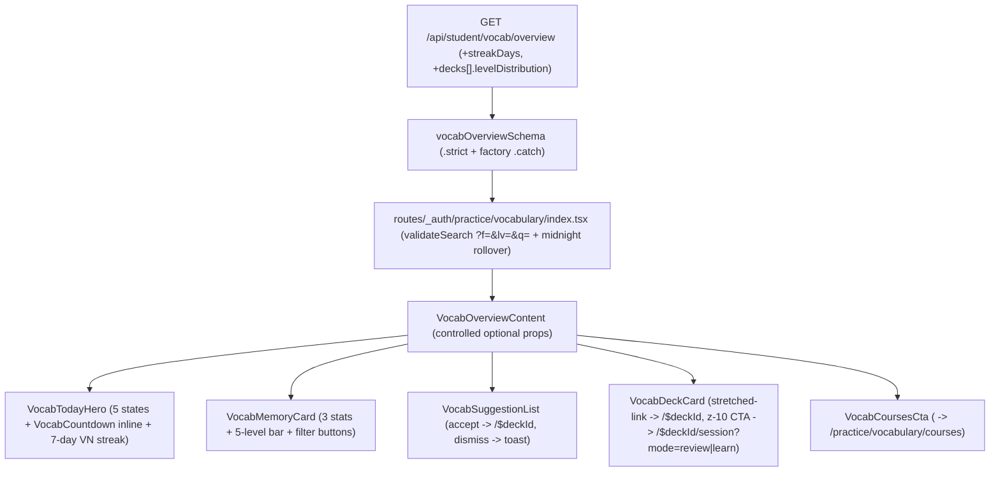

# Redesign trang Từ vựng học viên (`/student/practice/vocabulary`)

## Overview

Nâng cấp trang tổng quan từ vựng học viên (`apps/student/src/routes/_auth/practice/vocabulary/index.tsx`) theo thiết kế mới `open-design/vocabulary.html` trên hệ thống token design v2 (`packages/ui/src/styles/globals.css`), đồng thời mở rộng nhẹ API `GET /api/student/vocab/overview` (`streakDays` và `decks[].levelDistribution`) với 0 migration DB và 0 query SQL phát sinh thêm. Toàn bộ CTA dẫn thẳng vào phiên học/ôn SRS thật (`/practice/vocabulary/$deckId/session?mode=review|learn`), thẻ bộ từ mở trang chi tiết `/practice/vocabulary/$deckId` qua stretched-link an toàn, và trạng thái lọc (`f`, `lv`, `q`) đồng bộ lên URL.

## Advisor Scope Lock (`--advice`)

- **Locked Scope:**
  1. Mở rộng `GET /api/student/vocab/overview` (`apps/server/src/routes/vocab.ts`) + schema (`packages/api/src/contracts.ts`) thêm `streakDays` (7 boolean theo ngày Việt Nam `[today-6 .. today]`) và `decks[].levelDistribution` (5-tuple `[L1..L5]` của card `state === "review"` thuộc từng bộ), dùng factory `() => [...]` trong `.catch(...)` giữ nguyên `.strict()`.
  2. Thêm 5 token cấp trí nhớ `--vocab-lv-1..5` (Light + inverted Dark) vào `packages/ui/src/styles/globals.css` và map qua `@theme inline`, 0 hard-coded hex.
  3. Redesign giao diện `/student/practice/vocabulary` với 5 trạng thái Hero ("Hôm nay"), dải 7 ngày chuỗi học theo giờ Việt Nam, thẻ "Trí nhớ của bạn" (3 chỉ số, thanh phân bổ 5 cấp, 5 nút lọc cấp trí nhớ), "Gợi ý cho bạn", "Bộ từ đang học" (tìm kiếm tiếng Việt không dấu debounce 300ms, lọc trạng thái `Tất cả | Đến hạn | Đang học | Đã thuộc hết`, lọc cấp trí nhớ, sync URL `?f=&lv=&q=`, stretched-link card an toàn), và thẻ "Thư viện từ vựng".
  4. Kiểm chứng đầy đủ: `pnpm exec biome check .`, `pnpm check-types`, `pnpm test`, 5 spec E2E liên quan (port override `8100..8105`), `pnpm design:compare --screens s-vocab,s-practice-vocabulary --side app --force`, audit 4 viewport (`1440×900`, `768×1024`, `375×812`, `320px` reflow) Light/Dark + keyboard focus, cập nhật `DESIGN.md`, chụp POT và commit `open-design/vocabulary.html` cùng PR.
- **Explicit Non-Goals:**
  - Không dựng modal flashcard mẫu 5 thẻ hay nút "Hoàn tác" giả từ `open-design/vocabulary.html`.
  - Không sửa `/practice/vocabulary/$deckId`, `/practice/vocabulary/$deckId/session`, `/practice/vocabulary/courses`, `/practice/vocabulary/courses/$courseId`.
  - Không thêm migration DB, không đổi SQL query, không đổi công thức tính `retention` (giữ all-time và đặt nhãn `"tỉ lệ nhớ"`, không ghi `"30 ngày"`).
  - Không chạy full E2E suite ở local (`AGENTS.md`).

## Goals

| # | Goal | Priority |
|---|---|---|
| 1 | Mở rộng `vocabOverviewSchema` và `GET /api/student/vocab/overview` thêm `streakDays` và `decks[].levelDistribution` (0 migration, 0 SQL mới) | P1 |
| 2 | Định nghĩa token `--vocab-lv-1..5` (Light/Dark) và xây dựng pure helpers + URL search parser bằng TDD | P1 |
| 3 | Redesign UI `/student/practice/vocabulary` theo `open-design/vocabulary.html` bảo toàn 100% testid/hợp đồng E2E và WCAG AA + 320px reflow | P1 |
| 4 | Pass toàn bộ gates (`biome`, `check-types`, `test`, 5 spec E2E mục tiêu, `design:compare`), cập nhật `DESIGN.md` và ảnh POT | P1 |

## Architecture & Invariants

- **Ràng buộc tương thích ngược & deploy:** `packages/infra/alchemy.run.ts:351-394` deploy `server` trước `lms`. Trong cửa sổ vài phút chuyển tiếp (hoặc tab học viên chưa reload), bundle cũ dùng `.strict()` sẽ ném `ZodError` với 2 key mới (cùng đánh đổi đã ghi ở `packages/api/src/vocab-contracts.test.ts:214-237,462-504`). Phù hợp với `--ship --beta` (staging); ghi chú rõ trong PR & test.
- **Ràng buộc E2E & unit test:**
  - `vocab-overview-streak`: exact `"1 ngày"` (chữ `"liên tiếp"` đặt bên ngoài).
  - `vocab-countdown-label`: `formatCountdown(remainingMs)` khớp `/^(1d 0h|23:59)/`.
  - `vocab-overview-new-count`: xuất hiện tối đa 1 lần trong DOM (`due`, `new-only`, `caught-up` khi `totalNewCount > 0`).
  - `vocab-deck-source-${deckId}`: `"Gợi ý"` cho `suggested`, `"Khóa ..."` cho `library`, `"Lớp ..."` cho `class`.
  - `vocab-deck-card-${deckId}`: bấm tâm card đi vào `/practice/vocabulary/$deckId`; nút CTA footer `relative z-10` đi vào `/practice/vocabulary/$deckId/session?mode=review|learn`.
  - `vocab-courses-cta`: `<Link href="/practice/vocabulary/courses">` chứa `"Thư viện từ vựng · X khóa · Y bài"`, ẩn khi `summary === null`.

## Phases

| # | Phase | Status |
|---|---|---|
| 1 | [Phase 1: Contract & Server Overview Extension](./phase-01-start.md) | Completed |
| 2 | [Phase 2: Design Tokens, URL Search & Pure Helpers](./phase-02-tokens-and-helpers.md) | Completed |
| 3 | [Phase 3: Redesigned Vocabulary Components & Route](./phase-03-vocabulary-ui-redesign.md) | Completed |
| 4 | [Phase 4: QA Gates, Targeted E2E, Visual Audit & Docs](./phase-04-verification-e2e-and-visual-audit.md) | Completed |

## Red Team Review

### Session — 2026-11-27
**Reviewers (3 parallel hostile lenses, Standard/Full Tier):** Assumption Destroyer (Scope Auditor), Security Adversary (Fact Checker), Failure Mode Analyst (Contract Verifier & Flow Tracer).
**Findings (deduplicated):** 13 (11 accepted, 2 rejected/trade-off locked by User Decision)
**Severity breakdown:** 2 Critical, 6 High, 5 Medium

| # | Finding | Severity | Disposition | Applied To |
|---|---------|----------|-------------|------------|
| 1 | `VocabTodayHero` thiếu prop `onExpired`, làm countdown ở trạng thái `caught-up` không tự refetch | Critical | Accept | `phase-03-vocabulary-ui-redesign.md` |
| 2 | Bỏ sót 3 assertion `.toEqual()` cứng trên `overview.decks` trong `vocab.test.ts:332-342,1053-1061,1490-1500` + cần tách nhánh `else` ở `vocab.ts:712` + sửa citation `573-753` | Critical | Accept | `phase-01-start.md` |
| 3 | `design:compare` dùng `design-seed.ts` không seed `vocab_*` nên chỉ kiểm chứng được trạng thái rỗng (`no-decks`) | High | Accept | `phase-04-verification-e2e-and-visual-audit.md` |
| 4 | URL search sync thiếu `lastEmittedRef` + `pendingSearchRef` + huỷ timer debounce khi xóa/reset filter | High | Accept | `phase-03-vocabulary-ui-redesign.md` |
| 5 | `VocabDeckCard` ghi typo `$deck.deckId`, thiếu `<h3 id=...>` cho `aria-labelledby`, và cần giữ footer `ml-auto` tránh tâm card trùng CTA `z-10` | High | Accept | `phase-03-vocabulary-ui-redesign.md` |
| 6 | `--vocab-lv-1` (`0.87`/`0.34`) quá gần `--muted`/`--card`, chưa đạt phân tách WCAG 1.4.11 | High | Accept | `phase-02-tokens-and-helpers.md` |
| 7 | Cửa sổ deploy `.strict()` khi `server` deploy trước `lms` làm tab cũ lỗi tới khi reload | High | Accept (Trade-off locked by User Decision #1 for `--ship --beta`) | `plan.md`, PR body & `vocab-contracts.test.ts` |
| 8 | Đổi `.catch(() => [...])` sang `.optional().default(() => [...])` | High | Reject (User Decision #1 khóa `.catch()` + đã bù bằng test raw JSON ở `vocab.test.ts`) | `phase-01-start.md` |
| 9 | `resolveVocabHeroState` thiếu guard `topDueDeck != null` & fallback `empty-decks` bao phủ mọi case còn lại | Medium | Accept | `phase-02-tokens-and-helpers.md`, `phase-03-vocabulary-ui-redesign.md` |
| 10 | Midnight rollover VN thiếu `nowMs`/`todayISO` state ở `VocabOverviewPage` + `VocabMemoryCard` `grid-cols-3` dễ chật ở 320px | Medium | Accept | `phase-03-vocabulary-ui-redesign.md` |
| 11 | `VocabSuggestionList` cần giữ `data-testid="vocab-suggestions-error"` và check `Boolean(item.note?.trim())` | Medium | Accept | `phase-03-vocabulary-ui-redesign.md` |
| 12 | `VocabCoursesCta` nút `outline` trên `bg-muted` thiếu `border-input` để đạt ≥ 3:1 | Medium | Accept | `phase-03-vocabulary-ui-redesign.md` |
| 13 | Mock `Link` của `vocab-course-catalog.test.tsx:37-65` bỏ qua `search.mode` — cần mock đầy đủ trong `vocab-overview-page.test.tsx` | Medium | Accept | `phase-03-vocabulary-ui-redesign.md` |

### Whole-Plan Consistency Sweep
- Files reread: `plan.md`, `phase-01-start.md`, `phase-02-tokens-and-helpers.md`, `phase-03-vocabulary-ui-redesign.md`, `phase-04-verification-e2e-and-visual-audit.md`
- Decision deltas checked: 13
- Reconciled stale references: 11
- Unresolved contradictions: 0

## Validation Log

### Session — 2026-11-27 (User Decisions via `ask_question`)
1. **API extension:** Chọn mở rộng `GET /api/student/vocab/overview` (0 migration, 0 SQL mới) với `.catch(() => [...])` giữ `.strict()` trong cùng PR `--ship --beta`.
2. **CTA navigation:** Điều hướng thẳng sang `/practice/vocabulary/$deckId/session?mode=review|learn` từ Hero & CTA footer; click card body/tiêu đề mở `/practice/vocabulary/$deckId`. Không dựng fake modal/fake undo.
3. **Design artifact:** Commit `open-design/vocabulary.html` cùng PR.

## Success Criteria

- [x] Toàn bộ 4 phase hoàn thành theo đúng TDD + handover checklist, có xác nhận `kongming` sau mỗi phase.
- [x] `pnpm exec biome check .`, `pnpm check-types`, `pnpm test` pass 100% (0 lỗi, 0 hex cứng ngoài whitelist).
- [x] Cả 5 spec E2E (`vocab-srs.spec.ts`, `vocab-hub-suggestion.spec.ts`, `vocab-library-clone.spec.ts`, `vocab-teacher-deck-clone.spec.ts`, `student-practice.spec.ts`) pass với port override không nới lỏng assertion (chạy trên `8200/8201/8205` vì `8100/8101/8105` đang có tiến trình khác giữ).
- [x] `pnpm design:compare --screens s-vocab,s-practice-vocabulary --side app` exit 0; verify 4 viewport (`1440×900`, `768×1024`, `375×812`, `320×640` reflow = 0 overflow) cả Light & Dark, cập nhật `DESIGN.md` và ảnh POT.

<!-- slug: redesign-student-vocabulary-page -->
