## Proof of Test (POT) — Issue #649 / PR #650

- **PR:** https://github.com/vinh19410/teacher-os/pull/650
- **Commit SHA:** `3684a73e`
- **Branch:** `feat/649-manual-class-sessions`

---

### I. Kết quả đáp ứng từng Done-means

1. **Lớp chưa có syllabus và chưa có buổi học sẽ hiển thị Empty State trong tab "Buổi học & bài giao":**
   - Đã xử lý trong `ClassSessionsSection.tsx` & `class-sessions.ts`: khi `cls.schedulingMode === "manual"` và chưa có buổi học, trả về `[]` thay vì 12 buổi chiếu trước. Hiển thị khung viền nét đứt Empty State kèm CTA "+ Thêm buổi học".
   - Bằng chứng kiểm thử: `apps/web/src/routes/_auth/classes/$classId.test.tsx` & `apps/web/src/lib/class-sessions.test.ts`.

2. **Nút góc trên phải PageHead đổi thành `+ Thêm buổi học` khi lớp chưa có syllabus:**
   - Đã xử lý trong `$classId.tsx`: khi `!sy`, nút hiển thị `+ Thêm buổi học` mở modal thêm buổi. Khi `sy` tồn tại, hiển thị `Sắp xếp buổi`.
   - Bằng chứng kiểm thử: `$classId.test.tsx` test case `"shows + Thêm buổi học button when class has no syllabus and opens manual session modal (Issue #649)"`.

3. **Bấm `+ Thêm buổi học` mở modal điền thông tin (prefill ngày/giờ thông minh), lưu thành công tạo buổi học mới:**
   - Component `AddClassSessionModal`: tự động gợi ý ngày học tiếp theo theo lịch tuần của lớp và `todayISOVietnam`, thời lượng và giờ học; kiểm tra `https://` và `TIME_REGEX` nghiêm ngặt.
   - Bằng chứng kiểm thử: `add-class-session-modal.test.tsx` (6/6 tests passed).

4. **Danh sách Sessions hiển thị đúng các buổi học đã tạo kèm nút `+ Thêm buổi`; StatCard cập nhật tỷ lệ theo số buổi thực tế:**
   - Header Section hiển thị `+ Thêm buổi` khi `!syllabus`. StatCard đếm theo số buổi thực tế (khởi tạo 0 buổi khi tạo lớp manual, tăng khi thêm buổi và giảm khi xóa buổi).
   - Bằng chứng kiểm thử: `$classId.test.tsx` (renders manual session and allows deletion) & `manual-sessions.test.ts`.

5. **Buổi học thủ công có thể Điểm danh, Điều chỉnh và Xóa hoàn toàn khi chưa điểm danh:**
   - `SessionActionsModal`: nút "Xóa buổi học" hiển thị cho các buổi chưa điểm danh/chưa hoàn thành. Bấm xác nhận gọi endpoint `DELETE /api/classes/:id/sessions/:date`.
   - Fallback prefill topic, zoom, time, dur đầy đủ cho cả lớp 0 học viên lẫn lớp đã có học viên.
   - Bằng chứng kiểm thử: `manual-sessions.test.ts` (12/12 tests passed) & `$classId.test.tsx`.

6. **Toàn bộ test suite liên quan, `pnpm check` và `pnpm check-types` đều PASS:**
   - Đã vượt qua toàn bộ 102 test files server (1,313 tests), 187 test files web (1,961 tests) và 0 lỗi typecheck/lint.

---

### II. Bằng chứng Screenshots (3 Viewports & Light/Dark)

#### 1. Empty State khi lớp chưa có syllabus (3 Viewports Light & Dark)
- **Desktop (1440×900) Light:**
  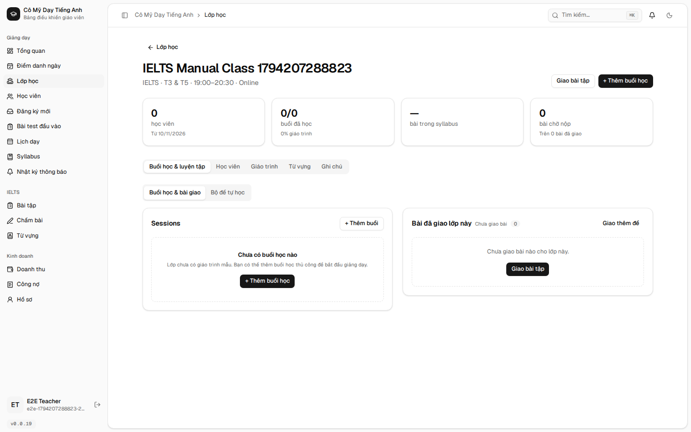
- **Desktop (1440×900) Dark:**
  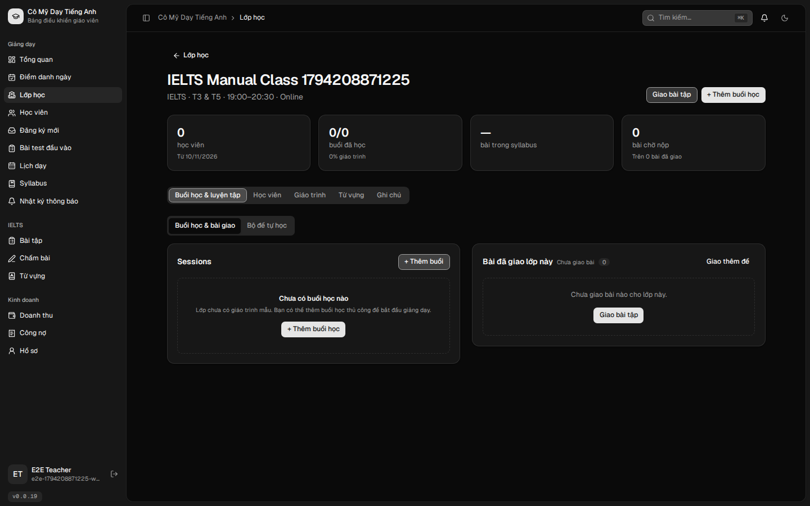
- **Tablet (768×1024) Light:**
  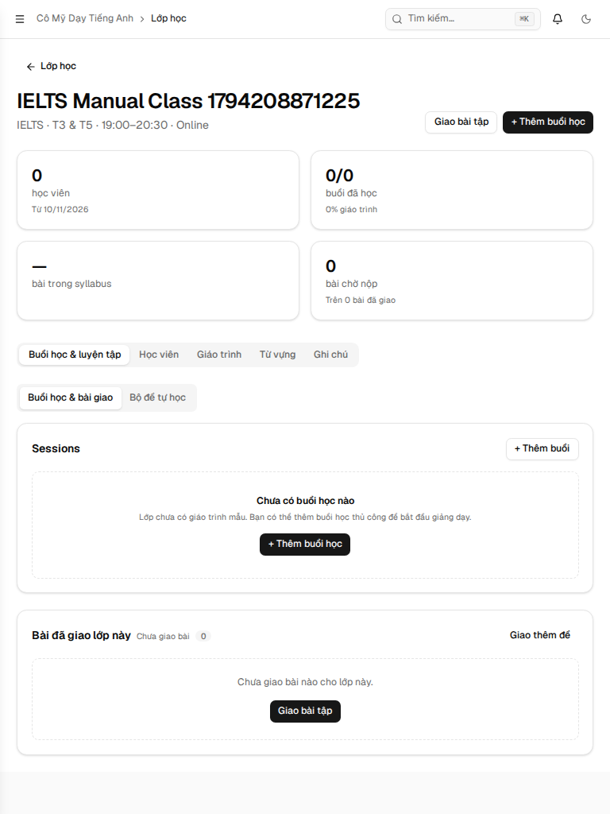
- **Tablet (768×1024) Dark:**
  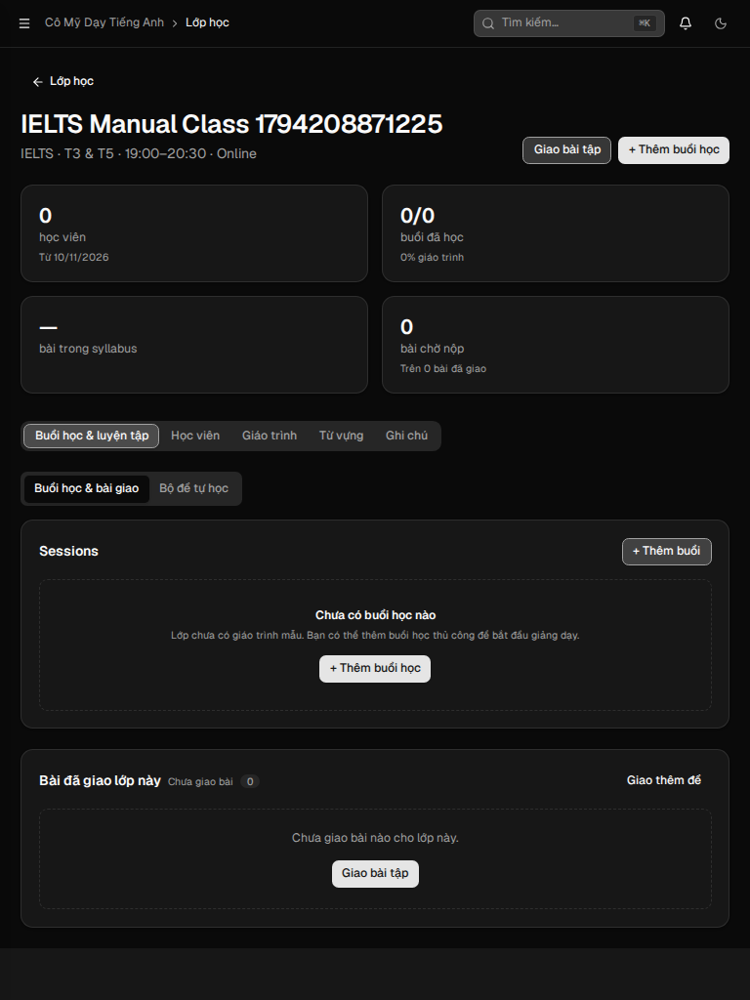
- **Mobile (375×812) Light:**
  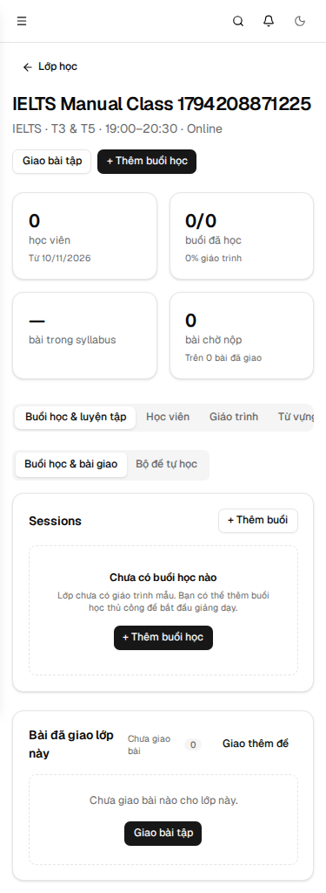
- **Mobile (375×812) Dark:**
  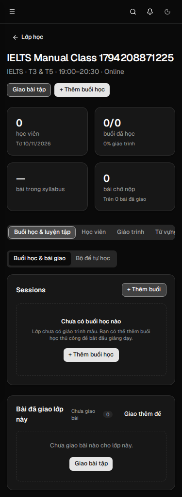

#### 2. Modal Thêm Buổi Học Thủ Công (`AddClassSessionModal`) — 3 Viewports
- **Desktop (1440×900):**
  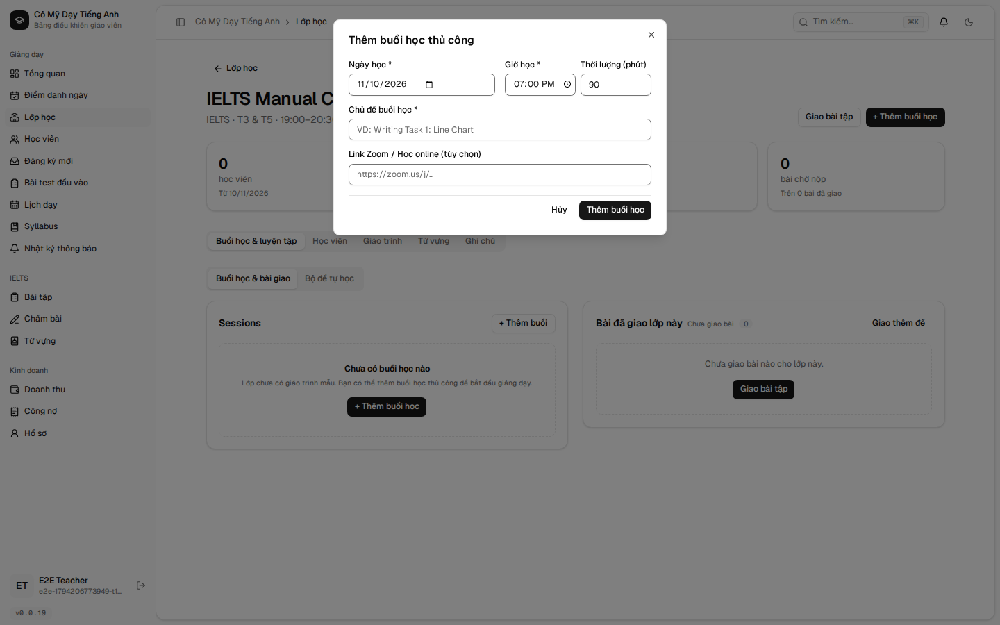
- **Tablet (768×1024):**
  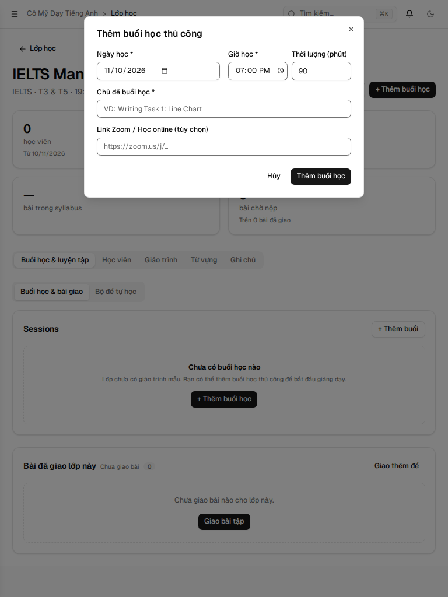
- **Mobile (375×812):**
  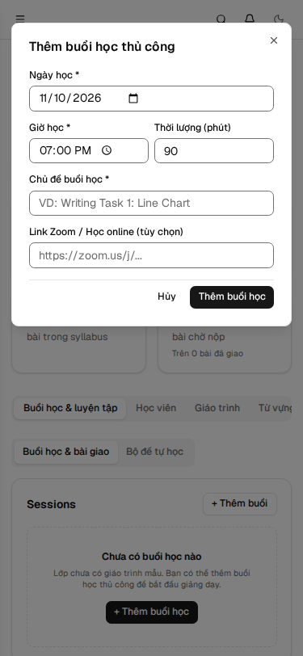

#### 3. Danh sách buổi học sau khi thêm thành công — 3 Viewports
- **Desktop (1440×900):**
  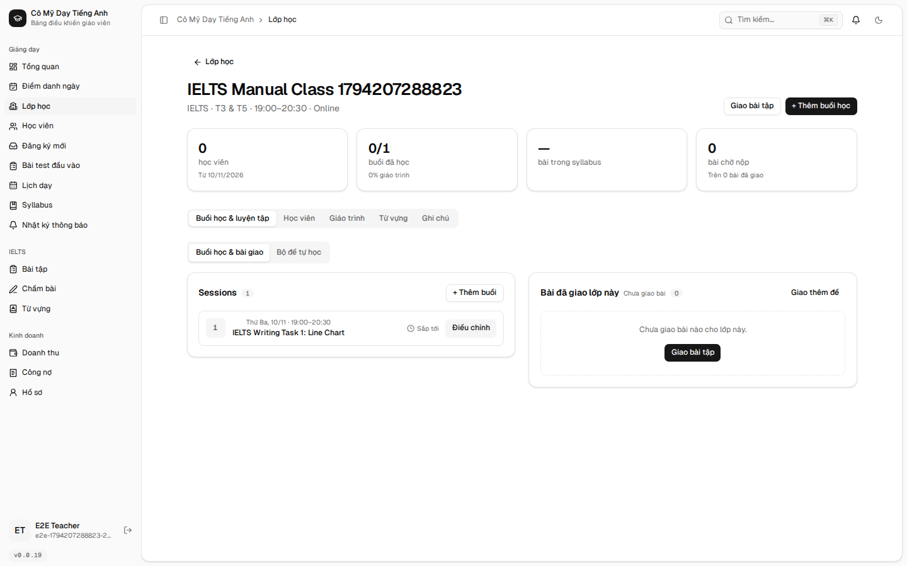
- **Tablet (768×1024):**
  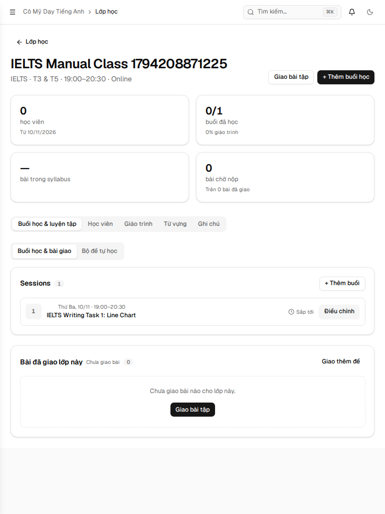
- **Mobile (375×812):**
  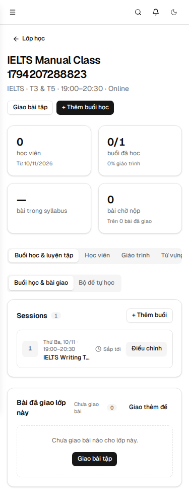

#### 4. Modal Điều Chỉnh Buổi Học kèm Nút Xóa Buổi Học — 3 Viewports
- **Desktop (1440×900):**
  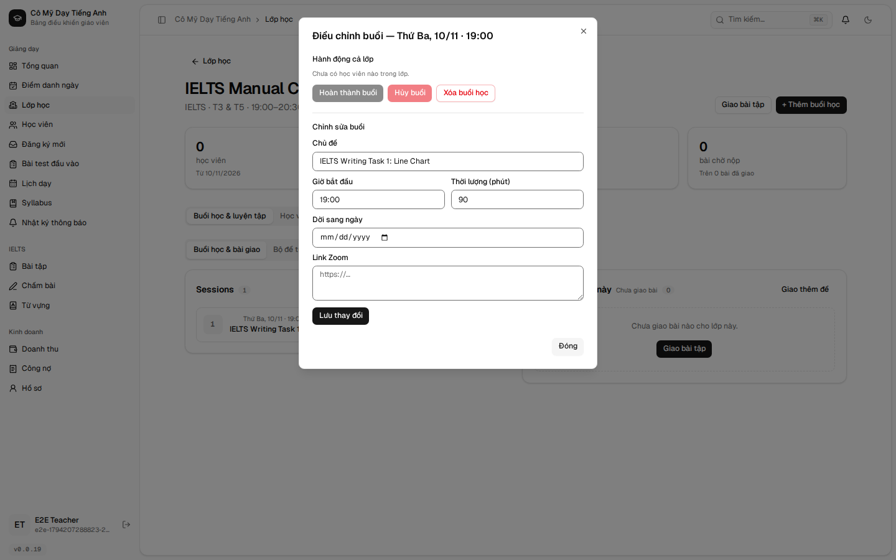
- **Tablet (768×1024):**
  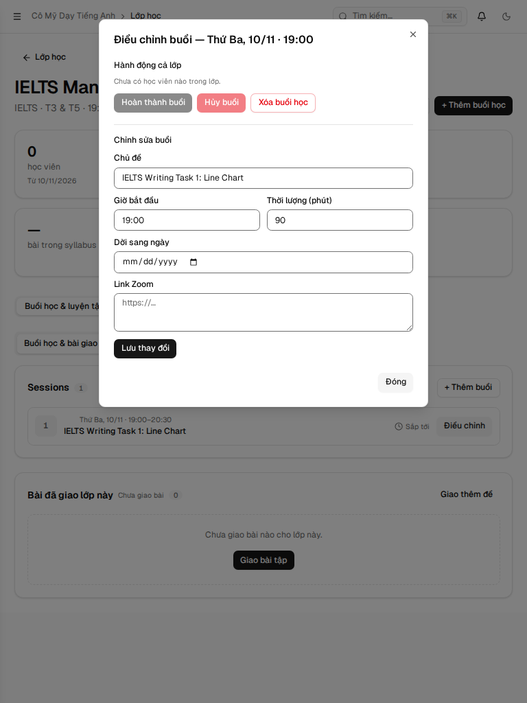
- **Mobile (375×812):**
  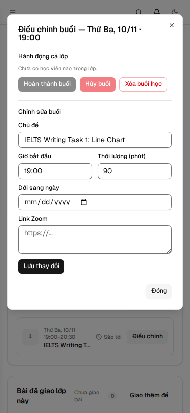

---

### III. Bằng chứng chạy Gate cục bộ (Local Gate Evidence)

```bash
# 1. Typecheck (root và từng package):
pnpm --filter @teacher-os/api run check-types -> PASS (tsc -b)
pnpm --filter @teacher-os/db run check-types  -> PASS (tsc --noEmit)
pnpm --filter web run check-types             -> PASS (tsc --noEmit)
pnpm --filter server exec tsc --project tsconfig.json -> kernel.ts không còn lỗi; phần còn lại (src/index.ts Env types, alchemy.run.ts effect rc) là lỗi môi trường có sẵn trên develop, không thuộc files thay đổi của PR.

# 2. Biome Lint & Format (23 files thay đổi):
pnpm exec biome check (23 files)              -> PASS (0 errors, 0 warnings)

# 3. Server Tests:
pnpm --filter server test
Test Files  102 passed (102)
Tests       1313 passed | 1 expected fail (1314)
Duration    298.62s

# 4. Web Tests:
pnpm --filter web test
Test Files  187 passed (187)
Tests       1961 passed (1961)
Duration    190.87s

# 5. E2E Tests (các spec bị ảnh hưởng trực tiếp bởi #649):
E2E_API_PORT=8100 E2E_WEB_PORT=8101 E2E_STUDENT_PORT=8103 E2E_ADMIN_PORT=8104 E2E_PROFILE_PORT=8105 pnpm --filter e2e e2e projected-sessions class-operations class-roster-tuition-debt create-invoice 649-screenshots
✓ specs/projected-sessions.spec.ts (1 test passed)
✓ specs/class-operations.spec.ts (2 tests passed)
✓ specs/class-roster-tuition-debt.spec.ts (1 test passed)
✓ specs/create-invoice.spec.ts (4 tests passed)
✓ specs/649-screenshots.spec.ts (1 test passed, 15 screenshots generated)
```
