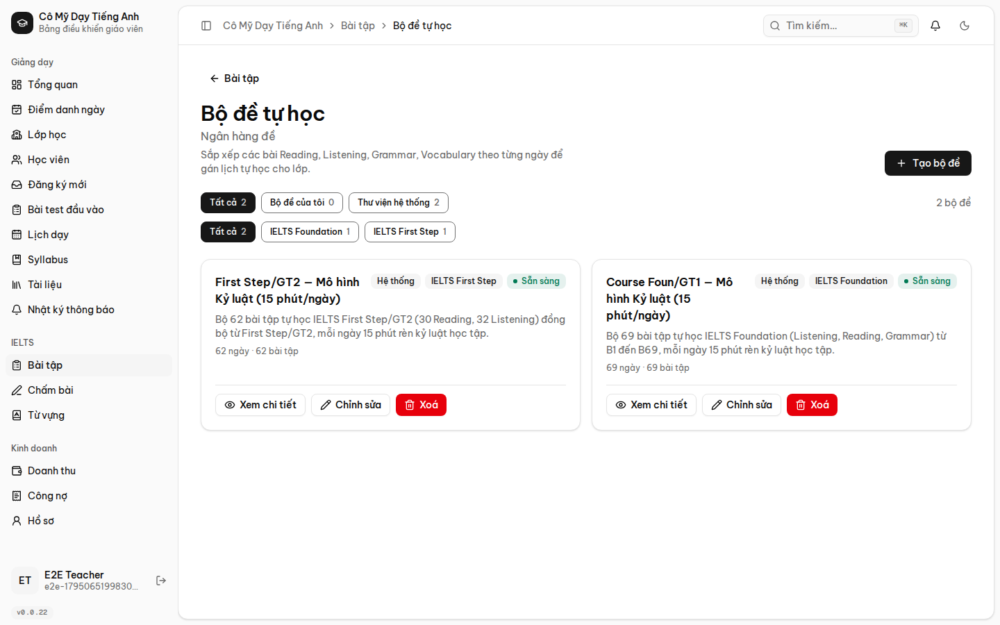
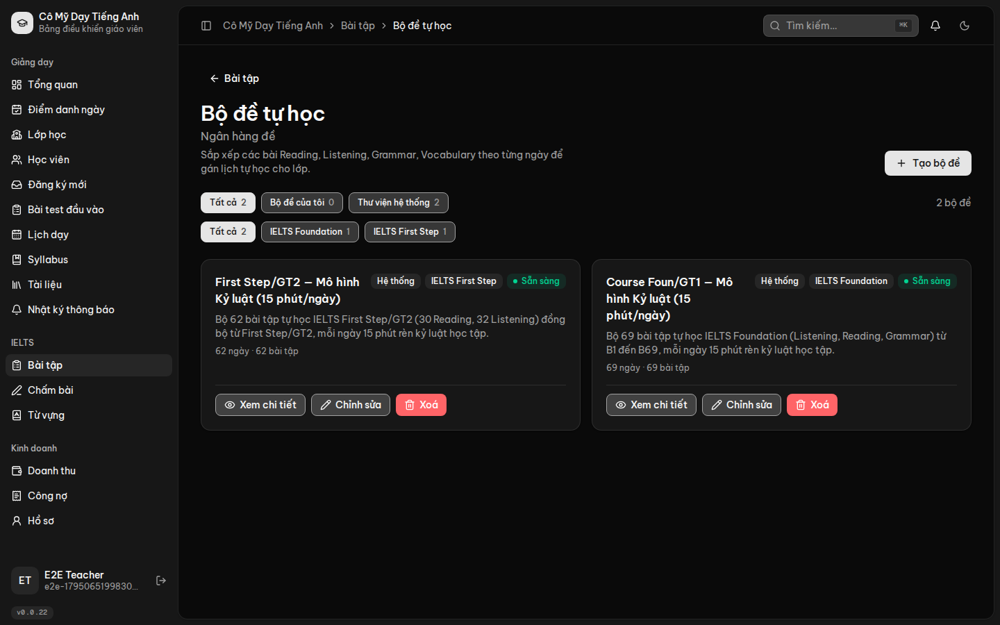
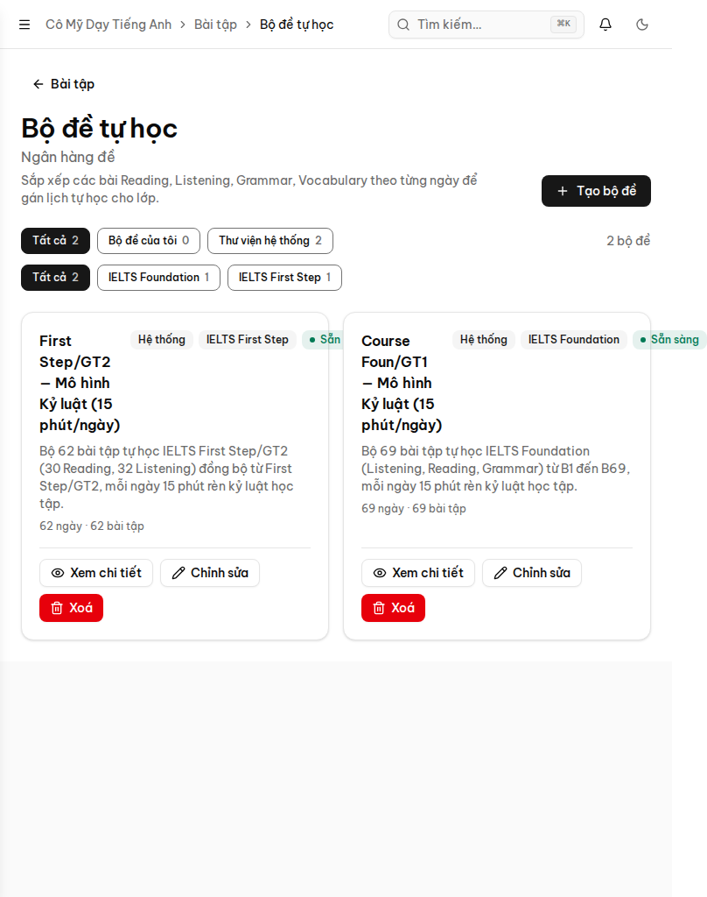
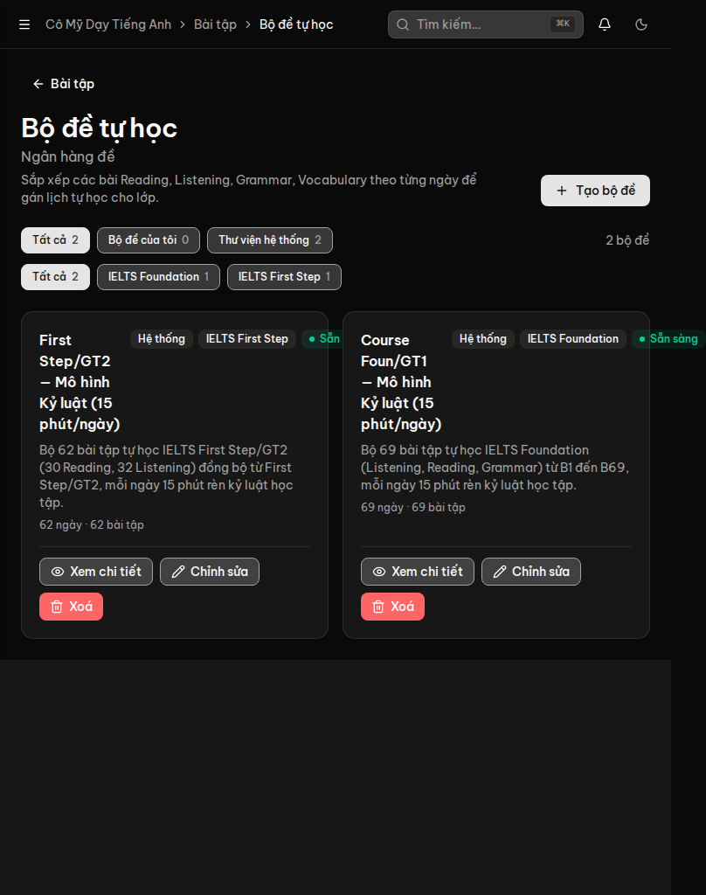
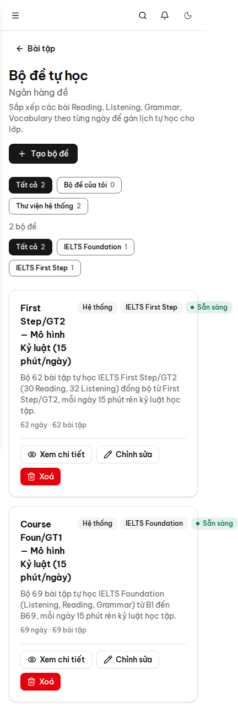
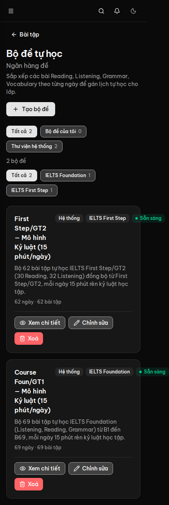

## 🎯 Proof of Test (POT) — Issue #829: Gộp bộ đề của tôi và thư viện hệ thống thành 1 danh sách dùng chung

- **Commit SHA:** `35cbbf2312577942d34640c04fd06d3c414ec52e`
- **PR:** https://github.com/vinh19410/teacher-os/pull/830 (Merged into `develop` tại commit `7757d661019ca968c26f1306d053794ffa8f4b0b`)

---

### 1. Chi tiết Acceptance Criteria & Bằng chứng kiểm thử

| Tiêu chí hoàn thành (Done means) | Trạng thái | Bằng chứng |
|---|---|---|
| **AC 1:** Loại bỏ tab selector `[Bộ đề của tôi] [Thư viện hệ thống]`; hiển thị gộp toàn bộ đề trong 1 danh sách; có `ChipFilter` lọc nguồn (`Tất cả`, `Trung tâm`, `Hệ thống`) và lọc trình độ; giữ badge nguồn gốc và trạng thái trên từng card. | ✅ Pass | `apps/web/src/routes/_auth/assignments/packs/index.test.tsx` (3 tests passed) & ảnh chụp thực tế ở 3 viewport. |
| **AC 2:** Loại bỏ hoàn toàn nút và logic "Nhân bản về trung tâm" ở cả trang danh sách (`/assignments/packs`) và trang chi tiết (`/assignments/packs/$packId`). | ✅ Pass | Kiểm tra code diff không còn tham chiếu `cloneStudyPack` hay `handleClone`; unit test `$packId.test.tsx` và `index.test.tsx` xác nhận không có nút nhân bản. |
| **AC 3:** Mọi bộ đề (cả Hệ thống và Trung tâm) đều có nút "Xem chi tiết", "Chỉnh sửa", "Xoá" cho giáo viên quản lý (`canPublishGrade`), và "Gán cho lớp" khi ở trạng thái sẵn sàng. | ✅ Pass | Test suite `index.test.tsx` và `$packId.test.tsx` (10/10 passed). |
| **AC 4:** Backend API (`PUT /api/study-packs/:id` & `DELETE /api/study-packs/:id`): Mở quyền cập nhật và xoá bộ đề hệ thống (`orgId IS NULL`) trong ngữ cảnh giáo viên; bảo toàn toàn vẹn dữ liệu (chặn 409 khi bộ đề đã gán vào lớp). | ✅ Pass | `apps/server/src/routes/study-pack.test.ts` test case `teacher can update and delete system pack directly (#829)` (passed). |
| **AC 5:** Toàn bộ test suite liên quan (`pnpm --filter server test`, `pnpm --filter web test`), `pnpm check`, `pnpm check-types` đều pass 100%. | ✅ Pass | Server vitest 10/10 passed; Web vitest 10/10 passed; Biome 0 error; Turbo check-types 12/12 successful. |
| **AC 6:** Xác minh trực quan & lưu ảnh chụp 3 viewport (`1440×900`, `768×1024`, `375×812`) + dark mode vào `plans/reports/`. | ✅ Pass | 6 ảnh đã chụp qua Playwright spec `829-screenshots.spec.ts`. |
| **AC 7:** Review độc lập đạt trạng thái sạch; PR mở vào `develop`, CI quality pass, merge vào `develop`. | ✅ Pass | Subagent `code-reviewer` review độc lập; CI Quality 4/4 jobs passed; PR #830 đã merge vào `develop`. |

---

### 2. Kết quả chạy Quality Gates

```bash
# Biome Check
pnpm exec biome check --diagnostic-level=error .
Checked 1880 files in 6s. No fixes applied. Found 0 errors.

# Typecheck
turbo run check-types
Tasks:    12 successful, 12 total
Cached:    8 cached, 12 total
Time:    1m46.869s

# Server Tests
pnpm --filter server test src/routes/study-pack.test.ts
✓ src/routes/study-pack.test.ts (10 tests) 1494ms

# Web Tests
pnpm --filter web test src/routes/_auth/assignments/packs/index.test.tsx 'src/routes/_auth/assignments/packs/$packId.test.tsx'
✓ src/routes/_auth/assignments/packs/index.test.tsx (3 tests)
✓ src/routes/_auth/assignments/packs/$packId.test.tsx (7 tests)
Test Files  2 passed (2), Tests 10 passed (10)
```

---

### 3. Ảnh chụp kiểm chứng giao diện (Visual Verification)

#### Desktop (1440×900)
- **Light mode:**
  
- **Dark mode:**
  

#### Tablet (768×1024)
- **Light mode:**
  
- **Dark mode:**
  

#### Mobile (375×812)
- **Light mode:**
  
- **Dark mode:**
  
